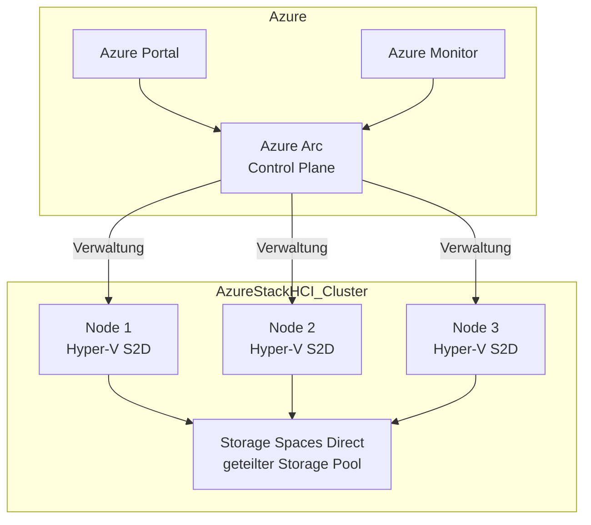
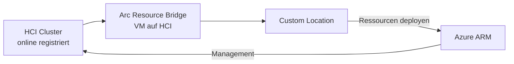
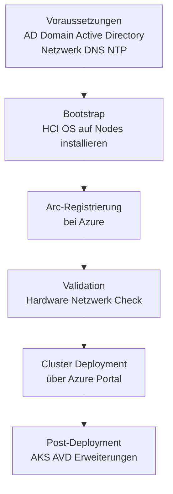
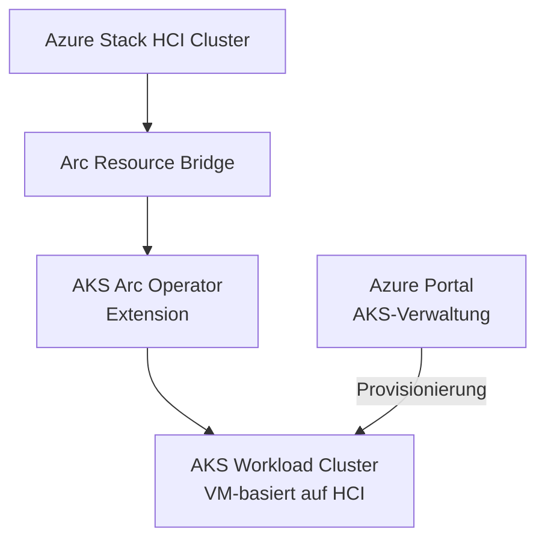
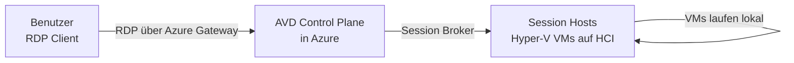

---
tags:
  - azure
  - arc
  - hci
  - hyperkonvergent
  - hybrid-cloud
  - infrastruktur
aliases:
  - HCI
  - Hyper-Converged Infrastructure
  - Azure Stack HCI 23H2
---

# Azure Stack HCI

> [!ABSTRACT] TL;DR
> Azure Stack HCI ist Microsofts hyperkonvergente Infrastruktur-Lösung (Hyper-V + Storage Spaces Direct + SDN) für On-Premises-Rechenzentren. Seit Version **23H2 (2024)** ist Arc die native Verwaltungsschicht — Registrierung, AKS, Azure Virtual Desktop, Updates und VMs werden direkt über das Azure Portal verwaltet.

---

## Was ist Azure Stack HCI?

**Azure Stack HCI** ist ein hyperkonvergentes Betriebssystem von Microsoft, das folgende Technologien auf Standard-Hardware kombiniert:

- **Hyper-V**: Virtualisierungs-Hypervisor für VMs
- **Storage Spaces Direct (S2D)**: Software-definierter Speicher über lokale NVMe/SSD-Laufwerke
- **Software Defined Networking (SDN)**: Netzwerkvirtualisierung und -segmentierung
- **Azure Arc**: Verwaltungsebene für alle HCI-Ressourcen



---

## HCI-Konzept: Hyper-Converged Infrastructure

Im Gegensatz zu traditionellen **3-tier Architekturen** (Compute + Network + Storage getrennt) fasst HCI alle drei Schichten auf denselben physischen Knoten zusammen:

| Architektur | Compute | Network | Storage | Vorteile |
|---|---|---|---|---|
| **3-Tier** | Separate Server | Separate Switches | SAN/NAS | Flexibel, aber komplex |
| **HCI** | Kombiniert | Kombiniert | Lokale Disks | Einfach, skalierbar, kostengünstig |

**Scale-Out-Prinzip:** Kapazität wird durch Hinzufügen weiterer Knoten erhöht — kein komplexes SAN-Management.

---

## Azure Stack HCI als Arc-fähige Infrastruktur

Seit **Azure Stack HCI 23H2** ist **Azure Arc die einzige Verwaltungsebene**. Der HCI-Cluster wird automatisch bei der Einrichtung mit Azure Arc verbunden.



**Arc Resource Bridge** ist eine spezielle VM, die auf dem HCI-Cluster läuft und als Brücke zwischen dem lokalen Kubernetes-Cluster und Azure ARM fungiert.

**Automatisch installierte Arc-Infrastruktur bei HCI 23H2:**
- Arc Resource Bridge VM
- AKS Arc Operator (Kubernetes Extension)
- Custom Location für den HCI-Cluster
- Azure Arc-Agents auf allen Cluster-Knoten

---

## Hardware-Anforderungen und zertifizierte Hardware

### Mindestanforderungen pro Knoten

| Komponente | Minimum | Empfohlen |
|---|---|---|
| **CPU** | Intel/AMD x64, 1,4 GHz, 64-Bit | Neueste Xeon/EPYC Generation |
| **RAM** | 32 GB (kleinste Konfiguration) | 128–512 GB für Produktion |
| **Disks** | 2x NVMe (OS + Cache) + Kapazitäts-Disks | NVMe für Cache + SSD/NVMe für Kapazität |
| **Netzwerk** | 2x 10 GbE (Management + Storage) | 25/100 GbE mit RDMA (RoCEv2/iWARP) |
| **Nodes** | 1 (Single-Node, eingeschränkt) | 2–16 Nodes für Produktion |

### Zertifizierter Hardware-Katalog

Microsoft pflegt einen **HCI Catalog** auf hcicatalog.azurewebsites.net mit allen validierten Systemen:

**Wichtige Partner:**
- Dell Technologies (Dell MX, AX-Nodes)
- HPE (ProLiant DL, SimpliVity)
- Lenovo (ThinkAgile MX)
- DataON (HCI-Systeme)
- Fujitsu, Hitachi, NEC, Supermicro

> [!TIP] Validated Nodes vs. Integrated Systems
> Der HCI-Katalog unterscheidet **Validated Nodes** (einzelne Server, die mit HCI kompatibel sind) von **Integrated Systems** (vollständig vorkonfigurierte, getestete HCI-Lösungen inkl. Verkabelung). Für Produktivumgebungen werden **Integrated Systems** empfohlen.

---

## Azure Stack HCI OS

Das **Azure Stack HCI OS** ist ein eigenständiges Windows Server-basiertes Betriebssystem (kein vollständiges Windows Server!):

| Merkmal | Azure Stack HCI OS | Windows Server |
|---|---|---|
| **Lizenzmodell** | Azure Subscription (monatlich) | Perpetual oder SA |
| **Desktop Experience** | ❌ (nur Core) | ✅ optional |
| **Abrechnung** | Per physischem Core | Pro OS/CAL |
| **Updates** | Azure Update Manager | Windows Update / WSUS |
| **Arc-Integration** | Nativ (built-in) | Optional |
| **Azure Hybrid Benefit** | ✅ mit Windows Server SA | N/A |

### HCI OS Versionen

| Version | Codename | Veröffentlichung | Lifecycle Ende |
|---|---|---|---|
| **22H2** | — | Oktober 2022 | Mai 2025 |
| **23H2** | — | November 2023 | November 2025 |
| **24H2** | — | 2024 (Preview) | Geplant |

---

## Cluster-Erstellung und Azure-Registrierung

### Neue Deployment-Methode (23H2)

Seit Azure Stack HCI 23H2 erfolgt das Deployment vollständig über das Azure Portal oder ARM-Templates — ohne Windows Admin Center als primäres Tool.



```powershell
# Schritt 1: Arc-Agent auf HCI-Node installieren und registrieren
Invoke-AzStackHciArcInitialization `
  -SubscriptionID "<subId>" `
  -ResourceGroup "myHCI-RG" `
  -TenantID "<tenantId>" `
  -Cloud "AzureCloud" `
  -Region "westeurope" `
  -Proxy "" `
  -SpnID "<spId>" `
  -SpnSecret "<spSecret>"

# Schritt 2: Cluster-Registrierung bei Azure
Register-AzStackHCI `
  -SubscriptionId "<subId>" `
  -Region "westeurope" `
  -ResourceGroupName "myHCI-RG" `
  -ResourceName "myHCI-Cluster"
```

---

## Azure Kubernetes Service auf HCI (AKS-HCI)

**AKS enabled by Azure Arc** auf Azure Stack HCI 23H2 bringt managed Kubernetes on-premises:



```bash
# AKS-Cluster auf HCI 23H2 erstellen (Azure CLI)
az aksarc create \
  --name "myAKSCluster" \
  --resource-group "myHCI-RG" \
  --custom-location "<customLocationId>" \
  --node-count 3 \
  --node-vm-size "Standard_A4_v2" \
  --kubernetes-version "1.28" \
  --generate-ssh-keys

# Cluster-Credentials abrufen
az aksarc get-credentials \
  --name "myAKSCluster" \
  --resource-group "myHCI-RG"
```

**Features von AKS auf HCI:**
- Vollständig Azure-gemanagter Kubernetes-Lifecycle
- Automatische Updates (Kubernetes-Version, Node-OS)
- Integration mit Azure Monitor für Container Insights
- Entra ID-basiertes RBAC
- Azure Policy für Kubernetes-Governance

---

## Azure Virtual Desktop auf HCI

**Azure Virtual Desktop (AVD) auf Azure Stack HCI** ermöglicht virtualisierte Windows-Desktops **in eigenen Rechenzentren** — ideal für:

- Regulierte Branchen (Finanz, Healthcare, öffentlicher Sektor)
- Datenlokalisierungsanforderungen (DSGVO, FINMA)
- Niedrige Latenz-Anforderungen (lokale Desktops)
- Remote-Standorte ohne ausreichende WAN-Bandbreite



> [!NOTE] AVD auf HCI allgemein verfügbar (GA)
> Azure Virtual Desktop auf Azure Stack HCI 23H2 ist seit **Februar 2024** allgemein verfügbar (GA). Die Session-Host-VMs laufen lokal auf dem HCI-Cluster, während der AVD-Steuerungsplan (Broker, Gateway) weiterhin in Azure betrieben wird.

---

## Azure Stack HCI Insights

**Azure Stack HCI Insights** ist ein Azure Monitor Workbook-basiertes Monitoring-Dashboard:


**Überwachte Metriken:**
- Cluster-Gesamtzustand (Health Status)
- Server-Ressourcenauslastung (CPU, RAM, Netzwerk)
- Storage Spaces Direct-Zustand (Volume Health, Tiering)
- Virtuelle Maschinen (Status, Ressourcenverbrauch)
- Netzwerk-Performance (RDMA, East-West Traffic)

---

## Azure Update Manager für HCI

**Azure Update Manager** verwaltet Updates für HCI-Cluster zentralisiert:

```bash
# Verfügbare Updates prüfen
az stack-hci update list \
  --cluster-name "myHCI-Cluster" \
  --resource-group "myHCI-RG"

# Update starten
az stack-hci update start \
  --cluster-name "myHCI-Cluster" \
  --resource-group "myHCI-RG" \
  --update-name "<updateId>"
```

**Lifecycle Actions (Automatisch in 23H2):**
- Monatliche Sicherheitsupdates
- Feature-Updates (Halbjährlich)
- Treiber- und Firmware-Updates (OEM-spezifisch)
- Solution Updates (Arc Resource Bridge, AKS-Extension)

---

## Windows Admin Center für HCI

**Windows Admin Center (WAC)** bleibt ein optionales lokales Verwaltungstool für erweiterte Diagnose:

| Aufgabe | Azure Portal | Windows Admin Center |
|---|---|---|
| Cluster-Erstellung (23H2) | ✅ (primär) | ❌ |
| VM-Verwaltung | ✅ | ✅ |
| Storage-Diagnose | Eingeschränkt | ✅ detailliert |
| SDN-Konfiguration | Eingeschränkt | ✅ |
| Offline-Verwaltung | ❌ | ✅ |
| Erweiterte Logs/Diagnose | Teilweise | ✅ |

---

## Azure Stack HCI vs. Azure Stack Hub vs. Azure Stack Edge

| Merkmal | Azure Stack HCI | Azure Stack Hub | Azure Stack Edge |
|---|---|---|---|
| **Primärzweck** | VM + Container auf-premises | Vollständige Azure-Dienste on-premises | Edge-Computing, KI, IoT |
| **Zielgruppe** | IT-Infrastruktur-Teams | Entwickler + Ops, Azure-Parität | OT/IoT-Teams, Feldarbeit |
| **Hardware** | Zertifizierte Standard-Server | Spezifische Microsoft-Appliance | Microsoft-Appliance |
| **Management** | Azure Portal (via Arc) | Lokales Azure Portal | Azure Portal + lokal |
| **Kubernetes** | AKS via Arc (GA) | AKS-Engine | Kubernetes on-device |
| **Datenbankdienste** | Arc Data Services | SQL MI, MySQL etc. | Eingeschränkt |
| **Formfaktor** | Rack-Server | Rack-Einheit | 1U bis portable |

---

## Kosten

**Azure Stack HCI** wird pro physischem Core pro Monat abgerechnet:

| Bestandteil | Kosten |
|---|---|
| **HCI OS Subscription** | ~10 USD/Core/Monat (ca. variiert nach Region) |
| **Azure Hybrid Benefit** | Reduzierung wenn Windows Server SA vorhanden |
| **AKS auf HCI** | Kostenlos (nur Infrastruktur-Kosten) |
| **Azure Monitor** | Log Analytics nach Datenmenge |
| **Defender für HCI** | Defender for Servers Preis |
| **Hardware** | Einmalig (OEM-Preis) |

> [!TIP] Azure Hybrid Benefit für HCI
> Mit **Windows Server Datacenter-Lizenzen mit Software Assurance** kann der HCI OS-Subscriptionpreis auf **0 USD** reduziert werden. Dies gilt pro physischem Core der vorhandenen Lizenzen.

---

## Verwandte Notizen
- [[Azure Arc Grundlagen]]
- [[Azure Stack Edge]]
- [[Arc-enabled Data Services]]
- [[Azure Update Manager]]
