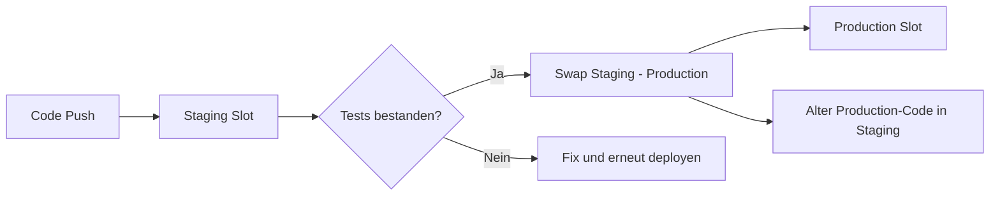
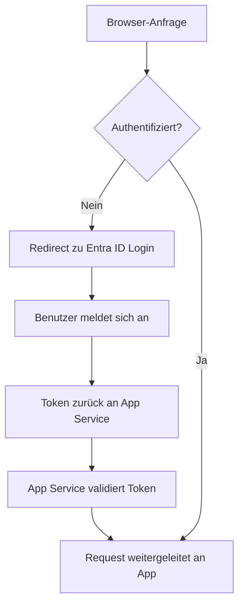

---
tags:
  - azure
  - compute
  - app-service
  - paas
  - web-apps
  - deployment-slots
aliases:
  - Azure Web Apps
  - App Service Azure
  - Azure PaaS Web
---

# Azure App Service

> [!ABSTRACT] TL;DR
> Azure App Service ist eine vollständig verwaltete PaaS-Plattform für Web-Anwendungen, REST-APIs und mobile Backends. Entwickler deployen Code oder Container, ohne Infrastruktur verwalten zu müssen. Deployment Slots, Auto-Scaling, Managed Certificates und Easy Auth gehören zum Standardumfang.

---

## Was ist Azure App Service?

Azure App Service ist ein Platform-as-a-Service (PaaS), der das Hosting von Web-Anwendungen ohne VM-Verwaltung ermöglicht. Azure übernimmt Betriebssystem-Patches, Hardware-Wartung, Load Balancing und Skalierung.

**Kernfunktionen:**
- Mehrere Sprachen und Frameworks in einer Plattform
- Automatische Skalierung basierend auf Metriken
- Integriertes CI/CD aus GitHub, Azure DevOps, Bitbucket
- SSL/TLS ohne manuelle Zertifikatsverwaltung
- Integrierte Authentifizierung (Easy Auth) ohne Code-Änderungen
- VNet-Integration für sicheren Zugriff auf interne Ressourcen

---

## Unterstützte Runtimes

| Runtime | Unterstützte Versionen | Plattform |
|---------|----------------------|-----------|
| **.NET** | .NET 6, 7, 8 (LTS), .NET Framework 4.8 | Windows, Linux |
| **Node.js** | 18, 20 (LTS), 22 | Windows, Linux |
| **Python** | 3.8, 3.9, 3.10, 3.11, 3.12 | Linux |
| **Java** | Java 8, 11, 17, 21 (SE, Tomcat, JBoss) | Windows, Linux |
| **PHP** | 8.0, 8.1, 8.2, 8.3 | Linux |
| **Ruby** | 3.2, 3.3 | Linux |
| **Custom Container** | Docker-kompatibel | Windows, Linux |

> [!NOTE] Runtime-Versionen aktuell halten
> Microsoft aktualisiert unterstützte Runtime-Versionen regelmäßig. Ältere Versionen erhalten End-of-Life-Datum und müssen migriert werden. Prüfe die aktuelle Liste im Azure Portal.

---

## App Service Plans

Der App Service Plan definiert Region, Betriebssystem, Compute-Ressourcen und Features.

| SKU | vCPUs | RAM | Features | Anwendungsfall |
|-----|-------|-----|----------|----------------|
| **Free (F1)** | Shared | 1 GiB | Kein Custom Domain, kein SSL | Lernen, Experimente |
| **Shared (D1)** | Shared | 1 GiB | Custom Domain | Sehr kleine Sites |
| **Basic (B1)** | 1 | 1,75 GiB | Custom Domain, SSL, manuelles Scaling | Dev/Test |
| **Basic (B2)** | 2 | 3,5 GiB | Wie B1, mehr Ressourcen | Dev/Test |
| **Basic (B3)** | 4 | 7 GiB | Wie B1, mehr Ressourcen | Dev/Test |
| **Standard (S1)** | 1 | 1,75 GiB | Auto-Scale, Deployment Slots (5), VNet | Kleine Produktion |
| **Standard (S2)** | 2 | 3,5 GiB | Wie S1 | Mittelgroße Produktion |
| **Standard (S3)** | 4 | 7 GiB | Wie S1 | Mittlere Produktion |
| **Premium v3 (P1v3)** | 2 | 8 GiB | VNet, Slots (20), Zone Redundancy | Hohe Performance |
| **Premium v3 (P2v3)** | 4 | 16 GiB | Wie P1v3 | Hohe Performance |
| **Premium v3 (P3v3)** | 8 | 32 GiB | Wie P1v3 | Enterprise-Scale |
| **Isolated v2 (I1v2)** | 2 | 8 GiB | Dedizierte VNet-Umgebung (ASE v3) | Compliance, Isolation |
| **Isolated v2 (I6v2)** | 16 | 64 GiB | Wie I1v2, maximale Leistung | Enterprise Isolation |

> [!TIP] Direkt P1v3 für Produktion
> Basic (B-Tier) bietet kein Auto-Scaling. Für Produktions-Workloads mindestens **Standard S1** oder besser **Premium P1v3** verwenden (bessere Compute-Performance, Zone Redundancy möglich).

---

## Deployment-Methoden

| Methode | Wann verwenden | Besonderheiten |
|---------|---------------|----------------|
| **GitHub Actions** | CI/CD-Pipeline aus GitHub | OIDC-Integration, kein Passwort |
| **Azure DevOps** | Enterprise CI/CD | Release Pipelines, Approvals |
| **ZIP Deploy** | Schnelles manuelles Deployment | `az webapp deploy --src-path app.zip` |
| **Local Git** | Einfaches Deployment ohne Pipeline | `git push azure main` |
| **FTP/FTPS** | Legacy, nicht empfohlen | Einfachste Methode, unsicher |
| **Docker Container** | Container-basierte Anwendungen | ACR-Integration, Multi-Container |
| **Deployment Center** | Portal-gestützte Pipeline | Wizard für häufige Szenarien |

### GitHub Actions Beispiel

```yaml
name: Deploy to Azure App Service

on:
  push:
    branches: [main]

jobs:
  deploy:
    runs-on: ubuntu-latest
    steps:
      - uses: actions/checkout@v4

      - name: Set up .NET
        uses: actions/setup-dotnet@v4
        with:
          dotnet-version: '8.0.x'

      - name: Build and publish
        run: |
          dotnet restore
          dotnet publish -c Release -o ./publish

      - name: Deploy to Azure Web App
        uses: azure/webapps-deploy@v3
        with:
          app-name: 'myapp-prod'
          slot-name: 'staging'
          publish-profile: ${{ secrets.AZURE_WEBAPP_PUBLISH_PROFILE }}
          package: './publish'
```

---

## Deployment Slots

Slots sind separate Instanzen einer App mit eigener URL — ideal für Zero-Downtime-Deployments.



### Slot-Swap durchführen

```bash
# Manueller Swap: Staging → Production
az webapp deployment slot swap \
  --resource-group rg-prod \
  --name myapp-prod \
  --slot staging \
  --target-slot production

# Slot erstellen
az webapp deployment slot create \
  --resource-group rg-prod \
  --name myapp-prod \
  --slot staging \
  --configuration-source myapp-prod
```

### Slot-spezifische Einstellungen

Einige App Settings und Connection Strings sollen slot-spezifisch bleiben (nicht mitgeswapt werden):

```bash
# Slot-spezifische App Setting (wird nicht mitgeswapt)
az webapp config appsettings set \
  --resource-group rg-prod \
  --name myapp-prod \
  --slot staging \
  --slot-settings ASPNETCORE_ENVIRONMENT=Staging

# Produktion bleibt mit ASPNETCORE_ENVIRONMENT=Production
az webapp config appsettings set \
  --resource-group rg-prod \
  --name myapp-prod \
  --slot-settings ASPNETCORE_ENVIRONMENT=Production
```

### Auto-Swap

Automatischer Swap nach erfolgreichem Warmup des Staging-Slots:

```bash
# Auto-Swap konfigurieren (Swap immer in Production)
az webapp deployment slot auto-swap \
  --resource-group rg-prod \
  --name myapp-prod \
  --slot staging \
  --auto-swap-slot production
```

> [!NOTE] Warmup vor Swap
> App Service wartet auf HTTP-200-Antwort der App im neuen Slot, bevor der Swap abgeschlossen wird. Konfiguriere `applicationInitialization` im web.config für eigene Warmup-Pfade.

---

## Auto-Scaling

### Manuelles Scaling

```bash
# App Service Plan auf 3 Instanzen skalieren
az appservice plan update \
  --resource-group rg-prod \
  --name asp-prod \
  --number-of-workers 3
```

### Schedule-basiertes Autoscaling

```json
{
  "profiles": [{
    "name": "Businesshours",
    "capacity": { "minimum": "3", "maximum": "10", "default": "3" },
    "recurrence": {
      "frequency": "Week",
      "schedule": {
        "timeZone": "W. Europe Standard Time",
        "days": ["Monday", "Tuesday", "Wednesday", "Thursday", "Friday"],
        "hours": [8],
        "minutes": [0]
      }
    }
  }, {
    "name": "Nighttime",
    "capacity": { "minimum": "1", "maximum": "3", "default": "1" },
    "recurrence": {
      "frequency": "Week",
      "schedule": {
        "timeZone": "W. Europe Standard Time",
        "days": ["Monday", "Tuesday", "Wednesday", "Thursday", "Friday"],
        "hours": [20],
        "minutes": [0]
      }
    }
  }]
}
```

### Metric-basiertes Autoscaling

Trigger-Metriken für App Service:
- `CpuPercentage` — CPU-Auslastung des Plans
- `MemoryPercentage` — RAM-Auslastung
- `HttpQueueLength` — Wartende HTTP-Anfragen
- `DiskQueueLength` — Disk-I/O-Warteschlange

---

## Custom Domains und SSL

### Custom Domain hinzufügen

```bash
# CNAME oder A-Record im DNS: myapp.example.com → myapp-prod.azurewebsites.net
# Dann Domain in App Service registrieren:
az webapp custom-hostname add \
  --resource-group rg-prod \
  --webapp-name myapp-prod \
  --hostname myapp.example.com
```

### TLS-Binding

| Binding-Typ | Beschreibung | Voraussetzung |
|------------|-------------|---------------|
| **SNI SSL** | Ein Zertifikat pro Hostname (Standard) | Standard-Plan oder höher |
| **IP-SSL** | Dedizierte IP-Adresse pro Zertifikat | Standard-Plan oder höher, eigene IP nötig |

### Managed Certificate (kostenlos)

```bash
# Kostenloses Azure-verwaltetes Zertifikat erstellen
az webapp config ssl create \
  --resource-group rg-prod \
  --name myapp-prod \
  --hostname myapp.example.com

# SSL-Binding erstellen
az webapp config ssl bind \
  --resource-group rg-prod \
  --name myapp-prod \
  --certificate-thumbprint <thumbprint> \
  --ssl-type SNI
```

> [!NOTE] Managed Certificate Voraussetzungen
> Das kostenlose Managed Certificate erfordert: (1) Custom Domain bereits registriert, (2) CNAME zeigt auf azurewebsites.net, (3) mindestens Basic-Plan. Wildcard-Zertifikate werden nicht unterstützt.

---

## Easy Auth (Authentifizierung ohne Code)

Easy Auth integriert Identitätsprovider ohne eine einzige Codezeile zu ändern.



```bash
# Easy Auth mit Entra ID konfigurieren
az webapp auth update \
  --resource-group rg-prod \
  --name myapp-prod \
  --enabled true \
  --action LoginWithAzureActiveDirectory \
  --aad-client-id "xxxxxxxx-xxxx-xxxx-xxxx-xxxxxxxxxxxx" \
  --aad-token-issuer-url "https://sts.windows.net/{tenantId}/"
```

**Unterstützte Provider:**
- Microsoft Entra ID (empfohlen für Unternehmensanwendungen)
- GitHub (für Developer-Tools)
- Facebook, Google, X (Twitter) (für Consumer-Apps)
- Beliebiger OpenID Connect-Provider

---

## VNet Integration

### Regional VNet Integration (ausgehender Traffic)

Ausgehende Verbindungen der App gehen durch das VNet — Zugriff auf interne Ressourcen (Datenbanken, Services).

```bash
# VNet Integration aktivieren
az webapp vnet-integration add \
  --resource-group rg-prod \
  --name myapp-prod \
  --vnet vnet-prod \
  --subnet snet-appservice
```

> [!IMPORTANT] Subnet delegieren
> Das Subnet muss an `Microsoft.Web/serverFarms` delegiert werden. Mindestgröße: /28 (16 IPs). Pro App Service Plan wird ein Subnet benötigt.

### Private Endpoints (eingehender Traffic)

Private Endpoints blockieren öffentlichen Zugriff — die App ist nur über das VNet erreichbar:

```bash
# Private Endpoint für App Service erstellen
az network private-endpoint create \
  --resource-group rg-prod \
  --name pe-myapp-prod \
  --vnet-name vnet-prod \
  --subnet snet-private-endpoints \
  --private-connection-resource-id $(az webapp show -g rg-prod -n myapp-prod --query id -o tsv) \
  --group-id sites \
  --connection-name conn-myapp-prod
```

---

## App Service Environment (ASE v3)

ASE v3 bietet vollständige Isolation — der App Service Plan läuft in einem dedizierten VNet.

| Aspekt | Multi-Tenant (Standard) | ASE v3 (Isolated) |
|--------|------------------------|-------------------|
| **Isolation** | Shared Infrastructure | Dedizierte Infrastruktur |
| **Netzwerk** | VNet-Integration optional | Vollständig im VNet |
| **Eingehender Traffic** | Public oder Private Endpoint | Nur VNet (ILB oder External) |
| **Compliance** | Standard Azure-Compliance | PCI-DSS, HIPAA möglich |
| **Kosten** | Plan-Preis | Isolated-Plan + ASE-Stempelgebühr |
| **Skalierung** | bis 30 Instanzen pro Plan | bis 200 Instanzen |

---

## Application Insights Integration

```bash
# Application Insights mit App Service verbinden
az webapp config appsettings set \
  --resource-group rg-prod \
  --name myapp-prod \
  --settings \
    APPLICATIONINSIGHTS_CONNECTION_STRING="InstrumentationKey=xxx;IngestionEndpoint=https://westeurope-5.in.applicationinsights.azure.com/" \
    ApplicationInsightsAgent_EXTENSION_VERSION="~3" \
    XDT_MicrosoftApplicationInsights_Mode="Recommended"
```

- **Agent-basierte Instrumentierung**: Kein Code nötig für Request-Tracking, Dependency-Tracking, Exception-Logging
- **Live Metrics**: Echtzeit-Telemetrie während Deployments oder Fehlersuche
- **Distributed Tracing**: Vollständige Traces über mehrere Services hinweg

---

## WebJobs

Hintergrundprozesse, die im gleichen App Service Plan laufen:

| Typ | Ausführung | Anwendungsfall |
|-----|-----------|----------------|
| **Triggered** | Manuell oder per Cron-Schedule | Nachtliche Reports, Cleanup-Jobs |
| **Continuous** | Läuft ständig (kann pausiert werden) | Message-Queue-Verarbeitung |

```bash
# WebJob per CLI deployen
az webapp webjob triggered upload \
  --resource-group rg-prod \
  --webapp-name myapp-prod \
  --webjob-name daily-cleanup \
  --webjob-file cleanup-job.zip
```

---

## Fehlerbehebung

### Diagnose-Blade

Azure Portal → App Service → Diagnose und Problembehandlung → Guided Troubleshooter

### Log Stream (Live-Logs)

```bash
# Live Application-Logs streamen
az webapp log tail \
  --resource-group rg-prod \
  --name myapp-prod

# File-System-Logs aktivieren
az webapp log config \
  --resource-group rg-prod \
  --name myapp-prod \
  --web-server-logging filesystem \
  --application-logging filesystem \
  --level verbose
```

### Kudu-Konsole (Advanced Tools)

Erreichbar unter `https://<appname>.scm.azurewebsites.net`:
- **Debug Console**: Bash (Linux) oder CMD/PowerShell (Windows) im Container
- **Log Files**: Zugriff auf alle Application-Logs
- **Process Explorer**: Laufende Prozesse anzeigen
- **Site Extensions**: Zusätzliche Tools installieren

### Health Check

```bash
# Health Check konfigurieren (App Service überwacht Endpunkt)
az webapp config set \
  --resource-group rg-prod \
  --name myapp-prod \
  --health-check-path "/health"
```

> [!TIP] Health Check für Scale Sets
> Mit konfiguriertem Health Check entfernt App Service Instanzen aus dem Load Balancer, die wiederholt auf `/health` mit HTTP 5xx antworten, und ersetzt sie durch neue Instanzen.

---

## Verwandte Notizen
- [[Azure Functions]]
- [[Azure Container Apps]]
- [[Azure Container Instances]]
- [[Azure RBAC]]
