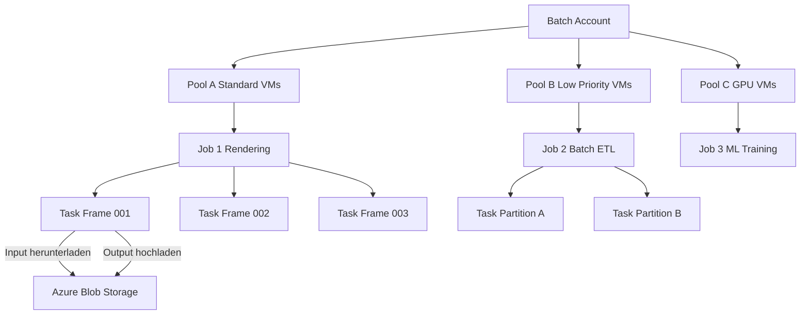
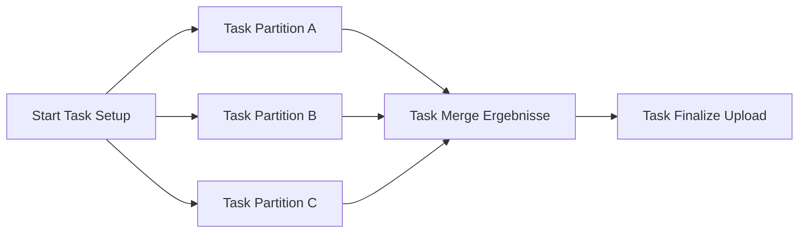

---
tags:
  - azure
  - compute
  - batch
  - hpc
  - parallele-verarbeitung
  - spot
aliases:
  - Azure Batch HPC
  - Azure Batch Service
---

# Azure Batch

> [!ABSTRACT] TL;DR
> Azure Batch ist Azures verwalteter Dienst für hochparallele und HPC-Workloads. Batch orchestriert Pools aus VMs, verteilt Tasks auf Nodes und verwaltet Input/Output über Azure Storage. Der Batch Service selbst ist kostenlos — bezahlt wird nur für die genutzten VMs und Storage.

---

## Was ist Azure Batch?

Azure Batch ermöglicht das Ausführen tausender paralleler Computer-Jobs auf verwalteten VM-Pools, ohne Cluster oder HPC-Infrastruktur selbst aufzubauen.

**Typische Anwendungsfälle:**

| Branche | Workload | Skalierung |
|---------|---------|-----------|
| **Visual Effects** | 3D-Rendering (Blender, Arnold) | Tausende Frames parallel |
| **Life Sciences** | Genomik-Sequenzierung, Drug Discovery | Millionen von Reads |
| **Finanzwesen** | Monte-Carlo-Simulationen, Risikomodelle | Millionen Szenarien |
| **Engineering** | Finite-Elemente-Analysen, CFD | Tausende Parameterkombinationen |
| **Energie** | Seismische Verarbeitung, Reservoir-Simulation | Petabyte-Datenmengen |
| **DevOps** | Parallele Test-Suites, Build-Pipelines | Hunderte gleichzeitiger Jobs |
| **EO / GIS** | Satellitenbildverarbeitung, Kartierung | Tausende Kacheln |

---

## Batch-Architektur



**Hierarchie:**
- **Batch Account**: Zentraler Verwaltungscontainer (Region-spezifisch)
- **Pool**: Gruppe von VMs mit gleicher OS-Konfiguration
- **Job**: Logische Gruppierung zusammengehöriger Tasks
- **Task**: Einzelne auszuführende Aufgabe (ein Prozess auf einem Node)

---

## Pool-Konfiguration

```bash
# Pool per Azure CLI erstellen
az batch pool create \
  --account-name mybatchaccount \
  --account-endpoint mybatchaccount.westeurope.batch.azure.com \
  --id pool-rendering \
  --vm-size Standard_D8s_v5 \
  --target-dedicated-nodes 0 \
  --target-low-priority-nodes 20 \
  --image-reference publisher=microsoftwindowsserver offer=windowsserver sku=2022-datacenter-core version=latest \
  --node-agent-sku-id "batch.node.windows amd64"
```

### Pool JSON-Konfiguration

```json
{
  "id": "pool-hpc-prod",
  "vmSize": "Standard_D8s_v5",
  "virtualMachineConfiguration": {
    "imageReference": {
      "publisher": "Canonical",
      "offer": "0001-com-ubuntu-server-jammy",
      "sku": "22_04-lts-gen2",
      "version": "latest"
    },
    "nodeAgentSkuId": "batch.node.ubuntu 22.04",
    "containerConfiguration": {
      "type": "DockerCompatible",
      "containerImageNames": ["myregistry.azurecr.io/hpc-worker:latest"]
    }
  },
  "targetDedicatedNodes": 0,
  "targetLowPriorityNodes": 50,
  "enableAutoScale": true,
  "autoScaleFormula": "...",
  "startTask": {
    "commandLine": "bash -c 'apt-get update && apt-get install -y libmpi-dev'",
    "waitForSuccess": true,
    "userIdentity": { "autoUser": { "elevationLevel": "admin" } }
  }
}
```

### Auto-Scale-Formel

```
// Formel: Skaliere basierend auf Queue-Länge
// Immer mindestens 1 Node, maximal 100
$tasks = $ActiveTasks.GetSamplePercent(TimeInterval_Minute * 15);
$targetNodes = ($tasks < 70) ? max(1, $PendingTasks.GetSample(1)) : max(1, $ActiveTasks.GetSample(1) + $PendingTasks.GetSample(1));
$NodeDeallocationOption = taskcompletion;
targetDedicated = min(100, $targetNodes);
```

---

## Task-Typen

| Task-Typ | Beschreibung | Anwendungsfall |
|----------|-------------|----------------|
| **Normal Task** | Standard-Arbeitstask | Rendering, Simulation, Analyse |
| **Start Task** | Läuft bei Node-Start, einmalig | Dependencies installieren, Setup |
| **Job Manager Task** | Startet zuerst, kann weitere Tasks erstellen | Dynamische Task-Generierung |
| **Job Preparation Task** | Läuft vor dem ersten Task auf einem Node | Daten vorab herunterladen |
| **Job Release Task** | Läuft nach dem letzten Task auf einem Node | Cleanup, Daten hochladen |
| **Multi-Instance Task** | Mehrere Nodes für einen Task (MPI) | Tightly coupled HPC (OpenMPI, MPICH) |

---

## Task-Abhängigkeiten

Tasks können von anderen Tasks abhängen — Batch wartet mit der Ausführung bis die Abhängigkeit erfüllt ist.

```json
{
  "id": "task-merge",
  "commandLine": "python merge_results.py",
  "dependsOn": {
    "taskIds": ["task-partition-a", "task-partition-b", "task-partition-c"]
  }
}
```



---

## Input/Output über Azure Blob Storage

### Dateien vor Task hochladen

```python
from azure.storage.blob import BlobServiceClient, BlobClient

# Input-Datei in Azure Blob Storage hochladen
blob_client = BlobClient(
    account_url="https://stbatch.blob.core.windows.net",
    container_name="input",
    blob_name="data/chunk_001.csv",
    credential=DefaultAzureCredential()
)

with open("local/chunk_001.csv", "rb") as f:
    blob_client.upload_blob(f, overwrite=True)
```

### Task mit Resource Files (automatischer Download)

```python
import azure.batch as batch
from azure.batch import models

task = models.TaskAddParameter(
    id="task-process-001",
    command_line="python process.py --input chunk_001.csv --output result_001.json",
    resource_files=[
        models.ResourceFile(
            http_url="https://stbatch.blob.core.windows.net/input/data/chunk_001.csv",
            file_path="chunk_001.csv"
        ),
        models.ResourceFile(
            http_url="https://stbatch.blob.core.windows.net/scripts/process.py",
            file_path="process.py"
        )
    ],
    output_files=[
        models.OutputFile(
            file_pattern="result_001.json",
            destination=models.OutputFileDestination(
                container=models.OutputFileBlobContainerDestination(
                    container_url="https://stbatch.blob.core.windows.net/output?<SAS_TOKEN>",
                    path="results/"
                )
            ),
            upload_options=models.OutputFileUploadOptions(
                upload_condition=models.OutputFileUploadCondition.task_completion
            )
        )
    ]
)
```

---

## Anwendungspakete (Application Packages)

Anwendungspakete werden als ZIP hochgeladen und automatisch auf allen Nodes entpackt.

```bash
# Anwendungspaket hochladen
az batch application package create \
  --resource-group rg-batch \
  --name mybatchaccount \
  --application-name myrenderer \
  --version "3.5.1" \
  --package-file renderer-3.5.1.zip

# Paket als Standard-Version setzen
az batch application set \
  --resource-group rg-batch \
  --name mybatchaccount \
  --application-name myrenderer \
  --default-version "3.5.1"
```

Das Paket wird automatisch auf jedem Node-Start nach `$AZ_BATCH_APP_PACKAGE_myrenderer#3_5_1` entpackt.

---

## Spot VMs (Low Priority Nodes) in Batch

Low Priority Nodes in Batch sind äquivalent zu Spot VMs — bis zu 80% günstiger, aber eviction-anfällig.

```python
# Pool mit Low Priority Nodes
pool_config = models.PoolAddParameter(
    id="pool-low-prio",
    vm_size="Standard_D8s_v5",
    virtual_machine_configuration=models.VirtualMachineConfiguration(
        image_reference=models.ImageReference(
            publisher="Canonical",
            offer="0001-com-ubuntu-server-jammy",
            sku="22_04-lts-gen2",
            version="latest"
        ),
        node_agent_sku_id="batch.node.ubuntu 22.04"
    ),
    target_dedicated_nodes=2,         # Garantierte Nodes für kritische Tasks
    target_low_priority_nodes=48,     # Spot-Nodes für Bulk-Verarbeitung
    resize_timeout=timedelta(minutes=15)
)
```

**Eviction-Behandlung in Batch:**
- Bei Eviction wird der Task automatisch auf **requeue** gesetzt
- Batch startet den Task auf einem anderen Node neu
- Workloads sollten idempotent sein oder Checkpointing implementieren

> [!TIP] Dedicated + Low Priority kombinieren
> 2-5 Dedicated Nodes für kritische Job-Manager-Tasks + viele Low Priority Nodes für Bulk-Arbeit ist die optimale Kombination für Kosteneffizienz bei gleichzeitiger Stabilität.

---

## Docker-Container-Tasks

```python
# Pool mit Container-Konfiguration
container_config = models.ContainerConfiguration(
    type=models.ContainerType.DOCKER_COMPATIBLE,
    container_image_names=["myregistry.azurecr.io/hpc-worker:latest"],
    container_registries=[
        models.ContainerRegistry(
            registry_server="myregistry.azurecr.io",
            identity_reference=models.ComputeNodeIdentityReference(
                resource_id="/subscriptions/{subId}/resourceGroups/rg-batch/providers/Microsoft.ManagedIdentity/userAssignedIdentities/id-batch-acr"
            )
        )
    ]
)

# Task im Container ausführen
task = models.TaskAddParameter(
    id="container-task-01",
    command_line="python /app/process.py --workers 8",
    container_settings=models.TaskContainerSettings(
        image_name="myregistry.azurecr.io/hpc-worker:latest",
        container_run_options="--rm --env BATCH_SIZE=1000"
    )
)
```

---

## Via Azure Portal (UI)

> [!TIP] Schnelleinstieg
> Das Azure Portal eignet sich besonders für die erstmalige Einrichtung von Batch-Konten, Pools und zur Job-Überwachung.

### Batch-Konto erstellen

1. **portal.azure.com** → **Batch-Konten** → **+ Erstellen**
2. **Grundlagen**-Tab:
   - Abonnement & Ressourcengruppe
   - **Kontoname**: 3–24 Zeichen, Kleinbuchstaben & Ziffern
   - **Region**: z. B. `West Europe`
   - **Speicherkonto**: Verknüpftes Storage-Konto für Task-Output auswählen oder neu erstellen
3. **Erweitert**-Tab:
   - **Pool-Zuordnungsmodus**: Batch-Dienst (Standard) oder Benutzerabonnement
   - Managed Identity (optional)
4. **Überprüfen + erstellen** → **Erstellen**

### Pool erstellen

1. Batch-Konto → **Pools** → **+ Hinzufügen**
2. **Pool-ID** vergeben, **VM-Größe** wählen (z. B. `Standard_D4s_v3`)
3. **Betriebssystem**: Marketplace-Image (Ubuntu, Windows Server) oder eigenes Image
4. **Zielanzahl dedizierter Knoten** / **Spot-/Low-Priority-Knoten** festlegen
5. **Anwendungspakete** zuweisen (optional)
6. **OK** → Pool wird bereitgestellt

### Job und Task erstellen

1. Batch-Konto → **Jobs** → **+ Hinzufügen**
2. **Pool** auswählen → **OK**
3. Job → **Tasks** → **+ Hinzufügen**
4. **Befehlszeile** eingeben, Ein-/Ausgabedateien referenzieren → **Absenden**

### Monitoring

1. Batch-Konto → **Einblicke** → Knoten-, Job- und Task-Status einsehen
2. **Metriken** → benutzerdefinierte Dashboards erstellen

---

## Python SDK: Vollständiges Beispiel

```python
import os
from datetime import timedelta
from azure.batch import BatchServiceClient
from azure.batch import models
from azure.identity import DefaultAzureCredential

# Batch-Client initialisieren
credential = DefaultAzureCredential()
batch_client = BatchServiceClient(
    credential,
    batch_url="https://mybatchaccount.westeurope.batch.azure.com"
)

# 1. Pool erstellen (falls nicht vorhanden)
pool_id = "pool-python-example"
if not batch_client.pool.exists(pool_id):
    pool = models.PoolAddParameter(
        id=pool_id,
        vm_size="Standard_D4s_v5",
        virtual_machine_configuration=models.VirtualMachineConfiguration(
            image_reference=models.ImageReference(
                publisher="Canonical",
                offer="0001-com-ubuntu-server-jammy",
                sku="22_04-lts-gen2",
                version="latest"
            ),
            node_agent_sku_id="batch.node.ubuntu 22.04"
        ),
        target_dedicated_nodes=0,
        target_low_priority_nodes=5,
        enable_auto_scale=False
    )
    batch_client.pool.add(pool)
    print(f"Pool '{pool_id}' erstellt")

# 2. Job erstellen
job_id = "job-example-001"
job = models.JobAddParameter(
    id=job_id,
    pool_info=models.PoolInformation(pool_id=pool_id),
    on_all_tasks_complete=models.OnAllTasksComplete.TERMINATE_JOB
)
batch_client.job.add(job)
print(f"Job '{job_id}' erstellt")

# 3. Tasks hinzufügen
tasks = []
for i in range(20):
    task = models.TaskAddParameter(
        id=f"task-{i:03d}",
        command_line=f"bash -c 'echo Verarbeite Chunk {i} && sleep 10 && echo Fertig'",
        resource_files=[],
        environment_settings=[
            models.EnvironmentSetting(name="CHUNK_INDEX", value=str(i))
        ]
    )
    tasks.append(task)

# Tasks in Batches von 100 hinzufügen
batch_client.task.add_collection(job_id, tasks)
print(f"{len(tasks)} Tasks hinzugefügt")

# 4. Auf Completion warten
import time

while True:
    job_status = batch_client.job.get(job_id)
    if job_status.state == models.JobState.COMPLETED:
        print("Job abgeschlossen!")
        break
    
    task_counts = batch_client.job.get_task_counts(job_id)
    print(f"Status: {task_counts.active} wartend, {task_counts.running} laufend, {task_counts.succeeded} erfolgreich, {task_counts.failed} fehlgeschlagen")
    time.sleep(30)

# 5. Fehlgeschlagene Tasks anzeigen
failed_tasks = list(batch_client.task.list(job_id, task_list_options=models.TaskListOptions(
    filter="state eq 'completed' and executionInfo/result eq 'failure'"
)))
if failed_tasks:
    print(f"Fehlgeschlagene Tasks: {[t.id for t in failed_tasks]}")
```

---

## Monitoring

```bash
# Pool-Events und Metriken
az monitor metrics list \
  --resource $(az batch account show -n mybatchaccount -g rg-batch --query id -o tsv) \
  --metric DedicatedCoreCount LowPriorityCoreCount TaskCompleteEvent \
  --interval PT1H \
  --output table

# Azure Monitor Alert bei fehlgeschlagenen Tasks
az monitor metrics alert create \
  --resource-group rg-batch \
  --name alert-batch-task-failures \
  --resource $(az batch account show -n mybatchaccount -g rg-batch --query id -o tsv) \
  --condition "count TaskFailEvent > 10" \
  --window-size PT5M \
  --evaluation-frequency PT1M \
  --action $(az monitor action-group show -g rg-monitoring -n ag-ops --query id -o tsv)
```

### Batch Explorer

Batch Explorer ist eine kostenlose Desktop-App für die grafische Verwaltung von Batch-Accounts:
- Pools, Jobs und Tasks visualisieren
- Node-Zustand und Task-Status in Echtzeit
- Heat-Maps für Node-Auslastung
- Task-Logs direkt anzeigen
- Download: `batchexplorer.io`

---

## Kosten

| Komponente | Kosten |
|-----------|--------|
| **Batch Service** | Kostenlos |
| **Dedicated VMs** | Standard Azure VM-Preise |
| **Low Priority VMs** | Bis 80% Rabatt gegenüber Dedicated |
| **Azure Storage** | Blob Storage (Input/Output) |
| **Egress** | Standard Azure-Egress-Preise |

**Kostenoptimierung:**
- Maximaler Einsatz von Low Priority Nodes für Bulk-Verarbeitung
- Auto-Scale mit Scale-to-Zero nach Job-Abschluss
- Anwendungspakete in Azure Storage (günstiger als Container Registry für einfache Skripte)
- Job Completion Action: Pool nach Job-Ende automatisch skalieren (auf 0)

> [!TIP] Batch-Quotas prüfen
> Neue Subscriptions haben oft niedrige Batch-Kern-Quotas (z.B. 10 Dedicated Cores pro Region). Für HPC-Workloads frühzeitig Quota-Erhöhung beantragen: Azure Portal → Batch Account → Quotas und Grenzwerte.

---

## Verwandte Notizen
- [[Azure Spot VMs]]
- [[Azure Virtual Machines]]
- [[Azure Storage Grundlagen]]
- [[Azure Container Registry]]
