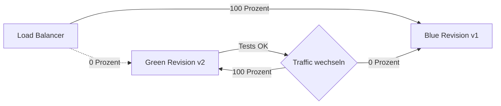
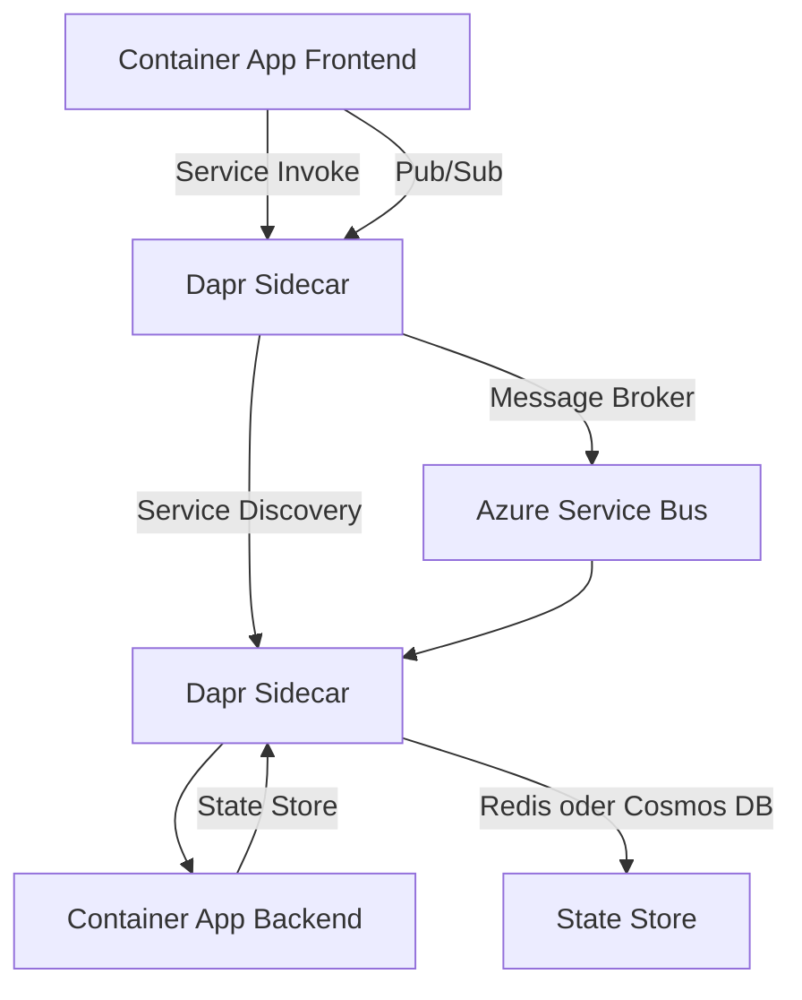

---
tags:
  - azure
  - compute
  - container-apps
  - serverless
  - dapr
  - keda
aliases:
  - Azure Container Apps
  - ACA Azure
---

# Azure Container Apps

> [!ABSTRACT] TL;DR
> Azure Container Apps ist eine serverlose Container-Plattform, die auf Kubernetes (AKS) und KEDA aufbaut — ohne dass Kubernetes-Wissen notwendig ist. Container Apps skalieren automatisch von 0 auf N basierend auf HTTP-Traffic oder Event-Quellen. Dapr-Integration ermöglicht Microservices ohne Boilerplate-Code.

---

## Was sind Azure Container Apps?

Container Apps abstrahiert Kubernetes vollständig. Entwickler deployen Container und konfigurieren Skalierungsregeln — Azure verwaltet den darunterliegenden Kubernetes-Cluster.

**Kernfunktionen:**
- **Scale-to-Zero**: Keine laufenden Instanzen wenn kein Traffic — keine Compute-Kosten
- **KEDA-Autoscaling**: Skalierung basierend auf HTTP, Queues, Events, Cron
- **Dapr-Integration**: Service Discovery, State Management, Pub/Sub out-of-the-box
- **Revisions**: Immutable Deployments mit Traffic-Splitting
- **Jobs**: Einmalige oder geplante Container-Ausführungen

---

## Container Apps Environment

Ein Environment ist die gemeinsame Infrastruktur für mehrere Container Apps — geteiltes Netzwerk, Logging und Dapr-Konfiguration.

```bash
# Container Apps Environment erstellen
az containerapp env create \
  --resource-group rg-containerapps \
  --name cae-prod \
  --location westeurope \
  --logs-workspace-id $(az monitor log-analytics workspace show \
    -g rg-monitoring -n law-prod --query customerId -o tsv) \
  --logs-workspace-key $(az monitor log-analytics workspace get-shared-keys \
    -g rg-monitoring -n law-prod --query primarySharedKey -o tsv)

# Container App erstellen
az containerapp create \
  --resource-group rg-containerapps \
  --name ca-webapp \
  --environment cae-prod \
  --image myregistry.azurecr.io/webapp:v1.0.0 \
  --target-port 8080 \
  --ingress external \
  --min-replicas 0 \
  --max-replicas 10 \
  --cpu 0.5 \
  --memory 1.0Gi
```

---

## Revisions

Jedes Deployment erstellt eine neue, unveränderliche **Revision**. Traffic kann flexibel auf Revisionen verteilt werden.

```bash
# Neue Revision deployen (neues Image)
az containerapp update \
  --resource-group rg-containerapps \
  --name ca-webapp \
  --image myregistry.azurecr.io/webapp:v2.0.0 \
  --revision-suffix v2

# Traffic aufteilen (90% v1, 10% v2 — A/B-Test)
az containerapp ingress traffic set \
  --resource-group rg-containerapps \
  --name ca-webapp \
  --revision-weight ca-webapp--v1=90 ca-webapp--v2=10

# Alle Revisionen anzeigen
az containerapp revision list \
  --resource-group rg-containerapps \
  --name ca-webapp \
  --output table
```

### Blue/Green Deployment



```bash
# 1. Neue (grüne) Revision deployen ohne Traffic
az containerapp update \
  --resource-group rg-containerapps \
  --name ca-webapp \
  --image myregistry.azurecr.io/webapp:v2.0.0 \
  --revision-suffix green

# 2. Testen über Revision-spezifische URL
# (jede Revision hat eigene URL: ca-webapp--green.westeurope.azurecontainerapps.io)

# 3. Traffic komplett umschalten
az containerapp ingress traffic set \
  --resource-group rg-containerapps \
  --name ca-webapp \
  --revision-weight ca-webapp--green=100
```

---

## KEDA-Autoscaling

### HTTP Scaler

```yaml
# Container App YAML mit HTTP-Autoscaling
scale:
  minReplicas: 0
  maxReplicas: 20
  rules:
    - name: http-rule
      http:
        metadata:
          concurrentRequests: "100"  # Neue Instanz ab 100 parallelen Requests
```

```bash
# HTTP Scaler per CLI
az containerapp update \
  --resource-group rg-containerapps \
  --name ca-webapp \
  --min-replicas 0 \
  --max-replicas 20 \
  --scale-rule-name http-rule \
  --scale-rule-type http \
  --scale-rule-http-concurrency 100
```

### Azure Queue Scaler

```bash
# Queue-basiertes Autoscaling
az containerapp update \
  --resource-group rg-containerapps \
  --name ca-worker \
  --min-replicas 0 \
  --max-replicas 50 \
  --scale-rule-name queue-rule \
  --scale-rule-type azure-queue \
  --scale-rule-metadata queueName=work-items queueLength=5 accountName=stworkqueue \
  --scale-rule-auth "connection=azure-storage-connection"
```

### Cron Scaler

```yaml
scale:
  minReplicas: 1
  maxReplicas: 10
  rules:
    - name: cron-rule
      custom:
        type: cron
        metadata:
          timezone: "W. Europe Standard Time"
          start: "0 8 * * 1-5"    # Mo-Fr 08:00
          end: "0 20 * * 1-5"     # Mo-Fr 20:00
          desiredReplicas: "5"
```

---

## Dapr-Integration

Dapr (Distributed Application Runtime) vereinfacht Microservice-Kommunikation durch standardisierte Building Blocks.

### Dapr-Architektur in Container Apps



### Dapr aktivieren

```bash
# Dapr auf Container App aktivieren
az containerapp create \
  --resource-group rg-containerapps \
  --name ca-backend \
  --environment cae-prod \
  --image myregistry.azurecr.io/backend:latest \
  --enable-dapr \
  --dapr-app-id backend-service \
  --dapr-app-port 8080 \
  --dapr-app-protocol http
```

### Dapr Service Invocation

```python
# Python: Anderer Service via Dapr aufrufen (kein direkter Hostname nötig)
import requests

# Dapr sidecar läuft auf localhost:3500
response = requests.get(
    "http://localhost:3500/v1.0/invoke/backend-service/method/api/data"
)
print(response.json())
```

### Dapr Pub/Sub

```bash
# Dapr Pub/Sub-Komponente mit Azure Service Bus erstellen
az containerapp env dapr-component set \
  --resource-group rg-containerapps \
  --name cae-prod \
  --dapr-component-name pubsub \
  --yaml - << 'EOF'
componentType: pubsub.azure.servicebus.topics
version: v1
metadata:
  - name: connectionString
    secretRef: servicebus-connection
EOF
```

```python
# Publisher: Event veröffentlichen
import requests

requests.post(
    "http://localhost:3500/v1.0/publish/pubsub/orders",
    json={"orderId": "12345", "amount": 99.99}
)

# Subscriber: Dekorator-basiertes Empfangen (Flask Beispiel)
from flask import Flask, request
app = Flask(__name__)

@app.route('/orders', methods=['POST'])
def handle_order():
    event = request.json
    print(f"Bestellung erhalten: {event}")
    return '', 200
```

---

## Ingress

| Typ | Erreichbarkeit | Anwendungsfall |
|-----|---------------|----------------|
| **External** | Öffentliches Internet (HTTPS) | Web-Apps, APIs für externe Clients |
| **Internal** | Nur innerhalb des Environments | Microservice-to-Microservice |
| **Deaktiviert** | Kein Ingress | Batch-Jobs, Worker ohne HTTP |

```bash
# Ingress auf internal umstellen (nur intern erreichbar)
az containerapp ingress enable \
  --resource-group rg-containerapps \
  --name ca-backend \
  --type internal \
  --target-port 8080 \
  --transport http
```

---

## VNet-Integration

```bash
# Custom VNet für das Environment konfigurieren
az containerapp env create \
  --resource-group rg-containerapps \
  --name cae-prod-vnet \
  --location westeurope \
  --infrastructure-subnet-resource-id \
    "/subscriptions/{subId}/resourceGroups/rg-network/providers/Microsoft.Network/virtualNetworks/vnet-prod/subnets/snet-aca" \
  --internal-only false
```

> [!IMPORTANT] Subnet-Größe
> Das Infrastruktur-Subnet benötigt mindestens /23 (512 IPs). Für sehr kleine Umgebungen reicht /27 beim Workload-Profile-Type Consumption.

---

## Managed Identity

```bash
# System-assigned Identity
az containerapp identity assign \
  --resource-group rg-containerapps \
  --name ca-webapp \
  --system-assigned

# Key Vault-Zugriff via Managed Identity
IDENTITY_PRINCIPAL=$(az containerapp show \
  -g rg-containerapps -n ca-webapp \
  --query identity.principalId -o tsv)

az keyvault set-policy \
  --name kv-prod \
  --object-id $IDENTITY_PRINCIPAL \
  --secret-permissions get list

# Secret aus Key Vault als Umgebungsvariable
az containerapp secret set \
  --resource-group rg-containerapps \
  --name ca-webapp \
  --secrets "db-password=keyvaultref:https://kv-prod.vault.azure.net/secrets/db-password,identityref:/subscriptions/{subId}/resourceGroups/rg-prod/providers/Microsoft.ManagedIdentity/userAssignedIdentities/id-aca"
```

---

## Jobs

Container Apps Jobs führen Container einmalig oder geplant aus — kein Service, der dauerhaft läuft.

| Job-Typ | Trigger | Anwendungsfall |
|---------|---------|----------------|
| **Manual** | API-Aufruf | On-demand Aufgaben, CI/CD |
| **Scheduled** | Cron-Ausdruck | Regelmäßige Reports, Cleanup |
| **Event-driven** | KEDA-Trigger | Queue-Verarbeitung |

```bash
# Scheduled Job erstellen (täglich um 02:00)
az containerapp job create \
  --resource-group rg-containerapps \
  --name caj-nightly-cleanup \
  --environment cae-prod \
  --image myregistry.azurecr.io/cleanup-job:latest \
  --trigger-type Schedule \
  --cron-expression "0 2 * * *" \
  --replica-timeout 3600 \
  --replica-retry-limit 3 \
  --cpu 0.25 \
  --memory 0.5Gi

# Job manuell ausführen
az containerapp job start \
  --resource-group rg-containerapps \
  --name caj-nightly-cleanup
```

---

## Container Apps vs. AKS vs. Functions vs. App Service

| Aspekt | Container Apps | AKS | Functions | App Service |
|--------|---------------|-----|-----------|------------|
| **Abstraktionsebene** | Hoch (kein K8s) | Niedrig (voller K8s) | Sehr hoch (kein Container) | Hoch (Code/Container) |
| **Skalierung** | 0 → N (KEDA) | Manuell/Autoscaler | 0 → ∞ | Manuell/Auto-Scale |
| **Dapr-Support** | Nativ integriert | Manuell installieren | Nein | Nein |
| **Sprach-Bindung** | Kein (Container) | Kein (Container) | Sprach-spezifisch | Sprach-spezifisch |
| **Zustandslosigkeit** | Ja (empfohlen) | Beides möglich | Ja | Beides möglich |
| **Kubernetes-Wissen** | Nicht nötig | Erforderlich | Nicht nötig | Nicht nötig |
| **Cold Start** | Minimal | Kein | Ja (Consumption) | Nein |
| **Ideal für** | Serverlose Microservices | Enterprise K8s-Workloads | Event-driven Functions | Web-Apps, APIs |

---

## Monitoring

```bash
# Logs in Echtzeit anzeigen
az containerapp logs show \
  --resource-group rg-containerapps \
  --name ca-webapp \
  --follow

# Log Analytics Abfrage (letzte Fehler)
az monitor log-analytics query \
  --workspace $(az monitor log-analytics workspace show -g rg-monitoring -n law-prod --query id -o tsv) \
  --analytics-query "ContainerAppConsoleLogs_CL | where RevisionName_s contains 'ca-webapp' | where Log_s contains 'ERROR' | order by TimeGenerated desc | take 50"
```

---

## Kosten

### Consumption Plan

| Ressource | Kostenloses Kontingent (täglich) | Preis danach |
|-----------|--------------------------------|-------------|
| **vCPU** | 180.000 vCPU-Sekunden | ~0,000024 € / vCPU-s |
| **Memory** | 360.000 GiB-Sekunden | ~0,0000030 € / GiB-s |

**Beispiel:** 1 Container App, 0.5 vCPU, 1 GiB, 8h/Tag Auslastung, 20 Arbeitstage:
- vCPU: 0,5 × 28.800s × 20 = 288.000 s → 288.000 - 180.000 = 108.000 s × 0,000024 € = ~2,59 €/Monat
- Memory: ~1,30 €/Monat
- **Gesamt: ~3,90 €/Monat**

### Dedicated Plan

Für Workloads mit konstant hohem Traffic — reservierte Compute-Ressourcen ohne Kaltstart-Risiko.

---

## Verwandte Notizen
- [[Azure Functions]]
- [[Azure Kubernetes Service]]
- [[Azure Container Instances]]
- [[Azure Container Registry]]
