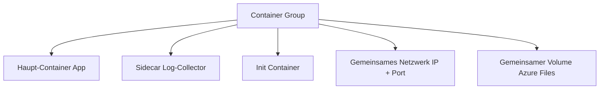

---
tags:
  - azure
  - compute
  - container-instances
  - aci
  - container
  - serverless
aliases:
  - ACI
  - Azure Container Instances ACI
---

# Azure Container Instances

> [!ABSTRACT] TL;DR
> Azure Container Instances (ACI) ist der schnellste Weg, Container in Azure auszuführen — kein Cluster, kein Kubernetes, keine Server-Verwaltung. Container starten in Sekunden und werden sekundengenau abgerechnet. Ideal für kurzlebige Tasks, Batch-Jobs, Dev/Test und CI/CD-Pipelines.

---

## Was ist ACI?

ACI führt Container direkt auf verwalteter Azure-Infrastruktur aus, ohne dass ein Container-Orchestrierer wie Kubernetes konfiguriert werden muss. Microsoft verwaltet die gesamte Infrastruktur darunter.

**Kernmerkmale:**
- Container starten in unter 10 Sekunden
- Sekundengenaue Abrechnung (CPU + Memory)
- Kein Overhead durch Cluster-Management
- Unterstützt Windows und Linux Container
- Direkte ACR-Integration via Managed Identity
- Persistenter Storage via Azure Files

---

## Container Groups

ACI-Ressourcen werden als **Container Groups** organisiert — mehrere Container auf demselben Host mit gemeinsamem Netzwerk und Storage.



**Sidecar-Pattern mit ACI:**
- Log-Aggregation (Fluent Bit als Sidecar)
- TLS-Termination (Envoy/Nginx als Sidecar)
- Metrics-Export (Prometheus Exporter als Sidecar)

---

## OS-Typen und Resource-Limits

| Aspekt | Linux | Windows |
|--------|-------|---------|
| **CPU (max)** | 4 vCPU | 4 vCPU |
| **Memory (max)** | 16 GiB | 14 GiB |
| **GPU** | Ja (K80, P100, V100 — Preview) | Nein |
| **Images** | Beliebige Linux-Images | Windows Server 2019/2022 |
| **Kaltstart** | Sekunden | Minuten |

> [!NOTE] Ressourcen-Granularität
> CPU kann in 0,1-vCPU-Schritten konfiguriert werden (z.B. 0,5 vCPU für leichte Tasks). Memory in 0,1-GiB-Schritten. Nur verbrauchte Ressourcen werden berechnet.

---

## Netzwerk

### Public IP und FQDN

```bash
# ACI mit öffentlicher IP und DNS-Name erstellen
az container create \
  --resource-group rg-aci \
  --name aci-webapp \
  --image nginx:latest \
  --ports 80 443 \
  --ip-address Public \
  --dns-name-label myapp-aci-prod \
  --location westeurope

# Zugriff via: myapp-aci-prod.westeurope.azurecontainer.io
```

### VNet-Integration (Delegated Subnet)

```bash
# ACI in VNet deployen (kein öffentlicher Zugriff)
az container create \
  --resource-group rg-aci \
  --name aci-internal \
  --image myapp:latest \
  --vnet vnet-prod \
  --subnet snet-aci \
  --ip-address Private \
  --location westeurope
```

> [!IMPORTANT] Subnet delegieren
> Das Subnet muss an `Microsoft.ContainerInstance/containerGroups` delegiert werden, bevor ACI darin deployiert werden kann.

---

## Persistent Storage: Azure Files

```yaml
# YAML-Konfiguration für Container mit Azure Files Volume
apiVersion: "2021-10-01"
location: westeurope
name: aci-with-storage
properties:
  containers:
  - name: app
    properties:
      image: myregistry.azurecr.io/myapp:latest
      resources:
        requests:
          cpu: 1
          memoryInGb: 2
      volumeMounts:
      - mountPath: /app/data
        name: data-volume
      ports:
      - port: 8080
  osType: Linux
  volumes:
  - name: data-volume
    azureFile:
      shareName: appdata
      storageAccountName: stappdata001
      storageAccountKey: "STORAGE_KEY_HERE"
  ipAddress:
    type: Public
    ports:
    - protocol: tcp
      port: 8080
tags: {}
type: Microsoft.ContainerInstance/containerGroups
```

---

## Environment Variables und Secrets

```bash
# Normale und geheime Environment Variables
az container create \
  --resource-group rg-aci \
  --name aci-app \
  --image myapp:latest \
  --environment-variables \
    APP_ENV=production \
    LOG_LEVEL=info \
  --secure-environment-variables \
    DB_PASSWORD=mysecretpassword \
    API_KEY=supersecretapikey
```

> [!WARNING] Secure Values im Portal nicht sichtbar
> Mit `--secure-environment-variables` gesetzte Werte sind nach dem Deployment nicht mehr lesbar — weder im Portal noch per CLI. Nur der Container selbst hat Zugriff.

---

## Restart Policies

| Policy | Verhalten | Anwendungsfall |
|--------|-----------|----------------|
| **Always** (Standard) | Container startet bei Fehler/Exit immer neu | Lang laufende Services, Web-Server |
| **OnFailure** | Neustart nur bei Exit-Code ≠ 0 | Batch-Jobs die ggf. fehlschlagen |
| **Never** | Kein automatischer Neustart | Einmalige Tasks, CI/CD-Schritte |

```bash
# Einmaliger Task (Never-Restart)
az container create \
  --resource-group rg-aci \
  --name aci-migration-task \
  --image myapp:latest \
  --command-line "python run_migration.py" \
  --restart-policy Never \
  --environment-variables DATABASE_URL="postgresql://server/db"
```

---

## Container Registry Integration

### ACR Pull via Managed Identity (empfohlen)

```bash
# 1. System-assigned Identity für ACI aktivieren
# 2. AcrPull-Rolle auf ACR zuweisen

az container create \
  --resource-group rg-aci \
  --name aci-secured \
  --image myregistry.azurecr.io/myapp:v1.2.3 \
  --acr-identity /subscriptions/{subId}/resourceGroups/rg-prod/providers/Microsoft.ManagedIdentity/userAssignedIdentities/id-aci-acr-pull \
  --assign-identity /subscriptions/{subId}/resourceGroups/rg-prod/providers/Microsoft.ManagedIdentity/userAssignedIdentities/id-aci-acr-pull
```

### Admin-Credentials (nicht empfohlen)

```bash
# ACR-Admin-Credentials abfragen (nur für Dev/Test)
ACR_USERNAME=$(az acr credential show --name myregistry --query username -o tsv)
ACR_PASSWORD=$(az acr credential show --name myregistry --query "passwords[0].value" -o tsv)

az container create \
  --resource-group rg-aci \
  --name aci-dev \
  --image myregistry.azurecr.io/myapp:latest \
  --registry-login-server myregistry.azurecr.io \
  --registry-username $ACR_USERNAME \
  --registry-password $ACR_PASSWORD
```

---

## Init Containers

Init Container laufen vor dem Haupt-Container und initialisieren die Umgebung:

```yaml
apiVersion: "2021-10-01"
location: westeurope
name: aci-with-init
properties:
  initContainers:
  - name: init-db-migration
    properties:
      image: myregistry.azurecr.io/db-migrate:latest
      command: ["python", "migrate.py"]
      environmentVariables:
      - name: DB_URL
        secureValue: "postgresql://server/db"
  containers:
  - name: webapp
    properties:
      image: myregistry.azurecr.io/webapp:latest
      resources:
        requests:
          cpu: 1
          memoryInGb: 2
      ports:
      - port: 8080
  osType: Linux
  ipAddress:
    type: Public
    ports:
    - protocol: tcp
      port: 8080
type: Microsoft.ContainerInstance/containerGroups
```

---

## ACI vs. AKS vs. Container Apps

| Aspekt | ACI | AKS | Container Apps |
|--------|-----|-----|----------------|
| **Komplexität** | Sehr niedrig | Hoch | Mittel |
| **Kubernetes-Wissen** | Nicht nötig | Erforderlich | Nicht nötig |
| **Skalierung** | Manuell / extern | Cluster Autoscaler, KEDA | KEDA (0→N) |
| **Orchestrierung** | Einzelne Container Groups | Vollständiges Kubernetes | Managed K8s (Knative+KEDA) |
| **Netzwerk** | Public IP / VNet | VNet, Ingress Controller | Managed Ingress |
| **Persistent Storage** | Azure Files | Azure Disk, Azure Files | Azure Files |
| **SLA** | 99,9% | 99,9% (+ Uptime SLA) | 99,95% |
| **Kosten** | Sekunden-genau | Nodes immer bezahlt | Consumption-basiert |
| **Anwendungsfall** | Kurzlebige Tasks, CI/CD | Komplexe Microservices | Serverless Microservices |

> [!TIP] Wann welchen Service nutzen
> - **ACI**: Einmalige Tasks, Batch-Jobs, CI/CD-Schritte, schnelle Experimente
> - **Container Apps**: Serverlose Microservices mit automatischer Skalierung
> - **AKS**: Wenn volle Kubernetes-Kontrolle oder spezielle K8s-Features benötigt werden

---

## Vollständiges YAML Multi-Container-Beispiel

```yaml
apiVersion: "2021-10-01"
location: westeurope
name: aci-multicontainer-example
properties:
  containers:
  - name: webapp
    properties:
      image: nginx:1.25-alpine
      resources:
        requests:
          cpu: 0.5
          memoryInGb: 1
      ports:
      - port: 80
        protocol: TCP
      environmentVariables:
      - name: APP_ENV
        value: production
      volumeMounts:
      - mountPath: /var/log/nginx
        name: shared-logs
  - name: log-exporter
    properties:
      image: fluent/fluent-bit:latest
      resources:
        requests:
          cpu: 0.25
          memoryInGb: 0.5
      environmentVariables:
      - name: LOG_DEST
        value: "azure-log-analytics"
      volumeMounts:
      - mountPath: /var/log/nginx
        name: shared-logs
        readOnly: true
  initContainers:
  - name: config-setup
    properties:
      image: busybox:latest
      command: ["sh", "-c", "echo 'Config initialized' > /shared/init.txt"]
      volumeMounts:
      - mountPath: /shared
        name: shared-logs
  osType: Linux
  restartPolicy: Always
  ipAddress:
    type: Public
    dnsNameLabel: myapp-aci-demo
    ports:
    - protocol: TCP
      port: 80
  volumes:
  - name: shared-logs
    emptyDir: {}
tags:
  environment: production
  team: platform
type: Microsoft.ContainerInstance/containerGroups
```

---

## Via Azure Portal (UI)

> [!TIP] Schnelleinstieg
> ACI-Container können direkt im Portal gestartet werden – ideal für schnelle Tests und Einzelcontainer-Workloads.

### Container-Instanz erstellen

1. **portal.azure.com** → **Container Instances** → **+ Erstellen**
2. **Grundlagen**-Tab:
   - Abonnement & Ressourcengruppe
   - **Containername**, **Region**
   - **Image-Quelle**: Schnellstart, Azure Container Registry oder „Andere Registrierung" (Docker Hub, GHCR)
   - **Image**: z. B. `nginx:latest`
   - **Betriebssystemtyp**: Linux / Windows
   - **Größe**: CPU (z. B. 1 Kern) & Arbeitsspeicher (z. B. 1,5 GB)
3. **Netzwerk**-Tab:
   - **Netzwerktyp**: Öffentlich, Privat (VNet) oder Keine
   - **DNS-Namensbezeichnung** für öffentliche IP
   - **Ports** öffnen (z. B. 80/TCP)
4. **Erweitert**-Tab:
   - **Neustartrichtlinie**: Immer, Bei Fehler, Nie
   - Umgebungsvariablen & Secrets eintragen
   - **Befehlsüberschreibung** (Entrypoint/CMD) optional anpassen
5. **Überprüfen + erstellen** → **Erstellen**

### Container-Logs und Status prüfen

1. Container Instanz → **Container** im linken Menü
2. **Protokolle**-Tab: Echtzeit-Logs einsehen
3. **Ereignisse**-Tab: Start- und Fehlerereignisse verfolgen
4. **Verbinden**-Tab: Interaktive Shell im Browser starten

---

## az container Befehle

```bash
# Container Group erstellen (aus YAML)
az container create \
  --resource-group rg-aci \
  --file container-group.yaml

# Status anzeigen
az container show \
  --resource-group rg-aci \
  --name aci-webapp \
  --query "{Status:instanceView.state, IP:ipAddress.ip, FQDN:ipAddress.fqdn}" \
  --output table

# Live-Logs streamen
az container logs \
  --resource-group rg-aci \
  --name aci-webapp \
  --container-name webapp \
  --follow

# Shell in Container öffnen
az container exec \
  --resource-group rg-aci \
  --name aci-webapp \
  --container-name webapp \
  --exec-command "/bin/sh"

# Events anzeigen (Fehlersuche)
az container show \
  --resource-group rg-aci \
  --name aci-webapp \
  --query "containers[0].instanceView.events[]" \
  --output table

# Container Group löschen
az container delete \
  --resource-group rg-aci \
  --name aci-webapp \
  --yes
```

---

## Kosten

ACI wird **sekundengenau** für verbrauchte CPU und Memory abgerechnet.

| Ressource | Preis (West Europe) |
|-----------|-------------------|
| **CPU** | ~0,0000114 € pro vCPU-Sekunde |
| **Memory** | ~0,0000013 € pro GiB-Sekunde |

**Beispiel-Rechnung:**
- 1 vCPU, 2 GiB, 1 Stunde Laufzeit
- CPU: 3.600s × 0,0000114 € = 0,041 €
- Memory: 3.600s × 2 GiB × 0,0000013 € = 0,009 €
- **Gesamt: ~0,05 € pro Stunde**

> [!TIP] Kosten bei Inaktivität
> ACI berechnet nur während der Laufzeit. Gestoppte Container (Restart Policy: Never + Exit) erzeugen keine Compute-Kosten — nur Storage für verbundene Volumes.

---

## Fehlerbehebung

```bash
# Container-Status und letzte Events
az container show \
  --resource-group rg-aci \
  --name aci-webapp \
  --query "containers[].{Name:name, State:instanceView.currentState.state, ExitCode:instanceView.currentState.exitCode}" \
  --output table

# Logs seit letztem Start
az container logs \
  --resource-group rg-aci \
  --name aci-webapp \
  --container-name webapp

# Init-Container-Logs
az container logs \
  --resource-group rg-aci \
  --name aci-webapp \
  --container-name init-db-migration

# Netzwerk-Diagnose (per exec)
az container exec \
  --resource-group rg-aci \
  --name aci-webapp \
  --container-name webapp \
  --exec-command "curl -v http://internal-service:8080/health"
```

| Problem | Ursache | Lösung |
|---------|---------|--------|
| `ImagePullBackOff` | Registry nicht erreichbar oder falsche Credentials | ACR-Credentials oder Managed Identity prüfen |
| `CrashLoopBackOff` | Container exitiert direkt | Logs prüfen, Restart Policy überdenken |
| `OOMKilled` | Zu wenig Memory | Memory-Limit erhöhen |
| `Pending` lange | Kapazitätsprobleme in Region | Andere Region oder VM-Größe versuchen |

---

## Verwandte Notizen
- [[Azure Container Registry]]
- [[Azure Kubernetes Service]]
- [[Azure Container Apps]]
- [[Azure Storage Grundlagen]]
