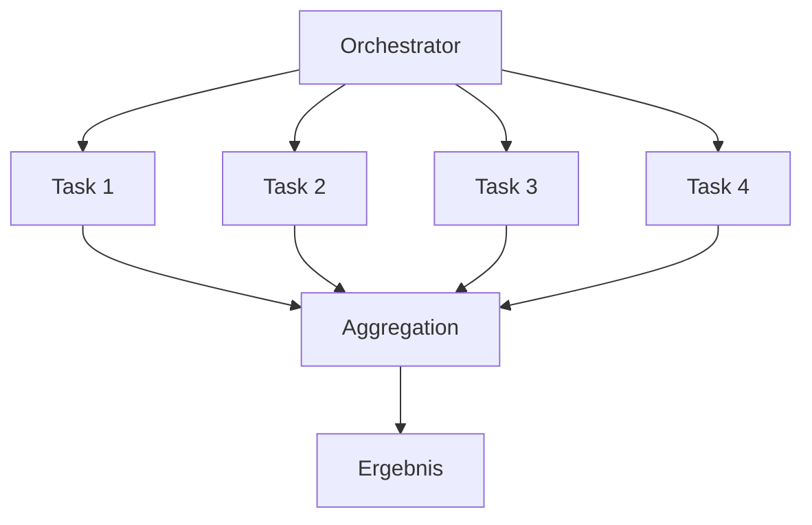
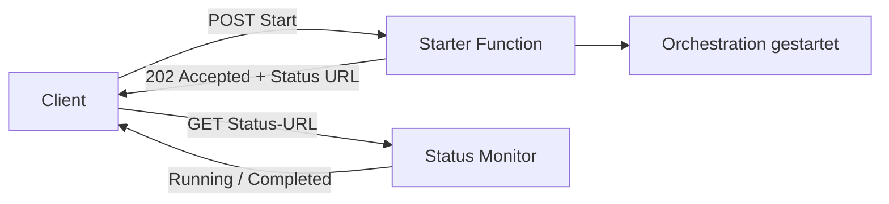

---
tags:
  - azure
  - compute
  - functions
  - serverless
  - durable-functions
  - event-driven
aliases:
  - Azure Serverless
  - Azure Functions Serverless
  - FaaS Azure
---

# Azure Functions

> [!ABSTRACT] TL;DR
> Azure Functions ist die serverlose Compute-Plattform von Azure. Code wird ereignisgesteuert ausgeführt — nur für tatsächliche Ausführungszeit wird bezahlt. Durable Functions ermöglichen zustandsbehaftete, langlebige Workflows. Der Flex Consumption Plan (2024) kombiniert serverlose Skalierung mit VNet-Unterstützung.

---

## Was sind Azure Functions?

Azure Functions ermöglichen das Ausführen von Event-driven Code ohne Server-Verwaltung. Die Plattform skaliert automatisch von null bis zu tausenden parallelen Ausführungen.

**Kernprinzipien:**
- **Event-Driven**: Code reagiert auf Trigger (HTTP, Timer, Queue, Event Hub, ...)
- **Stateless** (Standard): Jede Ausführung ist unabhängig
- **Stateful** (Durable Functions): Zustand über mehrere Aktivitäten hinweg
- **Pay-per-Execution**: Im Consumption Plan nur für Ausführungszeit zahlen
- **Auto-Scale**: Skaliert automatisch auf Basis der Trigger-Last

---

## Trigger-Typen

| Trigger | Auslöser | Typischer Anwendungsfall |
|---------|---------|------------------------|
| **HTTP** | HTTP-Anfrage (GET, POST, ...) | REST-APIs, Webhooks |
| **Timer** | Cron-Ausdruck | Geplante Jobs, Cleanup |
| **Blob Storage** | Neuer/geänderter Blob | Bildverarbeitung, ETL |
| **Queue Storage** | Neue Nachricht in Azure Queue | Asynchrone Verarbeitung |
| **Service Bus** | Queue oder Topic-Nachricht | Enterprise Messaging |
| **Event Hub** | Events im Event Hub | IoT, Telemetrie, Streaming |
| **Cosmos DB** | Change Feed | Datenreplikation, Reaktion auf DB-Änderungen |
| **Event Grid** | Event Grid-Ereignis | Azure-Ereignisse, Custom Events |
| **SignalR** | SignalR-Verbindung | Echtzeit-Kommunikation |
| **Custom** | Benutzerdefiniert (via SDK) | Eigene Trigger-Quellen |

---

## Hosting-Pläne

| Plan | Skalierung | Kaltstart | VNet | Preis-Modell | Ideal für |
|------|-----------|-----------|------|-------------|-----------|
| **Consumption** | 0 → ∞ automatisch | Ja (bei Inaktivität) | Nein (nur ausgehend via VNet-Integration) | Pro Ausführung + GB-s | Selten aufgerufene Functions, Pay-per-use |
| **Premium** | 1 → N (pre-warmed) | Nein | Ja (voll) | Mindestens 1 Instanz permanent | Kein Kaltstart, VNet-Zugriff |
| **Dedicated (App Service)** | Manuell / Auto-Scale | Nein | Ja | App Service Plan Preis | Vorhersehbare Kosten, geteilter Plan |
| **Container Apps** | 0 → N (KEDA) | Minimal | Ja | Consumption-basiert | Container-basierte Functions |
| **Flex Consumption** | 0 → N (schnell) | Minimal | Ja | Pro Ausführung | Neues Modell 2024 |

### Flex Consumption Plan (2024)

Der Flex Consumption Plan kombiniert die Vorteile des Consumption Plans mit:
- **VNet-Unterstützung** (eingehend und ausgehend)
- **Schnellere Skalierung** als Standard-Consumption
- **Always Ready Instances** konfigurierbar (reduziert Kaltstart)
- **Pay-per-execution** ohne langfristige Verpflichtung

```bash
# Flex Consumption Plan erstellen
az functionapp create \
  --resource-group rg-functions \
  --name func-myapp-flex \
  --storage-account stfunctions001 \
  --flex-consumption-location westeurope \
  --runtime dotnet-isolated \
  --runtime-version 8
```

---

## Durable Functions

Durable Functions ermöglichen zustandsbehaftete Workflows durch Orchestration Functions, die Activity Functions koordinieren.

### Komponenten

| Komponente | Beschreibung |
|-----------|-------------|
| **Orchestration Function** | Koordiniert den Ablauf, wartet auf Activities, behält Zustand |
| **Activity Function** | Einzelne Arbeitseinheit (kann fehlschlagen und wiederholt werden) |
| **Entity Function** | Zustandsbehaftetes Objekt (Counter, Akkumulator) |
| **Client Function** | Startet und überwacht Orchestrations |

### Patterns

#### Function Chaining

```csharp
[FunctionName("ChainOrchestrator")]
public static async Task<string> RunOrchestrator(
    [OrchestrationTrigger] IDurableOrchestrationContext context)
{
    var result1 = await context.CallActivityAsync<string>("ActivityA", "Input");
    var result2 = await context.CallActivityAsync<string>("ActivityB", result1);
    var result3 = await context.CallActivityAsync<string>("ActivityC", result2);
    return result3;
}
```

#### Fan-out / Fan-in



```csharp
[FunctionName("FanOutOrchestrator")]
public static async Task<int> RunOrchestrator(
    [OrchestrationTrigger] IDurableOrchestrationContext context)
{
    var workItems = new List<string> { "item1", "item2", "item3", "item4" };

    // Alle Tasks parallel starten (Fan-out)
    var parallelTasks = workItems
        .Select(item => context.CallActivityAsync<int>("ProcessItem", item))
        .ToList();

    // Auf alle warten (Fan-in)
    var results = await Task.WhenAll(parallelTasks);
    return results.Sum();
}
```

#### Async HTTP API (Status-Polling)

Für langlebige Operationen, die dem Client Status-URLs zurückgeben:



#### Monitor Pattern

Periodisches Prüfen einer Bedingung bis zum Erfüllt-Sein:

```csharp
[FunctionName("MonitorOrchestrator")]
public static async Task RunMonitor(
    [OrchestrationTrigger] IDurableOrchestrationContext context)
{
    var expiryTime = context.CurrentUtcDateTime.AddHours(24);

    while (context.CurrentUtcDateTime < expiryTime)
    {
        var isConditionMet = await context.CallActivityAsync<bool>("CheckCondition", null);
        if (isConditionMet)
        {
            await context.CallActivityAsync("TakeAction", null);
            return;
        }

        // 30 Minuten warten
        var nextCheck = context.CurrentUtcDateTime.AddMinutes(30);
        await context.CreateTimer(nextCheck, CancellationToken.None);
    }
}
```

#### Human Interaction

Orchestration wartet auf externe Bestätigung (z.B. Manager-Genehmigung):

```csharp
[FunctionName("ApprovalOrchestrator")]
public static async Task RunApproval(
    [OrchestrationTrigger] IDurableOrchestrationContext context)
{
    await context.CallActivityAsync("SendApprovalRequest", context.InstanceId);

    // Auf externe Bestätigung warten (Timeout: 7 Tage)
    using var timeoutCts = new CancellationTokenSource();
    var dueTime = context.CurrentUtcDateTime.AddDays(7);
    var durableTimeout = context.CreateTimer(dueTime, timeoutCts.Token);

    var approvalTask = context.WaitForExternalEvent<bool>("ApprovalReceived");

    if (approvalTask == await Task.WhenAny(approvalTask, durableTimeout))
    {
        timeoutCts.Cancel();
        bool approved = approvalTask.Result;
        await context.CallActivityAsync(approved ? "ProcessApproved" : "ProcessRejected", null);
    }
    else
    {
        await context.CallActivityAsync("EscalateRequest", null);
    }
}
```

---

## Bindings

Bindings sind deklarative Verbindungen zu anderen Azure-Services — kein SDK-Code nötig.

### function.json Beispiel (Blob Input + Queue Output)

```json
{
  "bindings": [
    {
      "name": "myBlob",
      "type": "blobTrigger",
      "direction": "in",
      "path": "uploads/{name}",
      "connection": "AzureWebJobsStorage"
    },
    {
      "name": "inputMetadata",
      "type": "blob",
      "direction": "in",
      "path": "metadata/{name}.json",
      "connection": "AzureWebJobsStorage"
    },
    {
      "name": "outputQueue",
      "type": "queue",
      "direction": "out",
      "queueName": "processed-items",
      "connection": "AzureWebJobsStorage"
    }
  ]
}
```

### C# mit Attribut-Bindings (empfohlen)

```csharp
[FunctionName("ProcessUpload")]
public static async Task Run(
    [BlobTrigger("uploads/{name}", Connection = "AzureWebJobsStorage")] Stream uploadedBlob,
    string name,
    [Blob("thumbnails/{name}", FileAccess.Write, Connection = "AzureWebJobsStorage")] Stream outputBlob,
    [Queue("processing-queue", Connection = "AzureWebJobsStorage")] IAsyncCollector<string> outputQueue,
    ILogger log)
{
    log.LogInformation($"Verarbeite Blob: {name}");
    // Thumbnail erstellen, in outputBlob schreiben
    await outputQueue.AddAsync($"processed:{name}");
}
```

---

## Cold Start

### Ursache und Auswirkung

Cold Start tritt auf, wenn eine Function-Instanz nach Inaktivität neu gestartet werden muss:

1. Kein Traffic → Consumption Plan skaliert auf 0
2. Neue Anfrage kommt rein
3. Azure startet neue Instanz (VM-Provisionierung + Runtime-Init)
4. Function-Code wird geladen und initialisiert
5. Erst jetzt wird die Anfrage bearbeitet

**Typische Cold Start-Zeiten:**
- .NET (Isolated): 1-3 Sekunden
- Node.js: 0,5-2 Sekunden
- Python: 2-5 Sekunden
- Java: 5-10 Sekunden

### Lösungen

| Lösung | Plan | Effekt | Kosten |
|--------|------|--------|--------|
| **Premium Plan** | Premium | Keine Cold Starts | Mindestens 1 Instanz permanent |
| **Always Ready Instances** | Flex Consumption | Reduzierte Cold Starts | Anteilige Kosten für warme Instanzen |
| **Dedicated Plan** | App Service | Keine Cold Starts | App Service Plan immer aktiv |
| **Timer-basiertes Warmup** | Consumption | Teilweise | Minimale Execution-Kosten |

---

## Managed Identity in Functions

```csharp
// DefaultAzureCredential wählt automatisch die beste Auth-Methode
// (Managed Identity in Azure, VS/CLI lokal)
using Azure.Identity;
using Azure.Storage.Blobs;

[FunctionName("UploadToBlob")]
public static async Task Run(
    [TimerTrigger("0 */5 * * * *")] TimerInfo timer,
    ILogger log)
{
    var credential = new DefaultAzureCredential();
    var blobServiceClient = new BlobServiceClient(
        new Uri("https://mystorageaccount.blob.core.windows.net"),
        credential
    );

    var containerClient = blobServiceClient.GetBlobContainerClient("reports");
    await containerClient.UploadBlobAsync(
        $"report-{DateTime.UtcNow:yyyyMMdd}.json",
        BinaryData.FromString("{\"status\": \"ok\"}")
    );
}
```

> [!IMPORTANT] Connection Strings vermeiden
> In Produktionsumgebungen niemals Storage/Service Bus Connection Strings in App Settings speichern. Stattdessen **Managed Identity** verwenden — sicherer und kein Secret-Rotation nötig.

---

## Via Azure Portal (UI)

> [!TIP] Schnelleinstieg
> Über das Portal lassen sich Funktions-Apps inkl. Hosting-Plan erstellen und Funktionen direkt im Browser testen.

### Funktions-App erstellen

1. **portal.azure.com** → **Funktions-Apps** → **+ Erstellen**
2. **Grundlagen**-Tab:
   - Abonnement & Ressourcengruppe
   - **Funktions-App-Name**: global eindeutig
   - **Veröffentlichen**: Code oder Container-Image
   - **Laufzeitstapel**: .NET, Node.js, Python, Java, PowerShell
   - **Version**: Runtime-Version auswählen
   - **Region**: z. B. `West Europe`
3. **Hosting**-Tab:
   - **Hostingplan**: Verbrauch (Serverless), Premium oder App Service-Plan
   - **Speicherkonto**: neu erstellen oder vorhandenes wählen
4. **Überwachung**-Tab: Application Insights aktivieren (empfohlen)
5. **Überprüfen + erstellen** → **Erstellen**

### Funktion im Portal erstellen

1. Funktions-App → **Funktionen** → **+ Erstellen**
2. **Entwicklungsumgebung**: Im Portal entwickeln
3. **Vorlage auswählen**: HTTP-Trigger, Timer-Trigger, Queue-Trigger usw.
4. **Neue Funktion**: Name vergeben, Autorisierungsebene wählen (Anonymous, Function, Admin)
5. → **Erstellen**

### Funktion testen

1. Funktion → **Code + Testen**
2. **Test/Ausführen**: Anforderungstext eingeben → **Ausführen**
3. Ausgabe und Protokolle direkt im Browser prüfen

### App-Einstellungen (Umgebungsvariablen)

1. Funktions-App → **Konfiguration** → **+ Neue Anwendungseinstellung**
2. Name & Wert eintragen → **Speichern**

---

## Local Development

```bash
# Azure Functions Core Tools installieren
npm install -g azure-functions-core-tools@4

# Neues Functions-Projekt erstellen
func init MyFunctionApp --worker-runtime dotnet-isolated

# Neue Function hinzufügen
cd MyFunctionApp
func new --name HttpTriggerExample --template "HTTP trigger"

# Lokal starten (mit Azurite als lokaler Storage-Emulator)
azurite --silent --location ./azurite-data &
func start

# Function lokal testen
curl -X POST http://localhost:7071/api/HttpTriggerExample \
  -H "Content-Type: application/json" \
  -d '{"name": "Azure"}'
```

---

## Monitoring

### Application Insights Integration

```bash
# Application Insights für Functions aktivieren
az functionapp config appsettings set \
  --resource-group rg-functions \
  --name func-myapp \
  --settings \
    APPLICATIONINSIGHTS_CONNECTION_STRING="InstrumentationKey=xxx;..."
```

### Kusto-Abfragen für Function-Monitoring

```sql
-- Fehlerrate der letzten 24 Stunden
requests
| where timestamp > ago(24h)
| where cloud_RoleName == "func-myapp"
| summarize
    totalRequests = count(),
    failedRequests = countif(success == false),
    failureRate = round(100.0 * countif(success == false) / count(), 2)
  by bin(timestamp, 1h)
| order by timestamp desc

-- Execution Duration Percentiles
requests
| where timestamp > ago(1h)
| where cloud_RoleName == "func-myapp"
| summarize
    p50 = percentile(duration, 50),
    p95 = percentile(duration, 95),
    p99 = percentile(duration, 99)
```

### Sampling konfigurieren

```json
{
  "logging": {
    "applicationInsights": {
      "samplingSettings": {
        "isEnabled": true,
        "maxTelemetryItemsPerSecond": 20,
        "excludedTypes": "Request;Exception"
      }
    }
  }
}
```

---

## Kosten-Vergleich

| Plan | Mindestkosten | Preis pro Ausführung | Preis pro GB-s | VNet | Kaltstart |
|------|--------------|---------------------|----------------|------|-----------|
| **Consumption** | ~0 € | 0,000016 € | 0,000016 € | Nein | Ja |
| **Flex Consumption** | ~0 € | 0,000016 € | 0,000016 € | Ja | Minimal |
| **Premium EP1** | ~145 €/Monat | Inklusive | Inklusive | Ja | Nein |
| **Premium EP2** | ~290 €/Monat | Inklusive | Inklusive | Ja | Nein |
| **Dedicated B1** | ~13 €/Monat | Inklusive | Inklusive | Ja | Nein |

> [!NOTE] Kostenloses Kontingent
> Der Consumption Plan enthält monatlich 1 Million kostenlose Ausführungen und 400.000 GB-s. Für kleine bis mittlere Workloads fallen oft keine Kosten an.

---

## Verwandte Notizen
- [[Azure App Service]]
- [[Azure Container Apps]]
- [[Azure Storage Grundlagen]]
