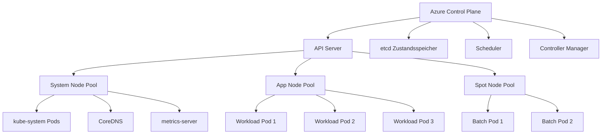
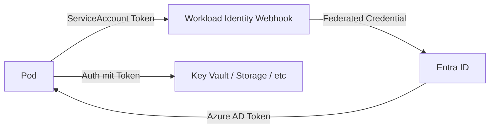

---
tags:
  - azure
  - compute
  - kubernetes
  - aks
  - container-orchestration
  - k8s
aliases:
  - AKS
  - Azure Kubernetes
  - K8s Azure
---

# Azure Kubernetes Service

> [!ABSTRACT] TL;DR
> Azure Kubernetes Service (AKS) ist Microsofts managed Kubernetes-Angebot. Der Control Plane (API Server, etcd, Scheduler) wird kostenlos von Azure verwaltet. Kunden bezahlen nur für die Worker-Nodes (VMs). AKS integriert sich nativ mit Entra ID, ACR, Azure Monitor, KEDA und Azure Policy.

---

## Was ist AKS?

AKS vereinfacht das Deployment und den Betrieb von Kubernetes in Azure durch:

- **Verwalteter Control Plane**: API Server, etcd, Controller Manager und Scheduler werden von Azure gepatcht und betrieben — kostenlos
- **Node Pool Management**: VMs als Kubernetes-Nodes, skalierbar und upgradebar
- **Native Azure-Integration**: Entra ID, RBAC, ACR, Managed Identity, Azure Monitor
- **Automatische Upgrades**: Patch- und Minor-Version-Updates ohne manuelle Eingriffe

---

## AKS-Architektur



---

## Node Pool Typen

| Pool-Typ | Zweck | Taint | Empfohlene VM-Größe |
|----------|-------|-------|---------------------|
| **System Pool** | Kubernetes-System-Komponenten | `CriticalAddonsOnly=true:NoSchedule` | Standard_D4s_v5 |
| **User Pool** | Anwendungs-Workloads | Kein (Standard) | Workload-spezifisch |
| **Spot Pool** | Unterbrechbare Batch-Workloads | `kubernetes.azure.com/scalesetpriority=spot:NoSchedule` | Standard_D4s_v5 (Spot) |

```bash
# Neuen User Node Pool hinzufügen
az aks nodepool add \
  --resource-group rg-aks \
  --cluster-name aks-prod \
  --name apppool \
  --node-count 3 \
  --node-vm-size Standard_D4s_v5 \
  --os-type Linux \
  --zones 1 2 3 \
  --enable-cluster-autoscaler \
  --min-count 2 \
  --max-count 10

# Spot Node Pool hinzufügen
az aks nodepool add \
  --resource-group rg-aks \
  --cluster-name aks-prod \
  --name spotpool \
  --priority Spot \
  --eviction-policy Delete \
  --spot-max-price -1 \
  --node-vm-size Standard_D4s_v5 \
  --node-count 0 \
  --enable-cluster-autoscaler \
  --min-count 0 \
  --max-count 20
```

---

## Kubernetes-Versionen und Upgrades

### LTS-Versionen

| Version | Support-Typ | Supported bis |
|---------|------------|---------------|
| 1.27 | LTS (2 Jahre) | ~2026 |
| 1.30 | LTS (2 Jahre) | ~2027 |
| Aktuelle | Standard (N-2) | 12 Monate |

### Upgrade-Kanäle

| Kanal | Verhalten | Empfehlung |
|-------|-----------|-----------|
| `none` | Kein automatisches Upgrade | Manuelles Control |
| `patch` | Automatische Patch-Releases | Produktion (sicher) |
| `stable` | Patch + Minor N-1 | Staging |
| `rapid` | Patch + Minor + neue Releases | Dev/Test |

```bash
# Upgrade-Kanal setzen
az aks update \
  --resource-group rg-aks \
  --name aks-prod \
  --auto-upgrade-channel patch

# Manuelle Cluster-Upgrade
az aks upgrade \
  --resource-group rg-aks \
  --name aks-prod \
  --kubernetes-version 1.30.5 \
  --node-image-upgrade-only false
```

---

## Netzwerk-Plugins

| Plugin | IP-Zuweisung | Skalierung | VNet-Integration | Empfehlung |
|--------|-------------|-----------|-----------------|-----------|
| **Kubenet** | Pod: NAT (nicht im VNet) | Bis ~400 Nodes | Eingeschränkt | Legacy |
| **Azure CNI** | Pod: Eigene VNet-IP | VNet-IP limitiert | Voll | Wenn Pod-IPs im VNet nötig |
| **Azure CNI Overlay** | Pod: Overlay + VNet für Node | Hoch skalierbar | Voll (ausgehend) | Empfohlen (neu) |
| **Cilium** | Pod: Overlay mit eBPF | Sehr hoch | Voll | High-Performance |

> [!TIP] Azure CNI Overlay empfohlen
> **Azure CNI Overlay** ist der empfohlene Netzwerk-Plugin für neue Cluster: Pods bekommen Overlay-IPs (kein VNet-IP-Verbrauch), trotzdem volle Azure-Integration und Network Policies.

---

## Network Policies

| Policy | Plugin | Protokolle | Features |
|--------|--------|-----------|---------|
| **Azure Network Policy** | Nur Azure CNI | TCP, UDP | Einfach, nativ integriert |
| **Calico** | Azure CNI, Kubenet, CNI Overlay | TCP, UDP, SCTP | Erweiterte Regeln, GlobalNetworkPolicy |
| **Cilium** | Cilium CNI | TCP, UDP, HTTP, DNS | eBPF-basiert, Layer 7 |

```yaml
# Network Policy: Nur Frontend darf auf Backend zugreifen
apiVersion: networking.k8s.io/v1
kind: NetworkPolicy
metadata:
  name: backend-allow-frontend
  namespace: app
spec:
  podSelector:
    matchLabels:
      app: backend
  policyTypes:
    - Ingress
  ingress:
    - from:
        - podSelector:
            matchLabels:
              app: frontend
      ports:
        - protocol: TCP
          port: 8080
```

---

## Ingress

### Application Gateway Ingress Controller (AGIC)

```bash
# AGIC als Add-on aktivieren
az aks enable-addons \
  --resource-group rg-aks \
  --name aks-prod \
  --addons ingress-appgw \
  --appgw-name agw-aks-prod \
  --appgw-subnet-cidr "10.2.0.0/16"
```

### NGINX Ingress via Helm

```bash
# NGINX Ingress Controller installieren
helm repo add ingress-nginx https://kubernetes.github.io/ingress-nginx
helm upgrade --install ingress-nginx ingress-nginx/ingress-nginx \
  --namespace ingress-nginx \
  --create-namespace \
  --set controller.service.annotations."service\.beta\.kubernetes\.io/azure-load-balancer-health-probe-request-path"=/healthz
```

---

## AKS + Entra ID: Workload Identity

Workload Identity ermöglicht Pods den Zugriff auf Azure-Services ohne Service Principal Secrets.



```bash
# Workload Identity auf AKS aktivieren
az aks update \
  --resource-group rg-aks \
  --name aks-prod \
  --enable-workload-identity \
  --enable-oidc-issuer

# User-assigned Managed Identity erstellen
az identity create \
  --resource-group rg-aks \
  --name id-aks-app

# Federated Credential konfigurieren
az identity federated-credential create \
  --name fc-aks-app \
  --identity-name id-aks-app \
  --resource-group rg-aks \
  --issuer $(az aks show -g rg-aks -n aks-prod --query oidcIssuerProfile.issuerUrl -o tsv) \
  --subject "system:serviceaccount:app-namespace:my-service-account" \
  --audience api://AzureADTokenExchange
```

---

## ACR Pull via Managed Identity

```bash
# AKS berechtigen, Images aus ACR zu pullen (kein imagePullSecret nötig)
az aks update \
  --resource-group rg-aks \
  --name aks-prod \
  --attach-acr myregistry

# Alternativ: Manuelle Rollenzuweisung
ACR_ID=$(az acr show --name myregistry --query id -o tsv)
KUBELET_MI=$(az aks show -g rg-aks -n aks-prod --query identityProfile.kubeletidentity.objectId -o tsv)
az role assignment create \
  --assignee $KUBELET_MI \
  --role AcrPull \
  --scope $ACR_ID
```

---

## Persistent Volumes

| Storage-Klasse | Access Mode | Protokoll | Anwendungsfall |
|---------------|-------------|-----------|----------------|
| **managed-csi** (Azure Disk) | ReadWriteOnce | SCSI | Datenbanken, zustandsbehaftete Apps |
| **managed-csi-premium** | ReadWriteOnce | SCSI | High-Performance-Datenbanken |
| **azurefile-csi** | ReadWriteMany | SMB | Shared Storage, CMS |
| **azurefile-csi-premium** | ReadWriteMany | SMB | High-Performance Shared Storage |

```yaml
# PersistentVolumeClaim für Azure Disk
apiVersion: v1
kind: PersistentVolumeClaim
metadata:
  name: db-data
spec:
  accessModes:
    - ReadWriteOnce
  storageClassName: managed-csi-premium
  resources:
    requests:
      storage: 50Gi
```

---

## Cluster Autoscaler

```bash
# Cluster Autoscaler pro Node Pool konfigurieren
az aks nodepool update \
  --resource-group rg-aks \
  --cluster-name aks-prod \
  --name apppool \
  --enable-cluster-autoscaler \
  --min-count 2 \
  --max-count 20
```

**Scale-to-Zero** für User Pools (nicht System Pools):
```bash
# User Pool auf 0 skalieren (ermöglicht durch Autoscaler)
az aks nodepool update \
  --resource-group rg-aks \
  --cluster-name aks-prod \
  --name batchpool \
  --min-count 0 \
  --max-count 10
```

---

## KEDA

KEDA (Kubernetes Event-Driven Autoscaler) skaliert Pods basierend auf Event-Quellen.

```bash
# KEDA auf AKS aktivieren
az aks update \
  --resource-group rg-aks \
  --name aks-prod \
  --enable-keda
```

```yaml
# ScaledObject: Azure Queue Scaler
apiVersion: keda.sh/v1alpha1
kind: ScaledObject
metadata:
  name: queue-worker-scaler
  namespace: app
spec:
  scaleTargetRef:
    name: queue-worker-deployment
  pollingInterval: 30
  cooldownPeriod: 300
  minReplicaCount: 0
  maxReplicaCount: 50
  triggers:
    - type: azure-queue
      metadata:
        queueName: work-items
        queueLength: "5"
        accountName: stworkqueue
      authenticationRef:
        name: azure-queue-auth
```

---

## Via Azure Portal (UI)

> [!TIP] Schnelleinstieg
> Das Azure Portal bietet einen geführten Assistenten zur AKS-Cluster-Erstellung mit Netzwerk-, Identitäts- und Add-on-Konfiguration.

### AKS-Cluster erstellen

1. **portal.azure.com** → **Kubernetes-Dienste** → **+ Erstellen** → **Kubernetes-Cluster erstellen**
2. **Grundlagen**-Tab:
   - Abonnement & Ressourcengruppe
   - **Clustervorkonfiguration**: Dev/Test, Produktion oder benutzerdefiniert
   - **Kubernetes-Clustername**, **Region**, **Verfügbarkeitszonen**
   - **Kubernetes-Version** auswählen
   - **Automatisches Upgrade**: Patch (empfohlen), Stabil oder Schnell
3. **Knotenpools**-Tab:
   - System-Knotenpool: VM-Größe (z. B. `Standard_D4s_v3`), Anzahl der Knoten
   - **+ Knotenpool hinzufügen**: User-Pools für Workloads
   - **Knotenpool-Modus**: System / Benutzer
   - Cluster-Autoskalierung aktivieren: Min./Max. Knoten
4. **Netzwerk**-Tab:
   - **Netzwerkkonfiguration**: Kubenet oder Azure CNI
   - VNet und Subnetz auswählen (bei CNI)
   - **DNS-Namenspräfix** für API-Server
5. **Integrationen**-Tab:
   - **Container Registry**: ACR verknüpfen
   - **Azure Monitor**: Container Insights aktivieren
   - **Microsoft Defender for Containers**: aktivieren
6. **Überprüfen + erstellen** → **Erstellen**

### Knotenpool skalieren

1. AKS-Cluster → **Knotenpools**
2. Knotenpool auswählen → **Skalieren**
3. Knotenanzahl anpassen oder Autoskalierung aktivieren

### Workloads im Portal prüfen

1. AKS-Cluster → **Workloads**
2. Deployments, ReplicaSets, Pods und DaemonSets einsehen
3. Pod → **Protokolle** oder **Live-Protokolle** für Echtzeit-Log-Streaming

---

## AKS Monitoring

### Container Insights

```bash
# Container Insights aktivieren
az aks enable-addons \
  --resource-group rg-aks \
  --name aks-prod \
  --addons monitoring \
  --workspace-resource-id /subscriptions/{subId}/resourceGroups/rg-monitoring/providers/Microsoft.OperationalInsights/workspaces/law-prod
```

### Prometheus + Azure Managed Grafana

```bash
# Azure Managed Prometheus aktivieren
az aks update \
  --resource-group rg-aks \
  --name aks-prod \
  --enable-azure-monitor-metrics \
  --azure-monitor-workspace-resource-id /subscriptions/{subId}/resourceGroups/rg-monitoring/providers/microsoft.monitor/accounts/prom-prod

# Azure Managed Grafana verknüpfen
az grafana update \
  --resource-group rg-monitoring \
  --name grafana-prod \
  --major-version 10
```

---

## Defender for Containers

```bash
# Defender for Containers aktivieren (Cluster-Ebene)
az aks update \
  --resource-group rg-aks \
  --name aks-prod \
  --enable-defender
```

**Funktionen:**
- **Runtime Protection**: Erkennt verdächtige Container-Aktivitäten (Privilege Escalation, Crypto Mining)
- **Image Scanning in ACR**: Vulnerability Assessment für alle gepushten Images
- **Admission Controller**: Blockiert Images mit kritischen Schwachstellen beim Deployment
- **Kubernetes Audit Logs**: Erkennt verdächtige API-Server-Operationen

---

## Upgrade-Prozess

```bash
# Verfügbare Upgrade-Versionen anzeigen
az aks get-upgrades \
  --resource-group rg-aks \
  --name aks-prod \
  --output table

# Cluster upgraden (mit Node Surge für Zero-Downtime)
az aks upgrade \
  --resource-group rg-aks \
  --name aks-prod \
  --kubernetes-version 1.30.5 \
  --yes

# Nur Node Image upgraden (OS-Patches ohne K8s-Version-Upgrade)
az aks nodepool upgrade \
  --resource-group rg-aks \
  --cluster-name aks-prod \
  --name apppool \
  --node-image-only
```

> [!TIP] Node Surge konfigurieren
> Mit `--max-surge 33%` werden bei Upgrades 33% extra Nodes temporär hochgefahren. Workloads werden auf neue Nodes migriert, dann werden alte Nodes entfernt. Empfohlen für Produktions-Cluster.

---

## Kosten

| Komponente | Kosten |
|-----------|--------|
| **Control Plane** | Kostenlos (Standard-Tier) |
| **Uptime SLA** | ~73 €/Monat (99,95% SLA — optional) |
| **Node VMs** | Standard VM-Preise (z.B. D4s_v5: ~140 €/Monat) |
| **OS Disk** | Managed Disk je nach Typ |
| **Load Balancer** | Standard Load Balancer: ~20 €/Monat |
| **Container Insights** | Log Analytics (pro GiB Ingestion) |

> [!NOTE] System Pool Größe minimieren
> Der System Node Pool benötigt mindestens 2 vCPUs und 4 GiB RAM. D2s_v5 (2 vCPUs, 8 GiB) mit 2 Nodes (Availability Zones) reicht für kube-system-Komponenten aus.

---

## Verwandte Notizen
- [[Azure Container Registry]]
- [[Azure Container Apps]]
- [[Azure Container Instances]]
- [[Azure RBAC]]
- [[Azure Policy]]
