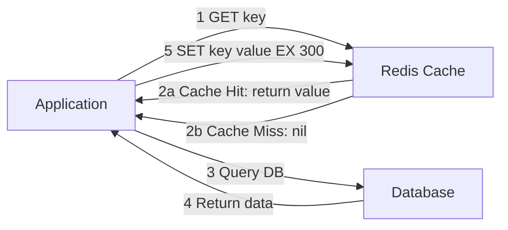

# Azure Cache for Redis

> [!ABSTRACT]
> Azure Cache for Redis ist ein vollständig verwalteter In-Memory-Daten-Store auf Basis von Redis. Er bietet blitzschnelle Datenzugriffe für Caching, Session Management, Real-Time Analytics und Message Queuing — mit Tiers von Basic bis Enterprise mit Active-Active Geo-Replikation.

---

## Was ist Azure Cache for Redis?

Azure Cache for Redis ist Microsofts verwalteter Redis-Dienst. Redis (Remote Dictionary Server) ist ein In-Memory Key-Value-Store, der Daten im RAM hält und damit Latenzzeiten im Mikrosekundenbereich bietet.

**Kernanwendungsfälle:**
- **Application Caching:** Datenbankabfragen, API-Antworten, HTML-Fragmente cachen
- **Session Store:** HTTP-Session-Daten für Web-Anwendungen
- **Rate Limiting:** API-Anfragen pro Zeitfenster begrenzen
- **Real-Time Leaderboards:** Sortierte Mengen für Ranglisten
- **Pub/Sub Messaging:** Nachrichten zwischen Microservices
- **Distributed Lock:** Globale Locks in verteilten Systemen

---

## Caching-Muster

### Cache-Aside (Lazy Loading)

Das häufigste Muster — Anwendung prüft Cache vor der Datenbank:



```python
import redis
import json

r = redis.Redis(
    host="myredis.redis.cache.windows.net",
    port=6380,
    password="accessKey==",
    ssl=True
)

def get_user(user_id: str):
    cache_key = f"user:{user_id}"
    
    # Cache prüfen
    cached = r.get(cache_key)
    if cached:
        return json.loads(cached)
    
    # Cache Miss: DB abfragen
    user = db.query("SELECT * FROM users WHERE id = ?", user_id)
    
    # Im Cache speichern (TTL: 300 Sekunden)
    r.setex(cache_key, 300, json.dumps(user))
    return user
```

### Write-Through

Jeder Write geht gleichzeitig in Cache und Datenbank:

- **Vorteil:** Cache immer aktuell (kein Cache Miss nach Write)
- **Nachteil:** Höhere Write-Latenz, ungenutzter Cache-Speicher bei selten gelesenen Daten

### Session Store

```python
# Flask Session Store mit Redis
from flask import Flask, session
from flask_session import Session

app = Flask(__name__)
app.config['SESSION_TYPE'] = 'redis'
app.config['SESSION_REDIS'] = redis.Redis(
    host="myredis.redis.cache.windows.net",
    port=6380, ssl=True, password="accessKey=="
)
Session(app)
```

### Rate Limiting

```python
def is_rate_limited(user_id: str, max_requests: int = 100, window: int = 60) -> bool:
    key = f"rate_limit:{user_id}"
    pipe = r.pipeline()
    pipe.incr(key)
    pipe.expire(key, window)
    result = pipe.execute()
    return result[0] > max_requests
```

---

## Service Tiers

| Tier | Nodes | SLA | Max Größe | Features | Monatliche Kosten (ca.) |
|---|---|---|---|---|---|
| **Basic** | 1 (kein Replikat) | Kein SLA | 53 GB | Nur für Dev/Test | Ab 15 € |
| **Standard** | 2 (Primary + Replica) | 99,9 % | 53 GB | HA, Monitoring | Ab 30 € |
| **Premium** | 2 | 99,9 % | 1,2 TB | VNet, Geo-Rep, Clustering, Persistenz | Ab 200 € |
| **Enterprise** | 3 (Redis Cluster) | 99,99 % | 14 TB | Redis-Module, Active-Active | Ab 700 € |
| **Enterprise Flash** | 3 (NVMe + RAM) | 99,99 % | 1,5 TB RAM + Flash | Kosteneffizient für große Caches | Ab 500 € |

> [!WARNING]
> **Basic-Tier hat kein SLA und kein Replikat** — ausschließlich für Entwicklung und Tests verwenden. Für jede produktive Anwendung mindestens **Standard** wählen.

---

## Premium-Features

### VNet Injection

Premium-Cache direkt im eigenen VNet deployen — keine öffentliche IP, Traffic bleibt im privaten Netzwerk:

```powershell
# Premium Cache im VNet erstellen
az redis create `
    --resource-group rg-prod `
    --name redis-prod `
    --location westeurope `
    --sku Premium `
    --vm-size P2 `
    --subnet-id "/subscriptions/.../subnets/snet-redis"
```

### Geo-Replication (Passive — Standard/Premium)

```powershell
# Geo-Replikation einrichten (Standard/Premium)
az redis geo-replication link create `
    --name georep-link `
    --primary-resource-id $primaryRedisId `
    --secondary-resource-id $secondaryRedisId
```

### Clustering (Sharding)

Premium-Tier unterstützt bis zu **10 Shards** für horizontale Skalierung:

```powershell
# Premium Cache mit 3 Shards erstellen
az redis create `
    --resource-group rg-prod `
    --name redis-cluster `
    --sku Premium `
    --vm-size P3 `
    --shard-count 3
```

---

## Enterprise Redis-Module

Enterprise-Tier unterstützt offizielle Redis-Module:

| Modul | Beschreibung | Anwendungsfall |
|---|---|---|
| **RediSearch** | Volltext-Suche und Sekundärindizes in Redis | Echtzeit-Suche, Auto-Complete |
| **RedisJSON** | Native JSON-Dokumente in Redis | Dokument-Store, Nested JSON |
| **RedisBloom** | Probabilistische Datenstrukturen (Bloom Filter, HyperLogLog) | Deduplizierung, Unique Count |
| **RedisTimeSeries** | Zeit-Reihen-Daten nativ in Redis | IoT-Telemetrie, Metriken |

```bash
# RediSearch: Suche nach Produkten
FT.CREATE idx:products ON JSON PREFIX 1 product: SCHEMA $.name AS name TEXT $.price AS price NUMERIC

FT.SEARCH idx:products "laptop @price:[500 2000]" LIMIT 0 10
```

---

## Clustering

Redis-Clustering verteilt Daten über mehrere Shards mittels **Hash Slots**:

- Insgesamt 16.384 Hash Slots
- Jeder Shard verantwortet einen Bereich von Hash Slots
- Client berechnet Hash Slot aus Key und spricht direkt den richtigen Shard an
- Alle Keys mit gleichem `{hash_tag}` gehen in denselben Slot

```python
# Hash-Tags für verwandte Keys im gleichen Slot
r.set("{user:123}.profile", data)
r.set("{user:123}.preferences", prefs)
# Beide Keys landen im selben Shard
```

---

## Geo-Replication

| Typ | Tiers | Modus | Anwendungsfall |
|---|---|---|---|
| **Passive Geo-Replication** | Standard, Premium | Active-Passive (Primary → Secondary) | DR, Read-Offloading in andere Region |
| **Active-Active** | Enterprise | Schreibzugriff in allen Regionen | Globale Anwendungen, niedrige Write-Latenz |

---

## Persistenz

Redis ist primär ein In-Memory-Store, unterstützt aber optionale Persistenz:

| Modus | Beschreibung | Datenverlust bei Ausfall | Performance-Impact |
|---|---|---|---|
| **RDB (Snapshots)** | Periodische Snapshots auf Disk (z.B. alle 15 Min) | Bis zum letzten Snapshot | Gering |
| **AOF (Append-Only File)** | Jede Write-Operation wird geloggt | Maximal 1 Sekunde | Höher |
| **RDB + AOF** | Kombination: AOF für Recovery, RDB für Backups | Minimal | Am höchsten |

> [!NOTE]
> Persistenz ist **Premium-Feature**. Für reine Caching-Szenarien (Cache kann neu befüllt werden) ist Persistenz nicht notwendig.

---

## Netzwerk und Sicherheit

### Private Endpoint (Standard/Premium)

```powershell
# Private Endpoint für Redis
az network private-endpoint create `
    --resource-group rg-prod `
    --name pe-redis `
    --vnet-name vnet-prod `
    --subnet snet-services `
    --private-connection-resource-id $redisId `
    --group-id redisCache `
    --connection-name redis-connection
```

### Firewall-Regeln

```powershell
# Firewall-Regel für spezifische IP
az redis firewall-rules create `
    --resource-group rg-prod `
    --name redis-prod `
    --rule-name AllowAppServer `
    --start-ip 10.0.1.5 `
    --end-ip 10.0.1.5
```

---

## Entra ID Authentifizierung

Statt Access Keys kann Entra ID für Authentifizierung genutzt werden:

```powershell
# Entra ID Authentifizierung aktivieren
az redis update `
    --resource-group rg-prod `
    --name redis-prod `
    --set properties.redisConfiguration.aad-enabled=true

# Managed Identity Zugriff gewähren
az redis access-policy-assignment create `
    --resource-group rg-prod `
    --name redis-prod `
    --policy-assignment-name "mi-app-policy" `
    --object-id $managedIdentityObjectId `
    --policy-name "Data Contributor"
```

> [!TIP]
> Mit Entra ID Authentifizierung können Access Keys vollständig deaktiviert werden — dies ist die empfohlene Security-Best-Practice.

---

## Via Azure Portal (UI)

> [!TIP] Schnelleinstieg
> Azure Cache for Redis lässt sich über das Portal in wenigen Schritten erstellen und konfigurieren.

### Redis-Cache erstellen

1. **portal.azure.com** → **Azure Cache für Redis** → **+ Erstellen**
2. **Grundlagen**-Tab:
   - Abonnement & Ressourcengruppe
   - **DNS-Name**: global eindeutiger Cache-Name (z. B. `mein-redis`)
   - **Region**: z. B. `West Europe`
   - **Cache-SKU**: Basic, Standard oder Premium
   - **Cache-Größe**: C0 (250 MB) bis C6 (53 GB) bei Standard/Basic; P1–P5 bei Premium
3. **Netzwerk**-Tab:
   - **Konnektivitätsmethode**: Öffentlicher Endpunkt oder privater Endpunkt
4. **Erweitert**-Tab:
   - **Redis-Version**: 6 (empfohlen)
   - **Nicht-TLS-Port**: Deaktivieren (Sicherheitsempfehlung)
   - **Clustering** (nur Premium): Anzahl der Shards festlegen
5. **Überprüfen + erstellen** → **Erstellen** (Bereitstellung dauert ca. 10–20 Minuten)

### Verbindungsdetails abrufen

1. Redis-Cache → **Zugriffsschlüssel**
2. **Primärer Verbindungsstring** kopieren → enthält Hostname, Port und Zugriffsschlüssel
3. Alternativ: **Hostnamen**, **Port** und **Schlüssel** separat einsehen

### Redis-Konsole im Portal

1. Redis-Cache → **Konsole**
2. Redis-Befehle direkt ausführen: `PING`, `SET key value`, `GET key`, `INFO`

### Skalierung

1. Redis-Cache → **Skalieren**
2. Neuen Tarif oder Größe auswählen → **Speichern** (Datenmigration erfolgt automatisch)

---

## .NET StackExchange.Redis — Cache-Aside Pattern

```csharp
using StackExchange.Redis;
using System.Text.Json;

// Verbindung aufbauen (Singleton)
var connection = ConnectionMultiplexer.Connect(
    "myredis.redis.cache.windows.net:6380,ssl=true,password=accessKey=="
);
IDatabase cache = connection.GetDatabase();

// Cache-Aside Pattern
public async Task<Product?> GetProductAsync(int productId)
{
    string key = $"product:{productId}";
    
    // Cache prüfen
    var cached = await cache.StringGetAsync(key);
    if (cached.HasValue)
        return JsonSerializer.Deserialize<Product>(cached!);
    
    // Cache Miss: Aus DB laden
    var product = await _db.Products.FindAsync(productId);
    if (product == null) return null;
    
    // Im Cache speichern (15 Minuten TTL)
    await cache.StringSetAsync(
        key,
        JsonSerializer.Serialize(product),
        TimeSpan.FromMinutes(15)
    );
    return product;
}
```

---

## Python redis-py Beispiel

```python
import redis
import json
from datetime import timedelta

# Verbindung mit SSL
client = redis.Redis(
    host="myredis.redis.cache.windows.net",
    port=6380,
    password="accessKey==",
    ssl=True,
    decode_responses=True
)

# Sortiertes Set (Leaderboard)
def add_score(user_id: str, score: float):
    client.zadd("leaderboard", {user_id: score})

def get_top_10():
    return client.zrevrange("leaderboard", 0, 9, withscores=True)

# Pub/Sub
def publish_event(channel: str, event: dict):
    client.publish(channel, json.dumps(event))

# Pipeline (Batch-Operationen)
pipe = client.pipeline()
pipe.set("key1", "value1", ex=300)
pipe.set("key2", "value2", ex=300)
pipe.incr("counter")
results = pipe.execute()
```

---

## Monitoring

Wichtige Metriken für Azure Cache for Redis:

| Metrik | Beschreibung | Zielwert |
|---|---|---|
| **Cache Hit Rate** | Anteil der Anfragen aus Cache bedient | > 90 % |
| **Cache Misses** | Anfragen, die Cache nicht treffen | Minimieren |
| **Used Memory** | Genutzter Arbeitsspeicher | < 80 % |
| **Server Load** | CPU-Auslastung des Redis-Servers | < 80 % |
| **Connected Clients** | Aktive Verbindungen | Basierend auf Tier |
| **Evicted Keys** | Automatisch gelöschte Keys (Memory voll) | 0 (idealerweise) |
| **Expired Keys** | Keys mit abgelaufenem TTL | Normal, kein Problem |

> [!WARNING]
> Hohe **Evicted Keys**-Zahlen zeigen, dass der Cache zu klein ist (Memory-Pressure). Entweder Cache-Größe erhöhen oder TTLs verkürzen.

---

## Redis vs. Service Bus

| Merkmal | Azure Cache for Redis | Azure Service Bus |
|---|---|---|
| **Persistenz** | Optional (RDB/AOF) | Immer persistiert |
| **Delivery Guarantee** | At-Most-Once (Pub/Sub) | At-Least-Once |
| **Message Order** | Kein garantiertes Ordering | Ordering möglich (Sessions) |
| **Komplexität** | Niedrig | Mittel |
| **Hauptzweck** | Caching, In-Memory-Store | Zuverlässiges Messaging |
| **Anwendungsfall** | Cache, Session, Real-Time | Workflows, Transaktionen |
| **Kosten** | Nach Cache-Größe | Nach Operationen |

---

## Kosten-Optimierung

```powershell
# Cache-Größe skalieren
az redis update `
    --resource-group rg-prod `
    --name redis-prod `
    --sku Standard `
    --vm-size C2  # C0=250MB, C1=1GB, C2=6GB, C3=13GB, ...

# Insights: Memory Usage prüfen
az monitor metrics list `
    --resource $redisId `
    --metric "usedmemory" `
    --interval PT1H
```

> [!TIP]
> **Reserved Capacity** für Azure Cache for Redis (1 oder 3 Jahre) spart bis zu 55 % gegenüber Pay-as-you-go.

---

## Verwandte Notizen

- [[Azure Cosmos DB]] — NoSQL-Datenbank, Redis als Caching-Layer davor
- [[Azure SQL Database]] — Relationale DB, Redis für Query-Caching
- [[Azure Synapse Analytics]] — Real-Time Analytics-Ergänzung
