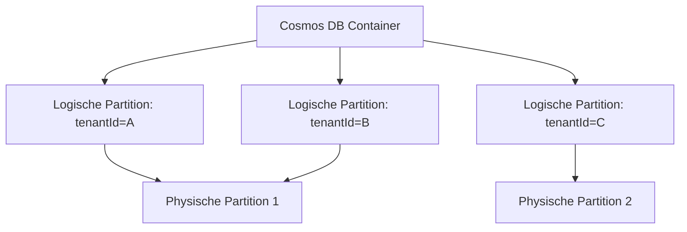
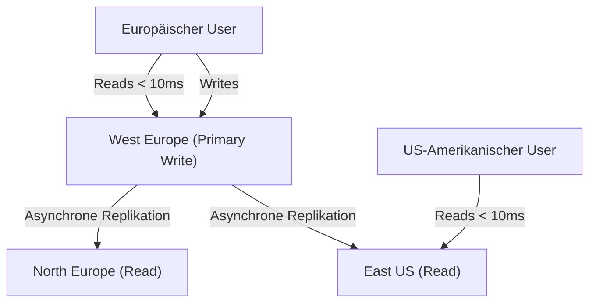

# Azure Cosmos DB

> [!ABSTRACT]
> Azure Cosmos DB ist Microsofts globally distributed, multi-model NoSQL-Datenbank. Sie bietet garantierte Latenz < 10 ms, flexible Konsistenz-Level, automatische Multi-Region-Replikation und unterstützt mehrere APIs (NoSQL, MongoDB, Cassandra, Gremlin, Table).

---

## Was ist Azure Cosmos DB?

Azure Cosmos DB ist eine **vollständig verwaltete, global verteilte NoSQL-Datenbank** der ersten Generation in Azure. Kernmerkmale:

- **Multi-Region-Replikation** mit einem Klick (weltweit)
- **Mehrere APIs** für verschiedene Datenmodelle
- **Garantierte Latenz** < 10 ms für Reads und Writes (99. Perzentil)
- **SLA: 99,999 %** für Multi-Master-Konfigurationen
- **Flexible Konsistenz:** 5 wählbare Konsistenz-Level
- **Automatisches Indexing** aller Felder standardmäßig
- **TTL:** Automatisches Löschen von Dokumenten

---

## Multi-Model APIs

| API | Protokoll | Abfragesprache | Datenmodell | Anwendungsfall |
|---|---|---|---|---|
| **NoSQL (Core SQL)** | Cosmos-proprietär | SQL-ähnliche Query Language | JSON-Dokumente | Empfohlen für neue Projekte |
| **MongoDB** | MongoDB Wire Protocol | MQL (MongoDB Query Language) | BSON-Dokumente | Migration von MongoDB, Entwickler-Kompatibilität |
| **Cassandra** | CQL (Cassandra Query Language) | CQL | Wide-Column | Migration von Cassandra, Time-Series |
| **Gremlin** | Apache TinkerPop | Gremlin-Traversal-Language | Graph (Knoten + Kanten) | Social Networks, Empfehlungen, Fraud Detection |
| **Table** | Azure Table Storage | OData / REST | Key-Value mit Properties | Migration von Azure Table Storage |

> [!NOTE]
> Der **NoSQL (Core SQL) API** ist der native Cosmos DB API mit den meisten Features. Für neue Anwendungen ohne Migrations-Anforderungen sollte dieser bevorzugt werden.

---

## Multi-Region Writes und Reads

- **Regionen hinzufügen** ohne Downtime mit einem Klick im Azure Portal
- **Automatisches Failover** konfigurierbar (Priority-basiert)
- **Multi-Master (Multi-Region Writes):** Schreibzugriff in jeder Region möglich
- Reads aus der **nächstgelegenen Region** (niedrigste Latenz)
- Replikation von Änderungen in alle Regionen

```powershell
# Sekundäre Leseregioen hinzufügen
az cosmosdb update `
    --resource-group rg-prod `
    --name cosmos-prod `
    --locations "westeurope=0" "northeurope=1" "eastus=2"
    # Format: region=failover-priority (0=Primary)

# Multi-Master (Multi-Region Writes) aktivieren
az cosmosdb update `
    --resource-group rg-prod `
    --name cosmos-prod `
    --enable-multiple-write-locations true
```

---

## Konsistenz-Level

Azure Cosmos DB bietet 5 Konsistenz-Level als **Sliding Scale** zwischen Konsistenz und Performance:

| Level | Beschreibung | Latenz | Throughput-Kosten | Anwendungsfall |
|---|---|---|---|---|
| **Strong** | Immer neueste Version gelesen (linearisierbar) | Höchste (über alle Regionen) | Höchste (2x RUs für Reads) | Finanztransaktionen, kritische Daten |
| **Bounded Staleness** | Reads höchstens K Versionen oder T Sekunden veraltet | Niedrig (außer Cross-Region) | Hoch | Niedrige Latenz, begrenzte Verzögerung tolerierbar |
| **Session** | Innerhalb einer Session immer aktuell (Read-your-own-writes) | Niedrig | Mittel | Standard-Webapps, Shopping Cart, User Profiles |
| **Consistent Prefix** | Kein Out-of-Order, aber Verzögerung möglich | Sehr niedrig | Niedrig | Social Media Feeds, Events in Reihenfolge |
| **Eventual** | Maximale Performance, aber Lesungen können veraltet sein | Niedrigste | Niedrigste | Nicht-kritische Zählungen, Like-Counts |

> [!TIP]
> **Session Consistency** ist der Standard und für die meisten Webapplikationen der beste Kompromiss: Innerhalb einer Client-Session sind immer die neuesten Daten sichtbar (Read-your-own-writes), Cross-Client können minimale Verzögerungen auftreten.

---

## Request Units (RUs)

Cosmos DB misst alle Operationen in **Request Units (RUs)** — einer kombinierten Metrik aus CPU, I/O und Memory:

**Grundregel:** `1 RU = 1 KB Punkt-Leseoperation`

| Operation | RU-Kosten (Beispiel 1 KB Dokument) |
|---|---|
| **Punkt-Read** (by ID + Partition Key) | 1 RU |
| **Query** (einfach, indiziert) | 2–5 RU |
| **Write (Insert/Replace)** | ~5 RU |
| **Delete** | ~5 RU |
| **Cross-Partition Query** | 10–100+ RU je nach Fan-Out |

**Beispiel-Kalkulation:**

```
Anwendung: 1000 Nutzer gleichzeitig
Pro Nutzer: 10 Reads/s + 2 Writes/s
Reads: 1000 x 10 x 1 RU = 10.000 RU/s
Writes: 1000 x 2 x 5 RU = 10.000 RU/s
Gesamt: ~20.000 RU/s benötigt
```

> [!NOTE]
> Der **Azure Cosmos DB Capacity Calculator** (portal.azure.com) hilft bei der RU-Schätzung für neue Projekte.

---

## Kapazitätsmodi

| Modus | Beschreibung | Min | Max | Anwendungsfall |
|---|---|---|---|---|
| **Provisioned (Manual)** | Feste RU/s bereitstellen | 400 RU/s | Unbegrenzt | Vorhersehbare Last, niedrigste Kosten bei stabiler Last |
| **Provisioned (Autoscale)** | Automatisch skalieren (10:1 Verhältnis) | 10 % der Max-RUs | Konfiguriertes Maximum | Variable Last mit Peak-Perioden |
| **Serverless** | Abrechnung per Request (pay-per-use) | 0 | 5000 RU/s | Dev/Test, sehr sporadische Workloads |

**Autoscale-Beispiel:**
- Konfiguriert: Max 10.000 RU/s
- Minimum: 1000 RU/s (10 % von 10.000)
- Kosten: Basierend auf dem höchsten Wert in der letzten Stunde
- Keine manuelle Anpassung bei Lastspitzen erforderlich

```powershell
# Autoscale konfigurieren (max 10.000 RU/s)
az cosmosdb sql container throughput update `
    --resource-group rg-prod `
    --account-name cosmos-prod `
    --database-name mydb `
    --name mycontainer `
    --max-throughput 10000
```

---

## Partitionierung

Partitionierung ist das **kritischste Design-Element** in Cosmos DB. Ein schlechter Partition Key führt zu Hot Partitions und Performance-Problemen.

### Kriterien für einen guten Partition Key

| Kriterium | Beschreibung |
|---|---|
| **Hohe Kardinalität** | Viele eindeutige Werte (nicht: true/false, Status) |
| **Gleichmäßige Verteilung** | Daten gleichmäßig auf Partitionen verteilt |
| **Häufiger Filter** | Partition Key in WHERE-Klauseln verwendet |
| **Max 20 GiB** | Pro logischer Partition maximal 20 GiB |

### Physische vs. Logische Partitionen



**Hot Partition Problem:** Wenn alle Writes auf eine logische Partition gehen (z.B. Partition Key = aktuelles Datum), entsteht eine Hot Partition mit Throughput-Throttling.

```json
// Gutes Beispiel: tenantId als Partition Key (hohe Kardinalität)
{
    "id": "order-12345",
    "tenantId": "tenant-abc",  // Partition Key
    "amount": 99.99,
    "createdAt": "2024-11-01T10:00:00Z"
}
```

---

## Global Distribution



**Multi-Master:** Mit aktivierten Multi-Region Writes kann jeder User in seine lokale Region schreiben — Cosmos DB löst Konflikte automatisch (Last-Write-Wins oder Custom Conflict Resolution).

---

## Change Feed

Change Feed ist ein **geordneter Log aller Änderungen** in einem Container:

- Jedes Insert und Update (kein Delete standardmäßig) wird im Change Feed erfasst
- Ordenung innerhalb einer logischen Partition garantiert
- Konsumenten: Azure Functions, Change Feed Processor SDK

**Anwendungsfälle:**
- Event-Sourcing / CQRS-Pattern
- Cache-Invalidierung (Redis aktuell halten)
- Real-Time Analytics (Synapse Link)
- Downstream-Services benachrichtigen
- Materialized Views aktualisieren

```csharp
// Change Feed Processor (C#)
var processor = container.GetChangeFeedProcessorBuilder<MyItem>(
    processorName: "myProcessor",
    onChangesDelegate: async (changes, cancellationToken) =>
    {
        foreach (var item in changes)
        {
            Console.WriteLine($"Changed: {item.Id}");
            // Cache invalidieren, Events senden, etc.
        }
    })
    .WithInstanceName("instance1")
    .WithLeaseContainer(leaseContainer)
    .Build();

await processor.StartAsync();
```

---

## Cosmos DB for PostgreSQL

Für Workloads, die Standard-PostgreSQL-Syntax mit horizontaler Skalierung kombinieren:

- Basiert auf **Citus-Extension** für PostgreSQL
- Automatisches Sharding von Tabellen
- PostgreSQL-kompatibel (Standard SQL, Stored Procedures, etc.)
- Anwendungsfall: SaaS-Anwendungen, Time-Series, Analytik auf TB-Skala

---

## Indexing Policy

Standardmäßig indiziert Cosmos DB **alle Felder** automatisch. Dies vereinfacht Abfragen, erhöht aber Write-RUs und Storage.

```json
// Optimierte Indexing Policy (nur benötigte Felder indizieren)
{
    "indexingMode": "consistent",
    "automatic": true,
    "includedPaths": [
        {"path": "/tenantId/?"},
        {"path": "/status/?"},
        {"path": "/createdAt/?"}
    ],
    "excludedPaths": [
        {"path": "/largeTextField/*"},
        {"path": "/binaryData/*"},
        {"path": "/*"}
    ],
    "compositeIndexes": [
        [
            {"path": "/status", "order": "ascending"},
            {"path": "/createdAt", "order": "descending"}
        ]
    ]
}
```

> [!TIP]
> Composite Indexes sind **notwendig** für `ORDER BY` auf mehreren Feldern. Ohne Composite Index schlägt die Query fehl.

---

## TTL — Time to Live

Automatisches Löschen von Dokumenten nach einer definierten Zeit:

```json
// TTL auf Container-Ebene (Standard: -1 = kein Ablauf)
// TTL auf Dokument-Ebene überschreibt Container-TTL

// Dokument mit 30 Tagen TTL
{
    "id": "session-abc123",
    "userId": "user-1",
    "data": "...",
    "ttl": 2592000  // 30 Tage in Sekunden
}
```

**Anwendungsfälle:** Session-Daten, temporäre Berechnungsergebnisse, Log-Einträge, IoT-Telemetrie mit Rolling Window.

---

## Backups

| Modus | Beschreibung | PITR | Kosten |
|---|---|---|---|
| **Periodic (Standard)** | Snapshots alle 4 Stunden, 2 Kopien aufbewahrt | Nein (nur Snapshot-Restore) | Im Preis inklusive |
| **Continuous (7 Tage)** | Kontinuierliche Backups, PITR auf Minuten genau | Ja (7 Tage) | Niedrig |
| **Continuous (30 Tage)** | Kontinuierliche Backups, PITR auf Minuten genau | Ja (30 Tage) | Höher |

```powershell
# Continuous Backup aktivieren (30 Tage PITR)
az cosmosdb update `
    --resource-group rg-prod `
    --name cosmos-prod `
    --backup-policy-type Continuous `
    --continuous-tier Continuous30Days
```

---

## Microsoft Defender for Cosmos DB

- **SQL Injection Detection** (für Cosmos DB SQL API)
- **Anomalie-Erkennung:** Ungewöhnliche Zugriffsmuster, unbekannte IPs
- **Verdächtige Aktivitäten:** Daten-Exfiltration, ungewöhnliche Delete-Operationen
- Integration mit Microsoft Sentinel

---

## Via Azure Portal (UI)

> [!TIP] Schnelleinstieg
> Das Portal führt durch die API-Wahl, Kapazitätsmodus und Multi-Region-Konfiguration in einem geführten Assistenten.

### Cosmos DB-Konto erstellen

1. **portal.azure.com** → **Azure Cosmos DB** → **+ Erstellen**
2. **API auswählen**:
   - **Azure Cosmos DB for NoSQL** (empfohlen, JSON-Dokumente)
   - **Azure Cosmos DB for MongoDB** (MongoDB-kompatibel)
   - **Azure Cosmos DB for Apache Cassandra**
   - **Azure Cosmos DB for Apache Gremlin** (Graph)
   - **Azure Cosmos DB for Table** (Key-Value)
3. **Grundlagen**-Tab:
   - Abonnement & Ressourcengruppe
   - **Kontoname**: global eindeutig
   - **Region** (primäre Schreibregion)
   - **Kapazitätsmodus**: Provisionierter Durchsatz oder Serverlos
   - **Free Tier-Rabatt**: Aktivieren (erste 1.000 RU/s + 25 GB kostenlos)
4. **Globale Verteilung**-Tab: Zusätzliche Leseregionen hinzufügen
5. **Netzwerk**-Tab: Öffentlicher Endpunkt (alle Netzwerke) oder privater Endpunkt
6. **Sicherung**-Tab: Sicherungsmodus (Periodisch oder Kontinuierlich) wählen
7. **Überprüfen + erstellen** → **Erstellen**

### Datenbank und Container erstellen

1. Cosmos DB-Konto → **Daten-Explorer** → **+ Neuer Container**
2. **Datenbank-ID** (neu oder vorhanden), **Container-ID**
3. **Partitionsschlüssel**: z. B. `/userId` (gut verteilt wählen!)
4. **Durchsatz**: Manuell (z. B. 400 RU/s) oder Autoskalierung (max. RU/s festlegen)
5. **OK**

### Daten einfügen und abfragen

1. Daten-Explorer → Container → **Elemente** → **+ Neues Element**
2. JSON-Dokument eingeben → **Speichern**
3. Container → **Neue SQL-Abfrage**: `SELECT * FROM c WHERE c.userId = 'u1'` → **Abfrage ausführen**

---

## Kosten-Optimierung

| Strategie | Einsparung | Details |
|---|---|---|
| **Autoscale statt Manual** | 10–50 % | Spart RUs in Zeiten niedriger Last |
| **Partition Key optimieren** | 20–40 % | Weniger Cross-Partition-Queries |
| **Indexing Policy anpassen** | 10–30 % | Unbenötigte Felder ausschließen |
| **TTL aktivieren** | Variabel | Storage-Kosten reduzieren |
| **Serverless für Dev/Test** | 90 % | Kein Idle-Verbrauch |
| **Reservierte Kapazität** | Bis 65 % | 1- oder 3-Jahres-Reservierung |
| **Richtige Konsistenz** | Bis 50 % | Eventual Consistency statt Strong |

---

## Verwandte Notizen

- [[Azure Database for PostgreSQL]] — Auch Cosmos DB for PostgreSQL (Citus)
- [[Azure Cache for Redis]] — Caching-Schicht vor Cosmos DB
- [[Azure Synapse Analytics]] — Analytics über Synapse Link
- [[Azure Data Factory]] — ETL und Daten-Integration
- [[Azure Data Lake Storage Gen2]] — Rohdaten und Analytics
