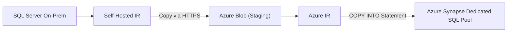
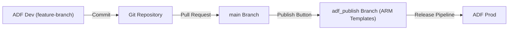
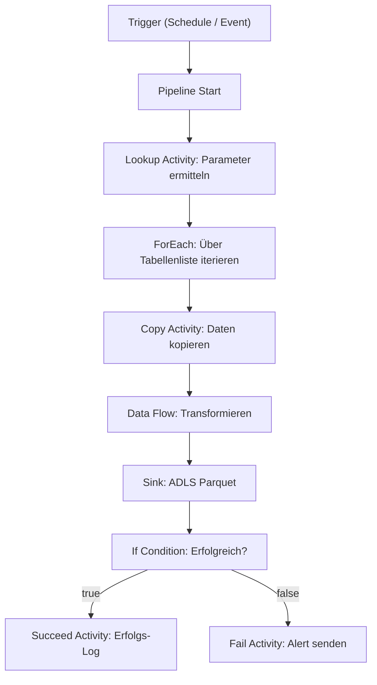

# Azure Data Factory

> [!ABSTRACT]
> Azure Data Factory (ADF) ist Microsofts cloud-nativer ETL/ELT-Dienst für Datenintegration und -transformation. Er ermöglicht das Erstellen, Planen und Überwachen von Datenpipelines über 90+ Datenquellen — von On-Premises bis Cloud, ohne Infrastruktur verwalten zu müssen.

---

## Was ist Azure Data Factory?

Azure Data Factory ist ein **serverloser, cloud-nativer Datenintegrationsdienst**. Er ermöglicht:

- **Datenbewegung** aus 90+ Quellen (SQL Server, Blob, SAP, Salesforce, REST APIs, etc.)
- **Datentransformation** via Mapping Data Flows (Spark-basiert, kein Code)
- **Orchestrierung** komplexer Workflows mit Control Flow
- **SSIS-Pakete** in der Cloud ausführen (Azure-SSIS IR)
- **Monitoring** und Re-Run-Funktionalität für alle Pipeline-Läufe
- **CI/CD** via Git-Integration

---

## Kernkomponenten

| Komponente | Beschreibung | Beispiel |
|---|---|---|
| **Pipeline** | Container für logisch zusammengehörige Activities | "ETL_Sales_Daily" |
| **Activity** | Ausführbare Einheit innerhalb einer Pipeline | Copy Activity, Data Flow |
| **Dataset** | Verweis auf Datenstruktur in einer Datenquelle | "SQL Table Orders", "CSV in Blob" |
| **Linked Service** | Verbindungsinformationen zu einer Datenquelle | SQL Server Connection, Storage Account |
| **Integration Runtime (IR)** | Compute-Infrastruktur für Activity-Ausführung | Azure IR, Self-Hosted IR |
| **Trigger** | Auslöser für Pipeline-Ausführung | Schedule, Event |
| **Parameter** | Dynamische Werte zur Laufzeit | Pipeline-Parameter, Dataset-Parameter |

---

## Activity-Typen

| Kategorie | Activity | Beschreibung |
|---|---|---|
| **Datenbewegung** | Copy Activity | Daten von Quelle zu Ziel kopieren (90+ Konnektoren) |
| **Transformation** | Mapping Data Flow | Visuelles ETL ohne Code (Spark-basiert) |
| **Transformation** | HDInsight Hive/Pig | Legacy Big Data Transformationen |
| **Transformation** | Azure Databricks Notebook | Databricks Notebooks ausführen |
| **Control Flow** | If Condition | Bedingte Ausführung |
| **Control Flow** | ForEach | Iteration über Liste |
| **Control Flow** | Until | Ausführung bis Bedingung erfüllt |
| **Control Flow** | Switch | Multi-Branch basierend auf Wert |
| **Control Flow** | Wait | Pause für X Sekunden |
| **Control Flow** | Set Variable | Variable setzen |
| **Control Flow** | Execute Pipeline | Andere Pipeline aufrufen |
| **Extern** | Azure Function | Azure Function aufrufen |
| **Extern** | Web Activity | HTTP-Anfrage an beliebige URL |
| **Extern** | SSIS Package | SSIS-Paket via Azure-SSIS IR ausführen |
| **Extern** | Stored Procedure | Gespeicherte Prozedur ausführen |

---

## Integration Runtimes

| IR-Typ | Ausführungsort | Anwendungsfall | Kosten |
|---|---|---|---|
| **Azure IR** | Azure-Region (verwaltete Cloud-VMs) | Cloud-zu-Cloud Datenbewegung und -transformation | Pay-per-Use (DIU) |
| **Self-Hosted IR** | On-Prem oder Azure VM | Verbindung zu On-Prem-Quellen, privaten Netzwerken | Feste VM-Kosten |
| **Azure-SSIS IR** | Azure-Managed SSIS Runtime | Bestehende SSIS-Pakete (.dtsx) in Azure ausführen | vCore/Stunde |

```powershell
# Self-Hosted IR erstellen
$ir = Set-AzDataFactoryV2IntegrationRuntime `
    -ResourceGroupName "rg-adf" `
    -DataFactoryName "adf-prod" `
    -Name "SelfHostedIR" `
    -Type SelfHosted `
    -Description "On-Prem SQL Server Connectivity"

# Auth-Key für IR-Installation anzeigen
Get-AzDataFactoryV2IntegrationRuntimeKey `
    -ResourceGroupName "rg-adf" `
    -DataFactoryName "adf-prod" `
    -Name "SelfHostedIR"
```

```powershell
# Azure-SSIS IR erstellen und starten
Set-AzDataFactoryV2IntegrationRuntime `
    -ResourceGroupName "rg-adf" `
    -DataFactoryName "adf-prod" `
    -Name "AzureSSISIR" `
    -Type Managed `
    -Location "westeurope" `
    -NodeSize "Standard_D4_v3" `
    -NodeCount 2 `
    -CatalogServerEndpoint "sqlserver.database.windows.net" `
    -CatalogAdminCredential $cred

Start-AzDataFactoryV2IntegrationRuntime `
    -ResourceGroupName "rg-adf" `
    -DataFactoryName "adf-prod" `
    -Name "AzureSSISIR"
```

---

## Mapping Data Flows

Mapping Data Flows ermöglichen **visuelles ETL ohne Code** — intern Spark-basiert:

### Verfügbare Transformationen

| Transformation | Beschreibung |
|---|---|
| **Source** | Daten aus Quelle lesen |
| **Sink** | Daten in Ziel schreiben |
| **Select** | Spalten auswählen / umbenennen / entfernen |
| **Filter** | Zeilen nach Bedingung filtern |
| **Derived Column** | Neue Spalten berechnen / bestehende transformieren |
| **Aggregate** | GROUP BY mit Aggregationsfunktionen |
| **Join** | Inner / Left / Right / Full Outer Join |
| **Lookup** | Einzelne Zeile aus anderen Dataset nachschlagen |
| **Conditional Split** | Datenstream basierend auf Bedingung aufteilen |
| **Union** | Mehrere Streams zusammenführen (UNION ALL) |
| **Sort** | Daten sortieren |
| **Flatten** | Verschachtelte Arrays aufflachen |
| **Parse** | Strings in strukturierte Typen konvertieren |
| **Assert** | Datenqualitätsprüfungen |

```python
# Mapping Data Flow: Nur über ADF-UI konfigurierbar
# Alternativ: Datenfluss-Code (JSON) direkt bearbeiten
{
    "name": "dataflow_transform_sales",
    "type": "MappingDataFlow",
    "sources": [{"name": "SourceSQLSales", "dataset": "ds_sql_sales"}],
    "sinks": [{"name": "SinkADLSSales", "dataset": "ds_adls_silver_sales"}],
    "transformations": [
        {"name": "FilterCompleted"},
        {"name": "DeriveFullName"},
        {"name": "AggregateByRegion"}
    ]
}
```

> [!TIP]
> Mapping Data Flows starten einen **Spark Cluster** beim ersten Ausführen — das Aufwärmen dauert 1–3 Minuten. Für sehr kurze Transformationen kann Copy Activity mit Inline-Transformation schneller sein.

---

## Copy Activity Performance

### DIU — Data Integration Units

DIUs sind die Leistungseinheit für Copy Activity in der Azure IR:

| DIU | vCores | Memory | Max Throughput |
|---|---|---|---|
| 2 (Standard) | 2 | 4 GB | ~50 MB/s |
| 4 | 4 | 8 GB | ~100 MB/s |
| 8 | 8 | 16 GB | ~200 MB/s |
| 128 | 128 | 256 GB | ~1.600 MB/s |

```json
{
    "name": "CopyLargeSalesData",
    "type": "Copy",
    "typeProperties": {
        "source": {"type": "AzureSqlSource"},
        "sink": {"type": "ParquetSink"},
        "parallelCopies": 8,
        "dataIntegrationUnits": 32
    }
}
```

### Staging (PolyBase/COPY für Synapse)

Für große Datenmengen nach Azure Synapse Analytics empfiehlt sich **Staged Copy** via Azure Blob:



---

## Trigger-Typen

| Trigger | Beschreibung | Besonderheit |
|---|---|---|
| **Schedule Trigger** | Cron-ähnliche Zeitplanung | Mehrere Pipelines pro Trigger |
| **Tumbling Window** | Feste Zeitfenster mit Backfill | Abhängigkeiten zwischen Windows möglich |
| **Storage Event** | Reagiert auf Blob-Erstellung/-Löschung | Near Real-Time Ingestion |
| **Custom Event** | Azure Event Grid-Ereignisse | Flexible Event-basierte Trigger |

```powershell
# Schedule Trigger erstellen (täglich 02:00 Uhr)
$trigger = Set-AzDataFactoryV2Trigger `
    -ResourceGroupName "rg-adf" `
    -DataFactoryName "adf-prod" `
    -Name "trg_daily_02_00" `
    -DefinitionFile "trigger.json"

# Trigger aktivieren
Start-AzDataFactoryV2Trigger `
    -ResourceGroupName "rg-adf" `
    -DataFactoryName "adf-prod" `
    -TriggerName "trg_daily_02_00"
```

```json
{
    "name": "trg_daily_02_00",
    "type": "ScheduleTrigger",
    "typeProperties": {
        "recurrence": {
            "frequency": "Day",
            "interval": 1,
            "startTime": "2024-01-01T02:00:00Z",
            "timeZone": "W. Europe Standard Time"
        }
    },
    "pipelines": [{"pipelineReference": {"name": "pl_etl_sales_daily"}}]
}
```

---

## Parametrisierung

Parametrisierung macht Pipelines **wiederverwendbar** für verschiedene Datenquellen, Umgebungen oder Zeiträume:

```json
{
    "name": "pl_ingest_table_generic",
    "parameters": {
        "SourceTable": {"type": "string"},
        "TargetFolder": {"type": "string"},
        "LoadDate": {"type": "string", "defaultValue": "@utcNow('yyyy-MM-dd')"}
    },
    "activities": [
        {
            "name": "CopyTable",
            "type": "Copy",
            "typeProperties": {
                "source": {
                    "type": "AzureSqlSource",
                    "sqlReaderQuery": {"value": "@concat('SELECT * FROM ', pipeline().parameters.SourceTable, ' WHERE LoadDate = ''', pipeline().parameters.LoadDate, '''')", "type": "Expression"}
                },
                "sink": {
                    "type": "ParquetSink",
                    "storeSettings": {
                        "fileName": {"value": "@concat(pipeline().parameters.SourceTable, '_', pipeline().parameters.LoadDate, '.parquet')", "type": "Expression"}
                    }
                }
            }
        }
    ]
}
```

**Globale Parameter** gelten für die gesamte ADF-Instanz (z.B. Umgebungsname, Storage-Account-Name).

---

## ADF Monitoring

```powershell
# Pipeline Run Status prüfen
Get-AzDataFactoryV2PipelineRun `
    -ResourceGroupName "rg-adf" `
    -DataFactoryName "adf-prod" `
    -LastUpdatedAfter (Get-Date).AddHours(-24) `
    -LastUpdatedBefore (Get-Date) | Where-Object {$_.Status -eq "Failed"}

# Activity Runs für einen Pipeline Run
Get-AzDataFactoryV2ActivityRun `
    -ResourceGroupName "rg-adf" `
    -DataFactoryName "adf-prod" `
    -PipelineRunId "xxxxxxxx-xxxx-xxxx-xxxx-xxxxxxxxxxxx" `
    -RunStartedAfter (Get-Date).AddHours(-24) `
    -RunStartedBefore (Get-Date)
```

**Monitoring im Azure Portal:**
- **Pipeline Runs:** Alle gestarteten Pipelines mit Status, Dauer, Fehler
- **Activity Runs:** Einzelne Activity-Details innerhalb einer Pipeline
- **Gantt-Diagramm:** Zeitliche Visualisierung aller Activities
- **Re-Run:** Fehlgeschlagene Pipelines ab dem Fehler neu starten
- **Azure Monitor Alerts:** E-Mail/SMS bei Pipeline-Fehlern

---

## CI/CD für ADF

### Git-Integration

ADF unterstützt native Git-Integration mit GitHub oder Azure DevOps:



**Workflow:**
1. Entwickler arbeiten in Feature-Branches
2. Pull Request → Review → Merge in `main`
3. **Publish** in ADF-UI generiert ARM-Templates im `adf_publish`-Branch
4. Azure DevOps Release Pipeline deployt ARM-Templates nach UAT/PROD

```powershell
# ADF ARM Template deployen (Release Pipeline)
New-AzResourceGroupDeployment `
    -ResourceGroupName "rg-adf-prod" `
    -TemplateFile "ARMTemplateForFactory.json" `
    -TemplateParameterFile "ARMTemplateParametersForFactory.json" `
    -factoryName "adf-prod" `
    -Mode Incremental
```

> [!IMPORTANT]
> Der `adf_publish`-Branch enthält die **ARM-Templates** aus der Collaboration Branch (`main`). Dieser Branch sollte **nie manuell bearbeitet** werden.

---

## ADF vs. Synapse Pipelines vs. Fabric Data Factory

| Merkmal | Azure Data Factory | Synapse Pipelines | Fabric Data Factory |
|---|---|---|---|
| **Standalone Service** | Ja | Teil von Synapse Workspace | Teil von Microsoft Fabric |
| **Konnektoren** | 90+ | 90+ (gleich wie ADF) | 90+ |
| **SSIS-Support** | Ja (Azure-SSIS IR) | Ja | Nein |
| **Git-Integration** | Ja | Ja | Ja |
| **Preismodell** | Pay-per-use | Pay-per-use | Fabric Capacity |
| **Empfehlung** | Standalone ETL | Teil eines Synapse-Projekts | Neue Fabric-Projekte |

---

## Private Endpoints — Managed VNet

```powershell
# ADF Managed VNet erstellen (in ARM Template)
# ADF mit Managed VNet:
{
    "type": "Microsoft.DataFactory/factories",
    "properties": {
        "managedVirtualNetwork": {
            "type": "ManagedVirtualNetworkReference",
            "referenceName": "default"
        }
    }
}

# Managed Private Endpoint für SQL erstellen
New-AzDataFactoryV2ManagedPrivateEndpoint `
    -ResourceGroupName "rg-adf" `
    -DataFactoryName "adf-prod" `
    -ManagedVirtualNetworkName "default" `
    -Name "pe-sql-prod" `
    -PrivateLinkResourceId $sqlServerId `
    -GroupId "sqlServer"
```

> [!NOTE]
> Managed Private Endpoints erfordern **Managed VNet** in ADF. Die privaten Endpunkte müssen nach der Erstellung vom Ressourcen-Besitzer **genehmigt** werden.

---

## Kosten

| Komponente | Abrechnungseinheit | Preis (ca.) |
|---|---|---|
| **Orchestration** | Activity Run | 0,001 USD/Activity Run |
| **Copy Activity (Azure IR)** | DIU-Stunden | 0,25 USD/DIU-h |
| **Mapping Data Flow** | vCore-Stunden | 0,274 USD/vCore-h |
| **Self-Hosted IR** | Stunden aktiv | ~VM-Kosten |
| **Azure-SSIS IR** | vCore-Stunden | 0,84 USD/vCore-h (D4_v3) |
| **Pipeline Runs** | Ausführungen | Erste 1000/Monat kostenlos |

> [!TIP]
> Für **viele kleine Copy-Aktivitäten** (z.B. 1000 kleine Files täglich) summieren sich Activity-Run-Kosten schnell. Bessere Alternative: Eine Copy Activity mit **Wildcard-Pfad** oder ForEach mit parallelen Sub-Runs.

---

## Pipeline-Ausführungsfluss



---

## PowerShell/CLI Beispiele

```powershell
# Pipeline manuell auslösen
$runId = Invoke-AzDataFactoryV2Pipeline `
    -ResourceGroupName "rg-adf" `
    -DataFactoryName "adf-prod" `
    -PipelineName "pl_etl_sales_daily" `
    -Parameter @{LoadDate="2024-11-01"}

Write-Host "Pipeline Run ID: $runId"

# Status prüfen (Polling)
do {
    $run = Get-AzDataFactoryV2PipelineRun `
        -ResourceGroupName "rg-adf" `
        -DataFactoryName "adf-prod" `
        -PipelineRunId $runId
    Write-Host "Status: $($run.Status)"
    Start-Sleep -Seconds 30
} while ($run.Status -in @("InProgress", "Queued"))

Write-Host "Finaler Status: $($run.Status)"
```

```bash
# Azure CLI: Pipeline triggern
az datafactory pipeline create-run \
    --resource-group rg-adf \
    --factory-name adf-prod \
    --name pl_etl_sales_daily \
    --parameters "{\"LoadDate\": \"2024-11-01\"}"

# Laufende Pipelines anzeigen
az datafactory pipeline-run query-by-factory \
    --resource-group rg-adf \
    --factory-name adf-prod \
    --last-updated-after "2024-11-01T00:00:00Z" \
    --last-updated-before "2024-11-02T00:00:00Z" \
    --filters operand=Status operator=Equals values=InProgress
```

---

## Verwandte Notizen

- [[Azure Synapse Analytics]] — Synapse Pipelines basieren auf ADF-Technologie
- [[Azure Data Lake Storage Gen2]] — Primäres Staging und Storage für ADF
- [[Azure SQL Database]] — Häufige Datenquelle/-ziel für ADF
- [[Azure SQL Managed Instance]] — On-Prem-nahe SQL-Quelle via Self-Hosted IR
- [[Azure Cosmos DB]] — NoSQL-Quelle/-Ziel für ADF-Pipelines
- [[Azure Storage Grundlagen]] — Blob Storage für Staging und Landing Zone
