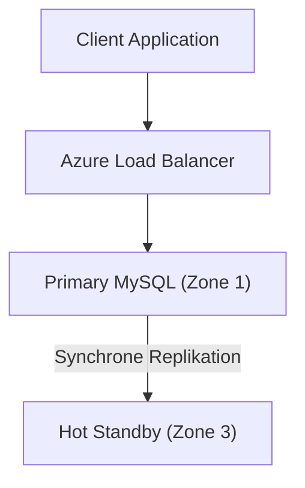
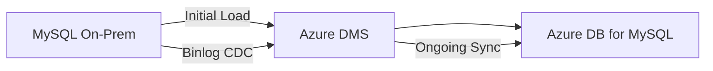

# Azure Database for MySQL

> [!ABSTRACT]
> Azure Database for MySQL ist ein vollständig verwalteter MySQL-PaaS-Dienst auf Basis von MySQL Community Edition. Mit dem Flexible Server-Modell bietet er Zone-Redundante HA, Read Replicas, Stop/Start-Funktion und Integration in das Azure-Ökosystem.

---

## Was ist Azure Database for MySQL?

Azure Database for MySQL ist Microsofts verwalteter MySQL-Dienst. Er basiert auf der **MySQL Community Edition** und bietet:

- Automatische Patches (MySQL und OS)
- Eingebaute Hochverfügbarkeit (Zone-Redundant oder Same-Zone)
- Automatische Backups mit Point-in-Time Restore
- Flexible Skalierung (vCores, Storage)
- Stop/Start-Funktion für Dev/Test-Kostenersparnis
- Integration mit Azure Monitor, Entra ID, Key Vault

> [!DANGER]
> **Single Server ist End-of-Life seit 16. September 2024!** Alle bestehenden Single-Server-Deployments müssen zu Flexible Server migriert werden. Neue Deployments sind nur mit Flexible Server möglich.

---

## Flexible Server

Flexible Server ist das **einzige Deployment-Modell** für neue Azure MySQL-Instanzen:

- Deployment im VNet oder mit Public Access + Firewall
- Volle Kontrolle über Maintenance Windows
- Stop/Start-Funktion (Dev/Test-Kosteneinsparung)
- Zone-Redundante und Same-Zone HA
- Granulare Server-Parameter konfigurierbar

```powershell
# Flexible Server erstellen
az mysql flexible-server create `
    --resource-group rg-prod `
    --name mysql-prod `
    --location westeurope `
    --admin-user mysqladmin `
    --admin-password "P@ssw0rd123!" `
    --sku-name Standard_D4ds_v5 `
    --tier GeneralPurpose `
    --storage-size 128 `
    --version 8.0 `
    --high-availability ZoneRedundant `
    --zone 1 `
    --standby-zone 3
```

---

## Compute Tiers

| Tier | vCores | RAM | Anwendungsfall |
|---|---|---|---|
| **Burstable (B-Serie)** | 1–8 | 1–32 GB | Dev/Test, kleine Web-Apps |
| **General Purpose (D-Serie)** | 2–64 | 8–256 GB | Standard-Produktions-Workloads |
| **Business Critical (E-Serie)** | 2–96 | 16–672 GB | High-Performance OLTP |

> [!NOTE]
> **Burstable** verwendet CPU Credits (ähnlich AWS T-Instanzen). Geeignet für sporadische Last, nicht für konstant hohe CPU-Workloads.

---

## Hochverfügbarkeit

### Zone-Redundant HA

- Hot Standby in anderer Availability Zone
- Automatischer Failover in < 120 Sekunden
- **SLA: 99,99 %**
- Synchrone Replikation (kein Datenverlust)
- Doppelte Compute-Kosten (Primary + Standby)

### Same-Zone HA

- Standby im gleichen Availability Zone
- Schnellerer Failover (< 60 Sekunden)
- Niedrigere Kosten als Zone-Redundant
- **SLA: 99,95 %**



---

## Read Replicas

| Merkmal | Details |
|---|---|
| **Maximale Anzahl** | 5 Read Replicas |
| **Regionen** | Gleiche Region oder andere Region (Cross-Region Replica) |
| **Replikation** | Asynchron via MySQL Binlog |
| **Failover** | Kein automatischer Failover (kein HA-Ersatz) |
| **Anwendungsfall** | Reporting, Analytics, Read-Offloading, geo-nahe Reads |
| **Promotion** | Replica kann zu eigenständigem Server promoted werden |

```powershell
# Read Replica erstellen
az mysql flexible-server replica create `
    --resource-group rg-prod `
    --source-server mysql-prod `
    --name mysql-prod-replica `
    --location northeurope
```

---

## MySQL-Versionen

| Version | Status | Support Ende | Empfehlung |
|---|---|---|---|
| **MySQL 5.7** | Extended Support | Oktober 2025 | Migration zu 8.0 empfohlen |
| **MySQL 8.0** | Allgemein verfügbar | April 2026 | Produktionseinsatz OK |
| **MySQL 8.4 LTS** | Long-Term Support (seit 2024) | April 2032 | Neue Projekte empfohlen |

```powershell
# MySQL-Version prüfen und upgraden
az mysql flexible-server upgrade `
    --resource-group rg-prod `
    --name mysql-prod `
    --version 8.0
```

> [!IMPORTANT]
> In-Place Major Version Upgrades (5.7 → 8.0) werden unterstützt, aber es empfiehlt sich ein **Test-Upgrade** in Dev/Test-Umgebung vor der Produktion.

---

## Backups

| Backup-Typ | Details |
|---|---|
| **Automatisches Backup** | Täglich, binlog-basierte kontinuierliche Sicherung |
| **PITR-Fenster** | 1–35 Tage konfigurierbar |
| **Backup-Redundanz** | Locally Redundant (LRS) oder Geo-Redundant (GRS) |
| **Geo-Redundante Backups** | Restore in Paired-Region möglich |
| **Manuelle Snapshots** | Manuell ausführbar, bis 50 gespeichert |

```powershell
# Backup-Aufbewahrung konfigurieren
az mysql flexible-server update `
    --resource-group rg-prod `
    --name mysql-prod `
    --backup-retention 28

# Point-in-Time Restore
az mysql flexible-server restore `
    --resource-group rg-prod `
    --name mysql-prod-restored `
    --source-server mysql-prod `
    --restore-time "2024-11-01T12:00:00Z"
```

---

## Netzwerk

### Firewall-Regeln

```powershell
# Firewall-Regel hinzufügen
az mysql flexible-server firewall-rule create `
    --resource-group rg-prod `
    --name mysql-prod `
    --rule-name AllowOffice `
    --start-ip-address 203.0.113.10 `
    --end-ip-address 203.0.113.10
```

### Private Endpoint

```powershell
# Private Endpoint erstellen
az network private-endpoint create `
    --resource-group rg-prod `
    --name pe-mysql `
    --vnet-name vnet-prod `
    --subnet snet-data `
    --private-connection-resource-id $mysqlId `
    --group-id mysqlServer `
    --connection-name mysql-connection
```

### VNet-Integration

Deployment des MySQL Flexible Servers direkt im VNet (keine public IP). Empfohlen für alle Produktionsinstanzen.

---

## Microsoft Entra ID Authentifizierung

```powershell
# Entra ID Admin konfigurieren
az mysql flexible-server ad-admin create `
    --resource-group rg-prod `
    --server-name mysql-prod `
    --display-name "MySQL-DBA-Group" `
    --object-id "xxxxxxxx-xxxx-xxxx-xxxx-xxxxxxxxxxxx" `
    --identity "mi-mysql-prod"
```

```sql
-- Benutzer mit Entra ID authentifizieren
-- Verbindung erfolgt via Managed Identity Token statt Passwort
```

---

## Connection Pooling

Im Gegensatz zu PostgreSQL (eingebaurter pgBouncer) hat Azure Database for MySQL **keinen eingebauten Connection Pooler**.

### ProxySQL (Empfohlen)

ProxySQL ist die empfohlene Lösung für Connection Pooling mit MySQL:

- Deployment als VM oder Container in Azure
- Multiplexing von Client-Verbindungen
- Read/Write-Splitting (Reads zu Replicas routen)
- Query-Caching, Query-Routing

```bash
# ProxySQL Docker-Deployment (vereinfacht)
docker run -d -p 6033:6033 -p 6032:6032 \
    -v /etc/proxysql.cnf:/etc/proxysql.cnf \
    proxysql/proxysql
```

### MySQL Router

MySQL Router (offizielle MySQL-Lösung) ermöglicht transparentes Connection Routing und Failover.

---

## Performance

### Query Store

Query Store ist in Flexible Server aktivierbar und speichert Query-Statistiken:

```sql
-- Slow Queries analysieren
SELECT digest_text, count_star, avg_timer_wait/1000000000 AS avg_ms
FROM performance_schema.events_statements_summary_by_digest
ORDER BY avg_timer_wait DESC
LIMIT 10;
```

### Slow Query Logs

```powershell
# Slow Query Log aktivieren (Queries > 1 Sekunde)
az mysql flexible-server parameter set `
    --resource-group rg-prod `
    --server-name mysql-prod `
    --name slow_query_log `
    --value ON

az mysql flexible-server parameter set `
    --resource-group rg-prod `
    --server-name mysql-prod `
    --name long_query_time `
    --value 1
```

---

## Via Azure Portal (UI)

> [!TIP] Schnelleinstieg
> Azure Database for MySQL – Flexible Server lässt sich vollständig über das Portal erstellen und konfigurieren.

### Flexible Server erstellen

1. **portal.azure.com** → **Azure Database for MySQL Flexible Servers** → **+ Erstellen**
2. **Grundlagen**-Tab:
   - Abonnement & Ressourcengruppe
   - **Servername**: global eindeutig (z. B. `mysql-server-prod`)
   - **Region**: z. B. `West Europe`
   - **MySQL-Version**: 8.0 oder 5.7
   - **Workloadtyp**: Entwicklung/Test, Produktion (bestimmt Standardkonfiguration)
   - **Compute + Speicher**: SKU auswählen (Burstable B1ms, General Purpose D4s_v3, Business Critical E4s_v3)
   - **Administratorkonto**: Benutzername & Passwort
3. **Verfügbarkeit**-Tab:
   - **Hochverfügbarkeit**: Deaktiviert, Zonenredundant oder Gleiche Zone
   - **Standby-Verfügbarkeitszone** wählen (bei zonenredundant)
4. **Netzwerk**-Tab:
   - **Konnektivitätsmethode**: Öffentlicher Zugriff oder privater Zugriff (VNet-Integration)
   - Firewall-Regeln hinzufügen (bei öffentlichem Zugriff)
5. **Sicherheit**-Tab: Microsoft Defender für MySQL aktivieren (optional)
6. **Überprüfen + erstellen** → **Erstellen**

### Datenbank erstellen

1. MySQL Flexible Server → **Datenbanken** → **+ Hinzufügen**
2. **Datenbankname**, Zeichensatz und Sortierung wählen → **Erstellen**

### Serverparameter konfigurieren

1. MySQL Flexible Server → **Serverparameter**
2. Parameter suchen (z. B. `max_connections`, `innodb_buffer_pool_size`)
3. Wert anpassen → **Speichern**

### Skalierung

1. MySQL Flexible Server → **Compute + Speicher**
2. Compute-Tier oder Speichergröße anpassen → **Speichern** (Neustart erforderlich)

---

## Import und Export

### mysqldump (Klassisch)

```bash
# Dump exportieren
mysqldump -h sourcehost -u root -p \
    --single-transaction --routines --triggers \
    --databases mydb > mydb.sql

# Import auf Azure MySQL
mysql -h mysql-prod.mysql.database.azure.com \
    -u mysqladmin -p mydb < mydb.sql
```

### mydumper / myloader (Schneller für große DBs)

```bash
# Paralleler Dump (4 Threads)
mydumper -h sourcehost -u root -p password \
    -B mydb -t 4 -o ./dump_dir

# Paralleles Restore
myloader -h mysql-prod.mysql.database.azure.com \
    -u mysqladmin -p password -d ./dump_dir -t 4
```

### Azure Database Migration Service (DMS)

Für Online-Migration mit minimaler Downtime:



---

## Stop/Start-Funktion

Die **Stop/Start-Funktion** ist ein wichtiges Kostensparfeature für Dev/Test-Umgebungen:

```powershell
# Server stoppen (nur Compute-Kosten entfallen, Storage weiterhin berechnet)
az mysql flexible-server stop `
    --resource-group rg-dev `
    --name mysql-dev

# Server starten
az mysql flexible-server start `
    --resource-group rg-dev `
    --name mysql-dev
```

> [!WARNING]
> Der Server **startet automatisch nach 7 Tagen** wieder, auch wenn er manuell gestoppt wurde. Dies ist ein Azure-Sicherheitsmechanismus. Für langfristige Einsparungen den Server **löschen** und bei Bedarf neu erstellen (mit ARM-Template oder Bicep).

---

## Maintenance Windows

```powershell
# Benutzerdefiniertes Wartungsfenster (Sonntag 02:00 Uhr)
az mysql flexible-server update `
    --resource-group rg-prod `
    --name mysql-prod `
    --maintenance-window day-of-week=0,start-hour=2,start-minute=0
    # 0=Sonntag
```

**Systemverwaltetes Wartungsfenster:** Azure wählt automatisch einen Zeitraum mit niedrigem Traffic (meist Mitte der Woche, nachts). Für Produktionssysteme wird ein **benutzerdefiniertes Fenster** empfohlen.

---

## Integration mit Azure App Service

```json
{
    "connectionStrings": {
        "DefaultConnection": {
            "value": "Server=mysql-prod.mysql.database.azure.com;Port=3306;Database=mydb;Uid=mysqladmin;Pwd=@Microsoft.KeyVault(SecretUri=https://kv-prod.vault.azure.net/secrets/mysql-password);SslMode=Required;",
            "type": "MySQL"
        }
    }
}
```

> [!TIP]
> Mit **Managed Identity** und **Azure Key Vault References** in App Service können Datenbankpasswörter vollständig aus der Konfiguration entfernt werden.

---

## Verwandte Notizen

- [[Azure Database for PostgreSQL]] — Managed PostgreSQL auf Azure
- [[Azure SQL Database]] — Microsoft SQL Server als PaaS
- [[Azure Data Factory]] — ETL und Daten-Integration
- [[Azure RBAC]] — Zugriffskontrolle und IAM
