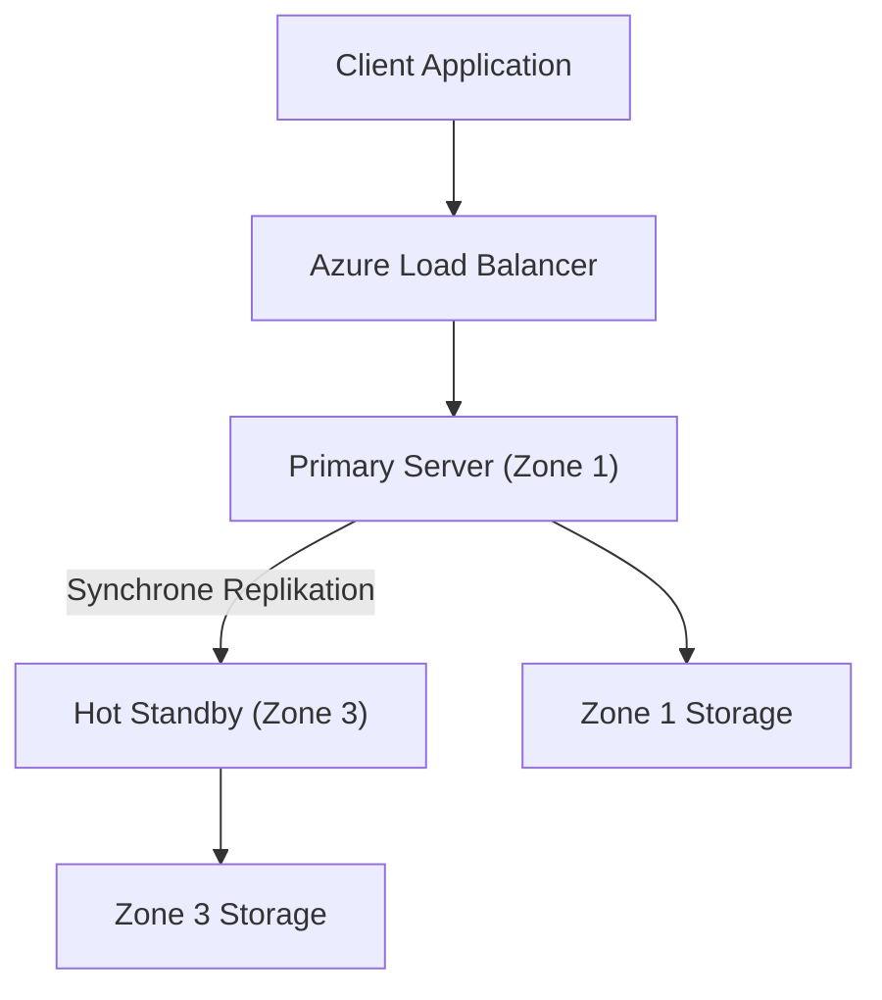
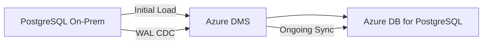

# Azure Database for PostgreSQL

> [!ABSTRACT]
> Azure Database for PostgreSQL ist ein vollständig verwalteter PostgreSQL-PaaS-Dienst. Mit dem Flexible Server-Deployment-Modell bietet er hohe Flexibilität, Zone-Redundante HA, Read Replicas und eingebaute Features wie pgBouncer und pgvector für KI/ML-Anwendungen.

---

## Was ist Azure Database for PostgreSQL?

Azure Database for PostgreSQL ist der verwaltete PostgreSQL-Dienst von Microsoft Azure. Microsoft übernimmt:

- Automatische Patches für PostgreSQL und Betriebssystem
- Eingebaute Hochverfügbarkeit (Zone-Redundant oder Same-Zone)
- Automatische Backups mit PITR
- Monitoring, Alerting und Performance Insights
- Eingebauter Verbindungs-Pooler (pgBouncer)
- Unterstützung für viele PostgreSQL-Extensions

> [!IMPORTANT]
> **Single Server ist End-of-Life (EOL) am 28. September 2025!** Alle Single-Server-Deployments müssen zu Flexible Server migriert werden. Neue Deployments sollten ausschließlich Flexible Server verwenden.

---

## Flexible Server

Flexible Server ist das **einzige aktive Deployment-Modell** für Azure Database for PostgreSQL. Es bietet:

- Volle Kontrolle über Maintenance Windows
- Stop/Start-Funktion (bis zu 7 Tage, dann automatischer Start)
- Zone-Redundante HA mit Hot Standby
- Eingebauter pgBouncer Connection Pooler
- Benutzerdefinierte Parameter über Server-Parameter
- Deployment im VNet oder mit Public Access + Firewall

```powershell
# Flexible Server erstellen
az postgres flexible-server create `
    --resource-group rg-prod `
    --name psql-prod `
    --location westeurope `
    --admin-user pgadmin `
    --admin-password "P@ssw0rd123!" `
    --sku-name Standard_D4ds_v5 `
    --tier GeneralPurpose `
    --storage-size 128 `
    --version 16 `
    --high-availability ZoneRedundant `
    --zone 1 `
    --standby-zone 3
```

---

## Compute Tiers

| Tier | vCores | RAM | Anwendungsfall | Burstable? |
|---|---|---|---|---|
| **Burstable (B-Serie)** | 1–2 | 2–8 GB | Dev/Test, kleine Apps | Ja (CPU burst bis 100 %) |
| **General Purpose (D-Serie)** | 2–96 | 8–384 GB | Produktions-Workloads | Nein |
| **Memory Optimized (E-Serie)** | 2–96 | 16–672 GB | In-Memory-intensive Workloads | Nein |

```powershell
# Server-Tier ändern (General Purpose 8 vCores)
az postgres flexible-server update `
    --resource-group rg-prod `
    --name psql-prod `
    --sku-name Standard_D8ds_v5 `
    --tier GeneralPurpose
```

> [!TIP]
> **Burstable** eignet sich für Entwicklungsumgebungen mit niedriger durchschnittlicher CPU-Last. Für produktive OLTP-Anwendungen sollte **General Purpose** oder **Memory Optimized** gewählt werden.

---

## Hochverfügbarkeit

### Zone-Redundant HA (Empfohlen für Produktion)

- **Hot Standby** in einer anderen Availability Zone
- Automatischer Failover bei Ausfall in < 120 Sekunden
- **SLA: 99,99 %**
- Synchrone Replikation via PostgreSQL Streaming Replication
- Kein Datenverlust bei Failover (RPO = 0)



### Same-Zone HA

- Standby im gleichen Availability Zone
- Niedrigere Kosten als Zone-Redundant
- Schützt gegen Node-Ausfall, nicht gegen Zone-Ausfall
- **SLA: 99,95 %**

| Merkmal | Zone-Redundant HA | Same-Zone HA | Kein HA |
|---|---|---|---|
| **SLA** | 99,99 % | 99,95 % | 99,9 % |
| **Failover-Zeit** | < 120s | < 60s | N/A |
| **Kosten** | 2x Compute | 2x Compute | 1x Compute |
| **Zone-Ausfall** | ✅ Geschützt | ❌ | ❌ |
| **Node-Ausfall** | ✅ | ✅ | ❌ |

---

## Read Replicas

| Merkmal | Details |
|---|---|
| **Maximale Anzahl** | 5 Read Replicas |
| **Deployment** | Gleiche Region oder andere Region (Cross-Region) |
| **Replikation** | Asynchron (minimale Latenz, aber kein RPO=0) |
| **Anwendungsfall** | Reporting, Analytics, Read-Offloading |
| **Promotion** | Replica kann zu eigenständigem Server promoted werden |
| **Kosten** | Wie Primary-Server (eigene vCores/Storage) |

```powershell
# Read Replica erstellen
az postgres flexible-server replica create `
    --resource-group rg-prod `
    --name psql-prod `
    --replica-name psql-prod-replica `
    --location northeurope
```

---

## Skalierung

- **vCores skalieren** (hoch/runter): Erfordert kurzen Neustart (~2 Minuten Downtime)
- **Storage Auto-Grow:** Automatische Vergrößerung ohne Downtime (nur Vergrößerung möglich!)
- **IOPS:** Provisioned IOPS getrennt von Storage konfigurierbar
- **High Availability:** Kann nachträglich aktiviert/deaktiviert werden

> [!WARNING]
> **Storage kann nicht verkleinert werden!** Eine einmal gewählte Storage-Größe kann nicht reduziert werden. Daher empfiehlt sich Storage Auto-Grow für den Produktionseinsatz.

---

## PostgreSQL-Extensions

Azure Database for PostgreSQL unterstützt viele beliebte Extensions:

| Extension | Beschreibung | Anwendungsfall |
|---|---|---|
| **pgvector** | Vektor-Suche und -Operationen | KI/ML, RAG, Semantic Search |
| **pg_cron** | Cron-Jobs direkt in PostgreSQL | Scheduled Tasks ohne externen Job-Scheduler |
| **PostGIS** | Geospatiale Daten und Abfragen | GIS, Standortdienste, Karten |
| **pg_stat_statements** | Query-Performance-Tracking | Performance-Optimierung |
| **uuid-ossp** | UUID-Generierung | Eindeutige Schlüssel |
| **citext** | Case-Insensitive Text | E-Mail-Vergleiche |
| **hstore** | Key-Value-Store in PostgreSQL | Flexible Datenstrukturen |
| **pg_partman** | Tabellenpartitionierung verwalten | Große Tabellen, Time-Series |
| **pg_trgm** | Trigram-basierte Textsuche | Ähnlichkeitssuche, LIKE-Optimierung |
| **plpgsql** | PL/pgSQL Prozedurale Sprache | Stored Procedures |

```sql
-- pgvector installieren
CREATE EXTENSION IF NOT EXISTS vector;

-- Tabelle mit Vektor-Spalte erstellen
CREATE TABLE embeddings (
    id SERIAL PRIMARY KEY,
    content TEXT,
    embedding vector(1536)  -- OpenAI text-embedding-ada-002 Dimension
);

-- HNSW-Index für schnelle Vektorsuche
CREATE INDEX ON embeddings USING hnsw (embedding vector_cosine_ops);

-- Ähnlichste Vektoren finden (Semantic Search)
SELECT content, 1 - (embedding <=> '[0.1, 0.2, ...]'::vector) AS similarity
FROM embeddings
ORDER BY embedding <=> '[0.1, 0.2, ...]'::vector
LIMIT 10;
```

> [!TIP]
> **pgvector** macht Azure Database for PostgreSQL zur idealen Wahl für **RAG (Retrieval Augmented Generation)** Anwendungen mit Azure OpenAI. Embeddings direkt in der Datenbank speichern und suchen.

---

## Backups

| Backup-Typ | Details |
|---|---|
| **Automatisches Backup** | Täglich (Full), kontinuierliche WAL-Archivierung |
| **PITR-Fenster** | 7–35 Tage konfigurierbar |
| **Backup-Redundanz** | Locally Redundant (LRS) oder Geo-Redundant (GRS) |
| **Geo-Redundante Backups** | Restore in Paired-Region möglich |
| **Manuelle Backups** | Snapshot-Backups manuell auslösbar (bis 50 gespeichert) |

```powershell
# PITR konfigurieren (28 Tage Aufbewahrung)
az postgres flexible-server update `
    --resource-group rg-prod `
    --name psql-prod `
    --backup-retention 28

# Point-in-Time Restore
az postgres flexible-server restore `
    --resource-group rg-prod `
    --name psql-prod-restored `
    --source-server psql-prod `
    --restore-time "2024-11-01T12:00:00Z"
```

---

## Netzwerk

### Öffentlicher Zugriff + Firewall

```powershell
# Firewall-Regel hinzufügen
az postgres flexible-server firewall-rule create `
    --resource-group rg-prod `
    --name psql-prod `
    --rule-name AllowOffice `
    --start-ip-address 203.0.113.10 `
    --end-ip-address 203.0.113.10
```

### Private Endpoint (Empfohlen)

```powershell
# Private Endpoint für PostgreSQL erstellen
az network private-endpoint create `
    --resource-group rg-prod `
    --name pe-psql `
    --vnet-name vnet-prod `
    --subnet snet-data `
    --private-connection-resource-id $psqlId `
    --group-id postgresqlServer `
    --connection-name psql-connection
```

### VNet-Integration (Flexible Server)

Deployment des Servers direkt im VNet (keine Public IP). Empfohlen für neue Deployments mit Sicherheitsanforderungen.

---

## Microsoft Entra ID Authentifizierung

```powershell
# Entra ID Admin konfigurieren
az postgres flexible-server ad-admin create `
    --resource-group rg-prod `
    --server-name psql-prod `
    --display-name "DBA-Group" `
    --object-id "xxxxxxxx-xxxx-xxxx-xxxx-xxxxxxxxxxxx"
```

```sql
-- Verbindung via Entra ID Token (Python-Beispiel)
-- Token via azure-identity library holen und als Password verwenden
```

---

## pgBouncer — Eingebauter Connection Pooler

pgBouncer ist **direkt in Azure Database for PostgreSQL Flexible Server integriert** und muss nicht separat installiert werden:

| Modus | Beschreibung | Anwendungsfall |
|---|---|---|
| **Transaction Mode** | Eine DB-Verbindung pro Transaktion, dann zurück in Pool | Beste Performance, empfohlen |
| **Session Mode** | Eine DB-Verbindung für gesamte Client-Session | Kompatibel mit Session-Features |

```
# pgBouncer aktivieren und Port konfigurieren
# Standard: Port 5432 = Direct, Port 6432 = pgBouncer

Connection String (pgBouncer):
Host: psql-prod.postgres.database.azure.com
Port: 6432
Database: mydb
User: pgadmin
```

```powershell
# pgBouncer aktivieren
az postgres flexible-server parameter set `
    --resource-group rg-prod `
    --server-name psql-prod `
    --name pgbouncer.enabled `
    --value true
```

> [!NOTE]
> pgBouncer reduziert die Anzahl tatsächlicher Datenbankverbindungen erheblich. Bei Anwendungen mit vielen kurzlebigen Verbindungen (Node.js, Serverless Functions) kann pgBouncer die Performance um **Faktor 10+** verbessern.

---

## Azure Cosmos DB for PostgreSQL

Für Workloads, die horizontale Skalierung über eine einzelne Instanz hinaus benötigen, bietet **Azure Cosmos DB for PostgreSQL** (ehemals Hyperscale/Citus) horizontales Sharding:

- Basiert auf **Citus-Extension** für PostgreSQL
- Automatische Verteilung von Tabellen über Shards
- Skalierung auf Hunderte von GB bis TB
- SQL-kompatibel, kein Anwendungs-Rewrite nötig
- Anwendungsfall: SaaS-Anwendungen, Zeit-Reihen-Daten, Analytik

---

## Monitoring und Performance

### Query Store

Query Store ist in Flexible Server integriert und speichert Query-Performance-Statistiken:

```sql
-- Top 10 langsamste Queries
SELECT query, calls, total_exec_time, mean_exec_time
FROM pg_stat_statements
ORDER BY mean_exec_time DESC
LIMIT 10;
```

### Intelligent Performance

- **Performance Recommendations:** Automatische Index-Empfehlungen
- **Query Performance Insight:** Visualisierung im Azure Portal
- **Wait Statistics:** I/O, CPU, Lock-Wait-Analyse

---

## Maintenance Windows

```powershell
# Benutzerdefiniertes Wartungsfenster (Sonntag 03:00 Uhr)
az postgres flexible-server update `
    --resource-group rg-prod `
    --name psql-prod `
    --maintenance-window day-of-week=0,start-hour=3,start-minute=0
    # 0=Sonntag, 1=Montag, ..., 6=Samstag
```

---

## Via Azure Portal (UI)

> [!TIP] Schnelleinstieg
> Azure Database for PostgreSQL – Flexible Server lässt sich vollständig über das Portal konfigurieren.

### Flexible Server erstellen

1. **portal.azure.com** → **Azure Database for PostgreSQL Flexible Servers** → **+ Erstellen**
2. **Grundlagen**-Tab:
   - Abonnement & Ressourcengruppe
   - **Servername**: global eindeutig (z. B. `pgserver-prod`)
   - **Region**: z. B. `West Europe`
   - **PostgreSQL-Version**: 16, 15, 14 oder 13
   - **Workloadtyp**: Entwicklung, Produktion
   - **Compute + Speicher**: SKU wählen (Burstable B1ms, General Purpose D4s_v3, Memory Optimized E4s_v3)
   - **Administratorkonto**: Benutzername & Passwort
3. **Verfügbarkeit**-Tab:
   - **Hochverfügbarkeit**: Deaktiviert, Zonenredundant oder Gleiche Zone
4. **Netzwerk**-Tab:
   - **Konnektivitätsmethode**: Öffentlicher Zugriff + Firewallregeln oder VNet-Integration
5. **Überprüfen + erstellen** → **Erstellen**

### Datenbank und Erweiterungen verwalten

1. PostgreSQL Flexible Server → **Datenbanken** → **+ Hinzufügen** → Datenbankname → **Speichern**
2. Server → **Serverparameter** → `azure.extensions` suchen → gewünschte Extensions auswählen (z. B. `PGVECTOR`, `POSTGIS`) → **Speichern**

### Serverparameter konfigurieren

1. PostgreSQL Flexible Server → **Serverparameter**
2. Parameter filtern (z. B. `max_connections`, `shared_buffers`, `work_mem`)
3. Wert anpassen → **Speichern**

### Skalierung

1. PostgreSQL Flexible Server → **Compute + Speicher**
2. Compute-Tier, Speichergröße oder IOPS anpassen → **Speichern**

### Lese-Replikat erstellen

1. PostgreSQL Flexible Server → **Replikation** → **+ Replikat erstellen**
2. **Name** und **Region** des Replikats → **Erstellen**

---

## Migration

### pg_dump / pg_restore

```bash
# Dump von bestehender PostgreSQL-Instanz
pg_dump -h sourcehost -U pgadmin -d mydb \
    --no-owner --format=custom -f mydb.dump

# Restore auf Azure PostgreSQL Flexible Server
pg_restore -h psql-prod.postgres.database.azure.com \
    -U pgadmin -d mydb --no-owner mydb.dump
```

### Azure Database Migration Service

DMS unterstützt Online-Migration (minimale Downtime) mit Change Data Capture für PostgreSQL.



---

## Verwandte Notizen

- [[Azure Cosmos DB]] — Globally Distributed NoSQL, auch Cosmos DB for PostgreSQL
- [[Azure SQL Database]] — Microsoft SQL Server als PaaS
- [[Azure Data Factory]] — ETL und Daten-Integration
- [[Azure RBAC]] — Zugriffskontrolle auf Azure-Ressourcen
