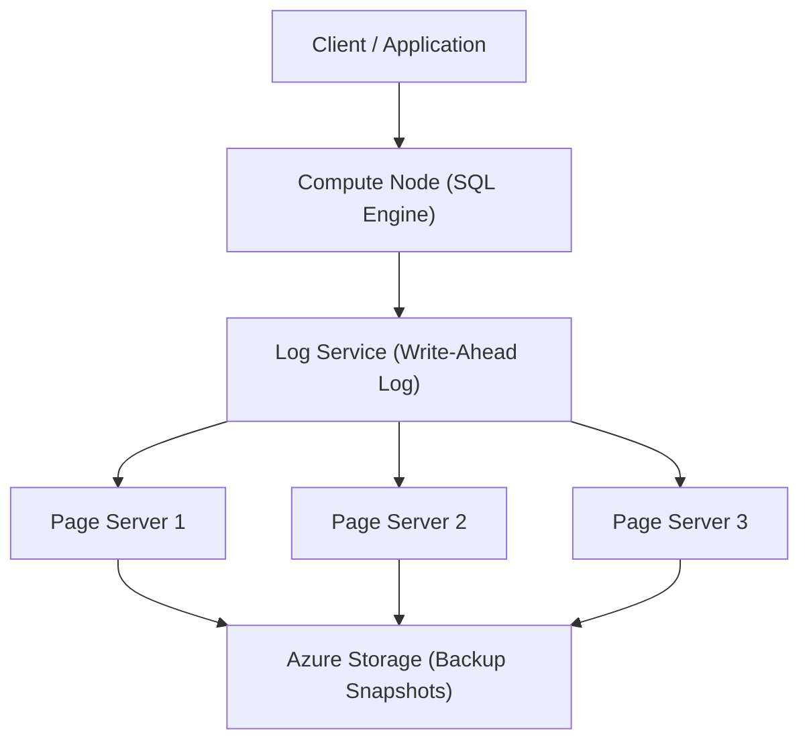
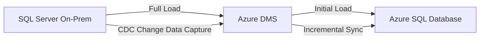

# Azure SQL Database

> [!ABSTRACT]
> Azure SQL Database ist ein vollständig verwalteter relationaler Datenbankdienst (PaaS) auf Basis der neuesten stabilen SQL Server Engine. Microsoft übernimmt Patching, Backups, HA und Skalierung — der Entwickler konzentriert sich auf Daten und Anwendungen.

---

## Was ist Azure SQL Database?

Azure SQL Database ist ein **Fully Managed Platform-as-a-Service** (PaaS), der auf der SQL Server Engine basiert. Microsoft verwaltet die gesamte Infrastruktur inklusive:

- Automatische Patches und Updates
- Eingebaute Hochverfügbarkeit (99,99 % SLA)
- Automatische Backups mit Point-in-Time Restore
- Integrierte Sicherheitsfunktionen (TDE, Always Encrypted, RLS)
- Intelligentes Performance-Tuning (Automatic Tuning, Query Store)

> [!NOTE]
> Azure SQL Database ist **nicht** 100 % kompatibel mit SQL Server On-Premises. Features wie SQL Agent, CLR, Service Broker oder Cross-DB Queries sind eingeschränkt oder nicht verfügbar. Für volle Kompatibilität → [[Azure SQL Managed Instance]].

---

## Kaufmodelle

Azure SQL Database bietet zwei grundlegend verschiedene Kaufmodelle:

| Merkmal | DTU-Modell | vCore-Modell |
|---|---|---|
| **Ressourcen** | Gebündelt (CPU + I/O + Memory) | Getrennt wählbar (vCores, RAM, Storage) |
| **Einstieg** | Einfacher, weniger Konfiguration | Mehr Flexibilität und Kontrolle |
| **Tiers** | Basic, Standard, Premium | General Purpose, Business Critical, Hyperscale |
| **Azure Hybrid Benefit** | Nicht verfügbar | Verfügbar (bis 55 % Einsparung) |
| **Reserved Capacity** | Nicht verfügbar | Verfügbar (bis 33 % Einsparung) |
| **Maximale Größe** | 4 TB (Premium P11/P15) | 100 TB (Hyperscale) |
| **Empfehlung** | Einfache, vorhersehbare Workloads | Produktions-Workloads, Kostentransparenz |

> [!TIP]
> Für neue Projekte wird das **vCore-Modell** empfohlen, da es mehr Flexibilität bietet und Azure Hybrid Benefit sowie Reserved Capacity unterstützt.

---

## Service Tiers (vCore-Modell)

| Tier | Storage | HA-Modell | SLA | In-Memory OLTP | Read Replika | Besonderheit |
|---|---|---|---|---|---|---|
| **General Purpose** | Remote Premium SSD | HA via Backup-Restore | 99,99 % | Nein | Optional (kostenpflichtig) | Standard-Workloads, kostengünstig |
| **Business Critical** | Lokale NVMe SSD | Always-On AG (3 Replika) | 99,995 % | Ja | 1 kostenlos inklusive | Niedrige Latenz, OLTP, Read Replika gratis |
| **Hyperscale** | Distributed Page Servers | Dedizierter HA-Mechanismus | 99,99 % | Nein | Bis zu 30 (kostenpflichtig) | Unbegrenzte Skalierung, schnelle Backups |

### General Purpose
Standard-Tier für die meisten Web- und Business-Anwendungen. Storage ist remote via Azure Premium Storage angebunden — bei Ausfall eines Compute-Nodes werden Daten ohne Verlust auf einem anderen Node neu gestartet.

### Business Critical
Höchste Performance und Verfügbarkeit. Drei synchrone Replikate sind immer aktiv (SQL Server Always On AG intern). Ein Read-Replica ist kostenlos inklusive und kann für Reporting genutzt werden.

### Hyperscale
Spezielle Architektur für Datenbanken über 4 TB bis unbegrenzt. Entkoppelt Compute von Storage durch Page Server. Skalierung des Computes in wenigen Minuten, Backups via Storage Snapshots in Sekunden.

---

## Single Database vs. Elastic Pool

| Kriterium | Single Database | Elastic Pool |
|---|---|---|
| **Ressourcen** | Dediziert für eine DB | Geteilt zwischen mehreren DBs |
| **Kosten** | Höher bei vielen DBs | Günstiger bei mehreren DBs mit variabler Last |
| **Management** | Einfach, isoliert | Zentral, mehrere DBs gleichzeitig |
| **Scaling** | Pro Datenbank | Pool-weites Scaling |
| **Anwendungsfall** | Einzelne kritische Anwendung | Multi-Tenant-Apps, Dev/Test-Datenbanken |
| **SLA** | Gleich wie Tier | Gleich wie Tier |
| **Max DBs pro Pool** | N/A | 500 (General Purpose) |

**Wann Elastic Pool?**
Wenn viele Datenbanken mit vorhersehbaren Peaks existieren, die sich zeitlich nicht überschneiden (z.B. regionale Workloads, Tenant-Datenbanken). Ein Pool mit 100 eDTUs kann günstiger sein als 10 einzelne Datenbanken à 20 DTUs.

---

## Hyperscale-Architektur



**Kernkonzepte der Hyperscale-Architektur:**

- **Page Server:** Horizontale Skalierung des Storage — jeder Page Server verantwortet einen Teil der Datenbank-Pages
- **Log Service:** Zentraler Write-Ahead Log, der Änderungen an alle Page Server verteilt
- **Compute Nodes:** Stateless SQL Engine — Skalierung in Sekunden durch neue Compute-Nodes
- **Schnelle Backups:** Backups via Storage-Snapshots (keine Full-Backup-Kopie notwendig) — in Sekunden statt Stunden
- **Schnelle Restores:** PITR via Snapshot Restore deutlich schneller als klassische Datenbanken

---

## Compute Tiers

### Provisioned (Standard)

Feste Anzahl vCores werden reserviert und sind immer verfügbar. Kosten fallen auch bei inaktiver Datenbank an.

- **Geeignet für:** Produktions-Workloads mit vorhersehbarer Last
- **vCores:** 2–80 vCores konfigurierbar
- **Abrechnung:** Pro Stunde, basierend auf konfigurierten vCores

### Serverless (Auto-Scale)

Compute skaliert automatisch basierend auf der tatsächlichen Workload. Auto-Pause bei Inaktivität.

| Merkmal | Details |
|---|---|
| **vCore-Range** | 0,5 – 40 vCores |
| **Auto-Pause** | Konfigurierbar (min. 1 Stunde), Datenbank pausiert bei Inaktivität |
| **Aufwachzeit** | Erste Anfrage nach Pause: 60–120 Sekunden (Cold Start) |
| **Abrechnung** | Nur für tatsächlich genutzte Compute-Sekunden |
| **Storage** | Wird während Pause weiterhin berechnet |
| **Anwendungsfall** | Dev/Test, intermittierende Workloads, Entwicklungsumgebungen |

> [!WARNING]
> Serverless **Auto-Pause** führt zu Cold-Start-Latenz. Für produktive Anwendungen mit SLA-Anforderungen sollte min. Pause-Delay auf mehrere Stunden gesetzt oder Provisioned gewählt werden.

---

## Backups

Azure SQL Database erstellt Backups vollautomatisch:

| Backup-Typ | Häufigkeit | Aufbewahrung (Standard) |
|---|---|---|
| **Full Backup** | Wöchentlich | Gem. PITR-Fenster |
| **Differential Backup** | Täglich | Gem. PITR-Fenster |
| **Transaction Log** | Alle 5–12 Minuten | Gem. PITR-Fenster |

**Point-in-Time Restore (PITR):**
- Standard: 7 Tage, konfigurierbar auf 1–35 Tage
- Restore in gleiche oder andere Region möglich
- Restore erstellt immer eine neue Datenbank (kein Überschreiben)

**Long-Term Retention (LTR):**
- Backups bis zu 10 Jahre aufbewahren
- Konfigurierbar: Wöchentlich, Monatlich, Jährlich
- Gespeichert in Azure Blob Storage (RA-GRS)
- Anwendungsfall: Compliance-Anforderungen (ISO, SOC, HIPAA)

```powershell
# PITR konfigurieren (Aufbewahrung auf 14 Tage)
Set-AzSqlDatabase -ResourceGroupName "rg-prod" `
    -ServerName "sql-server-prod" `
    -DatabaseName "mydb" `
    -BackupStorageRedundancy "Geo"

# LTR-Policy konfigurieren (wöchentliches Backup 12 Monate aufbewahren)
Set-AzSqlDatabaseBackupLongTermRetentionPolicy `
    -ResourceGroupName "rg-prod" `
    -ServerName "sql-server-prod" `
    -DatabaseName "mydb" `
    -WeeklyRetention "P12W"
```

---

## Sicherheit

### Always Encrypted

Client-seitige Verschlüsselung — Daten werden **vor** dem Senden zur Datenbank verschlüsselt. Der Server sieht niemals den Klartext.

- **Column Master Key (CMK):** In Azure Key Vault oder Windows Certificate Store
- **Column Encryption Key (CEK):** Verschlüsselt mit CMK, gespeichert in DB
- **Anwendungsfall:** Schutz vor DBAs, Cloud-Administratoren, Datenbankdumps

### Transparent Data Encryption (TDE)

Server-seitige Verschlüsselung aller Datenbankdateien (Data at Rest). Standardmäßig mit **Service-Managed Keys** aktiv. Kann auf **Customer-Managed Keys (CMK)** in Azure Key Vault umgestellt werden (BYOK).

### Row-Level Security (RLS)

Zeilenzugriffssteuerung über SQL-Prädikate direkt in der Datenbank:

```sql
-- Security Policy erstellen
CREATE SCHEMA Security;
GO

CREATE FUNCTION Security.fn_tenantAccessPredicate(@TenantId INT)
RETURNS TABLE
WITH SCHEMABINDING
AS
RETURN SELECT 1 AS result
WHERE @TenantId = CAST(SESSION_CONTEXT(N'TenantId') AS INT);

CREATE SECURITY POLICY TenantFilter
ADD FILTER PREDICATE Security.fn_tenantAccessPredicate(TenantId)
ON dbo.Orders;
```

### Dynamic Data Masking (DDM)

Maskiert sensible Daten für nicht-privilegierte Benutzer ohne Daten zu ändern:

```sql
-- E-Mail-Adresse maskieren (erste 2 Zeichen sichtbar, Rest versteckt)
ALTER TABLE Customers
ALTER COLUMN Email ADD MASKED WITH (FUNCTION = 'email()');

-- Kreditkartennummer: nur letzte 4 Ziffern sichtbar
ALTER TABLE Payments
ALTER COLUMN CreditCard ADD MASKED WITH (FUNCTION = 'partial(0,"XXXX-XXXX-XXXX-",4)');
```

---

## Microsoft Defender for SQL

Microsoft Defender for SQL bietet erweiterten Bedrohungsschutz für Azure SQL:

- **SQL Injection Detection:** Erkennt Angriffe und verdächtige Query-Muster in Echtzeit
- **Anomalie-Erkennung:** Ungewöhnliche Zugriffsmuster (unbekannte IP, ungewöhnliche Zeit)
- **Vulnerability Assessment:** Regelmäßige Scans auf Sicherheitslücken und Fehlkonfigurationen
- **Data Classification:** Automatische Erkennung und Klassifizierung sensibler Daten (PII, Kreditkarten)
- **Audit Logs:** Alle Datenbankzugriffe in Log Analytics oder Storage Account protokollieren

> [!IMPORTANT]
> Defender for SQL ist kostenpflichtig (ca. 15 USD/Server/Monat) aber für Produktions-Datenbanken mit sensiblen Daten **dringend empfohlen**.

---

## Netzwerk

### Private Endpoint (Empfohlen)

Datenbank erhält eine private IP-Adresse im eigenen VNet. Traffic verlässt nie das Microsoft-Netzwerk.

```powershell
# Private Endpoint erstellen
New-AzPrivateEndpoint -ResourceGroupName "rg-prod" `
    -Name "pe-sqldb" `
    -Location "westeurope" `
    -Subnet $subnet `
    -PrivateLinkServiceConnection $plsConfig
```

### Server-Firewall (IP-Regeln)

Klassische IP-basierte Firewall-Regeln. Nur für einfache Szenarien empfohlen.

```sql
-- Firewall-Regel hinzufügen (T-SQL)
EXEC sp_set_firewall_rule N'Office IP', '203.0.113.10', '203.0.113.10';
```

### VNet Service Endpoints

Traffic zu Azure SQL über das Microsoft-Backbone, ohne Private Endpoint. Weniger sicher als Private Endpoint, da kein Private IP.

---

## Via Azure Portal (UI)

> [!TIP] Schnelleinstieg
> Azure SQL Database lässt sich über das Portal mit geführtem Server-Setup, SKU-Auswahl und Backup-Konfiguration erstellen.

### SQL-Datenbank erstellen

1. **portal.azure.com** → **SQL-Datenbanken** → **+ Erstellen**
2. **Grundlagen**-Tab:
   - Abonnement & Ressourcengruppe
   - **Datenbankname**: z. B. `app-db`
   - **Server**: Neuen Server erstellen
     - Servername (global eindeutig), Region, Authentifizierungsmethode
     - SQL-Authentifizierung: Administratorname & Passwort
3. **Compute + Speicher konfigurieren**:
   - **Kaufmodell**: vCore oder DTU
   - **Dienstebene**: General Purpose, Business Critical oder Hyperscale
   - vCores, Arbeitsspeicher, Speichergröße anpassen
   - **Serverlos**: Automatisches Pausieren aktivieren (cost-saving)
4. **Netzwerk**-Tab:
   - **Konnektivitätsmethode**: Kein Zugriff, Öffentlicher Endpunkt oder Privater Endpunkt
   - **Azure-Dienste und -Ressourcen Zugriff erlauben**: Ja/Nein
5. **Sicherheit**-Tab: Microsoft Defender for SQL aktivieren (optional, kostenpflichtig)
6. **Zusätzliche Einstellungen**-Tab:
   - **Daten verwenden**: Keine, Beispieldaten (AdventureWorks) oder vorhandene Sicherung
   - **Sortierung**: z. B. `SQL_Latin1_General_CP1_CI_AS`
7. **Überprüfen + erstellen** → **Erstellen**

### Query Editor (Portal)

1. SQL-Datenbank → **Abfrage-Editor (Vorschau)**
2. Mit SQL-Authentifizierung oder Microsoft Entra ID anmelden
3. SQL-Abfragen direkt im Browser ausführen

### Skalierung

1. SQL-Datenbank → **Compute + Speicher** (im Menü **Konfigurieren**)
2. vCores oder Dienstebene anpassen → **Übernehmen**

---

## Elastic Jobs

Elastic Jobs ermöglichen die **Ausführung von T-SQL-Jobs über mehrere Datenbanken** — ähnlich dem SQL Server Agent, aber für Azure SQL Database.

```sql
-- Elastic Job Agent erstellen (PowerShell)
# Zuerst Job-Datenbank und Agent via Portal oder CLI erstellen

-- Job-Gruppe mit Zieldatenbanken
EXEC jobs.sp_add_target_group 'ProductionDBs';
EXEC jobs_sp_add_target_group_member 'ProductionDBs',
    @target_type = 'SqlDatabase',
    @server_name = 'sql-server-prod.database.windows.net',
    @database_name = 'db1';

-- Job und Step definieren
EXEC jobs.sp_add_job 'IndexMaintenance', @description = 'Rebuild fragmented indexes';
EXEC jobs.sp_add_jobstep 'IndexMaintenance', 'RebuildIndexes',
    @command = N'ALTER INDEX ALL ON dbo.Orders REBUILD;';

-- Zeitplan hinzufügen
EXEC jobs.sp_add_schedule 'IndexMaintenance', 
    @schedule_interval_type = 'Days',
    @schedule_interval_count = 7;
```

**Anwendungsfälle:**
- Index-Wartung über alle Tenant-Datenbanken
- Daten-Cleanup (alte Logs löschen)
- Reporting-Aggregationen
- Schema-Änderungen über viele Datenbanken gleichzeitig

---

## Query Performance Insight

Query Performance Insight visualisiert die ressourcenintensivsten Queries direkt im Azure Portal:

- **Top CPU-Queries:** Queries nach CPU-Verbrauch sortiert (letzte 24h, 7 Tage, custom)
- **Top Duration-Queries:** Queries nach Ausführungsdauer
- **Top I/O-Queries:** Queries nach Disk I/O
- **Drilldown:** Einzelne Query-Details, Ausführungsplan, Trend über Zeit

> [!TIP]
> Query Performance Insight basiert auf dem **Query Store**, der in Azure SQL Database immer aktiv ist. Kein manueller Konfigurationsaufwand.

---

## Automatic Tuning

Azure SQL Database kann automatisch Performance-Optimierungen vornehmen:

| Tuning-Aktion | Beschreibung | Standard |
|---|---|---|
| **Create Index** | Index bei häufigen Queries automatisch erstellen | Aktiviert |
| **Drop Index** | Ungenutzte Indizes automatisch entfernen | Aktiviert |
| **Force Last Good Plan** | Query Execution Plan korrigieren wenn Regression erkannt | Aktiviert |

```powershell
# Automatic Tuning konfigurieren
Set-AzSqlDatabaseRecommendedActionState `
    -ResourceGroupName "rg-prod" `
    -ServerName "sql-server-prod" `
    -DatabaseName "mydb" `
    -AdvisorName "CreateIndex" `
    -RecommendedActionName "IR_[dbo].[Orders]_..." `
    -State "Pending"
```

> [!NOTE]
> Jede automatische Änderung wird protokolliert und kann bei Performance-Verschlechterung automatisch **rückgängig gemacht** werden.

---

## Migration

### Database Migration Assessment (DMA)

Der **Data Migration Assistant (DMA)** prüft On-Premises SQL Server Datenbanken auf Kompatibilität mit Azure SQL Database:

1. DMA herunterladen und installieren
2. Assessment gegen Zielplattform (Azure SQL DB, SQL MI) ausführen
3. Inkompatible Features und Workarounds analysieren
4. Migration-Report exportieren

### Azure Database Migration Service (DMS)

Für Online-Migration mit minimaler Downtime:



### Backup/Restore

Einfachste Migrationsmethode für kleinere Datenbanken:

```powershell
# BACPAC exportieren (On-Prem)
SqlPackage /Action:Export /SourceServerName:localhost `
    /SourceDatabaseName:mydb /TargetFile:mydb.bacpac

# BACPAC importieren nach Azure SQL
SqlPackage /Action:Import /TargetServerName:"sqlsrv.database.windows.net" `
    /TargetDatabaseName:mydb /SourceFile:mydb.bacpac `
    /TargetUser:sqladmin /TargetPassword:P@ssw0rd!
```

---

## Kosten-Optimierung

| Strategie | Einsparung | Anwendungsfall |
|---|---|---|
| **Serverless + Auto-Pause** | Bis 90 % bei Inaktivität | Dev/Test, intermittente Workloads |
| **Azure Hybrid Benefit** | Bis 55 % (mit SA) | Vorhandene SQL Server-Lizenzen mit Software Assurance |
| **Reserved Capacity (1 Jahr)** | ~33 % | Stabile Produktions-Workloads |
| **Reserved Capacity (3 Jahre)** | ~55 % | Langfristige Produktions-Workloads |
| **Elastic Pool** | Bis 50 % bei vielen DBs | Multi-Tenant, viele kleine DBs |
| **Right-Sizing** | Variabel | Regelmäßiges Monitoring via Azure Advisor |

```powershell
# Azure Hybrid Benefit aktivieren
Set-AzSqlDatabase -ResourceGroupName "rg-prod" `
    -ServerName "sql-server-prod" `
    -DatabaseName "mydb" `
    -LicenseType "BasePrice"  # BasePrice = Hybrid Benefit, LicenseIncluded = PAYG
```

> [!TIP]
> **Azure Advisor** analysiert automatisch SQL Database-Ressourcen und gibt Empfehlungen für Right-Sizing und Reserved Capacity. Im Portal unter "Advisor" → "Cost" nachschauen.

---

## Verwandte Notizen

- [[Azure SQL Managed Instance]] — Near 100% SQL Server-Kompatibilität als PaaS
- [[SQL Server auf Azure VMs]] — Vollständige Kontrolle über SQL Server (IaaS)
- [[Azure Synapse Analytics]] — Data Warehouse und Analytics
- [[Azure Data Factory]] — ETL und Datenintegration
- [[Azure RBAC]] — Zugriffskontrolle für Azure-Ressourcen
