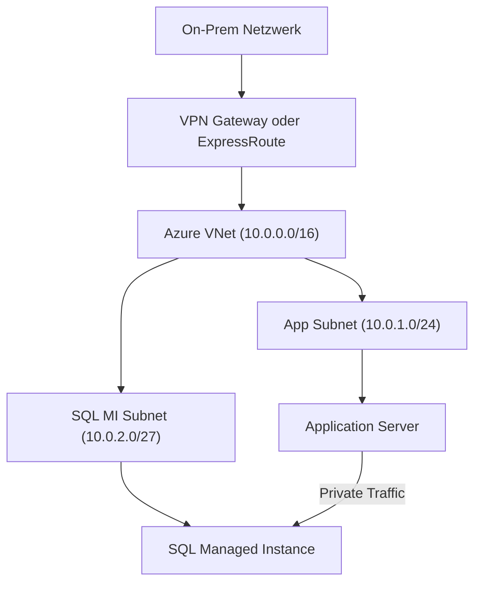
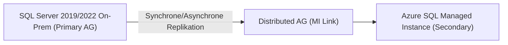
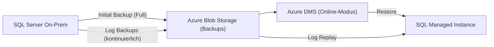

# Azure SQL Managed Instance

> [!ABSTRACT]
> Azure SQL Managed Instance (SQL MI) bietet nahezu 100 % Kompatibilität mit SQL Server On-Premises als vollständig verwalteter PaaS-Dienst. Ideal für Lift-and-Shift-Migrationen, bei denen Features wie SQL Agent, CLR, Linked Servers oder Service Broker benötigt werden.

---

## Was ist SQL Managed Instance?

Azure SQL Managed Instance kombiniert das Beste aus beiden Welten: die **volle SQL Server-Kompatibilität** einer On-Premises-Installation mit den Vorteilen eines vollständig verwalteten PaaS-Dienstes.

**Kernmerkmale:**
- Near 100 % Kompatibilität mit SQL Server (on-prem Edition)
- Deployment **im eigenen VNet** (keine öffentliche IP notwendig)
- SQL Agent, CLR, Database Mail, Linked Servers — alles verfügbar
- Automatische Backups, Patching, HA, Monitoring
- Instance-Level-Features (mehrere Datenbanken pro Instance)
- Cross-Database Queries und Transaktionen innerhalb der Instanz

> [!NOTE]
> SQL Managed Instance ist teurer als Azure SQL Database, bietet aber wesentlich mehr SQL Server-Features. Für neue Anwendungen ohne Legacy-Anforderungen → [[Azure SQL Database]] erwägen.

---

## Feature-Vergleich

| Feature | SQL Managed Instance | Azure SQL Database | SQL Server On-Prem |
|---|---|---|---|
| **SQL Agent** | ✅ Vollständig | ❌ (Elastic Jobs) | ✅ |
| **CLR (Common Language Runtime)** | ✅ | ❌ | ✅ |
| **Cross-Database Queries** | ✅ (innerhalb Instance) | ❌ | ✅ |
| **Linked Servers** | ✅ (eingeschränkt) | ❌ | ✅ |
| **Service Broker** | ✅ | ❌ | ✅ |
| **Database Mail** | ✅ | ❌ | ✅ |
| **Resource Governor** | ✅ | ❌ | ✅ |
| **Replikation** | ✅ (Subscriber) | ✅ (Subscriber) | ✅ |
| **Distributed Transactions (MSDTC)** | ✅ | ❌ | ✅ |
| **Windows Authentication** | ✅ (via AD) | ✅ (via Entra ID) | ✅ |
| **Always Encrypted** | ✅ | ✅ | ✅ |
| **In-Memory OLTP** | ✅ (Business Critical) | ✅ (Business Critical) | ✅ |
| **Elastic Pool** | ❌ (Instance Pools) | ✅ | N/A |
| **Serverless** | ❌ | ✅ | N/A |
| **Hyperscale** | ❌ | ✅ | N/A |

---

## VNet-Deployment

SQL Managed Instance wird **immer** in einem dedizierten Subnetz eines Azure Virtual Network bereitgestellt. Dies ist ein wesentlicher Unterschied zu Azure SQL Database.

**Anforderungen an das Subnetz:**
- Dediziertes Subnetz (keine anderen Azure-Ressourcen erlaubt)
- Mindestgröße: `/27` (32 Adressen, empfohlen `/24` oder größer)
- Network Security Group (NSG) mit spezifischen Regeln
- Route Table mit spezifischen Routen



```powershell
# SQL MI Subnetz vorbereiten
$vnet = Get-AzVirtualNetwork -Name "vnet-prod" -ResourceGroupName "rg-prod"
$subnet = Add-AzVirtualNetworkSubnetConfig -Name "snet-sqlmi" `
    -VirtualNetwork $vnet `
    -AddressPrefix "10.0.2.0/27" `
    -Delegation (New-AzDelegation -Name "sqlmi" `
        -ServiceName "Microsoft.Sql/managedInstances")
$vnet | Set-AzVirtualNetwork
```

> [!WARNING]
> Das SQL MI-Subnetz darf **ausschließlich** SQL Managed Instances enthalten. Keine VMs, App Services oder andere Ressourcen. Eine falsche Subnetz-Konfiguration verhindert das Deployment.

---

## Service Tiers

| Merkmal | General Purpose | Business Critical |
|---|---|---|
| **Storage** | Remote Azure Premium SSD | Lokale NVMe SSD |
| **Latenz (I/O)** | 5–10 ms | 1–2 ms |
| **HA-Modell** | Log-Replay auf Standby | Always-On AG (3 Replikate) |
| **SLA** | 99,99 % | 99,995 % |
| **Read Replica** | Nicht inklusive | 1 Lesereplikat kostenlos |
| **In-Memory OLTP** | Nein | Ja |
| **Anwendungsfall** | Standard Enterprise-Workloads | Kritische OLTP, niedrige Latenz |
| **Max Storage** | 16 TB | 4 TB |
| **Max vCores** | 80 | 80 |

---

## Managed Instance Link

Der **Managed Instance Link** ermöglicht eine hybride Konfiguration zwischen On-Premises SQL Server und Azure SQL Managed Instance über eine **Distributed Availability Group**.



**Anwendungsfälle:**

1. **Disaster Recovery:** On-Prem SQL Server als Primary, SQL MI als DR-Ziel
2. **Migration (Online):** Minimale Downtime durch kontinuierliche Synchronisation, Failover auf SQL MI zur Übernahme
3. **Read Offloading:** Leseintensive Queries auf SQL MI ausführen

**Anforderungen:**
- SQL Server 2019 oder SQL Server 2022
- SQL MI im selben oder verbundenen Netzwerk erreichbar
- Distributed AG-Lizenz (Enterprise Edition)

```sql
-- Managed Instance Link konfigurieren (vereinfacht)
-- 1. Availability Group auf SQL Server erstellen
CREATE AVAILABILITY GROUP [AG-Primary]
WITH (CLUSTER_TYPE = NONE)
FOR DATABASE [mydb]
REPLICA ON 'SQLSERVER01' WITH (
    ENDPOINT_URL = 'TCP://SQLSERVER01:5022',
    AVAILABILITY_MODE = SYNCHRONOUS_COMMIT,
    FAILOVER_MODE = MANUAL
);
```

---

## Business Critical — Freie Read Replica

Im Business Critical Tier ist **ein Lesereplikat kostenlos** inklusive. Dies ermöglicht:

- Reporting-Queries ohne Impact auf primären Workload
- Anwendungsconnection via `ApplicationIntent=ReadOnly`
- SSRS, Power BI, Analytik-Queries auslagern

```
-- Verbindungsstring für Read Replica
Server=mi-prod.xxx.database.windows.net;
Database=mydb;
User Id=sqladmin;
Password=...;
ApplicationIntent=ReadOnly;
```

---

## Instance Pools

Instance Pools ermöglichen mehrere kleine SQL MI-Instanzen auf **gemeinsamer Infrastruktur** — deutlich kostengünstiger für kleinere Instanzen.

| Merkmal | Standalone SQL MI | Instance Pool |
|---|---|---|
| **Mindestgröße** | 4 vCores | 2 vCores pro Instance |
| **Deployment-Zeit** | ~4–6 Stunden | ~2–3 Minuten (aus Pool) |
| **Kosten** | Pro Instance | Geteilt, günstiger bei vielen kleinen Instances |
| **Max Instances pro Pool** | N/A | 5 |
| **Anwendungsfall** | Einzelne große Instanz | Viele kleine Dev/Test/Tenant-Instanzen |

```powershell
# Instance Pool erstellen
New-AzSqlInstancePool -ResourceGroupName "rg-dev" `
    -Name "pool-dev" `
    -Location "westeurope" `
    -SubnetId $subnetId `
    -VCore 16 `
    -Edition "GeneralPurpose" `
    -ComputeGeneration "Gen5" `
    -LicenseType "LicenseIncluded"
```

---

## Hochverfügbarkeit und Zone Redundanz

**Standard HA (General Purpose):**
Automatischer Failover via Log-Replay auf einen Standby-Node im gleichen Availability Zone.

**Zone-Redundantes SQL MI:**
- Verfügbar für General Purpose und Business Critical
- Instances über drei Availability Zones verteilt
- Erhöht SLA auf 99,995 %
- Empfohlen für kritische Produktionsinstanzen

```powershell
# Zone-redundantes SQL MI erstellen
New-AzSqlInstance -ResourceGroupName "rg-prod" `
    -Name "sqlmi-prod" `
    -Location "westeurope" `
    -SubnetId $subnetId `
    -AdministratorCredential $cred `
    -StorageSizeInGB 512 `
    -VCore 8 `
    -Edition "BusinessCritical" `
    -ComputeGeneration "Gen5" `
    -LicenseType "BasePrice" `
    -ZoneRedundant   # Zone-Redundanz aktivieren
```

---

## Backups

| Backup-Typ | Häufigkeit | Details |
|---|---|---|
| **Full Backup** | Wöchentlich | Gespeichert in Azure Blob (RA-GRS) |
| **Differential** | Täglich | Delta seit letztem Full |
| **Transaction Log** | Alle 5–10 Minuten | Minimaler Datenverlust |
| **PITR** | Jederzeit | 1–35 Tage, Restore auf Minuten genau |
| **LTR** | Optional | Bis 10 Jahre, für Compliance |

> [!IMPORTANT]
> Bei SQL MI sind Backups an **verwalteten Ort** in Azure gespeichert. Eigene Backups auf eigenes Storage-Konto können über `BACKUP DATABASE ... TO URL` zusätzlich erstellt werden.

---

## Migration von SQL Server

### Azure Database Migration Service (DMS) — Online Migration



### Backup/Restore via Azure Blob

Einfachste Methode für kleinere Datenbanken mit akzeptabler Downtime:

```sql
-- Backup auf Azure Blob (On-Prem SQL Server)
BACKUP DATABASE [mydb]
TO URL = 'https://mystorageaccount.blob.core.windows.net/backups/mydb.bak'
WITH CREDENTIAL = 'AzureStorageCred', COMPRESSION, STATS = 10;

-- Restore auf SQL MI
RESTORE DATABASE [mydb]
FROM URL = 'https://mystorageaccount.blob.core.windows.net/backups/mydb.bak'
WITH CREDENTIAL = 'AzureStorageCred', STATS = 10;
```

### Log Replay Service (LRS)

Log Replay Service (LRS) ermöglicht kontinuierliches Replay von Transaction-Log-Backups von Azure Blob auf SQL MI — bis zur manuellen Übernahme (Cutover).

**Vorteile:** Keine DMS-Kosten, mehr Kontrolle über Cutover-Zeitpunkt.

---

## Kosten-Vergleich

| Dienst | Kontrolle | Kompatibilität | Kosten (ca.) | Anwendungsfall |
|---|---|---|---|---|
| **Azure SQL Database** | Gering (PaaS) | ~90 % | Ab 15 €/Monat | Neue Anwendungen, Cloud-Native |
| **Azure SQL Managed Instance** | Mittel (PaaS) | ~99 % | Ab 450 €/Monat | Lift-and-Shift, Legacy SQL Server |
| **SQL Server auf Azure VMs** | Hoch (IaaS) | 100 % | Ab 200 €/Monat + VM | Spezialfälle, OS-Anforderungen |

> [!TIP]
> SQL MI unterstützt **Azure Hybrid Benefit**: Mit vorhandenen SQL Server-Lizenzen mit Software Assurance können bis zu 55 % der Lizenzkosten eingespart werden.

```powershell
# Azure Hybrid Benefit für SQL MI aktivieren
Set-AzSqlInstance -ResourceGroupName "rg-prod" `
    -Name "sqlmi-prod" `
    -LicenseType "BasePrice"  # BasePrice = Hybrid Benefit
```

---

## Verwandte Notizen

- [[Azure SQL Database]] — Einfacherer PaaS-SQL-Dienst für neue Anwendungen
- [[SQL Server auf Azure VMs]] — Vollständige SQL Server-Kontrolle auf IaaS
- [[Azure RBAC]] — Zugriffskontrolle und Berechtigungen
- [[Azure Data Factory]] — ETL und Migration von Daten
