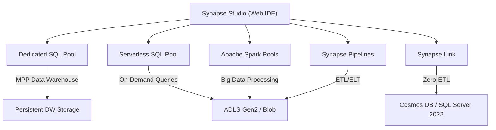
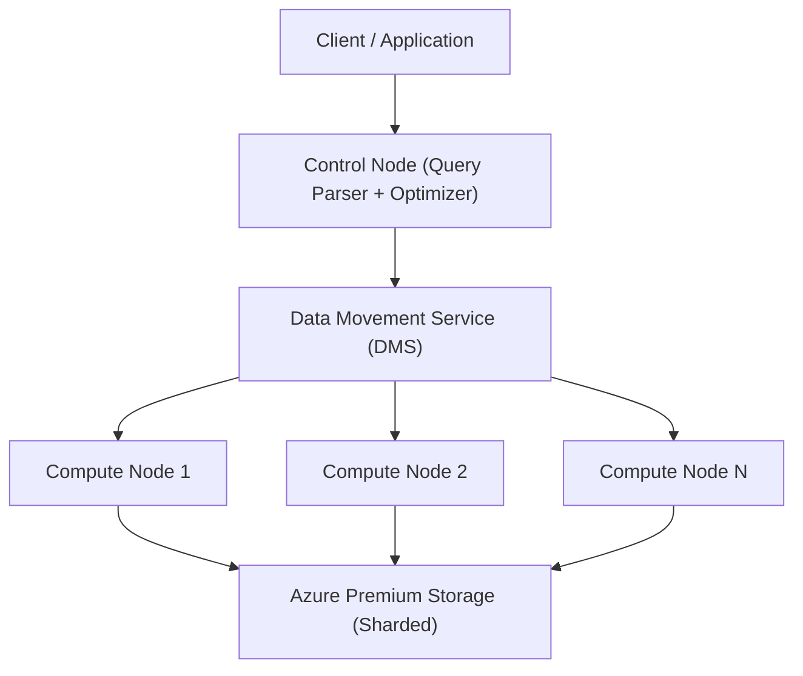

# Azure Synapse Analytics

> [!ABSTRACT]
> Azure Synapse Analytics ist eine unified Analytics-Plattform, die Data Warehouse (Dedicated SQL Pool), Serverless SQL-Abfragen über Data Lake, Apache Spark, Datenpipelines und Synapse Link in einer integrierten Umgebung (Synapse Studio) vereint.

---

## Was ist Azure Synapse Analytics?

Azure Synapse Analytics kombiniert mehrere Technologien unter einem Dach:

- **Dedicated SQL Pool** — Enterprise Data Warehouse mit massiv paralleler Verarbeitung (MPP)
- **Serverless SQL Pool** — Pay-per-Query über Azure Data Lake Storage
- **Apache Spark Pools** — PySpark, Scala, Notebooks für Data Engineering und ML
- **Synapse Pipelines** — ETL/ELT ähnlich Azure Data Factory
- **Synapse Link** — Zero-ETL-Integration mit Cosmos DB, SQL Server, Dataverse
- **Synapse Studio** — Integrierte Web-IDE für alle Komponenten

---

## Komponenten-Übersicht



---

## Dedicated SQL Pool

Dedicated SQL Pool ist das klassische **Enterprise Data Warehouse** in Synapse — früher bekannt als Azure SQL Data Warehouse.

### DWUs — Data Warehouse Units

DWUs sind die Performance-Metrik für Dedicated SQL Pool:

| DWU-Level | Beschreibung | Anwendungsfall |
|---|---|---|
| DW100c | Minimum, 1 Compute Node | Dev/Test |
| DW500c | Kleines DW | Kleine Organisationen |
| DW1000c | Standard | Mittelgroße DWs |
| DW5000c | High Performance | Großes Enterprise DW |
| DW30000c | Maximum | Sehr große DWs |

### MPP-Architektur



### Table Distributions

| Distribution | Beschreibung | Anwendungsfall |
|---|---|---|
| **Hash** | Zeilen via Hash-Funktion auf Compute Nodes verteilt | Große Faktentabellen, häufige JOINs |
| **Round Robin** | Zeilen gleichmäßig auf alle Nodes verteilt | Staging-Tabellen, kein klarer Join-Key |
| **Replicate** | Vollständige Kopie auf jedem Compute Node | Kleine Dimensionstabellen (< 2 GB) |

```sql
-- Hash-verteilte Faktentabelle
CREATE TABLE dbo.FactSales (
    SaleId INT NOT NULL,
    CustomerId INT NOT NULL,
    Amount DECIMAL(18,2),
    SaleDate DATE
)
WITH (
    DISTRIBUTION = HASH(CustomerId),
    CLUSTERED COLUMNSTORE INDEX
);

-- Replizierte Dimensionstabelle
CREATE TABLE dbo.DimCustomer (
    CustomerId INT NOT NULL,
    CustomerName NVARCHAR(100),
    Country NVARCHAR(50)
)
WITH (
    DISTRIBUTION = REPLICATE,
    CLUSTERED COLUMNSTORE INDEX
);
```

### Pause und Resume

Dedicated SQL Pool kann pausiert werden — Compute-Kosten entfallen, Storage bleibt:

```powershell
# Pool pausieren (nur Storage-Kosten)
Suspend-AzSynapseSqlPool -ResourceGroupName "rg-synapse" `
    -WorkspaceName "synapse-prod" `
    -Name "sqlpool-prod"

# Pool wieder starten
Resume-AzSynapseSqlPool -ResourceGroupName "rg-synapse" `
    -WorkspaceName "synapse-prod" `
    -Name "sqlpool-prod"
```

---

## Serverless SQL Pool

Serverless SQL Pool ermöglicht **Ad-hoc-SQL-Abfragen direkt über ADLS Gen2** ohne Datenbewegung:

- **Pay-per-TB** verarbeitete Daten (ca. 5 USD/TB)
- Unterstützt: Parquet, CSV, JSON, Delta Lake, ORC
- Externe Tabellen und Views als Abstraktion
- Kein Cluster zu verwalten — immer verfügbar

```sql
-- CSV direkt aus ADLS abfragen
SELECT TOP 10 *
FROM OPENROWSET(
    BULK 'https://mydatalake.dfs.core.windows.net/raw/sales/2024/*.csv',
    FORMAT = 'CSV',
    HEADER_ROW = TRUE,
    FIELDTERMINATOR = ','
) AS sales_data;

-- Parquet-Datei abfragen (deutlich effizienter)
SELECT
    year,
    SUM(amount) AS total_sales
FROM OPENROWSET(
    BULK 'https://mydatalake.dfs.core.windows.net/silver/sales/**',
    FORMAT = 'PARQUET'
) AS t
GROUP BY year
ORDER BY year;

-- Externe Tabelle erstellen (View über ADLS)
CREATE EXTERNAL TABLE [dbo].[ExternalSales] (
    SaleId INT,
    CustomerId INT,
    Amount DECIMAL(18,2),
    SaleDate DATE
)
WITH (
    LOCATION = 'silver/sales/**',
    DATA_SOURCE = ADLS_DataSource,
    FILE_FORMAT = ParquetFormat
);
```

> [!TIP]
> **Parquet-Format** ist 5–10x günstiger als CSV für Serverless SQL Pool, da Parquet spaltenbasiert gespeichert ist und Synapse nur benötigte Spalten liest.

---

## Apache Spark Pools

Spark Pools ermöglichen **Big Data Processing, Data Engineering und Machine Learning** in Synapse:

```python
# PySpark-Notebook: Daten aus ADLS lesen und transformieren
from pyspark.sql import SparkSession
from pyspark.sql.functions import col, sum, year

# Daten laden
df_sales = spark.read.parquet(
    "abfss://raw@mydatalake.dfs.core.windows.net/sales/"
)

# Transformation
df_result = df_sales \
    .filter(col("status") == "completed") \
    .groupBy(year("sale_date").alias("year"), "customer_id") \
    .agg(sum("amount").alias("total_amount")) \
    .orderBy("year", "total_amount", ascending=[True, False])

# Ergebnis in Silver Layer schreiben
df_result.write \
    .mode("overwrite") \
    .partitionBy("year") \
    .parquet("abfss://silver@mydatalake.dfs.core.windows.net/sales_summary/")
```

### Spark Pool Konfiguration

```powershell
# Spark Pool erstellen
New-AzSynapseSparkPool -ResourceGroupName "rg-synapse" `
    -WorkspaceName "synapse-prod" `
    -Name "sparkpool-default" `
    -SparkVersion "3.4" `
    -NodeSizeFamily "MemoryOptimized" `
    -NodeSize "Medium" `
    -AutoScaleMinNodeCount 3 `
    -AutoScaleMaxNodeCount 10 `
    -AutoPauseDelayInMinute 15
```

### Delta Lake in Spark

```python
# Delta Lake Tabelle erstellen und verwalten
df_sales.write.format("delta") \
    .mode("overwrite") \
    .save("abfss://gold@mydatalake.dfs.core.windows.net/delta/sales/")

# Delta Table lesen
df_delta = spark.read.format("delta") \
    .load("abfss://gold@mydatalake.dfs.core.windows.net/delta/sales/")

# Time Travel: Version vor 2 Tagen lesen
df_history = spark.read.format("delta") \
    .option("timestampAsOf", "2024-11-01") \
    .load("abfss://gold@mydatalake.dfs.core.windows.net/delta/sales/")
```

---

## Synapse Pipelines

Synapse Pipelines sind **Azure Data Factory-kompatibel** und bieten die gleichen Funktionen direkt in Synapse:

- Copy Activity für Daten-Ingestion aus 90+ Quellen
- Mapping Data Flows (visuelles ETL, Spark-basiert)
- Control Flow (If, ForEach, Until, Wait)
- Triggers: Schedule, Tumbling Window, Storage Event

```json
{
    "name": "pl_ingest_sales",
    "activities": [
        {
            "name": "Copy Sales Data",
            "type": "Copy",
            "inputs": [{"referenceName": "ds_sql_sales"}],
            "outputs": [{"referenceName": "ds_adls_raw_sales"}],
            "typeProperties": {
                "source": {"type": "AzureSqlSource"},
                "sink": {"type": "ParquetSink"}
            }
        }
    ]
}
```

---

## Synapse Link — Zero-ETL Integration

Synapse Link ermöglicht **analytischen Zugriff auf operative Daten ohne ETL**:

| Quelle | Beschreibung | Latenz |
|---|---|---|
| **Cosmos DB Analytical Store** | Automatische Column-Store-Spiegelung von Cosmos DB | Minuten |
| **SQL Server 2022** | Direkte Replikation in Synapse | Minuten |
| **Microsoft Dataverse** | Power Platform Daten in Synapse analysieren | Minuten |

```python
# Cosmos DB via Synapse Link in Spark abfragen
df_cosmos = spark.read.format("cosmos.olap") \
    .option("spark.synapse.linkedService", "CosmosDB_LinkedService") \
    .option("spark.cosmos.container", "orders") \
    .load()

df_cosmos.createOrReplaceTempView("cosmos_orders")
spark.sql("SELECT status, COUNT(*) FROM cosmos_orders GROUP BY status").show()
```

---

## Synapse Studio

Synapse Studio ist die **integrierte Web-IDE** für alle Synapse-Komponenten:

| Bereich | Funktion |
|---|---|
| **Data** | Linked Services verwalten, ADLS-Dateien durchsuchen |
| **Develop** | SQL-Skripte, Notebooks, Data Flows, Spark-Jobs |
| **Integrate** | Pipeline-Designer (wie ADF) |
| **Monitor** | Pipeline Runs, Spark-Jobs, SQL-Anfragen überwachen |
| **Manage** | SQL Pools, Spark Pools, Linked Services, Integration Runtimes |

---

## Sicherheit

### Managed VNet und Managed Private Endpoints

```powershell
# Workspace mit Managed VNet erstellen
New-AzSynapseWorkspace -ResourceGroupName "rg-synapse" `
    -Name "synapse-prod" `
    -DefaultDataLakeStorageAccountName "mydatalake" `
    -DefaultDataLakeStorageFilesystem "synapse" `
    -ManagedVirtualNetwork Enabled
```

### Column-Level Security (CLS)

```sql
-- Nur bestimmte Rollen sehen Spalte 'salary'
GRANT SELECT ON dbo.Employees(EmployeeId, Name, Department) TO [analyst_role];
-- analyst_role sieht keine Salary-Spalte
```

### Row-Level Security (RLS)

```sql
-- Jeder Analyst sieht nur seine Region
CREATE FUNCTION Security.fn_RegionFilter(@Region NVARCHAR(50))
RETURNS TABLE WITH SCHEMABINDING AS
RETURN SELECT 1 AS result
WHERE @Region = USER_NAME();

CREATE SECURITY POLICY RegionFilter
ADD FILTER PREDICATE Security.fn_RegionFilter(Region)
ON dbo.FactSales;
```

### Dynamic Data Masking

```sql
-- PII maskieren
ALTER TABLE dbo.DimCustomer
ALTER COLUMN Email ADD MASKED WITH (FUNCTION = 'email()');
```

---

## Synapse Analytics vs. Microsoft Fabric

| Merkmal | Azure Synapse Analytics | Microsoft Fabric |
|---|---|---|
| **Status** | GA, weiterhin supported | GA seit November 2023, neue Plattform |
| **Lizenzmodell** | Pay-as-you-go | Fabric Capacity (F-SKU) |
| **OneLake** | Kein natives OneLake | OneLake als zentrales Storage |
| **Empfehlung** | Bestehende Kunden | Neue Analytics-Projekte |
| **Migration** | Weiterhin nutzbar | Migration zu Fabric empfohlen |
| **Data Factory** | Synapse Pipelines | Fabric Data Factory |
| **Spark** | Synapse Spark | Fabric Spark (Notebooks) |
| **SQL** | Dedicated + Serverless | Fabric Warehouse + SQL Analytics |

> [!NOTE]
> Microsoft empfiehlt für **neue Analytics-Projekte** Microsoft Fabric. Azure Synapse Analytics wird weiterhin unterstützt und erhält Updates, aber die primäre Innovationsplattform ist Fabric.

---

## Kosten

| Komponente | Abrechnungsmodell | Beispiel |
|---|---|---|
| **Dedicated SQL Pool** | DWU/Stunde | DW500c: ~7 USD/h |
| **Serverless SQL Pool** | Pro TB verarbeiteter Daten | 5 USD/TB |
| **Spark Pools** | vCore-Stunden | Medium Node (8 vCores): ~0,46 USD/h |
| **Synapse Pipelines** | Activity Runs + DIU-h | 0,001 USD/Activity Run |
| **Storage (ADLS Gen2)** | Pro GB/Monat | ~0,018 USD/GB/Monat |

```powershell
# Dedicated SQL Pool nur bei Bedarf starten
# Automatisches Pausieren per Logic App oder Azure Automation:
$schedule = "0 18 * * 1-5"  # Werktags 18:00 Uhr pausieren
```

---

## Monitoring

Der **Monitoring Hub** in Synapse Studio zeigt:

- **Pipeline Runs:** Status, Laufzeit, Fehler aller Pipelines
- **SQL Requests:** Aktive und historische SQL-Abfragen (Dedicated + Serverless)
- **Spark Applications:** Job-Status, Stage-Details, Executor-Metriken
- **Integration Runtimes:** Status und Auslastung der IRs

```sql
-- Aktive SQL-Anfragen im Dedicated SQL Pool prüfen
SELECT request_id, status, resource_class, label, command
FROM sys.dm_pdw_exec_requests
WHERE status = 'Running'
ORDER BY submit_time DESC;
```

---

## Verwandte Notizen

- [[Azure Data Factory]] — Dedizierter ETL-Dienst, Synapse Pipelines basiert darauf
- [[Azure Data Lake Storage Gen2]] — Primärer Storage für Synapse
- [[Azure Cosmos DB]] — Zero-ETL via Synapse Link
- [[Azure SQL Database]] — Datenquelle für Synapse Pipelines
- [[Azure RBAC]] — Zugriffskontrolle auf Synapse-Ressourcen
