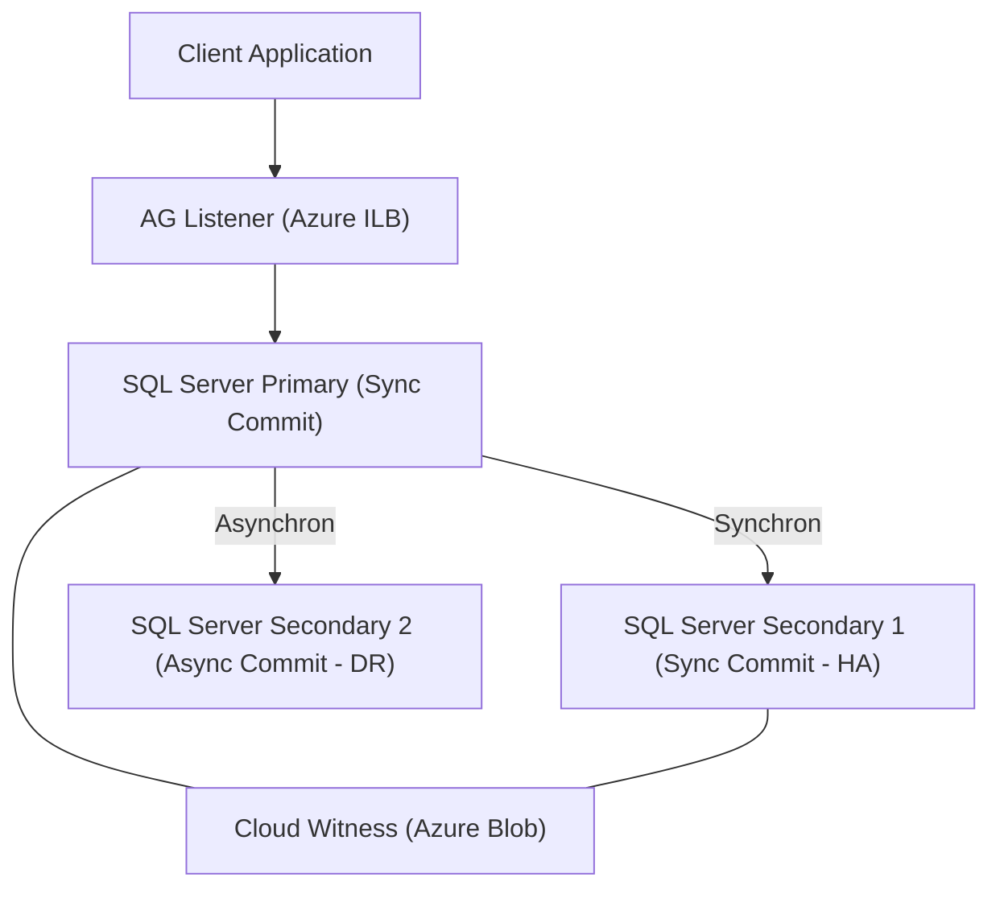

# SQL Server auf Azure VMs

> [!ABSTRACT]
> SQL Server auf Azure VMs (IaaS) bietet 100 % SQL Server-Kompatibilität auf virtuellen Azure-Maschinen. Ideal für Szenarien mit speziellen OS-Anforderungen, absoluter Kompatibilität, benutzerdefinierten Erweiterungen oder komplexen Compliance-Vorgaben, die PaaS nicht erfüllen kann.

---

## Wann SQL auf VMs statt PaaS?

| Anforderung | SQL auf VM | SQL MI | SQL Database |
|---|---|---|---|
| **100 % SQL Server-Kompatibilität** | ✅ | ~99 % | ~90 % |
| **OS-Level-Zugriff (RDP/SSH)** | ✅ | ❌ | ❌ |
| **Custom SQL Server-Extensions** | ✅ | ❌ | ❌ |
| **Windows-Authentifizierung (AD DS)** | ✅ | ✅ (Entra) | ✅ (Entra) |
| **Eigenes Backup-Tool (z.B. Veeam)** | ✅ | ❌ | ❌ |
| **SQL Server Reporting Services (SSRS)** | ✅ | ❌ | ❌ |
| **SQL Server Analysis Services (SSAS)** | ✅ | ❌ | ❌ |
| **SQL Server Integration Services (SSIS)** | ✅ | ❌ | ❌ (Azure-SSIS IR) |
| **Spezielle Hardware-Anforderungen** | ✅ | ❌ | ❌ |
| **Verwaltungsaufwand** | Hoch | Niedrig | Sehr niedrig |

> [!NOTE]
> SQL auf Azure VMs ist ein **IaaS**-Ansatz — Microsoft verwaltet nur die physische Infrastruktur. Betriebssystem, SQL Server, Patches, HA und Backups liegen in der Verantwortung des Kunden (unterstützt durch SQL IaaS Agent Extension).

---

## Via Azure Portal (UI)

> [!TIP] Schnelleinstieg
> SQL Server auf Azure VMs wird über spezialisierte Marketplace-Images erstellt, die SQL Server vorinstalliert und vorkonfiguriert bereitstellen.

### SQL Server VM aus Marketplace erstellen

1. **portal.azure.com** → **Virtuelle Computer** → **+ Erstellen** → **Azure-VM aus dem Katalog**
2. **Image suchen**: `SQL Server` eingeben → gewünschtes Image auswählen:
   - z. B. `SQL Server 2022 Developer on Windows Server 2022`
   - oder `SQL Server 2022 Enterprise on Windows Server 2022`
3. **Grundlagen**-Tab:
   - Abonnement & Ressourcengruppe, **VM-Name**, **Region**
   - **Größe**: Für SQL Server empfohlen E-Serie (speicheroptimiert) oder M-Serie (groß)
   - **Administratorkonto**: Benutzername & Passwort
4. **Datenträger**-Tab:
   - OS-Datenträger: Premium SSD
   - **+ Neuen Datenträger hinzufügen**: separate Premium SSDs für Daten und Logs
5. **SQL Server-Einstellungen**-Tab (spezifisch für SQL-Images):
   - **SQL-Konnektivität**: Lokal (nur VM), Privat (VNet) oder Öffentlich
   - **Port**: 1433 (Standard)
   - **SQL-Authentifizierung**: Aktivieren & SQL-Administratoranmeldedaten festlegen
   - **Speicherkonfiguration**: Daten-, Log- und TempDB-Pfade auf separaten Datenträgern
   - **Automatisierte Sicherung**: Aktivieren, Aufbewahrung & Speicherkonto festlegen
   - **Automatisiertes Patching**: Wartungsfenster konfigurieren
6. **Überprüfen + erstellen** → **Erstellen**

### SQL IaaS Agent Extension registrieren

1. VM → **SQL-IaaS-Erweiterung** (wird automatisch bei Marketplace-Images registriert)
2. Verwaltungsmodus prüfen: Lightweight → Vollständig upgraden für alle Features

---

## Marketplace-Images

Azure Marketplace bietet vorkonfigurierte SQL Server-Images:

| Image | SQL Version | Windows Server | Lizenz |
|---|---|---|---|
| SQL Server 2019 Developer | 2019 | 2019/2022 | Kostenlos (nur Dev/Test) |
| SQL Server 2019 Standard | 2019 | 2019/2022 | Pay-as-you-go oder BYOL |
| SQL Server 2019 Enterprise | 2019 | 2019/2022 | Pay-as-you-go oder BYOL |
| SQL Server 2022 Developer | 2022 | 2022 | Kostenlos (nur Dev/Test) |
| SQL Server 2022 Standard | 2022 | 2022 | Pay-as-you-go oder BYOL |
| SQL Server 2022 Enterprise | 2022 | 2022 | Pay-as-you-go oder BYOL |

```powershell
# SQL Server VM aus Marketplace-Image erstellen
New-AzVM -ResourceGroupName "rg-sql" `
    -Name "vm-sql-prod" `
    -Location "westeurope" `
    -ImageName "MicrosoftSQLServer:sql2022-ws2022:enterprise:latest" `
    -Size "Standard_E8ds_v5"
```

> [!TIP]
> Empfohlene VM-Größen für SQL Server: **Esv5-Serie** (Memory-Optimized) oder **Mdsv3-Serie** (Very Large Memory) für intensive OLTP-Workloads.

---

## SQL IaaS Agent Extension

Die **SQL IaaS Agent Extension** erweitert SQL Server VMs um verwaltete Azure-Features:

| Feature | Beschreibung | Registrierungsmodus |
|---|---|---|
| **Automated Backup** | Automatische Backups auf Azure Blob Storage | Full |
| **Automated Patching** | SQL Server-Patches in definierten Wartungsfenstern | Full |
| **Azure Key Vault Integration** | SQL Server-Zertifikate und -Keys in Key Vault verwalten | Full |
| **SQL VM Management** | SQL Server im Azure Portal verwalten | Full |
| **Best Practices Assessment** | Regelmäßige Prüfung auf SQL Server-Best-Practices | Full |
| **Disk Metrics** | SQL-spezifische Disk-Metriken in Azure Monitor | Lightweight |
| **Defender for SQL** | SQL Injection und Anomalie-Erkennung | Full |

```powershell
# SQL IaaS Extension im Full-Modus registrieren
New-AzSqlVM -ResourceGroupName "rg-sql" `
    -Name "vm-sql-prod" `
    -Location "westeurope" `
    -LicenseType "PAYG" `
    -SqlManagementType "Full"
```

---

## Speicher-Konfiguration Best Practice

Die Speicher-Konfiguration ist entscheidend für SQL Server-Performance auf Azure VMs:

| Disk | Typ | Caching | Zweck | Empfehlung |
|---|---|---|---|---|
| **OS Disk** | Premium SSD P30 | ReadWrite | Betriebssystem | 128–256 GB |
| **Daten-Disk (MDF)** | Premium SSD P30+ oder Ultra Disk | ReadOnly | SQL Datendateien | Separate Disk(s), RAID möglich |
| **Log-Disk (LDF)** | Premium SSD P30+ oder Ultra Disk | **None (kein Caching!)** | Transaction Log | Separate Disk, kein Caching! |
| **TempDB** | Premium SSD oder NVMe Temp Disk | ReadOnly | TempDB-Dateien | Lokale NVMe-Disk (Dsv4/Esv4) nutzen |
| **Backup-Disk** | Standard SSD oder Blob | None | SQL Backups | Azure Blob bevorzugen |

> [!DANGER]
> **Kein Write-Caching auf der Log-Disk!** Write-Caching auf der LDF-Disk kann bei VM-Neustart zu **Datenbankkorruption** führen. Caching für Log-Disk immer auf **None** setzen.

```powershell
# Daten-Disk mit ReadOnly Cache hinzufügen
$vm = Get-AzVM -ResourceGroupName "rg-sql" -Name "vm-sql-prod"
Add-AzVMDataDisk -VM $vm -Name "disk-sqldata" `
    -DiskSizeInGB 512 -Lun 0 -Caching "ReadOnly" -CreateOption Empty

# Log-Disk OHNE Cache hinzufügen
Add-AzVMDataDisk -VM $vm -Name "disk-sqllog" `
    -DiskSizeInGB 256 -Lun 1 -Caching "None" -CreateOption Empty

Update-AzVM -ResourceGroupName "rg-sql" -VM $vm
```

---

## Always On Availability Groups

Always On AG ist die empfohlene HA/DR-Lösung für SQL Server auf Azure VMs:



**Konfiguration in Azure:**

1. **Windows Server Failover Cluster (WSFC)** erstellen
2. **Always On AG** mit SQL Server Configuration Manager aktivieren
3. **Azure Internal Load Balancer (ILB)** als AG-Listener konfigurieren
4. **Cloud Witness** statt File Share Witness verwenden

```powershell
# Cluster erstellen
New-Cluster -Name "sql-cluster" `
    -Node "vm-sql-1", "vm-sql-2" `
    -NoStorage

# Cloud Witness konfigurieren
Set-ClusterQuorum -CloudWitness `
    -AccountName "stsqlwitness" `
    -AccessKey "storageAccountKey=="
```

```sql
-- AG auf Primary erstellen
CREATE AVAILABILITY GROUP [AG-Prod]
WITH (AUTOMATED_BACKUP_PREFERENCE = PRIMARY,
      DB_FAILOVER = ON)
FOR DATABASE [mydb], [mydb2]
REPLICA ON
    'vm-sql-1' WITH (
        ENDPOINT_URL = 'TCP://vm-sql-1:5022',
        AVAILABILITY_MODE = SYNCHRONOUS_COMMIT,
        FAILOVER_MODE = AUTOMATIC,
        READABLE_SECONDARY = NO),
    'vm-sql-2' WITH (
        ENDPOINT_URL = 'TCP://vm-sql-2:5022',
        AVAILABILITY_MODE = SYNCHRONOUS_COMMIT,
        FAILOVER_MODE = AUTOMATIC,
        READABLE_SECONDARY = YES);
```

---

## Failover Cluster Instances (FCI)

FCI bietet Instanz-Level-Hochverfügbarkeit — die gesamte SQL-Instanz (nicht einzelne DBs) scheitert über:

| Storage-Option | Beschreibung | Kosten | Anwendungsfall |
|---|---|---|---|
| **Azure Shared Disk** | Premium SSD oder Ultra Disk geteilt zwischen Nodes | Moderat | 2-Node FCI, einfach |
| **Storage Spaces Direct (S2D)** | Lokaler Storage über VMs aggregiert (Software-RAID) | Höher | Mehr Nodes, flexible Kapazität |
| **Premium File Share** | Azure Files Premium als gemeinsamer Storage | Moderat | Einfache Konfiguration |

---

## Cloud Witness

Cloud Witness ersetzt den traditionellen File Share Witness im Windows Failover Cluster:

- **Keine extra VM** für Witness notwendig (spart Kosten)
- Azure Blob Storage als Quorum-Witness
- Storage-Account sollte in **anderer Region** als SQL-VMs liegen
- Benötigt nur minimalen Storage (wenige KB)

```powershell
# Cloud Witness für WSFC konfigurieren
Set-ClusterQuorum -Cluster "sql-cluster" `
    -CloudWitness `
    -AccountName "stsqlwitness" `
    -AccessKey "base64encodedStorageKey=="
```

---

## SQL Server Lizenzierung

| Modell | Beschreibung | Kosten | Voraussetzung |
|---|---|---|---|
| **Pay-as-you-go (PAYG)** | Lizenz im VM-Preis inklusive | Höchste laufende Kosten | Keine |
| **BYOL (Azure Hybrid Benefit)** | Eigene SQL Server-Lizenz verwenden | Bis 40 % günstiger | SQL Server mit Software Assurance |
| **Developer Edition** | Kostenlos, aber nur für Dev/Test | Kostenlos | Kein Produktiveinsatz erlaubt |
| **Reserved VM Instances** | 1 oder 3 Jahre im Voraus zahlen | 20–35 % Einsparung | PAYG oder BYOL |

```powershell
# Azure Hybrid Benefit für SQL Server VM aktivieren
Update-AzSqlVM -ResourceGroupName "rg-sql" `
    -Name "vm-sql-prod" `
    -LicenseType "AHUB"  # AHUB = Azure Hybrid Use Benefit
```

> [!TIP]
> Mit **Azure Hybrid Benefit** können Einsparungen von bis zu 40 % auf die SQL Server-Lizenzkosten erzielt werden. Bei Kombination mit Reserved VM Instances sind Gesamteinsparungen von 60 %+ möglich.

---

## Automated Backup

Die SQL IaaS Agent Extension ermöglicht automatisierte Backups auf Azure Blob Storage:

```powershell
# Automated Backup konfigurieren
$autobackup = New-AzSqlVMAutoBackupConfig `
    -Enable `
    -RetentionPeriodInDays 30 `
    -StorageContext $storageContext `
    -EnableEncryption `
    -CertificatePassword $certPassword `
    -BackupSystemDbs `
    -BackupScheduleType Manual `
    -FullBackupFrequency Daily `
    -FullBackupStartHour 2 `
    -FullBackupWindowInHours 2 `
    -LogBackupFrequency 60

Set-AzSqlVM -ResourceGroupName "rg-sql" `
    -Name "vm-sql-prod" `
    -AutoBackupSettings $autobackup
```

**Backup-Typen (Automated Backup v2):**
- Full Backup: Täglich oder wöchentlich
- Differential Backup: Optional
- Log Backup: Alle 5–60 Minuten konfigurierbar
- Aufbewahrung: 1–90 Tage

---

## Automated Patching

Definiert Wartungsfenster für automatische SQL Server-Updates:

```powershell
# Wartungsfenster Sonntag 2:00 Uhr, 2 Stunden
$autopatch = New-AzSqlVMAutoPatchingConfig `
    -Enable `
    -DayOfWeek Sunday `
    -MaintenanceWindowStartingHour 2 `
    -MaintenanceWindowDuration 120

Set-AzSqlVM -ResourceGroupName "rg-sql" `
    -Name "vm-sql-prod" `
    -AutoPatchingSettings $autopatch
```

---

## Microsoft Defender for SQL

Auch auf SQL Server-VMs verfügbar über die SQL IaaS Extension:

- **SQL Injection Detection:** Erkennt Angriffsmuster in SQL-Abfragen
- **Anomalie-Erkennung:** Ungewöhnliche Zugriffe (neue IPs, ungewöhnliche Zeiten, Brute Force)
- **Vulnerability Assessment:** Wöchentliche Scans, Berichte im Azure Security Center
- **Sensitive Data Discovery:** Automatische Erkennung von PII in der Datenbank

---

## Migration zu SQL VM

| Methode | Downtime | Komplexität | Anwendungsfall |
|---|---|---|---|
| **Backup/Restore** | Stunden (DB-Größe) | Niedrig | Kleine DBs, akzeptable Downtime |
| **Log Shipping** | Minuten | Mittel | Größere DBs, Online-Migration |
| **Always On AG (Hybrid)** | Sekunden | Hoch | Zero-Downtime, kritische Systeme |
| **Azure DMS** | Minuten | Mittel | Automatisiert, Online-Migration |
| **Detach/Attach via VHD** | Stunden | Niedrig | Schnelle Migration, Downtime akzeptabel |

---

## Kosten-Vergleich SQL VM vs. SQL MI vs. SQL DB

| Dienst | Verwaltung | Kompatibilität | Typische Kosten/Monat | Anwendungsfall |
|---|---|---|---|---|
| **SQL Database (Serverless)** | Vollständig verwaltet | ~90 % | 15–100 € | Dev/Test, neue Apps |
| **SQL Database (GP 4 vCores)** | Vollständig verwaltet | ~90 % | 300–500 € | Produktions-Apps |
| **SQL Managed Instance (GP 8 vCores)** | Vollständig verwaltet | ~99 % | 450–800 € | Lift-and-Shift |
| **SQL Server VM (E4ds_v5, Ent.)** | IaaS | 100 % | 600–1200 € | Volle Kontrolle, SSRS/SSAS |
| **SQL Server VM + Hybrid Benefit** | IaaS | 100 % | 350–700 € | Volle Kontrolle mit Lizenz |

---

## Verwandte Notizen

- [[Azure SQL Database]] — Vollständig verwalteter PaaS-SQL-Dienst
- [[Azure SQL Managed Instance]] — Near-100%-Kompatibilität als PaaS
- [[Azure RBAC]] — Zugriffskontrolle auf Azure-Ressourcen
- [[Azure Storage Grundlagen]] — Blob Storage für Backups
