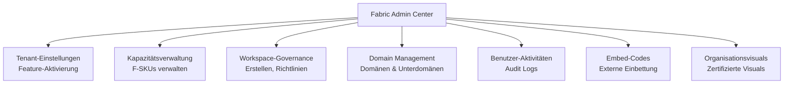
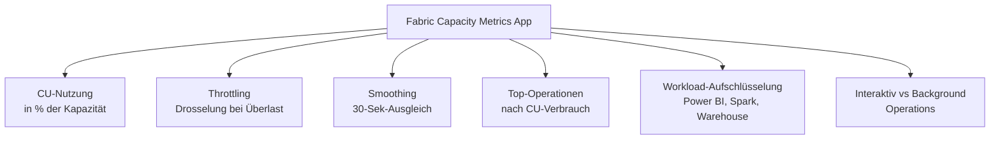
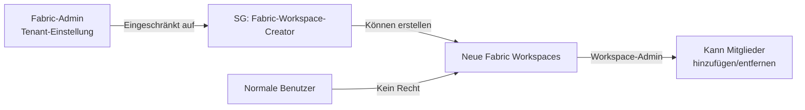
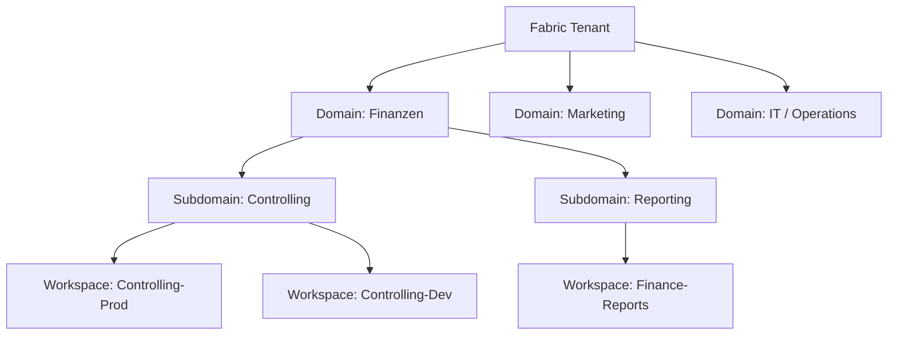
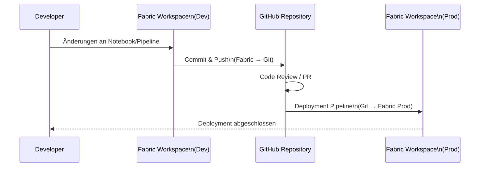
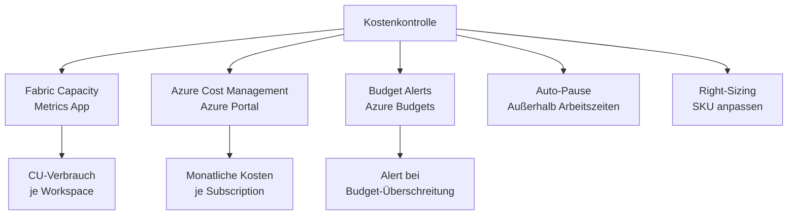

---
tags:
  - fabric
  - administration
  - governance
  - capacity
  - tenant-settings
  - azure
  - microsoft-365
aliases:
  - Fabric Admin
  - Fabric Admin Center
  - Fabric Verwaltung
---

# Fabric Administration

> [!ABSTRACT]
> Die Microsoft Fabric Administration umfasst die Verwaltung von Kapazitäten, Tenant-Einstellungen, Workspaces, Domains und Sicherheitseinstellungen über das **Fabric Admin Center** (`admin.fabric.microsoft.com`). Admins steuern, welche Features aktiviert sind, wie Kapazitäten skaliert werden und wie Governance über den gesamten Fabric-Tenant umgesetzt wird.

---

## Fabric Admin Center

Das Fabric Admin Center ist die zentrale Verwaltungsoberfläche für alle Fabric-Einstellungen. Es vereint das frühere Power BI Admin Portal und neue Fabric-spezifische Einstellungen.

**URL:** `https://admin.fabric.microsoft.com`

### Admin Center Übersicht



> [!NOTE]
> Um auf das Fabric Admin Center zuzugreifen, muss der Benutzer eine der folgenden Rollen haben: **Fabric-Administrator**, **Power Platform-Administrator**, **Globaler Administrator** oder **Abrechnungsadministrator** (für Kapazitätsverwaltung).

---

## Tenant-Einstellungen

Tenant-Einstellungen steuern, welche Features im gesamten Fabric-Tenant verfügbar sind. Sie können **für alle Benutzer**, **für bestimmte Sicherheitsgruppen** oder **ausgeschlossen für bestimmte Gruppen** konfiguriert werden.

### Wichtige Tenant-Einstellungen (Überblick)

| Einstellung | Kategorie | Standard | Empfehlung |
|---|---|---|---|
| Microsoft Fabric aktivieren | Fabric | Ein | Ein |
| Benutzer können Fabric-Elemente erstellen | Fabric | Ein | Gruppen-basiert |
| Copilot und Azure OpenAI | KI | Aus | Nach Bedarf |
| Direct Lake aktivieren | Power BI | Ein | Ein |
| Workspaces erstellen | Workspace | Alle | Eingeschränkte Gruppe |
| Domains erstellen | Governance | Admins | Admins |
| Git-Integration | DevOps | Ein | Ein |
| Öffentliche Einbettung | Sicherheit | Aus | Aus (prüfen) |
| Exportieren nach Excel | Export | Ein | Gruppen-basiert |
| Exportieren nach PDF | Export | Ein | Ein |
| Daten via API exportieren | Export | Ein | Eingeschränkte Gruppe |
| Dienstprinzipale dürfen API nutzen | API | Aus | Ein (für Automation) |

### Tenant-Einstellungen per REST API verwalten

```powershell
# Alle Tenant-Einstellungen abrufen
$token = (Get-AzAccessToken -ResourceUrl "https://analysis.windows.net/powerbi/api").Token
$headers = @{ Authorization = "Bearer $token" }

$uri = "https://api.powerbi.com/v1.0/myorg/admin/tenantSettings"
$settings = Invoke-RestMethod -Uri $uri -Headers $headers -Method Get

# Spezifische Einstellung suchen
$settings.tenantSettings |
    Where-Object { $_.settingName -like "*Export*" } |
    Select-Object settingName, enabled, tenantSettingGroup |
    Format-Table -AutoSize
```

```powershell
# Tenant-Einstellung ändern (Beispiel: Workspaces erstellen einschränken)
$uri = "https://api.powerbi.com/v1.0/myorg/admin/tenantSettings"
$body = @{
    tenantSettings = @(
        @{
            settingName = "CreateAppWorkspaces"
            enabled     = $true
            enabledSecurityGroups = @(
                @{ id = "xxxxxxxx-xxxx-xxxx-xxxx-xxxxxxxxxxxx"; name = "Fabric-Workspace-Creator" }
            )
        }
    )
} | ConvertTo-Json -Depth 5

Invoke-RestMethod -Uri $uri -Method Patch -Headers $headers -Body $body -ContentType "application/json"
```

---

## Kapazitätsverwaltung

Fabric-Kapazitäten (F-SKUs) sind die **Compute-Einheiten** für alle Fabric-Workloads. Sie werden in Azure provisioniert und über das Admin Center oder Azure Portal verwaltet.

### Fabric SKU-Übersicht

| SKU | CUs | RAM | Empfohlen für | Ungefähre Kosten/Monat |
|---|---|---|---|---|
| F2 | 2 | 10 GB | Evaluierung, Test | ~ca. 260 € |
| F4 | 4 | 20 GB | Kleine Teams | ~ca. 520 € |
| F8 | 8 | 40 GB | Mittlere Teams | ~ca. 1.040 € |
| F16 | 16 | 80 GB | Größere Teams | ~ca. 2.080 € |
| F32 | 32 | 160 GB | Abteilungen | ~ca. 4.160 € |
| F64 | 64 | 320 GB | Org-Level + Copilot | ~ca. 8.320 € |
| F128 | 128 | 640 GB | Enterprise | ~ca. 16.640 € |
| F256 | 256 | 1.280 GB | Große Konzerne | ~ca. 33.280 € |
| F512 | 512 | 2.560 GB | Sehr große Konzerne | ~ca. 66.560 € |
| F2048 | 2.048 | 10.240 GB | Hyperscale | Auf Anfrage |

> [!NOTE]
> Kosten sind Schätzwerte (Pay-as-you-go, West Europe). Tatsächliche Kosten variieren nach Region, Reservierungsmodell und Verbrauch.

### Kapazität erstellen (PowerShell / Azure CLI)

```powershell
# Fabric Capacity über Azure PowerShell erstellen
Install-Module -Name Az.Fabric -Force

$resourceGroupName = "rg-fabric-prod"
$capacityName      = "fabricprodcapacity"
$location          = "westeurope"
$adminEmail        = "fabric-admin@contoso.com"

New-AzFabricCapacity `
    -ResourceGroupName $resourceGroupName `
    -CapacityName $capacityName `
    -Location $location `
    -Sku "F64" `
    -AdministrationMember @($adminEmail)
```

```bash
# Azure CLI Alternative
az fabric capacity create \
  --resource-group rg-fabric-prod \
  --capacity-name fabricprodcapacity \
  --location westeurope \
  --sku name=F64 \
  --administration members='["fabric-admin@contoso.com"]'
```

### Kapazität pausieren und skalieren

```powershell
# Kapazität pausieren (Kosten sparen außerhalb Arbeitszeiten)
Suspend-AzFabricCapacity `
    -ResourceGroupName "rg-fabric-prod" `
    -CapacityName "fabricprodcapacity"

# Kapazität wieder starten
Resume-AzFabricCapacity `
    -ResourceGroupName "rg-fabric-prod" `
    -CapacityName "fabricprodcapacity"

# Kapazität skalieren (z.B. für monatliche Berichte hochskalieren)
Update-AzFabricCapacity `
    -ResourceGroupName "rg-fabric-prod" `
    -CapacityName "fabricprodcapacity" `
    -Sku "F128"
```

### Automatisches Pausieren mit Azure Automation

```powershell
# Azure Automation Runbook: Fabric Capacity nach Arbeitszeit pausieren
param(
    [string]$ResourceGroupName = "rg-fabric-prod",
    [string]$CapacityName      = "fabricprodcapacity"
)

# Managed Identity Authentifizierung
Connect-AzAccount -Identity

$currentHour = (Get-Date -TimeZone "W. Europe Standard Time").Hour

if ($currentHour -ge 20 -or $currentHour -lt 7) {
    Write-Output "Außerhalb Arbeitszeiten — Kapazität wird pausiert..."
    Suspend-AzFabricCapacity -ResourceGroupName $ResourceGroupName -CapacityName $CapacityName
    Write-Output "Kapazität pausiert."
} else {
    Write-Output "Innerhalb Arbeitszeiten — keine Aktion."
}
```

---

## Kapazitäts-Monitoring (Fabric Capacity Metrics App)

Die **Fabric Capacity Metrics App** ist eine Power BI App, die CU-Verbrauch, Throttling und Smoothing überwacht.

### Wichtige Metriken



### Throttling und Smoothing verstehen

| Konzept | Beschreibung |
|---|---|
| **CU (Capacity Units)** | Berechnungseinheit für Fabric-Workloads |
| **Smoothing** | CU-Verbrauch wird über 30 Sekunden geglättet |
| **Throttling** | Bei dauerhafter Überlastung werden neue Anfragen verzögert |
| **Background Operations** | Spark, Pipelines (niedrigere Priorität) |
| **Interactive Operations** | Power BI Berichte, SQL-Abfragen (hohe Priorität) |
| **Bursting** | Kurzfristig mehr als Kapazitäts-CUs verbrauchen |

```kusto
// KQL: Fabric Kapazitätsnutzung (aus Metrics App Dataset)
FabricCapacityMetrics
| where TimeGenerated >= ago(24h)
| summarize
    avg_cu_pct    = avg(CapacityUnitPercentage),
    max_cu_pct    = max(CapacityUnitPercentage),
    throttle_mins = countif(IsThrottled == true)
    by bin(TimeGenerated, 1h), WorkloadName
| order by TimeGenerated desc
```

---

## Workspace-Governance

### Wer darf Workspaces erstellen?

Best Practice: Workspace-Erstellung auf eine **spezifische Sicherheitsgruppe** einschränken, um unkontrolliertes Workspace-Wachstum zu verhindern.



### Workspace-Rollen

| Rolle | Rechte | Typische Benutzer |
|---|---|---|
| **Admin** | Alle Rechte inkl. Löschen | Workspace-Owner |
| **Member** | Inhalte veröffentlichen, bearbeiten | Data Engineers, BI-Entwickler |
| **Contributor** | Inhalte erstellen und bearbeiten | Analysten |
| **Viewer** | Nur lesen | Business-Benutzer |

### Workspaces per API auflisten

```powershell
# Alle Workspaces im Tenant auflisten (Admin-API)
$uri = "https://api.powerbi.com/v1.0/myorg/admin/groups?$top=5000"
$workspaces = Invoke-RestMethod -Uri $uri -Headers $headers

$workspaces.value |
    Select-Object id, name, type, state, capacityId |
    Where-Object { $_.type -eq "Workspace" } |
    Export-Csv "fabric_workspaces.csv" -NoTypeInformation

Write-Host "Workspaces exportiert: $($workspaces.value.Count)"
```

---

## Fabric Domain Management

Domains ermöglichen es, **Workspaces logisch nach Geschäftsbereichen zu gruppieren** und Governance-Richtlinien anzuwenden.



### Domain-Einstellungen

| Einstellung | Beschreibung |
|---|---|
| **Domain-Admin** | Kann Workspaces zur Domain zuweisen |
| **Contributors** | Können Workspaces der Domain hinzufügen |
| **Default Sensitivity Label** | Wird auf alle neuen Assets in der Domain angewendet |
| **Delegierte Tenant-Einstellungen** | Domain-spezifische Überschreibungen von Tenant-Einstellungen |

```powershell
# Fabric Domain erstellen (REST API)
$uri = "https://api.fabric.microsoft.com/v1/admin/domains"
$fabricToken = (Get-AzAccessToken -ResourceUrl "https://api.fabric.microsoft.com").Token
$fabricHeaders = @{ Authorization = "Bearer $fabricToken"; "Content-Type" = "application/json" }

$body = @{
    displayName = "Finanzen"
    description = "Domain für alle finanzrelevanten Fabric-Workspaces"
} | ConvertTo-Json

$domain = Invoke-RestMethod -Uri $uri -Method Post -Headers $fabricHeaders -Body $body
Write-Host "Domain erstellt: $($domain.id)"
```

---

## Admin-APIs (Power BI / Fabric REST API)

Fabric- und Power BI-Admin-APIs ermöglichen die **programmatische Verwaltung** aller Fabric-Ressourcen.

### Wichtige API-Endpunkte

| Endpunkt | Beschreibung |
|---|---|
| `/v1.0/myorg/admin/groups` | Alle Workspaces im Tenant |
| `/v1.0/myorg/admin/datasets` | Alle Semantic Models |
| `/v1.0/myorg/admin/reports` | Alle Berichte |
| `/v1.0/myorg/admin/tenantSettings` | Tenant-Einstellungen |
| `/v1.0/myorg/admin/capacities` | Kapazitäten |
| `/v1/workspaces` | Fabric Workspaces (neue API) |
| `/v1/admin/domains` | Domain-Verwaltung |
| `/v1/workspaces/{id}/spark/pools` | Spark-Pools |

### Service Principal für Automation einrichten

```powershell
# App-Registrierung in Azure AD erstellen
$app = New-AzADApplication -DisplayName "FabricAdminAutomation"
$sp  = New-AzADServicePrincipal -ApplicationId $app.AppId
$secret = New-AzADAppCredential -ApplicationId $app.AppId -EndDate (Get-Date).AddYears(1)

Write-Host "Client ID: $($app.AppId)"
Write-Host "Client Secret: $($secret.SecretText)"
Write-Host "Tenant ID: $((Get-AzContext).Tenant.Id)"

# Service Principal als Fabric-Admin-Gruppen-Mitglied hinzufügen
# (Im Fabric Admin Center: Tenant-Einstellung 'Dienstprinzipale dürfen Admin-APIs nutzen')
```

---

## Audit Logs für Fabric

Alle Fabric-Aktivitäten werden über **Microsoft 365 Unified Audit Logs** (Purview) erfasst.

```powershell
# Fabric-Audit-Logs der letzten 24 Stunden
Connect-ExchangeOnline -UserPrincipalName "admin@contoso.com"

$results = Search-UnifiedAuditLog `
    -StartDate (Get-Date).AddHours(-24) `
    -EndDate   (Get-Date) `
    -Operations "RunNotebook", "CreateLakehouse", "DeleteLakehouse",
                "RunPipeline", "CreateWarehouse", "ExportArtifact" `
    -ResultSize 5000

$results | ForEach-Object {
    $data = $_.AuditData | ConvertFrom-Json
    [PSCustomObject]@{
        Zeit      = $_.CreationDate
        Benutzer  = $_.UserIds
        Aktion    = $_.Operations
        Workspace = $data.WorkSpaceName
        Item      = $data.ArtifactName ?? $data.DatasetName
        IP        = $data.ClientIP
    }
} | Sort-Object Zeit -Descending | Format-Table -AutoSize
```

---

## Git-Integration für Fabric

Fabric-Workspaces können mit **Azure DevOps** oder **GitHub** verbunden werden, um Fabric-Artefakte versioniert zu speichern.



### Git-Integration aktivieren

```powershell
# Workspace mit Azure DevOps verbinden (Fabric REST API)
$workspaceId = "xxxxxxxx-xxxx-xxxx-xxxx-xxxxxxxxxxxx"
$uri = "https://api.fabric.microsoft.com/v1/workspaces/$workspaceId/git/connect"

$body = @{
    gitProviderDetails = @{
        organizationName = "contoso-devops"
        projectName      = "FabricProjekte"
        gitProviderType  = "AzureDevOps"
        repositoryName   = "fabric-analytics"
        branchName       = "main"
        directoryName    = "/workspaces/analytics-prod"
    }
} | ConvertTo-Json -Depth 5

Invoke-RestMethod -Uri $uri -Method Post -Headers $fabricHeaders -Body $body
```

---

## Disaster Recovery und Backup

> [!WARNING]
> Microsoft Fabric hat **keinen nativen Backup-Mechanismus** für Notebooks, Pipelines oder Lakehouse-Metadaten (Stand 2024). Backup-Strategien müssen eigenständig implementiert werden.

### Backup-Strategien

| Artefakt | Backup-Strategie |
|---|---|
| **Notebooks** | Git-Integration (Azure DevOps / GitHub) |
| **Pipelines** | Git-Integration + JSON-Export |
| **Lakehouse Delta-Tabellen** | OneLake Daten liegen in Azure Storage → ADLS Geo-Redundanz |
| **Semantic Models** | XMLA-Endpoint + Tabular Editor / ALM Toolkit |
| **Power BI Reports** | PBIX-Export per REST API |

```powershell
# Alle Power BI Reports als PBIX exportieren (Backup)
$uri = "https://api.powerbi.com/v1.0/myorg/admin/reports?$top=5000"
$reports = Invoke-RestMethod -Uri $uri -Headers $headers

$backupPath = "C:\FabricBackup\$(Get-Date -Format 'yyyyMMdd')"
New-Item -ItemType Directory -Path $backupPath -Force | Out-Null

foreach ($report in $reports.value) {
    try {
        $exportUri = "https://api.powerbi.com/v1.0/myorg/groups/$($report.workspaceId)/reports/$($report.id)/Export"
        $bytes = Invoke-RestMethod -Uri $exportUri -Headers $headers -Method Get
        $fileName = "$backupPath\$($report.name -replace '[\\/:*?"<>|]', '_').pbix"
        [System.IO.File]::WriteAllBytes($fileName, $bytes)
        Write-Host "Exportiert: $($report.name)"
    } catch {
        Write-Warning "Fehler bei $($report.name): $($_.Exception.Message)"
    }
}
```

---

## Kostenkontrolle (Fabric Capacity Metering)

### Kosten-Monitoring-Strategie



### Azure Budget Alert einrichten

```bash
# Azure CLI: Budget-Alert für Fabric-Kapazität
az consumption budget create \
  --budget-name "FabricMonthlyBudget" \
  --amount 5000 \
  --time-grain Monthly \
  --start-date 2024-01-01 \
  --end-date 2025-12-31 \
  --resource-group rg-fabric-prod \
  --notifications '[
    {
      "enabled": true,
      "operator": "GreaterThan",
      "threshold": 80,
      "contactEmails": ["fabric-admin@contoso.com"],
      "thresholdType": "Actual"
    }
  ]'
```

### Kostentreiber identifizieren

| Kostentreiber | Maßnahme |
|---|---|
| Spark-Jobs laufen über Nacht | Auto-Scheduling zu Nebenzeiten |
| Ungenutzte Custom Pools | Pool-Timeout konfigurieren |
| Große Power BI Imports | Direct Lake statt Import |
| Viele kleine Pipeline-Runs | Pipeline-Konsolidierung |
| Dev-Workspace über Wochenende | Auto-Pause für Non-Prod-Kapazitäten |

---

## Verwandte Notizen

- [[Microsoft Fabric Grundlagen]]
- [[Fabric Copilot]]
- [[Microsoft Purview in Fabric]]
- [[Power BI in Fabric]]
