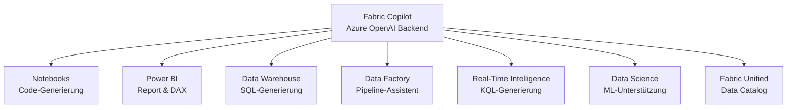
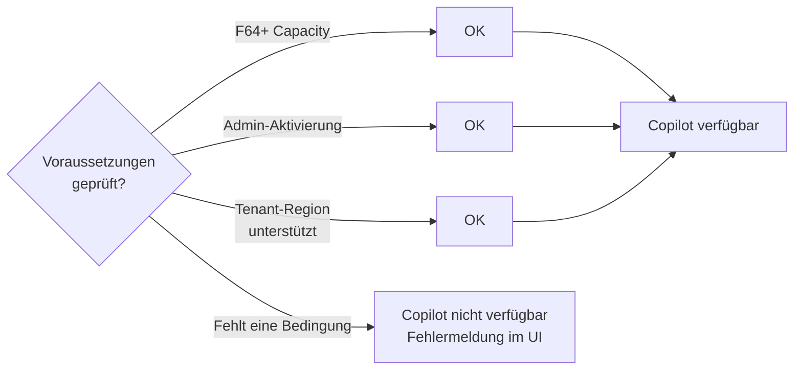
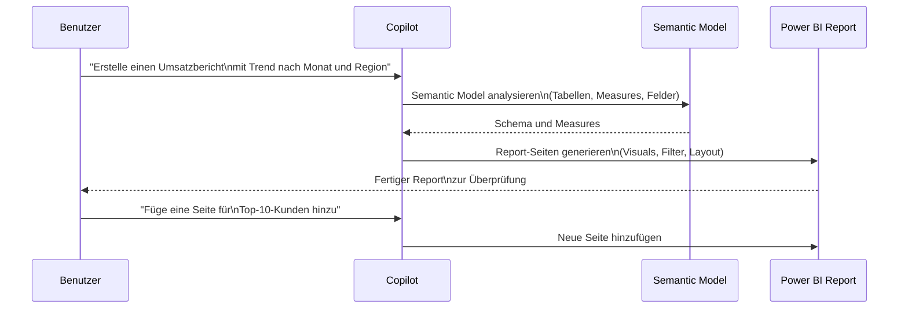
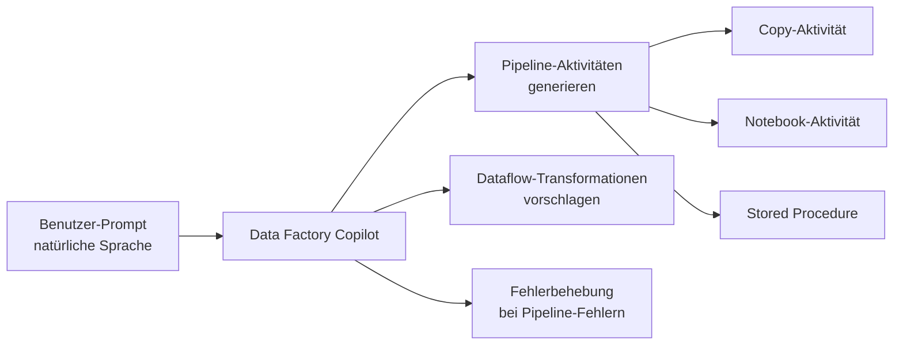
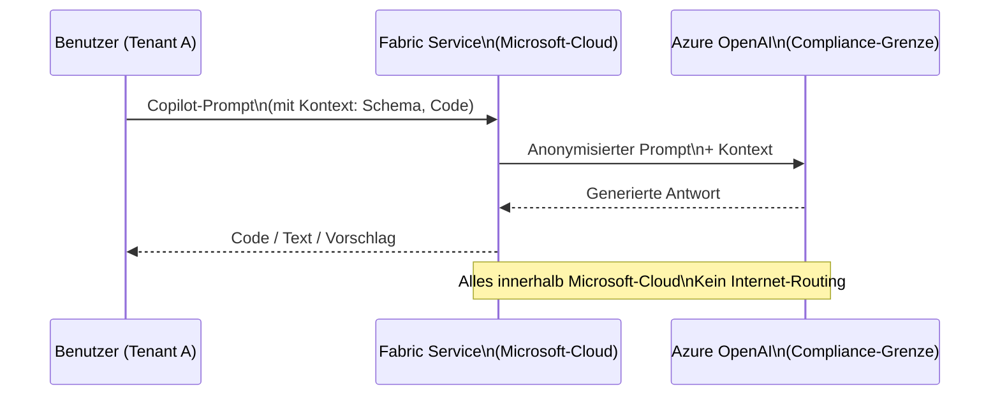

---
tags:
  - fabric
  - copilot
  - ki
  - llm
  - power-bi
  - notebooks
  - data-warehouse
  - azure
  - microsoft-365
aliases:
  - Copilot in Fabric
  - Fabric KI
  - Fabric AI Assistant
---

# Fabric Copilot

> [!ABSTRACT]
> Fabric Copilot ist der KI-Assistent, der in alle Microsoft Fabric-Erfahrungen integriert ist. Basierend auf Azure OpenAI ermöglicht Copilot Code-Generierung in Notebooks, natürlichsprachige Report-Erstellung in Power BI, SQL-Generierung im Data Warehouse, Pipeline-Erstellung in Data Factory und Abfragen in Real-Time Intelligence. Voraussetzung ist eine **Fabric Capacity von mindestens F64**.

---

## Was ist Fabric Copilot?

Fabric Copilot ist kein einzelnes Produkt, sondern eine **KI-Schicht**, die in alle Fabric-Erfahrungen (Experiences) eingebettet ist. Jede Experience hat ihre eigene Copilot-Ausprägung mit spezifischen Fähigkeiten.



### Copilot-Verfügbarkeit (Stand 2024/2025)

| Fabric-Erfahrung | GA-Status | Mindest-SKU |
|---|---|---|
| Power BI Copilot | ✅ GA (seit Okt. 2023) | F64 / P1 |
| Notebook Copilot | ✅ GA (seit 2024) | F64 |
| Data Warehouse Copilot | ✅ GA (seit 2024) | F64 |
| Data Factory Copilot | ✅ GA (seit 2024) | F64 |
| Real-Time Intelligence Copilot | 🔄 Preview | F64 |
| Data Science Copilot | 🔄 Preview | F64 |

---

## Voraussetzungen

> [!IMPORTANT]
> Fabric Copilot erfordert folgende Voraussetzungen:
> 1. **Fabric Capacity F64 oder höher** (oder P1 Premium-Kapazität für Power BI Copilot)
> 2. **Admin-Aktivierung** im Fabric Admin Center (Tenant-Einstellung)
> 3. **Copilot für Azure OpenAI aktiviert** — Prompts werden in der Compliance-Grenze des Tenants verarbeitet
> 4. Benutzer müssen Mitglied des Fabric-Workspaces sein



### Unterstützte Regionen (Copilot)

Copilot ist in bestimmten Azure-Regionen verfügbar. Für Tenants in nicht unterstützten Regionen kann **Cross-Geo-Verarbeitung** aktiviert werden:

| Region | Copilot native | Cross-Geo nötig |
|---|---|---|
| East US, West US | ✅ | Nein |
| West Europe, North Europe | ✅ | Nein |
| Germany West Central | ❌ (Stand 2024) | Ja |
| Australia East | ✅ | Nein |
| Southeast Asia | ✅ | Nein |

> [!WARNING]
> Cross-Geo-Verarbeitung bedeutet, dass Prompts **außerhalb der Home-Region** des Tenants verarbeitet werden. Für strenge Datenresidenz-Anforderungen (z.B. BSI-konforme Umgebungen) muss dies sorgfältig bewertet werden.

---

## Copilot im Notebook

Notebook Copilot ist der umfangreichste Copilot in Fabric und unterstützt:

### Funktionen

| Funktion | Beschreibung |
|---|---|
| **Code generieren** | Natürlichsprachige Beschreibung → PySpark/Python-Code |
| **Code erklären** | Markierten Code verständlich erläutern lassen |
| **Fehler beheben** | Fehlermeldung an Copilot übergeben → Fix vorschlagen |
| **Code dokumentieren** | Docstrings und Kommentare automatisch hinzufügen |
| **Refactoring** | Code optimieren und vereinfachen |
| **Schema verstehen** | Tabellenschema analysieren und beschreiben |

### Beispiel: Code-Generierung

```python
# Prompt an Copilot (im Copilot-Chat-Panel):
# "Schreibe PySpark-Code, der die sales_fact-Tabelle aus dem Lakehouse lädt,
#  nach Monat und Region aggregiert und als Delta-Tabelle speichert"

# Copilot generiert:
from pyspark.sql import functions as F
from pyspark.sql.types import DoubleType

# Daten laden
df = spark.read.format("delta").load("Tables/sales_fact")

# Aggregation nach Monat und Region
monthly_region_sales = (
    df
    .withColumn("month", F.date_trunc("month", F.col("order_date")))
    .groupBy("month", "region")
    .agg(
        F.sum("revenue").cast(DoubleType()).alias("total_revenue"),
        F.count("order_id").alias("order_count"),
        F.avg("order_value").alias("avg_order_value")
    )
    .orderBy("month", "region")
)

# Als Delta-Tabelle speichern
monthly_region_sales.write \
    .format("delta") \
    .mode("overwrite") \
    .option("mergeSchema", "true") \
    .saveAsTable("monthly_region_sales")

print(f"Tabelle gespeichert: {monthly_region_sales.count()} Zeilen")
```

### Beispiel: Fehler erklären und beheben

```python
# Fehlerhafte Code (Copilot bekommt Fehlermeldung):
# AnalysisException: Column 'order_dat' cannot be resolved

# Copilot erklärt:
# "Der Spaltenname 'order_dat' existiert nicht in der Tabelle.
#  Wahrscheinlich Tippfehler — die Spalte heißt 'order_date'"

# Copilot-Fix:
df.withColumn("month", F.date_trunc("month", F.col("order_date")))  # Korrigiert
```

---

## Copilot in Power BI

Power BI Copilot ist der **am weitesten entwickelte** Copilot in Fabric und unterstützt:

### Report aus natürlicher Sprache erstellen



### DAX-Generierung mit Copilot

```dax
-- Prompt: "Erstelle ein Measure für Umsatz der letzten 12 Monate
--          im Vergleich zu den 12 Monaten davor"

-- Copilot generiert:
Umsatz L12M :=
CALCULATE(
    [Umsatz Gesamt],
    DATESINPERIOD(
        'Datum'[Datum],
        LASTDATE('Datum'[Datum]),
        -12,
        MONTH
    )
)

Umsatz P12M :=
CALCULATE(
    [Umsatz Gesamt],
    DATESINPERIOD(
        'Datum'[Datum],
        DATEADD(LASTDATE('Datum'[Datum]), -12, MONTH),
        -12,
        MONTH
    )
)

Umsatz L12M vs P12M% :=
DIVIDE(
    [Umsatz L12M] - [Umsatz P12M],
    [Umsatz P12M],
    BLANK()
)
```

### Narrative Visual (Copilot-Zusammenfassung)

Das **Narrative Visual** generiert automatisch einen erklärenden Text für Power BI-Seiten:

```
Beispiel Copilot-generierter Narrative Text:
"Im Q3 2024 erzielte das Unternehmen einen Gesamtumsatz von 12,4 Mio. €,
was einem Wachstum von 8,3 % gegenüber Q3 2023 entspricht.
Die Region Nord führt mit 4,1 Mio. € (+ 12 %), während Region Süd
mit -2 % leicht rückläufig war. Die stärksten Produkte sind
'Premium-Paket' (+25 %) und 'Enterprise-Lizenz' (+18 %)."
```

> [!TIP]
> Das Narrative Visual kann auf bestimmte Measures und Zeiträume eingeschränkt werden, um relevante Zusammenfassungen zu erhalten.

---

## Copilot im Data Warehouse

Copilot im Fabric Data Warehouse generiert T-SQL basierend auf natürlicher Sprache.

### SQL-Generierung

```sql
-- Prompt: "Zeige mir die Top 10 Kunden nach Umsatz im letzten Quartal"

-- Copilot generiert:
SELECT TOP 10
    c.customer_name,
    c.customer_segment,
    c.country,
    SUM(f.revenue)     AS total_revenue,
    COUNT(f.order_id)  AS order_count,
    AVG(f.order_value) AS avg_order_value
FROM fact_sales f
    INNER JOIN dim_customer c ON f.customer_id = c.customer_id
    INNER JOIN dim_date d     ON f.date_key     = d.date_key
WHERE d.calendar_quarter = DATEPART(QUARTER, DATEADD(QUARTER, -1, GETDATE()))
  AND d.calendar_year    = YEAR(DATEADD(QUARTER, -1, GETDATE()))
GROUP BY
    c.customer_name,
    c.customer_segment,
    c.country
ORDER BY total_revenue DESC;
```

### Code-Vervollständigung im Warehouse

Copilot bietet auch **Inline-Code-Vervollständigung** im SQL-Editor (ähnlich GitHub Copilot):

```sql
-- Benutzer tippt:
SELECT customer_id, SUM(
-- Copilot schlägt vor:
SELECT customer_id, SUM(revenue) AS total_revenue
FROM fact_sales
WHERE order_date >= DATEADD(MONTH, -3, GETDATE())
GROUP BY customer_id
ORDER BY total_revenue DESC
```

---

## Copilot in Data Factory

Data Factory Copilot unterstützt beim Erstellen von Pipelines und Dataflows:



### Beispiel-Prompts für Data Factory Copilot

| Prompt | Copilot-Aktion |
|---|---|
| "Kopiere Daten von Azure SQL nach Lakehouse" | Copy-Aktivität mit Source/Sink konfigurieren |
| "Lass das Notebook täglich um 2 Uhr laufen" | Schedule-Trigger erstellen |
| "Warum schlägt meine Pipeline fehl?" | Fehlerlog analysieren und Lösung vorschlagen |
| "Füge eine E-Mail-Benachrichtigung bei Fehler hinzu" | Office 365 Outlook-Aktivität hinzufügen |

---

## Copilot in Real-Time Intelligence

Copilot in Real-Time Intelligence (RTI) hilft beim Erstellen von KQL-Abfragen:

```kusto
// Prompt: "Zeige mir die durchschnittliche Latenz der letzten Stunde
//          gruppiert nach Service und 5-Minuten-Intervallen"

// Copilot generiert:
AppRequests
| where TimeGenerated >= ago(1h)
| summarize
    avg_duration_ms = avg(DurationMs),
    request_count   = count(),
    p95_duration    = percentile(DurationMs, 95)
    by
    ServiceName = tostring(Properties["service"]),
    bin(TimeGenerated, 5m)
| order by TimeGenerated asc, avg_duration_ms desc
| render timechart
```

---

## Datenschutz und Sicherheit

> [!IMPORTANT]
> Fabric Copilot ist so konzipiert, dass **Prompts und Daten die Compliance-Grenze des Microsoft-Cloud-Tenants nicht verlassen**:
> - Prompts werden nicht für Training von KI-Modellen verwendet
> - Daten werden nicht mit anderen Tenants geteilt
> - Verarbeitung erfolgt über **Azure OpenAI Service** (keine OpenAI.com-API)
> - Alle Interaktionen werden in **Microsoft 365 Audit Logs** protokolliert

### Copilot-Datenfluss (vereinfacht)



---

## Copilot-Einstellungen im Fabric Admin Center

```powershell
# Copilot-Tenant-Einstellung per REST API prüfen
$uri = "https://api.powerbi.com/v1.0/myorg/admin/tenantSettings"
$token = (Get-AzAccessToken -ResourceUrl "https://analysis.windows.net/powerbi/api").Token
$headers = @{ Authorization = "Bearer $token" }

$settings = Invoke-RestMethod -Uri $uri -Headers $headers
$copilotSettings = $settings.tenantSettings | Where-Object { $_.settingName -like "*Copilot*" }
$copilotSettings | Select-Object settingName, enabled, canSpecifySecurityGroups
```

### Wichtige Copilot-Admin-Einstellungen

| Einstellung | Beschreibung | Empfehlung |
|---|---|---|
| **Copilot und Azure OpenAI aktivieren** | Hauptschalter für alle Copilot-Features | Erst testen, dann rollout |
| **Cross-Geo-Verarbeitung** | Prompts außerhalb Home-Region erlauben | Nur wenn Region nicht unterstützt |
| **Copilot für Power BI** | Narrative Visual, DAX-Generierung | Nach Bedarf aktivieren |
| **Copilot für Notebooks** | Code-Generierung und Erklärung | Für Data Engineers aktivieren |

---

## Einschränkungen und Limitierungen (2024)

| Limitierung | Details |
|---|---|
| **Mindest-SKU** | F64 (keine kleineren Capacities) |
| **Sprache** | Hauptsächlich Englisch (andere Sprachen in Preview) |
| **Kontext-Fenster** | Begrenzte Notebook-Zellen im Kontext |
| **Datenzugriff** | Copilot sieht Schema, aber keine echten Datenwerte |
| **Report-Komplexität** | Einfache bis mittlere Reports; komplexe Layouts manuell |
| **DAX-Qualität** | Einfache bis mittlere Measures; komplexe Zeitintelligenz prüfen |

> [!NOTE]
> Copilot-generierter Code sollte immer **vor der Produktionsnutzung überprüft werden**. Copilot kann falsche Spaltennamen oder Logikfehler erzeugen, besonders bei komplexen Anforderungen.

---

## Verwandte Notizen

- [[Microsoft Fabric Grundlagen]]
- [[Power BI in Fabric]]
- [[Fabric Data Warehouse]]
- [[Fabric Notebooks und Spark]]
- [[Fabric Administration]]
