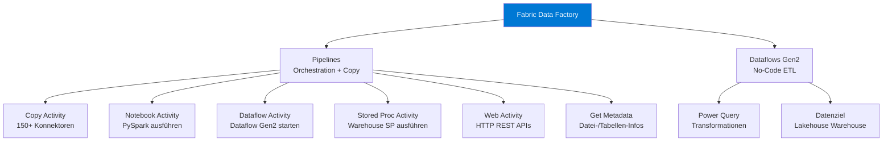
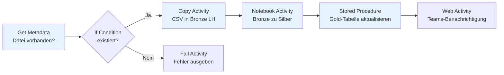
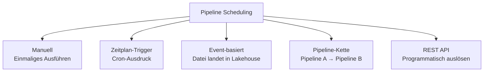
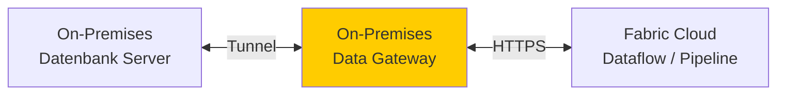
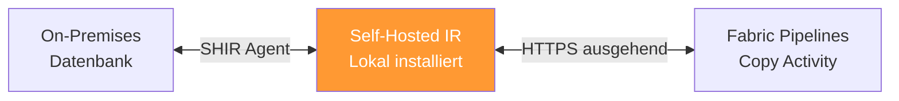
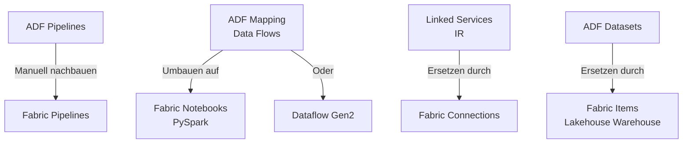
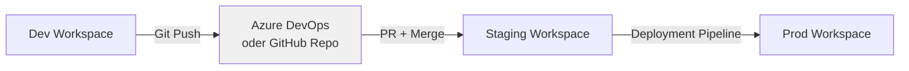

---
tags:
  - microsoft-fabric
  - data-factory
  - pipeline
  - etl
  - dataflow
  - integration
  - kopieraktivität
aliases:
  - Fabric Data Factory
  - Fabric Pipelines
  - Fabric ETL
  - Dataflows Gen2
---

# Fabric Data Factory

> [!ABSTRACT] TL;DR
> Fabric Data Factory ist die Datenintegrations-Erfahrung in Microsoft Fabric. Sie umfasst **Pipelines** (Code-basierte Orchestrierung, ähnlich ADF) und **Dataflows Gen2** (No-Code ETL mit Power Query). Beide können Daten direkt in Lakehouses, Warehouses und OneLake laden. Im Vergleich zu Azure Data Factory entfallen separate Infrastruktur-Überlegungen — Fabric Data Factory teilt sich die Kapazität mit allen anderen Workloads.

---

## Was ist Fabric Data Factory?

Fabric Data Factory ist eine der sechs Erfahrungen in Microsoft Fabric und deckt den **Datenintegrations- und ETL/ELT-Bereich** ab.

**Zwei Hauptkomponenten:**



> [!NOTE]
> Fabric Data Factory **ersetzt nicht vollständig** Azure Data Factory (ADF). ADF bleibt für komplexe Enterprise-Szenarien, Hybrid-Szenarien mit Self-Hosted IR, und bestehende ADF-Investitionen bestehen. Für **neue Fabric-Projekte** wird Fabric Data Factory empfohlen.

---

## Pipelines

Fabric Pipelines sind der Code-orientierte Weg zur Datenorchestrierung. Sie sind stark an **Azure Data Factory Pipelines** angelehnt.

### Unterstützte Activity-Typen

| Activity | Beschreibung | Typischer Einsatz |
|----------|-------------|------------------|
| **Copy Data** | Daten zwischen Quellen/Zielen kopieren | Rohdaten ingestieren |
| **Notebook** | Fabric Notebook ausführen | PySpark Transformationen |
| **Dataflow Gen2** | Dataflow ausführen | No-Code ETL |
| **Stored Procedure** | Warehouse SP ausführen | SQL-Transformationen |
| **Get Metadata** | Dateigröße, Zeilenzahl etc. ermitteln | Validierungen |
| **If Condition** | Bedingte Verzweigung | Fehlerbehandlung |
| **For Each** | Schleife über Items | Batch-Verarbeitung |
| **Set Variable** | Pipeline-Variablen setzen | Parametrisierung |
| **Web** | HTTP-Request (REST API) | Webhooks, Benachrichtigungen |
| **Wait** | Wartezeit einfügen | Abhängigkeiten |
| **Delete** | Dateien in OneLake löschen | Cleanup nach Ingest |
| **Invoke Pipeline** | Andere Pipeline starten | Modularisierung |
| **Script** | Direktes SQL im Warehouse | DDL/DML ausführen |

### Einfache Ingestion-Pipeline



---

## Dataflows Gen2 (Power Query basiert)

**Dataflows Gen2** sind der No-Code/Low-Code Ansatz für ETL in Fabric. Sie basieren auf **Power Query** (dieselbe Engine wie in Excel und Power BI).

**Unterschied Dataflow Gen1 vs. Gen2:**

| Eigenschaft | Dataflow Gen1 (Power BI) | Dataflow Gen2 (Fabric) |
|------------|--------------------------|------------------------|
| **Datenziele** | Intern (dataflow storage) | Lakehouse, Warehouse, Azure SQL etc. |
| **Staging** | Intern | Fabric Lakehouse als Staging |
| **Performance** | Begrenzt | Deutlich schneller (Fabric Compute) |
| **Inkrementell** | Begrenzt | Verbessert |
| **Konnektoren** | Power Query Konnektoren | Alle Power Query + mehr |

### Dataflow Gen2 erstellen

1. Workspace → **Neu** → **Dataflow Gen2**
2. Quelle hinzufügen (Datenbank, Datei, API, etc.)
3. Transformationen in Power Query Editor konfigurieren
4. **Datenziel** hinzufügen: Lakehouse-Tabelle oder Warehouse-Tabelle
5. Veröffentlichen

```python
# Dataflow Gen2 kann auch via REST API gesteuert werden
import requests

workspace_id = "<workspace-guid>"
dataflow_id = "<dataflow-guid>"
headers = {"Authorization": f"Bearer {access_token}"}

# Dataflow per API starten
response = requests.post(
    f"https://api.fabric.microsoft.com/v1/workspaces/{workspace_id}/dataflows/{dataflow_id}/refreshes",
    headers=headers
)
print(response.status_code)  # 202 = Accepted
```

> [!TIP]
> **Staging-Lakehouse**: Dataflows Gen2 erstellen ein internes Staging-Lakehouse (`Dataflows Staging`), das temporäre Daten zwischen Transformationsschritten speichert. Dieses Lakehouse erscheint automatisch im Workspace und kann gelöscht werden (wird neu erstellt).

---

## Copy Activity: 150+ Konnektoren

Die **Copy Activity** unterstützt über 150 Datenquellen und -ziele.

**Wichtige Quell-Konnektoren:**

| Kategorie | Konnektoren |
|-----------|------------|
| **Datenbanken** | Azure SQL DB, SQL Server, PostgreSQL, MySQL, Oracle, SAP HANA, SAP BW |
| **Cloud Storage** | Azure Blob, ADLS Gen2, AWS S3, GCS, SFTP |
| **SaaS** | Salesforce, Dynamics 365, ServiceNow, SharePoint, Dataverse |
| **Analytics** | Snowflake, Databricks, BigQuery, Synapse Analytics |
| **Dateien** | CSV, Parquet, JSON, Avro, Excel, XML, Delta |
| **Streaming** | Azure Event Hubs (limited) |
| **REST/HTTP** | Beliebige REST-APIs mit HTTP-Connector |

**Wichtige Ziel-Konnektoren:**

| Ziel | Format | Besonderheit |
|------|--------|--------------|
| **OneLake / Lakehouse** | Delta, Parquet, CSV | Empfohlen für Fabric |
| **Fabric Warehouse** | Direkt | Automatisches Schema-Mapping |
| **Azure Blob / ADLS Gen2** | Beliebig | Für externe Ablage |
| **Azure SQL DB** | SQL | Direkte DB-Schreiboperationen |

```json
// Copy Activity Konfiguration (Auszug aus Pipeline JSON)
{
    "name": "Kopiere_Kundendaten",
    "type": "Copy",
    "inputs": [{
        "referenceName": "AzureSQL_Kunden_DS",
        "type": "DatasetReference"
    }],
    "outputs": [{
        "referenceName": "Lakehouse_Bronze_DS",
        "type": "DatasetReference",
        "parameters": {
            "tableName": "raw_kunden"
        }
    }],
    "typeProperties": {
        "source": {
            "type": "AzureSqlSource",
            "sqlReaderQuery": "SELECT * FROM dbo.Kunden WHERE ModifiedDate > '@{pipeline().parameters.lastLoadDate}'"
        },
        "sink": {
            "type": "LakehouseTableSink",
            "tableActionOption": "AppendData"
        },
        "enableStaging": false
    }
}
```

---

## Parametrisierung

Pipelines unterstützen **Parameter** und **Variablen** für flexible, wiederverwendbare ETL-Prozesse.

```json
// Pipeline-Parameter definieren
{
    "parameters": {
        "startDatum": {
            "type": "string",
            "defaultValue": "@formatDateTime(addDays(utcNow(), -1), 'yyyy-MM-dd')"
        },
        "umgebung": {
            "type": "string",
            "defaultValue": "produktion"
        }
    }
}
```

```python
# Parameter in Ausdrücken verwenden (Expression Language)
# Gestrige Datum berechnen
"@formatDateTime(addDays(utcNow(), -1), 'yyyy-MM-dd')"

# Dynamischer Zielpfad
"@concat('Files/raw/', pipeline().parameters.umgebung, '/', formatDateTime(utcNow(), 'yyyy/MM/dd'))"

# Bedingte Logik
"@if(equals(pipeline().parameters.umgebung, 'produktion'), 'prod-lakehouse', 'dev-lakehouse')"
```

---

## Scheduling



**Zeitplan-Trigger konfigurieren:**
1. Pipeline öffnen → **Planen** → Zeitplan aktivieren
2. Frequenz: Stündlich / Täglich / Wöchentlich / Monatlich / Benutzerdefiniert (Cron)
3. Startzeit und Zeitzone festlegen

```powershell
# Pipeline per REST API auslösen
$body = @{
    "parameters" = @{
        "startDatum" = "2024-01-01"
        "umgebung"   = "produktion"
    }
} | ConvertTo-Json

Invoke-RestMethod `
    -Uri "https://api.fabric.microsoft.com/v1/workspaces/$workspaceId/items/$pipelineId/jobs/instances?jobType=Pipeline" `
    -Method POST `
    -Headers @{ Authorization = "Bearer $token"; "Content-Type" = "application/json" } `
    -Body $body
```

---

## On-Premises Daten einbinden

Für Daten aus lokalen Netzwerken gibt es zwei Optionen:

### On-Premises Data Gateway



- Installierter Agent im lokalen Netzwerk
- Unterstützt: SQL Server, Oracle, SAP, Dateifreigaben
- Konfiguration: Power Platform Admin Center
- Hauptsächlich für **Dataflows Gen2**

### Self-Hosted Integration Runtime (SHIR)



- Für **Fabric Pipelines** (Copy Activity)
- Registriert in Fabric unter „Verbindungen und Gateways"
- Unterstützt mehr Konnektoren als On-Premises Gateway

---

## Fabric Data Factory vs. Azure Data Factory

| Kriterium | Fabric Data Factory | Azure Data Factory |
|-----------|--------------------|--------------------|
| **Bereitstellung** | Automatisch in Fabric | Manuell in Azure |
| **Integration Runtime** | Fabric Compute (verwaltet) | Azure IR / SHIR / VNET IR |
| **Monitoring** | Fabric Monitor | ADF Monitor + Azure Monitor |
| **CI/CD** | Fabric Git-Integration | ARM Templates / Bicep |
| **Dataflows** | Dataflow Gen2 (Power Query) | Mapping Data Flows (Spark) |
| **SSIS** | ❌ Nicht unterstützt | ✅ SSIS-Ausführung möglich |
| **Trigger** | Zeitplan, Event, API | Zeitplan, Event, Tumbling Window |
| **Preismodell** | Fabric Capacity (CU) | Per Activity Run + Compute |
| **Zielgruppe** | Fabric-zentrierte Teams | Azure-zentrierte Teams |

> [!WARNING]
> **Azure Data Factory Mapping Data Flows** (Spark-basierte visuelle ETL) sind in Fabric Data Factory **nicht verfügbar**. Für komplexe Spark-Transformationen in Fabric → Fabric Notebooks verwenden.

### Migrationspfad ADF → Fabric Data Factory



> [!TIP]
> Microsoft bietet ein **ADF zu Fabric Migrationstool** (in Preview). Es kann ADF-Pipelines automatisch in Fabric-Pipelines konvertieren. Komplexe Mapping Data Flows müssen aber manuell in PySpark-Notebooks umgebaut werden.

---

## CI/CD Überlegungen



**Git-Integration für Pipelines:**
1. Workspace → Einstellungen → Git-Integration → Repository verbinden
2. Pipelines werden als **JSON-Dateien** im Repository gespeichert
3. Branching-Strategie: Feature-Branches → PR → Main → Deployment Pipeline

**Deployment Pipelines:**
- Fabric-native CI/CD (kein Azure DevOps erforderlich)
- Dev → Test → Prod Stufenmodell
- Parametrisierte Verbindungen per Umgebung (verschiedene Datenquellen in Prod vs. Dev)

---

## Data Pipeline Monitoring

```python
# Pipeline-Runs per REST API abfragen
import requests
from datetime import datetime, timedelta

workspace_id = "<workspace-guid>"
headers = {"Authorization": f"Bearer {access_token}"}

# Letzte 24 Stunden Pipeline-Runs
response = requests.get(
    f"https://api.fabric.microsoft.com/v1/workspaces/{workspace_id}/items",
    headers=headers,
    params={"type": "DataPipeline"}
)

pipelines = response.json()["value"]
for pipeline in pipelines:
    print(f"Pipeline: {pipeline['displayName']} | Status: {pipeline.get('status', 'N/A')}")
```

> [!NOTE]
> Pipeline-Laufprotokoll im Fabric-Portal: **Workspace → Überwachen** (Monitor Hub). Hier sieht man alle Pipeline-Runs mit Status, Dauer und Fehlerdetails.

---

## Verwandte Notizen

- [[Microsoft Fabric Grundlagen]]
- [[Fabric Lakehouse]]
- [[Fabric Data Warehouse]]
- [[OneLake]]
