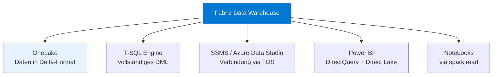
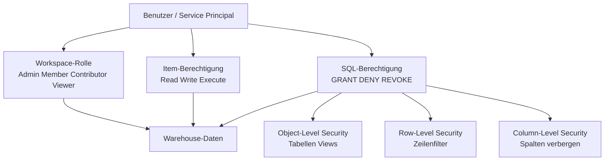
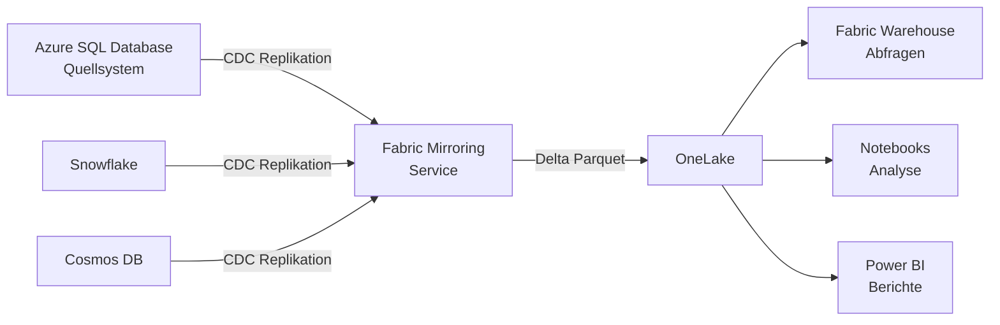

---
tags:
  - microsoft-fabric
  - data-warehouse
  - t-sql
  - sql
  - analytics
  - mirroring
  - sicherheit
aliases:
  - Fabric Warehouse
  - Fabric SQL Warehouse
  - Synapse SQL in Fabric
---

# Fabric Data Warehouse

> [!ABSTRACT] TL;DR
> Das Fabric Data Warehouse ist ein vollständig verwaltetes, T-SQL-basiertes Warehouse innerhalb von Microsoft Fabric. Im Gegensatz zum Lakehouse-SQL-Endpoint unterstützt es vollständige DML-Operationen (INSERT, UPDATE, DELETE, MERGE), Views, Stored Procedures und Row/Column-Level Security. Alle Daten liegen im Delta-Format in OneLake. Mirroring ermöglicht die nahtlose Replikation externer Datenbanken in Fabric.

---

## Was ist das Fabric Data Warehouse?

Das **Fabric Data Warehouse** ist ein eigenständiges Warehouse-Item in Microsoft Fabric, das auf T-SQL basiert und klassische Data-Warehouse-Workloads abdeckt.

**Architektur:**


**Eigenschaften:**
- Vollständiges **T-SQL** (DDL + DML + DCL)
- **Serverless** — kein manuelles Skalieren
- Daten in **Delta/Parquet** auf OneLake gespeichert
- **Kein Spark** — rein SQL-basiert
- Automatische **Statistiken** und **Query-Optimierung**

---

## SQL Endpoint vs. Fabric Warehouse

Ein häufiger Verwirrungspunkt: Was ist der Unterschied zwischen dem SQL Analytics Endpoint eines Lakehouse und einem Fabric Warehouse?

| Kriterium | Lakehouse SQL Analytics Endpoint | Fabric Data Warehouse |
|-----------|----------------------------------|----------------------|
| **Schreiboperationen** | ❌ Nur über Spark/Notebooks | ✅ T-SQL INSERT, UPDATE, DELETE |
| **Stored Procedures** | ❌ Nicht unterstützt | ✅ Vollständig unterstützt |
| **Eigene Views** | ✅ Nur Views | ✅ Views + SP + Functions |
| **Tabellen erstellen** | ❌ Nur via Spark | ✅ `CREATE TABLE` via T-SQL |
| **COPY INTO** | ❌ | ✅ Bulk-Ingest |
| **RLS / CLS** | ❌ Nur Workspace-Rollen | ✅ Row- und Column-Level Security |
| **Zielgruppe** | SQL-Analysten (Leseonly) | SQL-Entwickler, Data Engineers |
| **Typischer Use Case** | Berichte auf Lakehouse-Daten | Klassisches Data Warehouse |

> [!TIP]
> Denke an den **SQL Analytics Endpoint als schreibgeschütztes SQL-Interface** für ein Lakehouse und das **Fabric Warehouse als vollwertiges SQL Data Warehouse** mit eigenen, von T-SQL verwalteten Daten.

---

## Tabellen, Views, Stored Procedures, Functions

```sql
-- Tabelle erstellen
CREATE TABLE dbo.dim_kunden (
    kunden_id       INT           NOT NULL,
    vorname         NVARCHAR(100) NOT NULL,
    nachname        NVARCHAR(100) NOT NULL,
    email           NVARCHAR(255),
    land            NVARCHAR(50),
    erstellt_am     DATE          DEFAULT GETDATE(),
    CONSTRAINT PK_dim_kunden PRIMARY KEY NONCLUSTERED (kunden_id) NOT ENFORCED
);

-- View erstellen
CREATE VIEW dbo.v_bestellungen_aktuell AS
SELECT 
    b.bestell_id,
    b.bestell_datum,
    k.vorname + ' ' + k.nachname AS kunde,
    b.betrag
FROM dbo.fact_bestellungen b
JOIN dbo.dim_kunden k ON b.kunden_id = k.kunden_id
WHERE b.bestell_datum >= DATEADD(YEAR, -1, GETDATE());

-- Stored Procedure
CREATE PROCEDURE dbo.usp_aktualisiere_kundenstatus
    @mindest_umsatz DECIMAL(10,2) = 1000.00
AS
BEGIN
    UPDATE dbo.dim_kunden
    SET status = 'Premium'
    WHERE kunden_id IN (
        SELECT kunden_id
        FROM dbo.fact_bestellungen
        GROUP BY kunden_id
        HAVING SUM(betrag) >= @mindest_umsatz
    );
    
    PRINT 'Kundenstatus aktualisiert.';
END;

-- Funktion (Table-Valued Function)
CREATE FUNCTION dbo.fn_bestellungen_nach_land(@land NVARCHAR(50))
RETURNS TABLE
AS
RETURN (
    SELECT b.*
    FROM dbo.fact_bestellungen b
    JOIN dbo.dim_kunden k ON b.kunden_id = k.kunden_id
    WHERE k.land = @land
);
```

> [!NOTE]
> Fabric Warehouse unterstützt **keine enforced Primary Keys und Foreign Keys** (wie Azure Synapse Dedicated Pool). Constraints können `NOT ENFORCED` definiert werden — für den Query Optimizer, aber nicht für Datenintegrität.

---

## Ingestion: COPY INTO, Dataflows, Pipelines

### COPY INTO (Bulk-Ingest)

```sql
-- Daten aus OneLake in eine Warehouse-Tabelle laden
COPY INTO dbo.fact_bestellungen
FROM 'https://onelake.dfs.fabric.microsoft.com/<workspace-id>/<lakehouse-id>/Files/staging/orders/'
WITH (
    FILE_TYPE = 'PARQUET',
    CREDENTIAL = (IDENTITY = 'Managed Identity')
);

-- CSV-Ingest mit Optionen
COPY INTO dbo.staging_kunden
FROM 'https://onelake.dfs.fabric.microsoft.com/<workspace-id>/<lakehouse-id>/Files/raw/kunden.csv'
WITH (
    FILE_TYPE = 'CSV',
    FIRSTROW = 2,           -- Header-Zeile überspringen
    FIELDTERMINATOR = ';',
    ROWTERMINATOR = '\n',
    CREDENTIAL = (IDENTITY = 'Managed Identity')
);
```

### Dataflow Gen2 → Warehouse

1. Dataflow Gen2 erstellen → Daten transformieren (Power Query)
2. Datenziel: **Data Warehouse** auswählen
3. Zieltabelle und Update-Methode (Append / Replace / Upsert) konfigurieren

### Pipeline → Warehouse

```json
// Copy Activity Konfiguration in einer Fabric Pipeline
{
  "source": {
    "type": "AzureSqlSource",
    "sqlReaderQuery": "SELECT * FROM dbo.orders WHERE modified_date >= '@{pipeline().parameters.startDate}'"
  },
  "sink": {
    "type": "WarehouseTableSink",
    "writeBehavior": "upsert",
    "upsertSettings": {
      "keys": ["order_id"],
      "interimSchemaName": "dbo"
    }
  }
}
```

---

## Cross-Database Queries

Fabric Warehouse unterstützt **Cross-Database Queries** — Abfragen über mehrere Warehouses und Lakehouses in demselben Workspace.

```sql
-- Warehouse + Lakehouse in einer Abfrage kombinieren
SELECT 
    w.produkt_id,
    w.verkaufte_menge,
    l.produktname,
    l.kategorie
FROM [Sales-Warehouse].[dbo].[fact_verkäufe] w
JOIN [Produkt-Lakehouse].[dbo].[dim_produkte] l 
    ON w.produkt_id = l.produkt_id
WHERE w.verkaufsdatum >= '2024-01-01';

-- Three-Part-Name: [Item-Name].[Schema].[Tabelle]
-- Item-Name = Warehouse- oder Lakehouse-Name im Workspace
```

> [!IMPORTANT]
> Cross-Database Queries funktionieren nur innerhalb desselben **Workspace**. Für Workspace-übergreifende Abfragen → OneLake-Shortcuts verwenden.

---

## Sicherheit

### Überblick Sicherheitsschichten



### Object-Level Security (OLS)

```sql
-- Berechtigung auf Tabelle vergeben
GRANT SELECT ON dbo.fact_bestellungen TO [analyst@contoso.com];

-- Berechtigung entziehen
REVOKE SELECT ON dbo.fact_bestellungen FROM [analyst@contoso.com];

-- Stored Procedure ausführen erlauben
GRANT EXECUTE ON dbo.usp_aktualisiere_kundenstatus TO [etl-service@contoso.com];
```

### Row-Level Security (RLS)

```sql
-- RLS: Jeder Vertriebsmitarbeiter sieht nur seine eigenen Bestellungen
CREATE SCHEMA Security;

-- Filter-Funktion erstellen
CREATE FUNCTION Security.fn_bestellungen_filter(@vertrieb_email NVARCHAR(255))
RETURNS TABLE
WITH SCHEMABINDING
AS
RETURN SELECT 1 AS ergebnis
WHERE @vertrieb_email = USER_NAME()
   OR IS_MEMBER('db_owner') = 1;  -- Admins sehen alles

-- Security Policy anwenden
CREATE SECURITY POLICY BestellungenFilter
ADD FILTER PREDICATE Security.fn_bestellungen_filter(vertrieb_email)
ON dbo.fact_bestellungen
WITH (STATE = ON);
```

### Column-Level Security (CLS)

```sql
-- Spalte "gehalt" für bestimmte Benutzer verbergen
DENY SELECT ON dbo.dim_mitarbeiter (gehalt) TO [hr-analyst@contoso.com];

-- Alternativ: View ohne sensitive Spalten erstellen
CREATE VIEW dbo.v_mitarbeiter_public AS
SELECT mitarbeiter_id, vorname, nachname, abteilung, standort
-- gehalt, sozialversicherungsnummer werden NICHT eingeschlossen
FROM dbo.dim_mitarbeiter;

GRANT SELECT ON dbo.v_mitarbeiter_public TO [hr-analyst@contoso.com];
```

---

## Mirroring

**Mirroring** repliziert Daten aus externen Datenbanken nahezu in Echtzeit in Fabric (in OneLake), ohne die Quellsysteme zu belasten.

**Unterstützte Quellen:**

| Quelle | Status | Latenz |
|--------|--------|--------|
| **Azure SQL Database** | GA | ~1 Minute |
| **Azure SQL Managed Instance** | Preview | ~1 Minute |
| **Azure Cosmos DB** | GA | ~1–2 Minuten |
| **Snowflake** | GA | ~1 Minute |
| **Azure Database for PostgreSQL** | Preview | ~1 Minute |
| **SQL Server 2022** | Preview | ~1 Minute |



**Mirroring konfigurieren:**
1. Fabric Portal → Workspace → Neu → **Gespiegeltes Datenbank-Element**
2. Quelle auswählen (Azure SQL DB, Snowflake, etc.)
3. Verbindungsparameter eingeben
4. Zu spiegelnde Tabellen auswählen
5. Mirroring starten — Daten fließen in OneLake

> [!NOTE]
> Mirroring nutzt **Change Data Capture (CDC)** oder vergleichbare Mechanismen, um nur geänderte Datensätze zu übertragen. Das Quellsystem wird nicht belastet. Mirroring ist **kostenlos** — es fallen nur OneLake-Speicherkosten an.

---

## Copilot für Warehouse

```sql
-- Copilot in Fabric Warehouse aktivieren:
-- Warehouse öffnen → Copilot-Symbol oben rechts → Frage stellen

-- Beispiel-Prompts:
-- "Zeige mir die Top 10 Kunden nach Umsatz im letzten Quartal"
-- "Erstelle eine Stored Procedure zum täglichen Laden der Verkaufsdaten"
-- "Erkläre diesen Query: SELECT ..."
-- "Welche Tabellen haben keine Primary Keys?"

-- Copilot generiert T-SQL automatisch und zeigt Erklärungen
```

> [!TIP]
> Copilot für Warehouse analysiert das **Datenbankschema** automatisch und schlägt kontextbezogene SQL-Queries vor. Es kann auch bestehende Queries erklären, optimieren und Fehler beheben.

---

## Performance-Optimierung

```sql
-- 1. Statistiken manuell aktualisieren
UPDATE STATISTICS dbo.fact_bestellungen;

-- 2. Statistiken für bestimmte Spalten
CREATE STATISTICS stat_bestelldatum ON dbo.fact_bestellungen (bestell_datum);

-- 3. Query-Plan analysieren
SET SHOWPLAN_XML ON;
SELECT * FROM dbo.fact_bestellungen WHERE bestell_datum >= '2024-01-01';
SET SHOWPLAN_XML OFF;

-- 4. Ressourcenverbrauch überwachen
SELECT 
    request_id,
    command,
    status,
    start_time,
    total_elapsed_time / 1000 AS dauer_sekunden
FROM sys.dm_exec_requests
ORDER BY total_elapsed_time DESC;
```

**Performance-Best Practices:**
- **Partitionierung** mit `PARTITION BY` in Views für große Tabellen
- **Z-Order** über Delta-Optimierung (aus Notebooks)
- **Materialized Views** für häufig benötigte Aggregationen
- **Statistics** regelmäßig aktualisieren

---

## Monitoring: Query Activity und Billing

```sql
-- Query Activity im Warehouse überwachen
-- Fabric Portal → Warehouse → Query Activity (oben im Menü)

-- Oder via DMVs:
SELECT TOP 20
    request_id,
    login_name,
    submit_time,
    start_time,
    end_time,
    total_elapsed_time / 1000.0 AS dauer_s,
    [label],
    command
FROM sys.dm_exec_requests_history
ORDER BY submit_time DESC;

-- Aktuell laufende Queries
SELECT 
    request_id,
    login_name,
    status,
    command,
    total_elapsed_time
FROM sys.dm_exec_requests
WHERE status = 'running';

-- Query abbrechen
KILL '<request_id>';
```

> [!NOTE]
> **Billing**: Warehouse-Abfragen verbrauchen **Compute Units (CU)** der zugewiesenen Kapazität. Ressourcenintensive Queries können durch die **Workload-Verwaltung** in der Kapazität gedrosselt werden.

---

## Fabric Warehouse vs. Synapse Dedicated SQL Pool

| Kriterium | Fabric Data Warehouse | Synapse Dedicated SQL Pool |
|-----------|----------------------|--------------------------|
| **Verwaltungsaufwand** | Vollständig verwaltet (SaaS) | Semi-managed (PaaS) |
| **Skalierung** | Automatisch (Kapazität) | Manuell (DWU anpassen) |
| **Pausierung** | Über Kapazitätspause | Pausieren möglich |
| **Speicher** | OneLake (Delta) | Interne Azure Storage |
| **Distribution** | Automatisch | Hash / Round-Robin / Replicated |
| **T-SQL Kompatibilität** | Hoch (aber Unterschiede) | Hoch |
| **Lakehouse-Integration** | Nativ (Cross-DB) | Über External Tables |
| **Mirroring** | Integriert | Synapse Link |
| **Preis** | Kapazitätsbasiert | DWU-basiert |

---

## Verwandte Notizen

- [[Microsoft Fabric Grundlagen]]
- [[Fabric Lakehouse]]
- [[OneLake]]
- [[Fabric Copilot]]
- [[Fabric Data Factory]]
