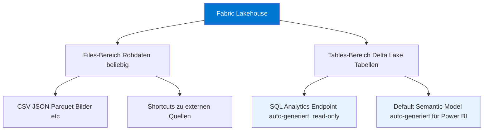
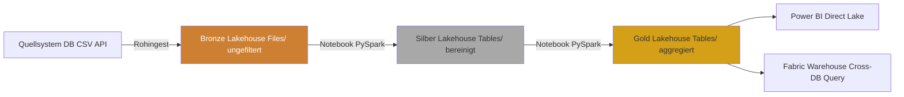
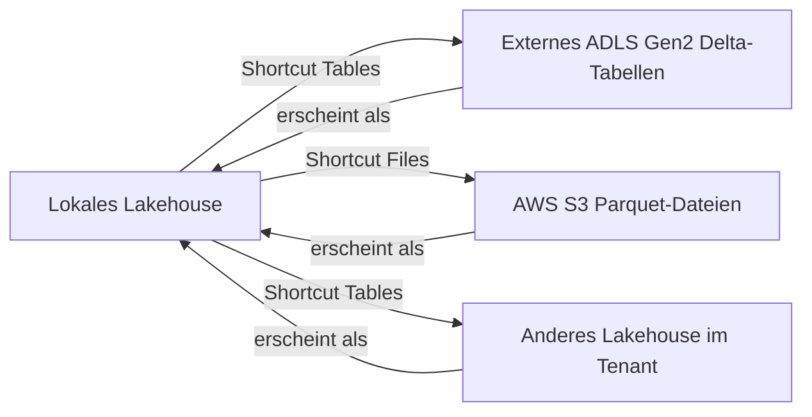

---
tags:
  - microsoft-fabric
  - lakehouse
  - delta-lake
  - spark
  - medallion
  - onelake
  - analytics
aliases:
  - Fabric Lakehouse
  - Lakehouse in Fabric
  - Delta Lakehouse
---

# Fabric Lakehouse

> [!ABSTRACT] TL;DR
> Ein Fabric Lakehouse kombiniert die Flexibilität eines Data Lakes (beliebige Dateiformate) mit der Abfragepower eines Data Warehouse (SQL). Daten werden in **Delta Lake**-Format (ACID-Transaktionen) in OneLake gespeichert. Jedes Lakehouse enthält einen **SQL Analytics Endpoint**, über den das Lakehouse direkt per T-SQL abgefragt werden kann — ohne Datenbewegung.

---

## Was ist ein Fabric Lakehouse?

Ein **Lakehouse** ist ein Fabric-Item, das zwei Konzepte vereint:

- **Data Lake**: Speicherung von Rohdaten jedes Formats (CSV, JSON, Parquet, Bilder, Videos)
- **Data Warehouse**: Strukturierte Tabellen mit SQL-Abfragen, ACID-Transaktionen, Schema-Enforcement

**Aufbau:**


> [!NOTE]
> Wenn ein Lakehouse erstellt wird, entstehen automatisch zwei weitere Items: der **SQL Analytics Endpoint** und das **Default Semantic Model** (Power BI-Dataset). Diese sind nicht separat löschbar.

---

## Delta-Tabellen (Delta Lake)

Alle Tabellen im Lakehouse werden im **Delta Lake**-Format gespeichert — einem Open-Source-Speicherformat, das auf Parquet aufbaut.

### Delta Lake Eigenschaften

| Eigenschaft | Beschreibung |
|-------------|-------------|
| **ACID-Transaktionen** | Atomare Schreiboperationen, keine halbfertigen Zustände |
| **Schema Enforcement** | Schreibt erzwingt das Schema (kein falsches Schreiben) |
| **Schema Evolution** | Kontrolliertes Hinzufügen neuer Spalten |
| **Time Travel** | Historische Versionen abfragen (`VERSION AS OF`, `TIMESTAMP AS OF`) |
| **CRUD-Operationen** | `INSERT`, `UPDATE`, `DELETE`, `MERGE` auf Tabellen |
| **Datei-Format** | Parquet + `_delta_log/` JSON-Transaktionslog |

**Beispiel: Time Travel**
```python
# In einem Fabric Notebook (PySpark)
# Historische Version einer Tabelle lesen
df_gestern = spark.read.format("delta") \
    .option("versionAsOf", 5) \
    .load("Tables/sales")

# Oder nach Timestamp
df_last_week = spark.read.format("delta") \
    .option("timestampAsOf", "2024-01-15") \
    .load("Tables/sales")

# Delta-Historie anzeigen
from delta.tables import DeltaTable
dt = DeltaTable.forPath(spark, "Tables/sales")
dt.history().show(10, truncate=False)
```

---

## SQL Analytics Endpoint

Der **SQL Analytics Endpoint** ist ein automatisch generierter, read-only T-SQL-Endpunkt für jedes Lakehouse.

**Eigenschaften:**
- Automatisch verfügbar — keine Konfiguration nötig
- Liest Delta-Tabellen aus dem `Tables/`-Bereich des Lakehouse
- Unterstützt **T-SQL** (SELECT, Views, Stored Procedures, Functions)
- **Keine DML** (kein INSERT/UPDATE/DELETE direkt über den Endpoint)
- Integration mit SQL Server Management Studio (SSMS) und Azure Data Studio

**Verbindungsstring:**
```
Server: <workspace-id>.datawarehouse.fabric.microsoft.com
Database: <lakehouse-name>
Authentication: Microsoft Entra ID (MFA oder Service Principal)
```

```sql
-- T-SQL Abfragen über den SQL Analytics Endpoint
-- Views erstellen (werden in Lakehouse gespeichert)
CREATE VIEW dbo.v_sales_monthly AS
SELECT 
    YEAR(order_date) AS Jahr,
    MONTH(order_date) AS Monat,
    SUM(amount) AS Gesamtumsatz,
    COUNT(*) AS Anzahl_Bestellungen
FROM sales
GROUP BY YEAR(order_date), MONTH(order_date);

-- Cross-Lakehouse-Abfrage (Workspace-übergreifend)
SELECT s.*, c.customer_name
FROM [Sales-Lakehouse].[dbo].[sales] s
JOIN [Customer-Lakehouse].[dbo].[customers] c ON s.customer_id = c.id;
```

---

## Lakehouse vs. Data Warehouse

| Kriterium | Fabric Lakehouse | Fabric Data Warehouse |
|-----------|-----------------|----------------------|
| **Primäre Sprache** | PySpark / Python (Notebooks) | T-SQL |
| **Schreiben** | Über Notebooks, Pipelines | Über T-SQL, Pipelines |
| **Lesen** | Spark + SQL Endpoint | T-SQL |
| **Rohdateien** | ✅ `Files/`-Bereich | ❌ Nur strukturierte Tabellen |
| **ACID** | Delta Lake (Spark) | SQL-Transaktionen |
| **Schema** | Schema-on-read (Files) + Enforcement (Tables) | Strict schema |
| **Eignet sich für** | Data Engineering, ML, diverse Formate | BI, SQL-Analysten, Berichte |
| **Kosten** | OneLake-Speicher + Compute | OneLake-Speicher + Compute |

> [!TIP]
> **Faustregel**: Wenn das Team primär mit Python/Spark arbeitet und diverse Datenformate verarbeitet → Lakehouse. Wenn das Team primär SQL-Analytiker sind und BI-Workloads dominieren → Data Warehouse. Beide können kombiniert werden (Cross-Database Queries).

---

## Notebooks für Lakehouse-Operationen (PySpark)

Fabric Notebooks unterstützen **PySpark**, **SQL** und **Python** (ohne Spark). Beim Öffnen eines Notebooks in einem Workspace mit Lakehouse wird das Lakehouse automatisch als **Mount-Punkt** eingebunden.

```python
# Lakehouse in Notebook einbinden (automatisch oder manuell)
# Pfad: /lakehouse/default/  (Standard-Lakehouse)
# Pfad: /lakehouse/<lakehouse-name>/

# Dateien im Files-Bereich lesen
df = spark.read.csv(
    "/lakehouse/default/Files/rohdaten/kunden.csv",
    header=True,
    inferSchema=True
)
df.show(5)

# Delta-Tabelle schreiben (Tables-Bereich)
df.write.format("delta").mode("overwrite").saveAsTable("kunden_bronze")

# Alternativ: direkter Pfad
df.write.format("delta").mode("overwrite").save("Tables/kunden_bronze")
```

```python
# MERGE (Upsert) in Delta-Tabelle
from delta.tables import DeltaTable

delta_table = DeltaTable.forName(spark, "kunden_silber")
neue_daten = spark.read.format("delta").load("Tables/kunden_bronze")

delta_table.alias("ziel").merge(
    neue_daten.alias("quelle"),
    "ziel.kunden_id = quelle.kunden_id"
).whenMatchedUpdateAll() \
 .whenNotMatchedInsertAll() \
 .execute()

print("Merge abgeschlossen")
```

```python
# Tabellen im Lakehouse auflisten
tabellen = spark.catalog.listTables("default")
for t in tabellen:
    print(f"{t.name} | {t.tableType} | {t.database}")
```

---

## Medallion-Architektur implementieren

Die Medallion-Architektur in Fabric wird typischerweise mit **einem Lakehouse pro Layer** umgesetzt:



**Bronze → Silber Notebook-Muster:**
```python
# Bronze zu Silber: Bereinigung und Standardisierung
from pyspark.sql.functions import col, trim, upper, to_date, when, isnan

# Bronze lesen (Rohdaten)
df_bronze = spark.read.format("delta").load(
    "abfss://Workspace@onelake.dfs.fabric.microsoft.com/Bronze-LH.Lakehouse/Tables/raw_orders"
)

# Bereinigung
df_silber = df_bronze \
    .filter(col("order_id").isNotNull()) \
    .withColumn("customer_name", trim(upper(col("customer_name")))) \
    .withColumn("order_date", to_date(col("order_date_str"), "yyyy-MM-dd")) \
    .withColumn("amount", when(col("amount") < 0, 0).otherwise(col("amount"))) \
    .drop("order_date_str", "_ingestion_timestamp_raw")

# Silber schreiben (mit Schema-Enforcement)
df_silber.write.format("delta") \
    .mode("overwrite") \
    .option("overwriteSchema", "true") \
    .saveAsTable("silber_orders")

print(f"Silber-Tabelle aktualisiert: {df_silber.count()} Zeilen")
```

---

## V-Order Optimierung

**V-Order** ist eine Microsoft-proprietäre Optimierungstechnik, die in Fabric standardmäßig aktiviert ist. Sie optimiert Parquet/Delta-Dateien für schnellere Lesevorgänge in Fabric.

| Eigenschaft | Details |
|------------|---------|
| **Aktiviert** | Standardmäßig in Fabric Notebooks und Pipelines |
| **Effekt** | 10–50% schnellere Lesegeschwindigkeit in Power BI Direct Lake |
| **Speicheroverhead** | Ca. 5–10% mehr Dateigröße durch Sortierung/Kompression |
| **Kompatibilität** | Normales Delta/Parquet — externe Tools können es lesen |

```python
# V-Order explizit aktivieren (Standard in Fabric)
spark.conf.set("spark.sql.parquet.vorder.enabled", "true")

# Beim Schreiben anwenden
df.write.format("delta") \
    .option("vorder", "true") \
    .mode("overwrite") \
    .saveAsTable("optimierte_tabelle")
```

---

## Table Maintenance: OPTIMIZE und VACUUM

Delta-Tabellen können durch häufige Schreibvorgänge viele kleine Dateien (Small Files) ansammeln. `OPTIMIZE` und `VACUUM` halten die Tabelle performant.

```python
# OPTIMIZE: Kleine Dateien zu größeren zusammenführen (compaction)
from delta.tables import DeltaTable

dt = DeltaTable.forName(spark, "silber_orders")
dt.optimize().executeCompaction()

# OPTIMIZE mit Z-ORDER (für häufig gefilterte Spalten)
dt.optimize().executeZOrderBy("order_date", "customer_id")

# VACUUM: Veraltete Dateien löschen (außerhalb des Retention-Fensters)
# Standard: 7 Tage History behalten
dt.vacuum(retentionHours=168)  # 168 Stunden = 7 Tage
```

```sql
-- OPTIMIZE und VACUUM auch über SQL-Endpoint möglich
OPTIMIZE silber_orders ZORDER BY (order_date);
VACUUM silber_orders RETAIN 168 HOURS;
```

> [!WARNING]
> `VACUUM` mit weniger als 168 Stunden (7 Tagen) löscht Daten, die für **Time Travel** benötigt werden könnten. Nur mit `RETAIN 0 HOURS` und explizitem Override ausführen, wenn wirklich nötig.

---

## Lakehouse-Schemas (Public Preview 2024)

Lakehouse-Schemas ermöglichen es, Tabellen innerhalb eines Lakehouse in **logische Schemas** (ähnlich wie Datenbank-Schemas in SQL) zu gruppieren.

```python
# Schema erstellen und Tabelle im Schema speichern
spark.sql("CREATE SCHEMA IF NOT EXISTS vertrieb")
spark.sql("CREATE SCHEMA IF NOT EXISTS finanzen")

# Tabelle in Schema schreiben
df_sales.write.format("delta") \
    .mode("overwrite") \
    .saveAsTable("vertrieb.bestellungen")

df_invoices.write.format("delta") \
    .mode("overwrite") \
    .saveAsTable("finanzen.rechnungen")
```

```sql
-- SQL-Abfrage mit Schema
SELECT * FROM vertrieb.bestellungen WHERE order_date >= '2024-01-01';
```

> [!NOTE]
> Mit Lakehouse-Schemas ist es möglich, ein einzelnes Lakehouse als **virtuelles Data Warehouse** zu nutzen, das verschiedene Business-Bereiche in separaten Schemas organisiert.

---

## Shortcuts im Lakehouse

Shortcuts können sowohl im `Files/`- als auch im `Tables/`-Bereich erstellt werden:



> [!TIP]
> Ein Shortcut auf Delta-Tabellen aus einem anderen Lakehouse macht Cross-Workspace-Abfragen möglich, **ohne Daten zu kopieren**. Ideal für das Gold-Layer-Pattern, wo das Gold-Lakehouse per Shortcut auf Silver-Tabellen verweist.

---

## Monitoring

```python
# Lakehouse-Tabellen-Metadaten abfragen
from pyspark.sql import SparkSession

# Tabellendetails
spark.sql("DESCRIBE DETAIL silber_orders").show(truncate=False)

# Delta-Log-History
spark.sql("DESCRIBE HISTORY silber_orders").show(10, truncate=False)

# Tabellengröße
spark.sql("""
    SELECT 
        tableName,
        numFiles,
        ROUND(sizeInBytes / 1024 / 1024, 2) AS groesse_mb
    FROM (DESCRIBE DETAIL silber_orders)
""").show()
```

```sql
-- Alle Tabellen im Lakehouse auflisten (SQL Endpoint)
SELECT TABLE_SCHEMA, TABLE_NAME, TABLE_TYPE
FROM INFORMATION_SCHEMA.TABLES
ORDER BY TABLE_SCHEMA, TABLE_NAME;
```

---

## Verwandte Notizen

- [[Microsoft Fabric Grundlagen]]
- [[OneLake]]
- [[Fabric Data Warehouse]]
- [[Fabric Notebooks und Spark]]
- [[Fabric Data Factory]]
