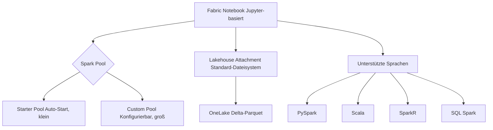
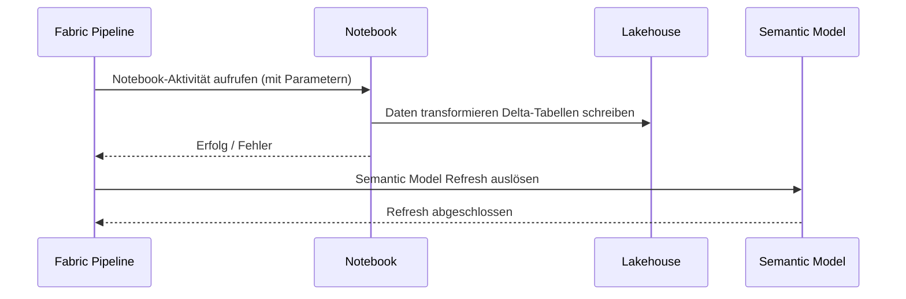
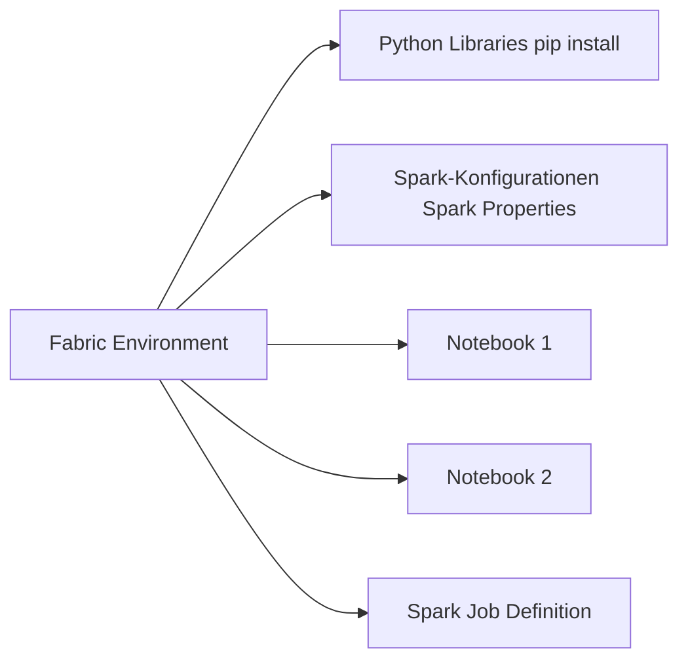
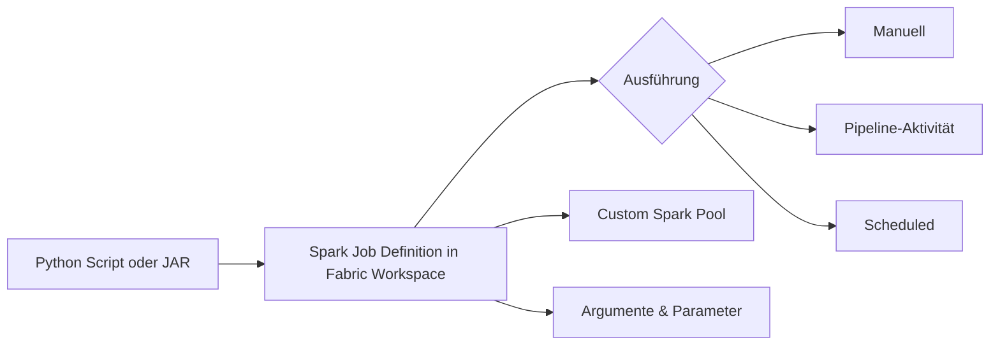
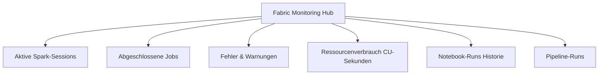

---
tags:
  - fabric
  - spark
  - notebooks
  - pyspark
  - data-engineering
  - azure
  - microsoft-365
aliases:
  - Fabric Spark
  - Fabric Notebooks
  - PySpark Fabric
---

# Fabric Notebooks und Spark

> [!ABSTRACT]
> Microsoft Fabric Notebooks sind Jupyter-basierte interaktive Entwicklungsumgebungen für Data Engineering und Data Science. Sie laufen auf Apache Spark und unterstützen PySpark, Scala, SparkR und SQL. Fabric bringt einen vorkonfigurierten **Starter Pool** mit, der ohne Vorlaufzeit startet, sowie anpassbare Custom Pools für rechenintensive Workloads.

---

## Überblick: Fabric Notebooks

Fabric Notebooks sind direkt im Fabric-Workspace verfügbar — kein separates Setup erforderlich. Sie basieren auf dem Open-Source Jupyter-Standard und sind vollständig in OneLake und Lakehouse-Architekturen integriert.

### Architektur



---

## Spark-Pools in Fabric

### Starter Pool vs. Custom Pool

| Merkmal | Starter Pool | Custom Pool |
|---|---|---|
| Kaltstart | ~20 Sekunden | 3–5 Minuten |
| Node-Größe | Small (4 vCores, 28 GB) | Small bis XXLarge |
| Auto-Scaling | Eingeschränkt | Vollständig konfigurierbar |
| Min. Nodes | 1 | 1 |
| Max. Nodes | 10 | Bis zu 200 |
| Kosten | Niedriger | Höher (nach Bedarf) |
| Empfehlung | Entwicklung, kleine Jobs | Produktion, große Datasets |

### Custom Pool erstellen (REST API)

```powershell
# Fabric Spark Custom Pool erstellen
$workspaceId = "xxxxxxxx-xxxx-xxxx-xxxx-xxxxxxxxxxxx"
$uri = "https://api.fabric.microsoft.com/v1/workspaces/$workspaceId/spark/pools"

$body = @{
    name = "ProdSparkPool"
    nodeFamily = "MemoryOptimized"
    nodeSize = "Large"          # Small, Medium, Large, XLarge, XXLarge
    autoScale = @{
        enabled = $true
        minNodeCount = 2
        maxNodeCount = 20
    }
    dynamicExecutorAllocation = @{
        enabled = $true
        minExecutors = 1
        maxExecutors = 19
    }
} | ConvertTo-Json -Depth 5

$token = (Get-AzAccessToken -ResourceUrl "https://api.fabric.microsoft.com").Token
$headers = @{ Authorization = "Bearer $token"; "Content-Type" = "application/json" }

Invoke-RestMethod -Uri $uri -Method Post -Headers $headers -Body $body
```

---

## Unterstützte Sprachen

### PySpark

PySpark ist die meistgenutzte Sprache in Fabric Notebooks. Vollständiger Python-Ökosystem-Zugriff kombiniert mit Spark-Distributed-Computing.

```python
# PySpark: Delta-Tabelle aus dem Lakehouse lesen
df = spark.read.format("delta").load("Tables/sales_fact")

# Aggregation
from pyspark.sql import functions as F

umsatz_by_region = (
    df
    .filter(F.col("year") == 2024)
    .groupBy("region")
    .agg(
        F.sum("revenue").alias("total_revenue"),
        F.countDistinct("customer_id").alias("unique_customers"),
        F.avg("order_value").alias("avg_order_value")
    )
    .orderBy(F.col("total_revenue").desc())
)

umsatz_by_region.display()
```

### SQL in Notebooks

```python
# SparkSQL direkt verwenden
spark.sql("""
    CREATE OR REPLACE TEMP VIEW monthly_sales AS
    SELECT
        DATE_TRUNC('month', order_date) AS month,
        region,
        SUM(revenue)                    AS total_revenue,
        COUNT(*)                        AS order_count
    FROM sales_fact
    WHERE year >= 2023
    GROUP BY 1, 2
""")

# Ergebnis visualisieren
spark.sql("SELECT * FROM monthly_sales ORDER BY month, total_revenue DESC").display()
```

```sql
-- Zelle als %%sql Magic markieren
%%sql
SELECT
    region,
    SUM(revenue) AS umsatz,
    RANK() OVER (ORDER BY SUM(revenue) DESC) AS rang
FROM sales_fact
GROUP BY region
ORDER BY rang
```

### Scala und SparkR

```scala
// Scala: DataFrame-Operation
val df = spark.read.format("delta").load("Tables/customers")
val result = df
  .filter($"country" === "DE")
  .groupBy("city")
  .count()
  .orderBy($"count".desc)
  .limit(10)

result.show()
```

---

## Lakehouse als Standard-Attachment

Jedes Notebook kann ein **Standard-Lakehouse** haben. Dieses Lakehouse ist automatisch über `Files/` und `Tables/` erreichbar.

```python
# Dateien im Lakehouse-Files-Bereich lesen
df_csv = spark.read.option("header", True).csv("Files/raw/orders_2024.csv")

# Delta-Tabelle schreiben
df_csv.write.format("delta").mode("overwrite").saveAsTable("orders_2024")

# Lakehouse-Tabellen auflisten
display(spark.catalog.listTables())
```

### Lakehouse-Dateipfade

| Pfad | Beschreibung |
|---|---|
| `Files/` | Unstrukturierte Dateien (CSV, JSON, Parquet) |
| `Tables/` | Delta-Tabellen (managed) |
| `abfss://...@onelake.dfs.fabric.microsoft.com/...` | Vollständiger ABFS-Pfad |

```python
# Vollständigen OneLake-Pfad verwenden
workspace_id = "xxxxxxxx-xxxx-xxxx-xxxx-xxxxxxxxxxxx"
lakehouse_id  = "yyyyyyyy-yyyy-yyyy-yyyy-yyyyyyyyyyyy"

abfs_path = f"abfss://{workspace_id}@onelake.dfs.fabric.microsoft.com/{lakehouse_id}/Tables/sales"
df = spark.read.format("delta").load(abfs_path)
```

---

## Notebook-Features

### Parametrisierung

Notebooks können **parametrisiert** werden — hilfreich für Pipeline-Integration.

```python
# Parameter-Zelle (als "Parameter" markieren in der Zelle)
start_date = "2024-01-01"  # @param
end_date   = "2024-12-31"  # @param
target_table = "sales_aggregated"  # @param

# Im Notebook verwenden
df = spark.sql(f"""
    SELECT * FROM sales_fact
    WHERE order_date BETWEEN '{start_date}' AND '{end_date}'
""")

df.write.format("delta").mode("overwrite").saveAsTable(target_table)
print(f"Daten von {start_date} bis {end_date} in {target_table} geschrieben.")
```

### Pipeline-Integration



### Scheduling

Notebooks können direkt aus dem Fabric-Interface geplant werden — ohne externe Orchestrierung:

1. Notebook öffnen → **Ausführen** → **Zeitplan planen**
2. CRON-Ausdruck oder einfache Wiederholung konfigurieren
3. Benachrichtigungen bei Fehler einrichten

> [!NOTE]
> Für komplexe Abhängigkeiten zwischen mehreren Notebooks empfiehlt sich eine **Fabric Data Factory Pipeline** statt einfacher Notebook-Schedules.

---

## SparkML für Machine Learning

```python
from pyspark.ml.feature import VectorAssembler, StandardScaler
from pyspark.ml.classification import RandomForestClassifier
from pyspark.ml import Pipeline
from pyspark.ml.evaluation import BinaryClassificationEvaluator

# Daten laden
df = spark.read.format("delta").load("Tables/churn_features")

# Feature-Vorbereitung
feature_cols = ["age", "tenure_months", "monthly_spend", "support_tickets"]
assembler = VectorAssembler(inputCols=feature_cols, outputCol="features_raw")
scaler = StandardScaler(inputCol="features_raw", outputCol="features")

# Modell
rf = RandomForestClassifier(
    featuresCol="features",
    labelCol="churn_label",
    numTrees=100,
    maxDepth=8
)

# Pipeline
pipeline = Pipeline(stages=[assembler, scaler, rf])

# Training
train_df, test_df = df.randomSplit([0.8, 0.2], seed=42)
model = pipeline.fit(train_df)

# Evaluation
predictions = model.transform(test_df)
evaluator = BinaryClassificationEvaluator(labelCol="churn_label")
auc = evaluator.evaluate(predictions)
print(f"AUC: {auc:.4f}")

# Modell speichern (MLflow Integration)
import mlflow
mlflow.spark.log_model(model, "churn_model")
```

---

## Spark-Optimierung

### Delta Optimization

```python
# Delta-Tabelle optimieren (Compaction + Z-Ordering)
spark.sql("""
    OPTIMIZE sales_fact
    ZORDER BY (order_date, region)
""")

# Vacuum: Alte Dateien löschen (7 Tage Retention)
spark.sql("""
    VACUUM sales_fact
    RETAIN 168 HOURS
""")
```

### Caching

```python
# DataFrame cachen (RAM + Disk)
df_cached = spark.read.format("delta").load("Tables/large_table").cache()
df_cached.count()  # Materialisiert den Cache

# Nur RAM-Caching (schneller, aber weniger persistent)
from pyspark import StorageLevel
df_cached = df.persist(StorageLevel.MEMORY_ONLY)

# Cache freigeben
df_cached.unpersist()
```

### Broadcast Joins

```python
from pyspark.sql.functions import broadcast

# Kleine Dimensionstabelle als Broadcast markieren
dim_product = spark.read.format("delta").load("Tables/dim_product")

# Join mit Broadcast (vermeidet Shuffle)
result = (
    spark.read.format("delta").load("Tables/fact_sales")
    .join(broadcast(dim_product), "product_id", "left")
)
```

### Optimierungsübersicht

| Technik | Wann nutzen | Verbesserung |
|---|---|---|
| **OPTIMIZE / ZORDER** | Viele kleine Parquet-Dateien | Bis 10x schnellere Reads |
| **Caching** | Tabelle mehrfach abgefragt | 2–5x schneller |
| **Broadcast Join** | Dim-Tabelle < 10 GB | Kein Shuffle-Overhead |
| **Partition Pruning** | Filter auf Partition-Spalte | Liest nur relevante Partitionen |
| **Dynamic Executor Allocation** | Variable Last | Kostenoptimierung |
| **Adaptive Query Execution (AQE)** | Immer aktiviert in Fabric | Automatische Optimierung |

---

## Fabric Spark vs. Synapse Spark

| Merkmal | Fabric Spark | Azure Synapse Spark |
|---|---|---|
| Integration | Tief in Fabric / OneLake | Synapse Workspace |
| Kaltstart | ~20 Sek. (Starter Pool) | 3–5 Min. |
| Datenzugriff | OneLake nativ | ADLS Gen2 |
| Collaboration | Co-Authoring in Echtzeit | Nicht vorhanden |
| Monitoring | Fabric Monitoring Hub | Synapse Monitor |
| MLflow | Integriert | Integriert |
| Kosten-Modell | Fabric Capacity (CUs) | Azure Pay-per-use |
| Git-Integration | Fabric Git (Azure DevOps / GitHub) | Azure DevOps |
| Empfehlung | Neue Projekte auf Fabric | Migration zu Fabric empfohlen |

---

## Environment Management

Fabric Environments ermöglichen es, **Python-Libraries und Spark-Konfigurationen** zentral zu verwalten.



### Libraries im Notebook installieren (schnell)

```python
# Temporäre Installation (nur aktuelle Session)
%pip install scikit-learn==1.4.0 xgboost lightgbm

# Überprüfen
import sklearn
print(sklearn.__version__)
```

### Environment per REST API konfigurieren

```powershell
# Environment in Workspace erstellen
$workspaceId = "xxxxxxxx-xxxx-xxxx-xxxx-xxxxxxxxxxxx"
$uri = "https://api.fabric.microsoft.com/v1/workspaces/$workspaceId/environments"

$body = @{
    displayName = "ML-Environment-Prod"
    description = "Production ML Libraries"
} | ConvertTo-Json

Invoke-RestMethod -Uri $uri -Method Post -Headers $headers -Body $body -ContentType "application/json"
```

---

## Co-Authoring in Notebooks

Fabric Notebooks unterstützen **Echtzeit-Kollaboration** — ähnlich wie Google Docs:

- Mehrere Benutzer können gleichzeitig im selben Notebook arbeiten
- Cursor und Änderungen sind für alle sichtbar
- Kein separates Git-Commit für Zusammenarbeit nötig

> [!TIP]
> Co-Authoring und Git-Integration können parallel genutzt werden. Co-Authoring für tägliche Arbeit, Git für Versionskontrolle und Deployments.

---

## Spark Job Definition

Eine **Spark Job Definition** ermöglicht es, Spark-Jobs (Python-Scripts, JAR-Dateien) direkt in Fabric auszuführen — ohne interaktives Notebook.



---

## Monitoring

### Spark UI

Der **Spark UI** ist direkt aus dem Notebook erreichbar und zeigt:
- Job-Ausführungszeit
- Stage- und Task-Details
- DAG (Directed Acyclic Graph) des Spark-Jobs
- Executor-Metriken (RAM, CPU)

### Fabric Monitoring Hub



> [!NOTE]
> Der Fabric Monitoring Hub ist unter `app.fabric.microsoft.com` → **Monitoring Hub** erreichbar und zeigt alle Aktivitäten im Workspace.

---

## Verwandte Notizen

- [[Microsoft Fabric Grundlagen]]
- [[Fabric Lakehouse]]
- [[Fabric Data Factory]]
- [[Fabric Administration]]
