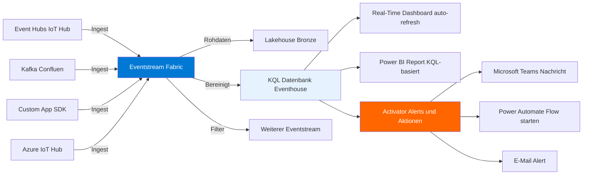
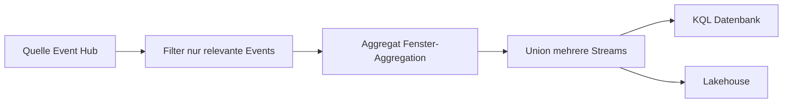
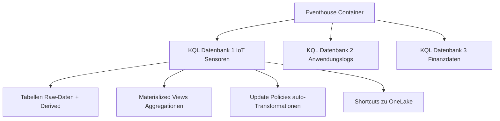
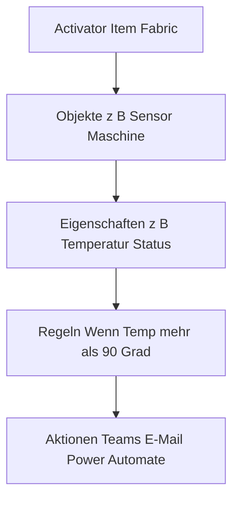
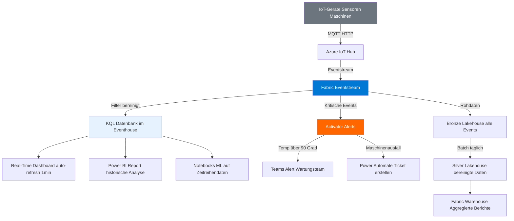

---
tags:
  - microsoft-fabric
  - real-time-intelligence
  - kql
  - eventstream
  - iot
  - streaming
  - activator
aliases:
  - Fabric RTI
  - Real-Time Intelligence Fabric
  - Fabric KQL
  - Fabric Eventhouse
---

# Fabric Real-Time Intelligence

> [!ABSTRACT] TL;DR
> Fabric Real-Time Intelligence (RTI) ist die Echtzeit-Analyse-Erfahrung in Microsoft Fabric. Sie basiert auf Azure Data Explorer-Technologie und umfasst: **Eventstreams** (Datenströme erfassen), **KQL-Datenbanken / Eventhouses** (Zeitreihendaten speichern und abfragen), **Real-Time Dashboards** (auto-aktualisierte Visualisierungen) und **Activator** (intelligente Alerts und Aktionen auf Streaming-Daten).

---

## Was ist Fabric Real-Time Intelligence?

Fabric RTI ermöglicht die **Erfassung, Analyse und Reaktion auf Streaming-Daten in Echtzeit** — ohne separate Infrastruktur.

**RTI-Architektur-Übersicht:**



**Typische Anwendungsfälle:**
- **IoT**: Sensordaten von Produktionsanlagen überwachen, Anomalien erkennen
- **Logs**: Anwendungs- und Systemlogs in Echtzeit analysieren
- **Finanzdaten**: Aktienkurse, Transaktionsmonitoring, Betrugserkennung
- **Clickstreams**: Nutzerverhalten auf Websites oder Apps analysieren
- **Telemetrie**: Infrastruktur- und App-Monitoring

---

## Eventstreams

**Eventstreams** sind die Ingestion-Komponente von Fabric RTI. Sie erfassen Datenströme aus verschiedenen Quellen, transformieren sie optional und leiten sie an verschiedene Ziele weiter.

### Unterstützte Quellen

| Quelle | Beschreibung | Authentifizierung |
|--------|-------------|------------------|
| **Azure Event Hubs** | Klassische Event-Streaming-Plattform | Connection String / SAS |
| **Azure IoT Hub** | IoT-Gerätedaten | Connection String |
| **Apache Kafka** | Kafka-kompatible Quellen | SASL/TLS |
| **Custom App** | Eigene Apps via Eventstream-SDK | Connection String |
| **Azure SQL DB CDC** | Change Data Capture aus SQL DB | Managed Identity |
| **PostgreSQL CDC** | Change Data Capture aus PostgreSQL | Verbindungsdetails |
| **MySQL CDC** | Change Data Capture aus MySQL | Verbindungsdetails |
| **Sample Data** | Vordefinierte Testdaten (Fahrrad-Streaming) | — |

### Unterstützte Ziele

| Ziel | Beschreibung |
|------|-------------|
| **KQL Datenbank / Eventhouse** | Hauptziel für RTI-Analysen |
| **Lakehouse** | Delta-Tabellen für Batch-Analysen |
| **Fabric Warehouse** | Direkt in Warehouse-Tabellen |
| **Eventstream (weiterer)** | Fan-out zu mehreren Eventstreams |
| **Reflexe / Activator** | Alerts und Aktionen |
| **Custom Endpoint** | Weiterleitung an externe Systeme |

### Eventstream-Transformationen

Eventstreams unterstützen **visuelle Transformationen** (kein Code erforderlich):



| Transformation | Beschreibung |
|---------------|-------------|
| **Filter** | Zeilen nach Bedingung filtern |
| **Manage fields** | Spalten auswählen, umbenennen, hinzufügen |
| **Aggregate** | Zeitfenster-Aggregationen (Tumbling, Hopping, Session) |
| **Group by** | Gruppierung für Aggregationen |
| **Union** | Mehrere Eventstreams zusammenführen |
| **Expand** | JSON/Arrays auffalten |
| **Join** | Stream mit Lookup-Tabelle verbinden |

---

## KQL-Datenbank und Eventhouse

### Was ist ein Eventhouse?

Ein **Eventhouse** ist ein Fabric-Item, das eine oder mehrere **KQL-Datenbanken** enthält. Es ist die Weiterentwicklung des einfachen „KQL Database"-Items und bietet Multi-Database-Fähigkeiten.



**KQL-Datenbank Eigenschaften:**
- Optimiert für **Zeitreihendaten** und **Telemetrie**
- **Hohe Ingestion-Raten** (Millionen Events pro Sekunde)
- **Spaltenbasierter Speicher** → extrem schnelle Aggregationen
- **Automatische Kompression** (10:1 bis 100:1)
- **Hot/Cold Cache** — aktuelle Daten im Hot Cache, ältere im Cold (OneLake)
- Daten werden in **OneLake** (Delta-Format) gespeichert

---

## KQL-Abfragen Grundlagen

**KQL (Kusto Query Language)** ist eine deklarative Abfragesprache, optimiert für Zeitreihendaten und Logs.

### Grundstruktur

```kusto
// KQL folgt dem Pipe-Prinzip: Tabelle | Operator | Operator | ...

// Einfache Abfrage
SensorDaten
| where Timestamp > ago(1h)          // Letzte Stunde
| where SensorId == "sensor-042"
| project Timestamp, Temperatur, Luftfeuchtigkeit   // Spalten auswählen
| order by Timestamp desc
| take 100                           // Erste 100 Zeilen

// ago() = relative Zeitangabe
// ago(1h) = vor 1 Stunde
// ago(7d) = vor 7 Tagen
// ago(30m) = vor 30 Minuten
```

### Wichtige Operatoren

```kusto
// WHERE: Filtern
SensorDaten
| where Timestamp between (datetime(2024-01-01) .. datetime(2024-01-31))
| where Temperatur > 80 or Luftfeuchtigkeit < 20

// SUMMARIZE: Aggregieren
SensorDaten
| where Timestamp > ago(24h)
| summarize 
    Durchschnitt = avg(Temperatur),
    Maximum = max(Temperatur),
    Minimum = min(Temperatur),
    Anzahl = count()
  by bin(Timestamp, 1h), SensorId    // Stündliche Buckets pro Sensor
| order by Timestamp asc

// EXTEND: Neue Spalten berechnen
SensorDaten
| extend 
    Temperatur_F = (Temperatur * 9/5) + 32,           // Celsius → Fahrenheit
    IstKritisch = iff(Temperatur > 90, true, false),
    TagDesMonats = dayofmonth(Timestamp)

// JOIN: Zwei Tabellen verbinden
SensorDaten
| join kind=leftouter SensorMetadata on SensorId
| project Timestamp, SensorId, SensorName, Standort, Temperatur

// RENDER: Visualisierung direkt in KQL
SensorDaten
| where Timestamp > ago(7d)
| summarize avg(Temperatur) by bin(Timestamp, 1h), SensorId
| render timechart                   // Zeitreihen-Diagramm
```

### Zeitreihen-Analyse

```kusto
// Anomalieerkennung mit series_decompose_anomalies()
SensorDaten
| where Timestamp > ago(30d)
| make-series Temp = avg(Temperatur) 
    on Timestamp 
    from ago(30d) to now() 
    step 1h 
    by SensorId
| extend (Anomalien, Score, Baseline) = series_decompose_anomalies(Temp)
| mv-expand Timestamp, Temp, Anomalien, Score, Baseline
| where Anomalien != 0               // Nur Anomalien zeigen

// Gleitender Durchschnitt (Moving Average)
SensorDaten
| where Timestamp > ago(7d)
| make-series Temp = avg(Temperatur) on Timestamp step 1h
| extend MA_6h = series_fir(Temp, dynamic([1,1,1,1,1,1]))  // 6-Stunden MA
```

### Performance-Tipps für KQL

```kusto
// GUT: Zeitfilter immer zuerst (nutzt Partition Pruning)
SensorDaten
| where Timestamp > ago(1d)          // Erst Zeit filtern
| where SensorId == "sensor-042"     // Dann andere Filter

// SCHLECHT: Zeitfilter nicht zuerst
SensorDaten
| where SensorId == "sensor-042"
| where Timestamp > ago(1d)

// Materialized View für häufige Aggregationen nutzen
.create materialized-view StündlicheAggregation on table SensorDaten
{
    SensorDaten
    | summarize avg(Temperatur), max(Temperatur) by bin(Timestamp, 1h), SensorId
}
```

---

## Real-Time Dashboards

**Real-Time Dashboards** in Fabric sind KQL-basierte Dashboards mit automatischer Aktualisierung.

**Eigenschaften:**
- Basieren direkt auf KQL-Abfragen (keine Datenbewegung in Power BI)
- **Auto-Refresh**: Konfigurierbar von 30 Sekunden bis 24 Stunden
- Unterstützte Visualisierungen: Zeitreihenlinien, Balkendiagramme, Kacheln, Karten, Tabellen
- **Parameter**: Interaktive Filter (Zeitbereich, Sensor-ID etc.)
- **Markdown**: Textabschnitte und Beschreibungen einfügen

**Dashboard erstellen:**
1. Fabric Portal → **Neu** → **Real-Time Dashboard**
2. KQL-Datenbank als Datenquelle verbinden
3. Visual hinzufügen → KQL-Abfrage eingeben → Visualisierungstyp wählen
4. Auto-Refresh-Intervall konfigurieren
5. Parameter für interaktive Filter erstellen

```kusto
// Beispiel-Abfrage für Real-Time Dashboard
// Parameter: @StartTime (Datetime), @SensorGroup (string)
SensorDaten
| where Timestamp > @StartTime
| where SensorGruppe == @SensorGruppe or @SensorGruppe == "Alle"
| summarize 
    AktuelleTemp = arg_max(Timestamp, Temperatur),
    DurchschnittTemp = avg(Temperatur)
  by SensorId
| project SensorId, AktuelleTemp, DurchschnittTemp
| order by AktuelleTemp desc
```

---

## Activator (ehem. Data Activator / Reflex)

**Activator** ist die Reaktions-Komponente von Fabric RTI. Er überwacht Streaming-Daten oder Power BI-Berichte und löst automatisch Aktionen aus, wenn Bedingungen erfüllt sind.

**Activator-Konzepte:**



| Begriff | Beschreibung | Beispiel |
|---------|-------------|---------|
| **Objekt** | Entität, die überwacht wird | Produktionslinie Nr 5 |
| **Eigenschaft** | Messwert des Objekts | Temperatur in Celsius |
| **Regel** | Bedingung, die überwacht wird | Temperatur > 90°C |
| **Aktion** | Was passiert bei Auslösung | Teams-Nachricht senden |

**Unterstützte Aktionstypen:**

| Aktion | Beschreibung |
|--------|-------------|
| **E-Mail senden** | An definierte Empfänger |
| **Teams-Nachricht** | Direkte Nachricht oder Channel |
| **Power Automate starten** | Beliebiger Power Automate Flow |
| **Azure Logic Apps** | Enterprise-Integration |
| **Webhook** | Beliebige HTTP-Endpoints |

**Activator über Eventstream anschließen:**
1. Eventstream → Ziel hinzufügen → **Reflex/Activator**
2. Activator-Item auswählen oder neu erstellen
3. Im Activator: Objekte und Eigenschaften aus Stream-Daten definieren
4. Regeln konfigurieren (Schwellwert, Anomalie, Änderung)
5. Aktion auswählen und konfigurieren

---

## RTI-Architektur: Vollständiges Beispiel (IoT-Szenario)



---

## Anwendungsfälle im Detail

### IoT-Monitoring

```kusto
// Maschinenstatus-Monitoring
// Letzte bekannte Status jeder Maschine
MaschinenDaten
| where Timestamp > ago(1h)
| summarize 
    LetzterStatus = arg_max(Timestamp, Status, Temperatur, Vibration),
    Ausfälle_1h = countif(Status == "Fehler")
  by MaschinenId
| project MaschinenId, LetzterStatus, Temperatur, Vibration, Ausfälle_1h
| where LetzterStatus == "Fehler" or Temperatur > 85
```

### Log-Analyse

```kusto
// Fehler-Analyse der letzten Stunde
AppLogs
| where Timestamp > ago(1h)
| where Level in ("ERROR", "CRITICAL")
| summarize Anzahl = count() by bin(Timestamp, 5m), Level, Komponente
| render timechart

// Top-10 häufigste Fehler
AppLogs
| where Timestamp > ago(24h) and Level == "ERROR"
| summarize Anzahl = count() by ErrorCode, ErrorMessage
| top 10 by Anzahl desc
```

### Clickstream-Analyse

```kusto
// Konversionsrate nach Seite (letzte 30 Minuten)
WebEvents
| where Timestamp > ago(30m)
| where EventType in ("page_view", "purchase")
| summarize 
    Aufrufe = countif(EventType == "page_view"),
    Käufe = countif(EventType == "purchase")
  by Seite
| extend Konversionsrate = round(100.0 * Käufe / Aufrufe, 2)
| order by Konversionsrate desc
```

---

## RTI vs. Event Hubs + Stream Analytics

| Kriterium | Fabric RTI | Azure Event Hubs + Stream Analytics |
|-----------|-----------|-------------------------------------|
| **Komplexität** | Niedrig (integriert, no-code) | Hoch (mehrere Services konfigurieren) |
| **Abfragesprache** | KQL (mächtig für Zeitreihen) | SQL-ähnlich (Stream Analytics) |
| **Integration** | Nativ in Fabric | Separate Azure-Services |
| **Dashboards** | Real-Time Dashboards (integriert) | Power BI (separate Einbindung) |
| **Alerts** | Activator (integriert) | Logic Apps / Functions |
| **Historische Daten** | KQL DB + OneLake | Azure Storage / ADLS |
| **ML Integration** | Fabric Notebooks (direkt) | Azure ML (extern) |
| **Kosten** | Fabric Capacity (CU) | Pay-per-Use pro Dienst |
| **Latenz** | Sekunden | Sekunden bis Minuten |

> [!TIP]
> **Empfehlung**: Wenn die Organisation bereits in Microsoft Fabric arbeitet, ist **Fabric RTI die bessere Wahl** — weniger Konfigurationsaufwand, native Integration mit Lakehouses und Power BI, und nur ein Abrechnungsmodell. Azure Event Hubs + Stream Analytics empfiehlt sich für bestehende Azure-Architekturen ohne Fabric.

---

## KQL-Datenbank Verwaltung

```kusto
// Tabelle erstellen (KQL DDL)
.create table SensorDaten (
    Timestamp: datetime,
    SensorId: string,
    Temperatur: real,
    Luftfeuchtigkeit: real,
    Status: string
)

// Ingestion Mapping erstellen (JSON → Tabellenspalten)
.create table SensorDaten ingestion json mapping "SensorMapping"
'[
    {"column":"Timestamp","path":"$.ts","datatype":"datetime"},
    {"column":"SensorId","path":"$.id","datatype":"string"},
    {"column":"Temperatur","path":"$.temp","datatype":"real"}
]'

// Datenaufbewahrung konfigurieren
.alter table SensorDaten policy retention softdelete = 90d

// Hot Cache konfigurieren (aktuelle Daten im Speicher halten)
.alter table SensorDaten policy caching hot = 7d
```

---

## Verwandte Notizen

- [[Microsoft Fabric Grundlagen]]
- [[OneLake]]
- [[Azure Event Hubs]]
- [[Azure Event Grid]]
