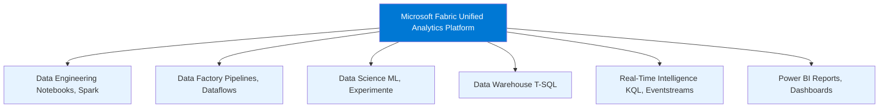
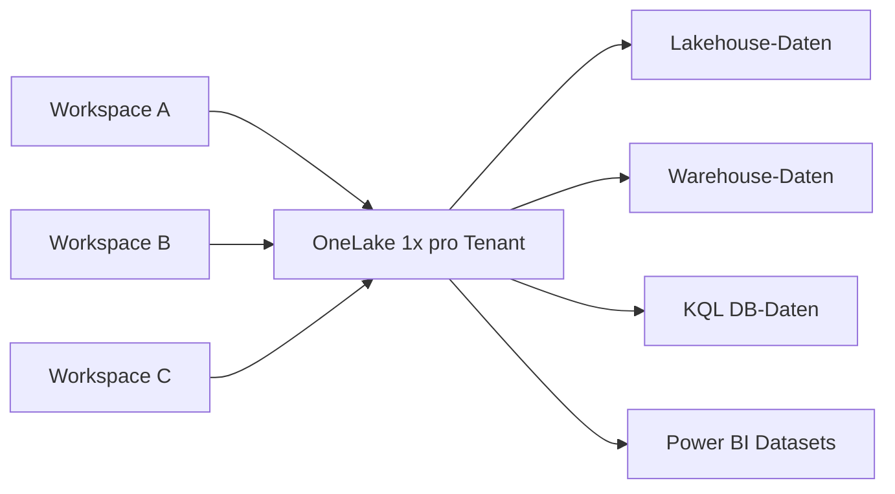
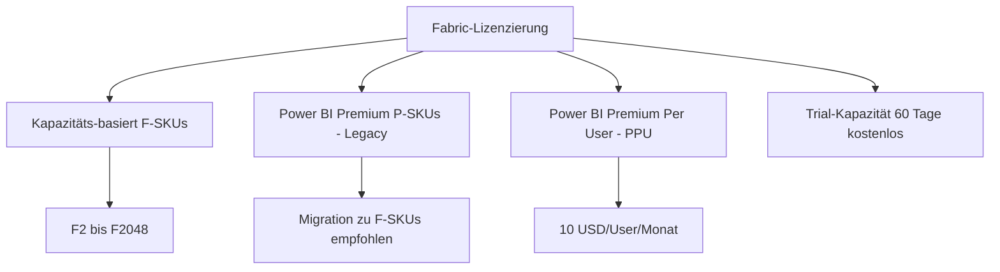
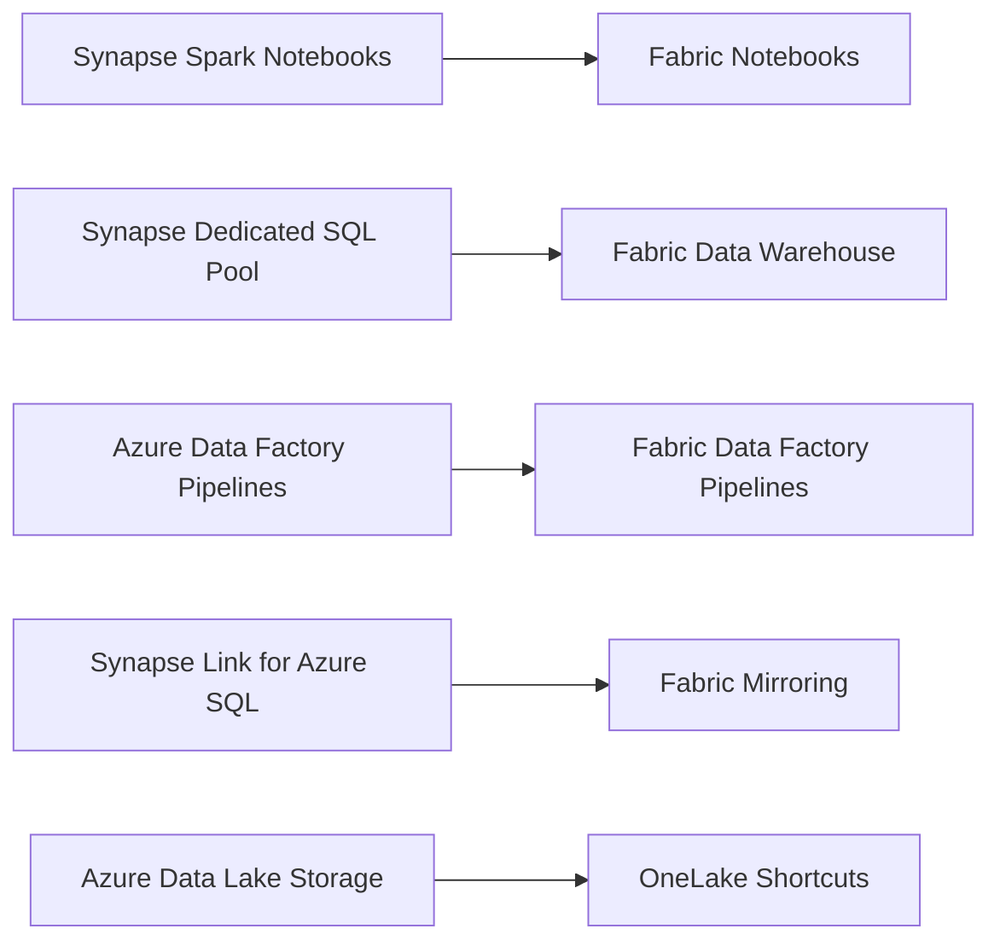

---
tags:
  - microsoft-fabric
  - analytics
  - unified-platform
  - onelake
  - fabric-kapazität
  - lizenzierung
  - azure
aliases:
  - Fabric Grundlagen
  - Microsoft Fabric Überblick
  - Fabric Platform
---

# Microsoft Fabric Grundlagen

> [!ABSTRACT] TL;DR
> Microsoft Fabric ist eine **All-in-One Analytics-Plattform** (SaaS), die Data Engineering, Data Factory, Data Science, Data Warehouse, Real-Time Intelligence und Power BI unter einem Dach vereint. Alle Workloads nutzen **OneLake** als gemeinsamen Data Lake und teilen sich eine einzige Kapazität (F-SKUs). Fabric ersetzt die bisherige Kombination aus Azure Synapse, Azure Data Factory und Power BI Premium.

---

## Was ist Microsoft Fabric?

Microsoft Fabric wurde im Mai 2023 auf der Build-Konferenz angekündigt und ist seit November 2023 **allgemein verfügbar (GA)**. Es handelt sich um eine **vollständig verwaltete SaaS-Plattform** für Analytics, die alle Daten-Workloads in einer einzigen integrierten Umgebung zusammenfasst.

**Kernprinzipien:**
- **One Platform** — kein Wechsel zwischen verschiedenen Azure-Diensten
- **One Data Lake** — alle Workloads nutzen OneLake als gemeinsamen Speicher
- **One Business Model** — eine Kapazitäts-SKU für alle Workloads
- **Open Formats** — Daten liegen in Delta/Parquet, kein proprietäres Lock-in

**Positionierung:**


---

## Fabric-Erfahrungen (Experiences)

Fabric gliedert sich in sechs spezialisierte Erfahrungen, die alle auf derselben Infrastruktur basieren:

| Erfahrung | Früher bekannt als | Hauptnutzer | Kernaufgabe |
|-----------|-------------------|-------------|-------------|
| **Data Engineering** | Azure Synapse Spark | Dateningenieure | Notebooks, Spark-Jobs, Lakehouses |
| **Data Factory** | Azure Data Factory | ETL-Entwickler | Pipelines, Dataflows Gen2 |
| **Data Science** | Azure ML (leicht) | Data Scientists | ML-Experimente, MLflow |
| **Data Warehouse** | Synapse Dedicated SQL | SQL-Analysten | T-SQL, Warehouses |
| **Real-Time Intelligence** | Azure Data Explorer | Ops/IoT-Teams | KQL, Eventstreams, Activator |
| **Power BI** | Power BI Premium | BI-Entwickler | Reports, Dashboards, Metriken |

> [!NOTE]
> Alle Erfahrungen sind im selben Workspace zugänglich — kein separates Portal nötig. Der Wechsel erfolgt über den Erfahrungs-Switcher links unten im Fabric-Portal.

---

## OneLake als zentraler Data Lake

**OneLake** ist das Herzstück von Microsoft Fabric. Es gibt genau **einen OneLake pro Tenant** — ähnlich wie OneDrive für Einzelpersonen, aber für Organisationsdaten.

**Schlüsseleigenschaften:**
- Basiert auf **Azure Data Lake Storage Gen2** (ADLS Gen2)
- **OneCopy-Prinzip**: Daten werden einmal gespeichert, von allen Erfahrungen genutzt
- Alle Fabric-Items (Lakehouses, Warehouses, KQL-Datenbanken) speichern ihre Daten in OneLake
- **Shortcuts** ermöglichen die Einbindung externer Daten (ADLS Gen2, AWS S3, GCS)



---

## Kapazitäten (Capacity / F-SKUs)

Fabric-Ressourcen werden durch **Kapazitäten** gesteuert. Eine Kapazität ist eine dedizierte Rechenressource, die Fabric-Workloads ausführt.

### F-SKU Übersicht

| SKU | Capacity Units (CU) | Empfohlene Nutzung | Monatl. Preis (ca.) |
|-----|--------------------|--------------------|---------------------|
| **F2** | 2 CU | Entwicklung, Tests | ~$262 |
| **F4** | 4 CU | Kleine Teams | ~$524 |
| **F8** | 8 CU | Abteilungen | ~$1.049 |
| **F16** | 16 CU | Mittlere Unternehmen | ~$2.097 |
| **F32** | 32 CU | Größere Workloads | ~$4.195 |
| **F64** | 64 CU | Enterprise | ~$8.390 |
| **F128** | 128 CU | Großes Enterprise | ~$16.779 |
| **F256** | 256 CU | Sehr groß | ~$33.558 |
| **F512** | 512 CU | Sehr groß | ~$67.117 |
| **F1024** | 1024 CU | Hyperscale | ~$134.234 |
| **F2048** | 2048 CU | Hyperscale | ~$268.467 |

> [!TIP]
> **Trial-Kapazität**: Jeder Microsoft 365-Benutzer kann eine kostenlose **60-Tage-Testkapazität** aktivieren (entspricht ca. F64). Im Fabric-Portal unter „Fabric-Testversion starten".

> [!IMPORTANT]
> Kapazitäten können **pausiert** werden (Billing stoppt). Beim Pausieren werden laufende Workloads abgebrochen. Durch **Autoscale** kann die Kapazität temporär erhöht werden, um Lastspitzen abzufangen.

### Kapazitäts-Bursting

Fabric unterstützt **Smoothing**: Kurze Lastspitzen werden über einen längeren Zeitraum verteilt abgerechnet, um Engpässe zu vermeiden. Die Abrechnung erfolgt in **Compute Units (CU-Sekunden)**.

---

## Workspaces und Workspace-Rollen

Ein **Workspace** ist der Organisationscontainer für Fabric-Items. Jeder Workspace ist einer Kapazität zugewiesen.

### Workspace-Rollen

| Rolle | Berechtigungen |
|-------|---------------|
| **Admin** | Alles: Workspace-Einstellungen, Mitglieder verwalten, Items löschen |
| **Member** | Items erstellen, bearbeiten, löschen; andere Member hinzufügen |
| **Contributor** | Items erstellen und bearbeiten; keine Mitgliederverwaltung |
| **Viewer** | Nur lesen; keine Erstellung oder Bearbeitung |

> [!NOTE]
> Workspace-Rollen gelten für **alle** Items im Workspace. Für feingranulare Steuerung können zusätzlich Item-Berechtigungen vergeben werden (z. B. nur auf ein bestimmtes Lakehouse).

### Workspace-Typen

- **Persönlicher Workspace** (`My Workspace`): Für jeden Benutzer, keine Freigabe
- **Standard-Workspace**: Für Teamarbeit, Kapazität erforderlich für Premium-Features
- **Template-Workspace**: Für vorgefertigte Lösungen (Deployment Pipelines)

```powershell
# Fabric Workspace per PowerShell verwalten (Fabric PowerShell Module)
Install-Module -Name MicrosoftFabric -Scope CurrentUser

# Verbindung herstellen
Connect-FabricAccount

# Workspaces auflisten
Get-FabricWorkspace | Select-Object DisplayName, Id, CapacityId

# Neuen Workspace erstellen
New-FabricWorkspace -DisplayName "Analytics-Produktion" -CapacityId "<Kapazitäts-ID>"
```

---

## Lizenzierung

### Lizenzmodelle im Überblick



**Wichtige Lizenzierungsregeln:**

| Szenario | Anforderung |
|----------|------------|
| Fabric-Items **erstellen** | Workspace auf Fabric-Kapazität (oder Trial) |
| Power BI-Reports **ansehen** | Power BI Free-Lizenz reicht (wenn auf F-Kapazität) |
| Power BI-Reports **erstellen** | Power BI Pro oder Fabric-Kapazität |
| Fabric-APIs nutzen | Service Principal + Fabric-Kapazität |
| Trial starten | Microsoft 365-Konto (Entra ID) |

> [!WARNING]
> **Power BI Premium P-SKUs** (P1–P5) sind Vorgänger-SKUs. Microsoft empfiehlt die Migration zu F-SKUs. P-SKUs können weiterhin genutzt werden, erhalten aber keine neuen Fabric-Features.

### P-SKU zu F-SKU Mapping

| P-SKU | Entspricht F-SKU | CU |
|-------|-----------------|-----|
| P1 | F8 | 8 |
| P2 | F16 | 16 |
| P3 | F32 | 32 |
| P4 | F64 | 64 |
| P5 | F128 | 128 |

---

## Fabric vs. Azure Synapse

Viele Organisationen fragen sich, ob sie von Azure Synapse zu Fabric migrieren sollen.

| Kriterium | Azure Synapse Analytics | Microsoft Fabric |
|-----------|------------------------|-----------------|
| **Bereitstellungsmodell** | PaaS (selbst konfigurieren) | SaaS (vollständig verwaltet) |
| **Speicher** | Separate Storage Accounts | OneLake (unified) |
| **Spark** | Synapse Spark Pools | Fabric Spark (verwaltet) |
| **SQL** | Dedicated SQL Pool | Fabric Data Warehouse |
| **Pipelines** | Azure Data Factory integriert | Fabric Data Factory |
| **Echtzeit** | Stream Analytics (getrennt) | Real-Time Intelligence (integriert) |
| **Power BI** | Separate Einbindung | Nativ integriert |
| **Preismodell** | Pay-per-Use pro Dienst | Kapazitäts-basiert (CU) |
| **Administration** | Azure Portal + Synapse Studio | Fabric Portal |
| **Networking** | VNET-Integration | Managed Private Endpoints |

> [!IMPORTANT]
> **Synapse wird nicht eingestellt**, aber neue Features erscheinen primär in Fabric. Microsoft empfiehlt eine **schrittweise Migration** für neue Projekte.

### Migrationspfad Synapse → Fabric



---

## Fabric Admin Center

Das **Fabric Admin Center** ist die zentrale Verwaltungsoberfläche für Fabric-Administratoren.

**Zugang:** `app.fabric.microsoft.com` → Einstellungen → Admin-Portal

### Tenant-Einstellungen (Auswahl)

| Einstellung | Beschreibung | Standard |
|-------------|-------------|---------|
| **Fabric aktivieren** | Fabric-Erfahrungen für Tenant aktivieren | Aktiviert |
| **Trial-Kapazitäten** | Benutzer dürfen Trial-Kapazitäten erstellen | Aktiviert |
| **Service Principals** | APIs über Service Principals nutzen | Deaktiviert |
| **Externe Datenaustausch** | Shortcuts zu externen Quellen erlauben | Aktiviert |
| **Copilot aktivieren** | KI-Features in Fabric | Deaktiviert (opt-in) |
| **Zertifizierung** | Benutzer dürfen Items zertifizieren | Nur bestimmte Gruppen |

```powershell
# Tenant-Einstellungen per API lesen
$headers = @{ Authorization = "Bearer $token" }
Invoke-RestMethod -Uri "https://api.fabric.microsoft.com/v1/admin/tenantsettings" `
    -Headers $headers -Method GET
```

### Kapazitätsverwaltung

- **Kapazitäten zuweisen**: Workspaces können zwischen Kapazitäten verschoben werden
- **Kapazitäts-Admins**: Können Kapazitäten pausieren/fortsetzen und Workspaces zuweisen
- **Auslastungs-Monitoring**: Microsoft Fabric Capacity Metrics App (Power BI)

```powershell
# Kapazitäts-Metriken App installieren
# Template-App aus AppSource: "Microsoft Fabric Capacity Metrics"
# Verbindet sich mit der Fabric-Admin-API und zeigt CU-Verbrauch pro Workspace/Workload
```

---

## Fabric Roadmap 2024/2025

Microsoft kommuniziert die Roadmap öffentlich unter [aka.ms/fabricroadmap](https://aka.ms/fabricroadmap).

**Wichtige Features 2024/2025:**

| Feature | Status | Beschreibung |
|---------|--------|-------------|
| **Fabric Lakehouse Schemas** | GA (2024) | Mehrere Schemas pro Lakehouse |
| **Database Mirroring** | GA (2024) | Azure SQL, Cosmos DB, Snowflake |
| **Copilot überall** | Rolling out | KI-Assistenz in allen Erfahrungen |
| **Fabric Eventhouse** | GA (2024) | Neue RTI-Komponente für KQL |
| **OneLake Catalog** | Preview | Datenkatalog direkt in OneLake |
| **API for GraphQL** | GA (2024) | GraphQL-API für Fabric-Daten |
| **Workspace Git Integration** | GA (2024) | Azure DevOps + GitHub |
| **Deployment Pipelines** | GA | CI/CD für Fabric-Items |
| **Managed Private Endpoints** | Preview | Sichere Netzwerkverbindungen |

> [!TIP]
> **Git-Integration aktivieren**: Im Workspace → Einstellungen → Git-Integration → Azure DevOps oder GitHub Repository verbinden. Unterstützt Branching und Pull Requests für Fabric-Items.

---

## Einstieg: Fabric aktivieren

```powershell
# 1. Fabric-Trial für Benutzer aktivieren (als Admin)
# Im Fabric Admin Center: Tenant-Einstellungen → Microsoft Fabric → Aktiviert

# 2. Workspace erstellen und Trial-Kapazität zuweisen
# Fabric Portal → Neu → Workspace → Erweitert → Lizenz: Trial

# 3. Erste Lakehouse erstellen
# Workspace → Neu → Lakehouse → Name vergeben

# 4. Daten hochladen (einfachster Einstieg)
# Lakehouse → Dateien → Hochladen → CSV/Parquet/JSON
```

> [!NOTE]
> **Fabric Portal URL**: `https://app.fabric.microsoft.com`
> **REST API Base URL**: `https://api.fabric.microsoft.com/v1`
> **Power BI Einbettungs-URL**: `https://app.powerbi.com` (weiterhin gültig)

---

## Verwandte Notizen

- [[OneLake]]
- [[Fabric Lakehouse]]
- [[Fabric Data Warehouse]]
- [[Fabric Data Factory]]
- [[Fabric Real-Time Intelligence]]
- [[Power BI in Fabric]]
- [[Fabric Notebooks und Spark]]
- [[Fabric Administration]]
