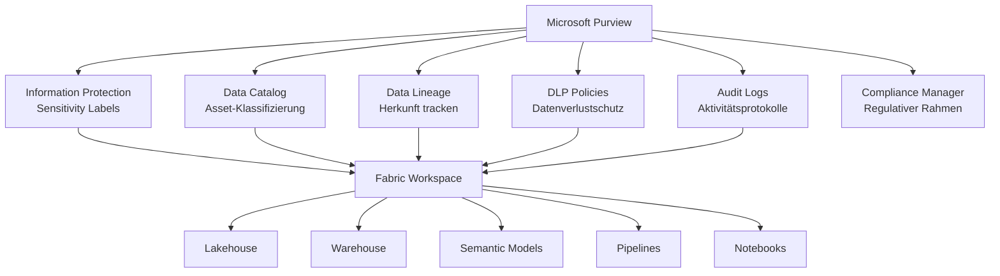
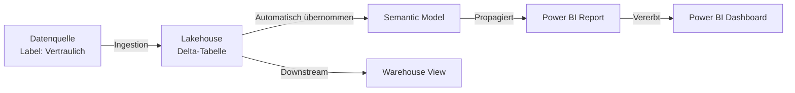
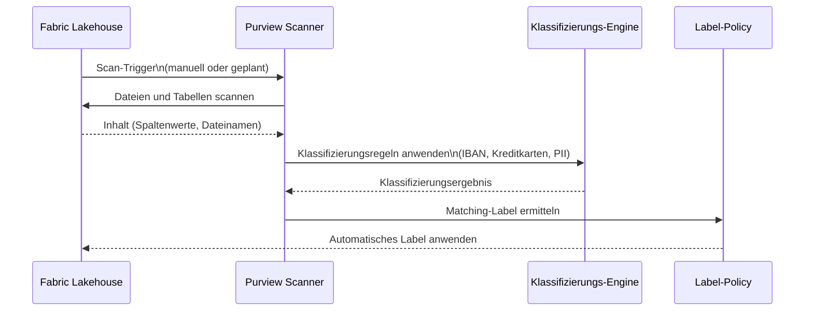
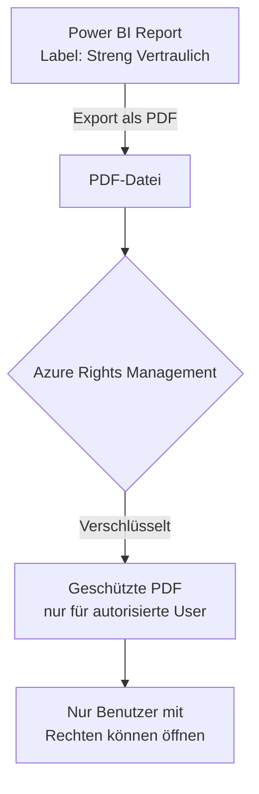
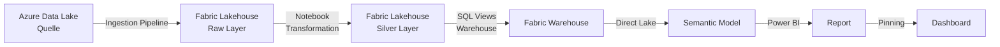
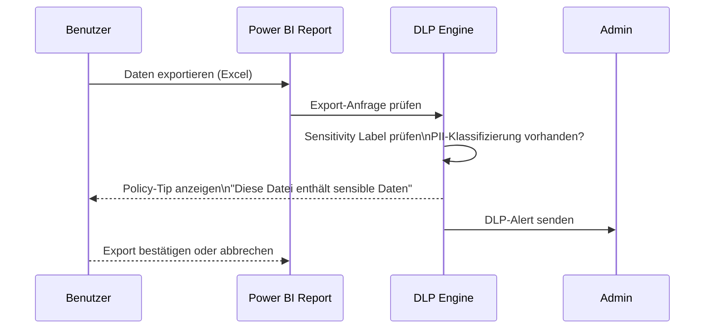
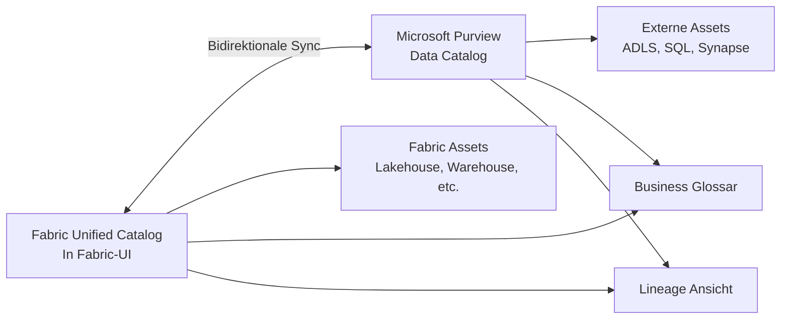

---
tags:
  - fabric
  - purview
  - governance
  - compliance
  - data-lineage
  - sensitivity-labels
  - microsoft-365
  - azure
aliases:
  - Purview Fabric
  - Fabric Governance
  - Data Catalog Fabric
---

# Microsoft Purview in Fabric

> [!ABSTRACT]
> Microsoft Purview ist die zentrale **Data Governance- und Compliance-Plattform** für Microsoft Fabric. Purview bietet Sensitivity Labels, Data Lineage, automatisches Klassifizieren von Fabric-Assets, DLP-Policies und Audit-Logs. Die Integration läuft bidirektional: Fabric-Assets werden in Purview gescannt und klassifiziert, während Labels aus M365 Purview in Fabric durchgesetzt werden.

---

## Purview-Integration in Microsoft Fabric

Microsoft Purview und Microsoft Fabric sind eng miteinander verknüpft. Purview übernimmt folgende Rollen in der Fabric-Architektur:



---

## Sensitivity Labels in Fabric

Sensitivity Labels aus **Microsoft 365 Purview Information Protection** können auf Fabric-Artefakte angewendet werden. Labels propagieren automatisch von Datenquellen zu abgeleiteten Artefakten.

### Label-Propagation in Fabric



> [!IMPORTANT]
> Die Label-Propagation in Fabric ist **unidirektional nach unten**: Ein Label an einer Quelle wird an abgeleitete Artefakte vererbt. Ein weniger restriktives Label an einem Downstream-Artefakt wird **nicht** auf die Quelle zurückpropagiert.

### Labels auf Fabric-Assets anwenden

| Fabric-Artefakt | Label-Unterstützung | Automatische Propagation |
|---|---|---|
| Lakehouse (Dateien) | ✅ | Nein |
| Lakehouse (Tabellen) | ✅ | Ja (von Quelle) |
| Data Warehouse | ✅ | Ja |
| Semantic Model | ✅ | Ja (von Datenquelle) |
| Power BI Report | ✅ | Ja (vom Semantic Model) |
| Notebook | ✅ | Nein |
| Pipeline | ✅ | Nein |
| Dataflow Gen2 | ✅ | Nein |

### Sensitivity Label per REST API setzen

```powershell
# Sensitivity Label auf Power BI Dataset setzen
$workspaceId  = "xxxxxxxx-xxxx-xxxx-xxxx-xxxxxxxxxxxx"
$datasetId    = "yyyyyyyy-yyyy-yyyy-yyyy-yyyyyyyyyyyy"
$labelId      = "zzzzzzzz-zzzz-zzzz-zzzz-zzzzzzzzzzzz"  # Label-ID aus Purview

$uri = "https://api.powerbi.com/v1.0/myorg/groups/$workspaceId/datasets/$datasetId/sensitivityLabel"

$body = @{
    sensitivityLabel = @{
        labelId = $labelId
    }
} | ConvertTo-Json

$token = (Get-AzAccessToken -ResourceUrl "https://analysis.windows.net/powerbi/api").Token
$headers = @{ Authorization = "Bearer $token"; "Content-Type" = "application/json" }

Invoke-RestMethod -Uri $uri -Method Patch -Headers $headers -Body $body
Write-Host "Sensitivity Label wurde gesetzt."
```

---

## Automatisches Labeling in Fabric

Purview kann Labels **automatisch** basierend auf Inhaltsklassifizierung vergeben:

### Automatisches Labeling-Workflow



### Unterstützte Klassifizierungen (Beispiele)

| Klassifizierungstyp | Beispiele |
|---|---|
| **Persönliche Daten (PII)** | Name, E-Mail, Geburtsdatum, Adresse |
| **Finanzdaten** | IBAN, Kreditkartennummern, BIC |
| **Gesundheitsdaten** | ICD-Codes, Patientennummern |
| **Rechtliche Daten** | Vertragsnummern, AGB-Referenzen |
| **Zugangsdaten** | Passwörter, API-Keys (Regex-basiert) |

---

## Information Protection (Verschlüsselung)

Sensitivity Labels können **Verschlüsselungs-Policies** enthalten, die auf exportierten Dateien aus Fabric durchgesetzt werden.



> [!WARNING]
> Die Verschlüsselung gilt für **Exporte** (PDF, Excel, PowerPoint) aus Power BI. Daten innerhalb von Fabric selbst (OneLake) sind durch Azure Storage-Verschlüsselung (at-rest) geschützt, nicht durch Labels.

---

## Data Lineage

Data Lineage in Purview ermöglicht das **Nachverfolgen der Datenherkunft** durch alle Fabric-Komponenten hindurch.

### Lineage-Übersicht in Fabric



### Purview Lineage Scanner

Purview scannt Fabric-Assets und erstellt automatisch Lineage-Graphen für:
- **Pipelines**: Copy-Aktivitäten zeigen Quelle → Ziel
- **Dataflows Gen2**: Transformationsschritte werden als Lineage erfasst
- **Notebooks**: Manuelle Annotation mit `mssparkutils.notebook.exit()`

```python
# Lineage-Annotation im Notebook (für Purview)
from notebookutils import mssparkutils

# Metadaten für Purview-Lineage hinterlegen
mssparkutils.notebook.exit({
    "output_table": "silver.sales_aggregated",
    "source_table": "bronze.raw_orders",
    "transformation": "aggregation_by_month"
})
```

---

## Purview Data Catalog: Fabric-Assets

Der **Purview Data Catalog** (Unified Catalog) zeigt alle Fabric-Assets zentral an und ermöglicht Suche, Klassifizierung und Business-Glossar-Verknüpfung.

### Assets in Purview registrieren

Fabric-Assets werden automatisch in Purview registriert, wenn die **Fabric-Purview-Integration** im Fabric Admin Center aktiviert ist.

| Asset-Typ in Fabric | Purview Asset-Typ |
|---|---|
| Lakehouse | Azure Data Lake (ADLS) |
| Warehouse | Azure SQL Database |
| Semantic Model | Power BI Dataset |
| Power BI Report | Power BI Report |
| Pipeline | Azure Data Factory Pipeline |
| Notebook | – (kein nativer Typ) |

### Business Glossar verknüpfen

```powershell
# Purview REST API: Business Term erstellen
$purviewAccount = "mein-purview-konto"
$uri = "https://$purviewAccount.purview.azure.com/catalog/api/atlas/v2/glossary/term"

$body = @{
    name = "Umsatz (Netto)"
    shortDescription = "Umsatz nach Abzug von Rabatten und Retouren"
    longDescription  = "Definiert als Bruttoumsatz minus Rabatte minus Retouren"
    status = "Active"
    abbreviation = "UN"
} | ConvertTo-Json

$purviewToken = (Get-AzAccessToken -ResourceUrl "https://purview.azure.com").Token
$headers = @{ Authorization = "Bearer $purviewToken"; "Content-Type" = "application/json" }

Invoke-RestMethod -Uri $uri -Method Post -Headers $headers -Body $body
```

---

## Data Loss Prevention (DLP) für Fabric

DLP-Policies in Purview können **Datenverlust aus Fabric verhindern**:

### DLP-Szenarien für Fabric

| Szenario | DLP-Aktion |
|---|---|
| Export von Kreditkartendaten aus Power BI | Export blockieren + Admin benachrichtigen |
| Teilen von Report mit externen Benutzern | Warnung + Genehmigung erforderlich |
| Download von Excel mit PII-Daten | Policy-Tip anzeigen |
| Öffentliche Einbettung von sensitivem Report | Blockieren |



> [!DANGER]
> Falsch konfigurierte DLP-Policies können **produktive Power BI Berichte blockieren**. Immer im Simulation Mode (Policy testen ohne zu blockieren) beginnen.

---

## Audit-Logs für Fabric-Aktivitäten

Alle Aktivitäten in Fabric werden in **Microsoft 365 Audit Logs** (über Purview) protokolliert.

### Wichtige Fabric-Audit-Events

| Ereignis | Beschreibung |
|---|---|
| `CreateLakehouse` | Neues Lakehouse erstellt |
| `DeleteLakehouse` | Lakehouse gelöscht |
| `RunNotebook` | Notebook ausgeführt |
| `CreatePipeline` | Pipeline erstellt |
| `RunPipeline` | Pipeline ausgeführt |
| `ViewReport` | Power BI Report angesehen |
| `ExportArtifact` | Daten exportiert |
| `ShareReport` | Report geteilt |
| `UpdateSensitivityLabel` | Label geändert |
| `CreateWorkspace` | Workspace erstellt |

### Audit-Logs per PowerShell abfragen

```powershell
# Microsoft 365 Compliance PowerShell (Exchange Online Module)
Connect-ExchangeOnline

# Fabric-Aktivitäten der letzten 7 Tage
$auditResults = Search-UnifiedAuditLog `
    -StartDate (Get-Date).AddDays(-7) `
    -EndDate   (Get-Date) `
    -RecordType FabricDashboard, FabricNotebook, FabricPipeline `
    -ResultSize 5000

$auditResults | ForEach-Object {
    $data = $_.AuditData | ConvertFrom-Json
    [PSCustomObject]@{
        Zeitpunkt    = $_.CreationDate
        Benutzer     = $_.UserIds
        Aktion       = $_.Operations
        Workspace    = $data.WorkSpaceName
        Artefakt     = $data.DatasetName ?? $data.ReportName
    }
} | Export-Csv -Path "fabric_audit_$(Get-Date -Format yyyyMMdd).csv" -NoTypeInformation
```

### KQL: Audit-Logs in Sentinel analysieren

```kusto
// Microsoft Fabric Aktivitäten in Microsoft Sentinel
OfficeActivity
| where RecordType in ("FabricNotebook", "FabricPipeline", "PowerBIDataset")
| where TimeGenerated >= ago(7d)
| summarize
    Aktivitaeten = count(),
    Nutzer = dcount(UserId)
    by Operation, bin(TimeGenerated, 1d)
| order by Aktivitaeten desc
| render barchart
```

---

## Compliance und Regulatory Compliance

Fabric ist in folgende Compliance-Frameworks eingebettet:

| Framework | Status in Fabric | Details |
|---|---|---|
| **ISO 27001** | ✅ Zertifiziert | Microsoft Cloud insgesamt |
| **SOC 1 / SOC 2** | ✅ Zertifiziert | Typ II Reports verfügbar |
| **DSGVO / GDPR** | ✅ Konform | Datenverarbeitungsvertrag (DPA) |
| **HIPAA** | ✅ Verfügbar | BAA von Microsoft erhältlich |
| **FedRAMP** | ✅ High (Government Cloud) | Azure Government |
| **BSI C5** | ✅ Zertifiziert | Für Deutschland relevant |

### Datenresidenz in Fabric

> [!IMPORTANT]
> Fabric speichert Daten standardmäßig in der **Fabric-Heimregion des Tenants** (meist die M365-Region). Für strikte DSGVO-Anforderungen (Deutschland) sicherstellen, dass die Fabric-Capacity in `Germany West Central` provisioniert wird.

```powershell
# Tenant-Region für Fabric prüfen
$uri = "https://api.powerbi.com/v1.0/myorg/admin/capacities"
$token = (Get-AzAccessToken -ResourceUrl "https://analysis.windows.net/powerbi/api").Token
$headers = @{ Authorization = "Bearer $token" }

$capacities = Invoke-RestMethod -Uri $uri -Headers $headers
$capacities.value | Select-Object displayName, region, sku, state
```

---

## Purview Unified Catalog (Fabric-native)

Ab 2024 bietet Fabric einen **eigenen Unified Catalog** (in der Fabric-Oberfläche), der direkt mit Purview synchronisiert:



> [!NOTE]
> Der Fabric Unified Catalog ist der empfohlene Einstiegspunkt für Power-Benutzer, während das vollständige Purview-Portal für Data-Governance-Administratoren gedacht ist.

---

## Verwandte Notizen

- [[Microsoft Fabric Grundlagen]]
- [[OneLake]]
- [[Fabric Administration]]
- [[Microsoft Defender for Cloud]]
