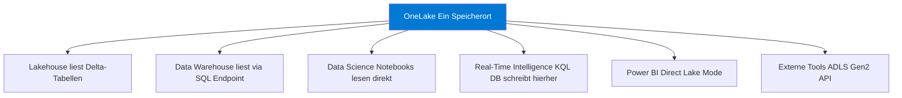
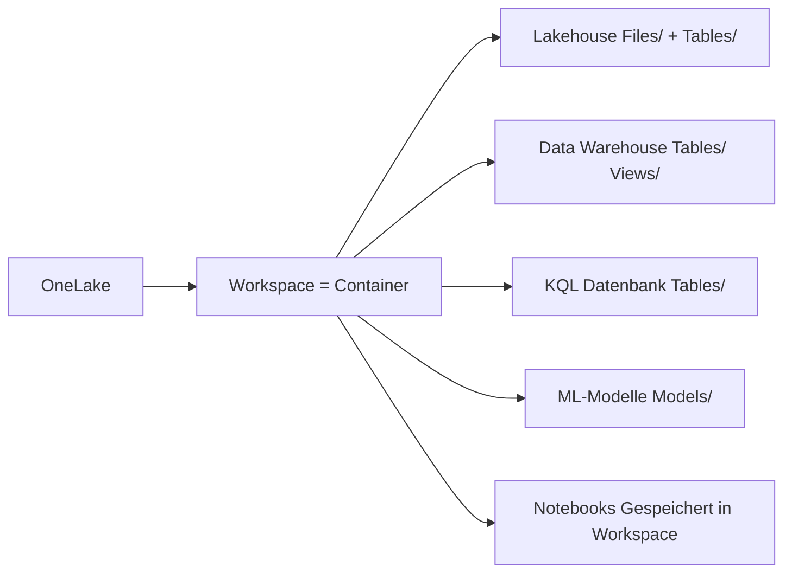
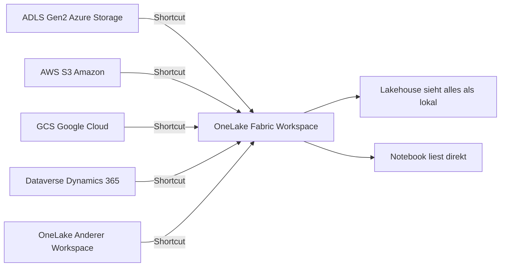
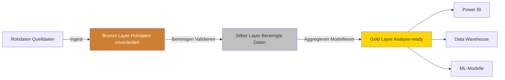
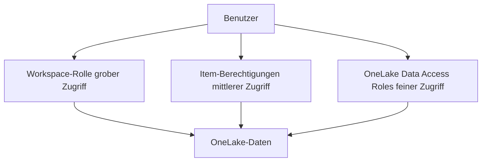

---
tags:
  - microsoft-fabric
  - onelake
  - data-lake
  - adls
  - shortcuts
  - medallion
  - speicher
aliases:
  - OneLake Fabric
  - Fabric Data Lake
  - One Lake
---

# OneLake

> [!ABSTRACT] TL;DR
> OneLake ist der **einzige, mandantenweite Data Lake** in Microsoft Fabric — eine Art OneDrive für Organisationsdaten. Er basiert auf Azure Data Lake Storage Gen2, speichert Daten im Delta/Parquet-Format und gilt für alle Fabric-Workloads gleichzeitig. Das **OneCopy-Prinzip** stellt sicher, dass Daten nur einmal gespeichert werden, aber von beliebig vielen Diensten gelesen werden können.

---

## Was ist OneLake?

OneLake ist die Datenspeichergrundlage von Microsoft Fabric. Es gibt genau **einen OneLake pro Entra-ID-Tenant** — unabhängig davon, wie viele Workspaces, Kapazitäten oder Fabric-Items existieren.

**Analogie:**
- **OneDrive** = persönlicher Datenspeicher für Einzelpersonen
- **SharePoint** = gemeinsamer Speicher für Teams
- **OneLake** = gemeinsamer Datenspeicher für alle Organisationsdaten in Fabric

**Technische Grundlage:**
- Basiert vollständig auf **Azure Data Lake Storage Gen2 (ADLS Gen2)**
- ADLS Gen2-kompatible APIs (bestehende Tools und Bibliotheken funktionieren)
- Daten liegen im **Delta Lake**-Format (Delta/Parquet) für Tabellen
- Rohdateien können in jedem Format gespeichert werden (CSV, JSON, Parquet, Avro etc.)

---

## OneCopy-Prinzip

Das **OneCopy-Prinzip** ist das zentrale Designprinzip von OneLake:



**Vorteile von OneCopy:**
- **Keine Datenduplizierung** → weniger Speicherkosten
- **Keine Datenbewegung** → kein ETL zwischen verschiedenen Speichern
- **Konsistenz** → alle Workloads sehen dieselben Daten
- **Weniger Latenz** → kein Kopieren von Daten vor der Analyse

> [!IMPORTANT]
> Bisher mussten Organisationen Daten in separate Speicher kopieren (Data Lake → Synapse → Power BI). Mit OneLake entfällt dieser Schritt vollständig.

---

## ADLS Gen2-Kompatibilität

OneLake implementiert die **vollständige ADLS Gen2 API**, was bedeutet:

| API / Tool | Kompatibilität | Hinweis |
|------------|---------------|---------|
| Azure Storage SDK | ✅ Vollständig | `dfs.core.windows.net`-Endpunkt |
| AzCopy | ✅ Vollständig | Datei-Transfers direkt in OneLake |
| Azure Storage Explorer | ✅ Vollständig | GUI-Tool für OneLake-Dateien |
| Databricks | ✅ Mit ABFS-Connector | `abfss://` URI-Schema |
| Apache Spark (extern) | ✅ Mit ABFS | Lesen/Schreiben direkt möglich |
| HDFS-kompatible Tools | ✅ Über ABFS | Hadoop-Ökosystem |

**OneLake URI-Schema:**
```
# Allgemeines Schema
abfss://<workspace>@onelake.dfs.fabric.microsoft.com/<item>/<pfad>

# Beispiel: Lakehouse-Tabelle
abfss://Analytics-Workspace@onelake.dfs.fabric.microsoft.com/Sales-Lakehouse/Tables/customers

# HTTPS-URL (OneLake Data Hub)
https://onelake.dfs.fabric.microsoft.com/<workspace-id>/<item-id>
```

```python
# Zugriff auf OneLake via ADLS Gen2 API (außerhalb von Fabric)
from azure.storage.filedatalake import DataLakeServiceClient
from azure.identity import DefaultAzureCredential

credential = DefaultAzureCredential()
service_client = DataLakeServiceClient(
    account_url="https://onelake.dfs.fabric.microsoft.com",
    credential=credential
)

# Workspace als Filesystem, Lakehouse als Verzeichnis
file_system_client = service_client.get_file_system_client("<workspace-name>")
paths = file_system_client.get_paths(path="<lakehouse-name>/Tables")
for path in paths:
    print(path.name)
```

---

## Fabric-Elemente und ihre Speicherorte

Jedes Fabric-Item hat einen definierten Speicherort in OneLake:



| Fabric-Item | Speicherstruktur in OneLake |
|-------------|----------------------------|
| **Lakehouse** | `<lakehouse>/Files/` (Rohdateien) + `<lakehouse>/Tables/` (Delta) |
| **Data Warehouse** | `<warehouse>/Tables/` (Delta, read-only via OneLake) |
| **KQL Datenbank** | `<eventhouse>/<kql-db>/Tables/` |
| **ML-Experimente** | Metadaten + Artefakte im Workspace |

> [!NOTE]
> Die **SQL Analytics Endpoint**-Tabellen eines Lakehouse sind **schreibgeschützt** über OneLake zugänglich — Schreibzugriff erfolgt nur über Notebooks/Pipelines.

---

## Shortcuts

Shortcuts sind **virtuelle Verknüpfungen** zu externen Datenspeichern, die in OneLake wie lokale Ordner aussehen.

**Unterstützte Shortcut-Quellen:**

| Quelle | Typ | Authentifizierung |
|--------|-----|------------------|
| **OneLake** (anderer Workspace) | Intern | Workspace-Rollen |
| **ADLS Gen2** | Extern | Account Key, SAS, Service Principal |
| **AWS S3** | Extern | Access Key + Secret, IAM |
| **Google Cloud Storage** | Extern | Service Account Key |
| **S3-kompatibel** | Extern | Access Key (z. B. MinIO) |
| **Dataverse** | Microsoft | Automatisch über Fabric |
| **KQL Datenbank** | Intern | Automatisch |



**Shortcut erstellen (Lakehouse):**
1. Lakehouse öffnen → `Dateien`-Bereich → Rechtsklick → **Neuer Shortcut**
2. Quelle auswählen (ADLS Gen2, S3, etc.)
3. Verbindung konfigurieren (Anmeldedaten)
4. Unterpfad im externen Speicher wählen

> [!TIP]
> Shortcuts sind **kostenlos** — es fallen keine OneLake-Speicherkosten für externe Daten an. Lediglich die Egress-Kosten beim Lesen der Quelldaten können anfallen.

> [!WARNING]
> Shortcuts zu **S3 und GCS** erfordern, dass der Tenant-Administrator in den Fabric-Einstellungen **„Externe Datenaustausch-Shortcuts"** aktiviert hat.

---

## OneLake Explorer (Desktop Client)

Der **OneLake Explorer** ist ein Windows-Desktop-Client (ähnlich OneDrive-Client), der OneLake als lokales Laufwerk einbindet.

**Installation & Nutzung:**
```powershell
# Download über Microsoft Store oder direkter Download
# https://aka.ms/OneLakeExplorer

# Nach Installation erscheint OneLake im Windows Explorer
# Pfad: C:\Users\<user>\OneLake - <tenant-name>
# Struktur: Workspace > Lakehouse > Files / Tables
```

**Funktionen:**
- Dateien per Drag & Drop in OneLake hochladen
- Lokale Synchronisation (ähnlich OneDrive-Sync)
- Direkter Zugriff auf Delta-Tabellen als Ordner
- Kein Code erforderlich für einfache Dateioperationen

> [!NOTE]
> OneLake Explorer unterstützt **keine automatische Synchronisation** in Echtzeit. Beim Hochladen wird die Datei direkt in OneLake übertragen, aber Änderungen in OneLake erscheinen erst nach einer manuellen Aktualisierung.

---

## OneLake Data Hub

Der **OneLake Data Hub** (im Fabric-Portal) ist die Oberfläche zur Entdeckung aller Daten im Tenant.

**Funktionen:**
- Alle Fabric-Items des Tenants durchsuchen
- Datensätze nach Endorsement filtern (Zertifiziert, Empfohlen)
- Zugriff auf Daten anderer Workspaces anfordern
- Datenherkunft (Lineage) einsehen

**Zugang:** `app.fabric.microsoft.com` → OneLake Data Hub (linke Navigation)

---

## Medallion-Architektur in OneLake

Die **Medallion-Architektur** (Bronze/Silber/Gold) ist das empfohlene Datenschichten-Muster in OneLake.



**Implementierung in Fabric:**

| Layer | Fabric-Empfehlung | Speicherformat |
|-------|------------------|---------------|
| **Bronze** | Lakehouse `Files/`-Bereich | CSV, JSON, Parquet (roh) |
| **Silber** | Lakehouse `Tables/`-Bereich | Delta Lake (bereinigt) |
| **Gold** | Lakehouse `Tables/` oder Warehouse | Delta Lake / SQL Views |

> [!TIP]
> Eine häufige Implementierung: **3 separate Lakehouses** (Bronze-LH, Silber-LH, Gold-LH) in demselben Workspace. Shortcuts verbinden die Lakehouses, sodass Bronze-Daten in Silber per Shortcut sichtbar sind.

---

## Sicherheit in OneLake

OneLake nutzt ein mehrschichtiges Sicherheitsmodell:

### Workspace-Rollen (grob)

| Rolle | OneLake-Zugriff |
|-------|----------------|
| **Admin/Member/Contributor** | Lesen + Schreiben auf alle Items im Workspace |
| **Viewer** | Nur Lesen |

### OneLake-Datenzugriff (fein)

Ab 2024 unterstützt OneLake **Row-Level Security** und **Column-Level Security** direkt über **OneLake Data Access Roles** (Preview).



> [!WARNING]
> **Achtung bei Shortcuts**: Wer Lesezugriff auf einen Shortcut hat, kann die Daten der Quelle lesen — auch wenn er keinen direkten Zugriff auf den externen Speicher hat. Shortcut-Berechtigungen sorgfältig planen.

---

## GDPR und Datenhaltung

| Aspekt | Details |
|--------|---------|
| **Datenstandort** | Wird durch die Fabric-Kapazitätsregion bestimmt |
| **Replikation** | Innerhalb der Region (Hochverfügbarkeit) |
| **Geo-Replikation** | Nicht standardmäßig; erfordert separate Konfiguration |
| **DSGVO-Compliance** | Microsoft ist Auftragsverarbeiter (DPA vorhanden) |
| **Datenlöschung** | Beim Löschen eines Workspace werden alle Daten gelöscht |
| **Soft Delete** | 7 Tage Wiederherstellungsfenster für Workspace-Elemente |

> [!IMPORTANT]
> Die **Kapazitätsregion** (z. B. `West Europe`) bestimmt, wo OneLake-Daten physisch gespeichert werden. Bei Compliance-Anforderungen (DSGVO, BSI) darauf achten, eine **EU-Region** zu wählen.

---

## OneLake Diagnose und Monitoring

```python
# OneLake-Nutzung über Fabric REST API abfragen
import requests

headers = {"Authorization": f"Bearer {access_token}"}

# Alle Lakehouses eines Workspace auflisten
workspace_id = "<workspace-guid>"
response = requests.get(
    f"https://api.fabric.microsoft.com/v1/workspaces/{workspace_id}/lakehouses",
    headers=headers
)

for lakehouse in response.json()["value"]:
    print(f"Lakehouse: {lakehouse['displayName']} | ID: {lakehouse['id']}")
```

```powershell
# OneLake Speichergröße überwachen (über Fabric Capacity Metrics App)
# Die App zeigt:
# - Speicher pro Workspace in GB
# - Lese-/Schreib-Operationen pro Stunde
# - Shortcut-Zugriffe
# Download: AppSource → "Microsoft Fabric Capacity Metrics"
```

---

## Verwandte Notizen

- [[Microsoft Fabric Grundlagen]]
- [[Fabric Lakehouse]]
- [[Fabric Data Warehouse]]
- [[Microsoft Purview in Fabric]]
