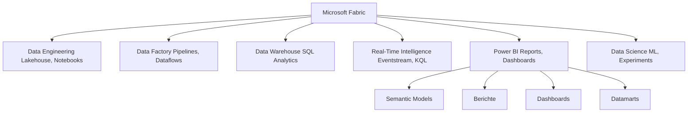
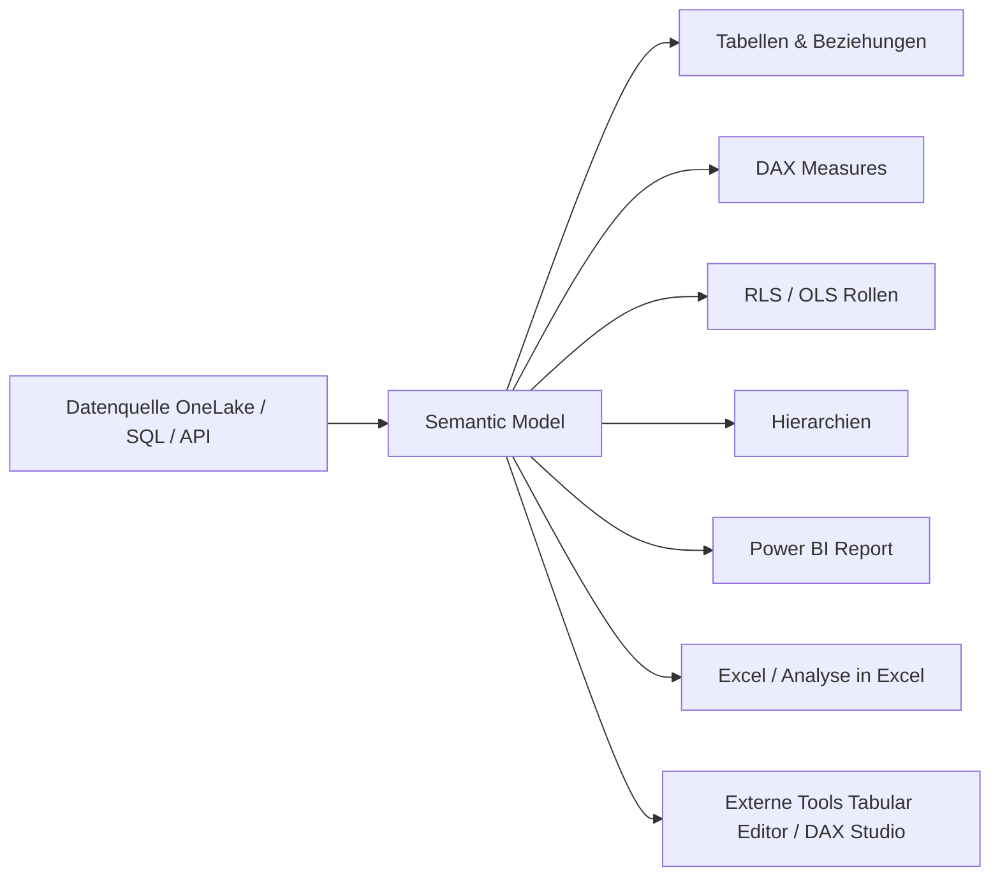
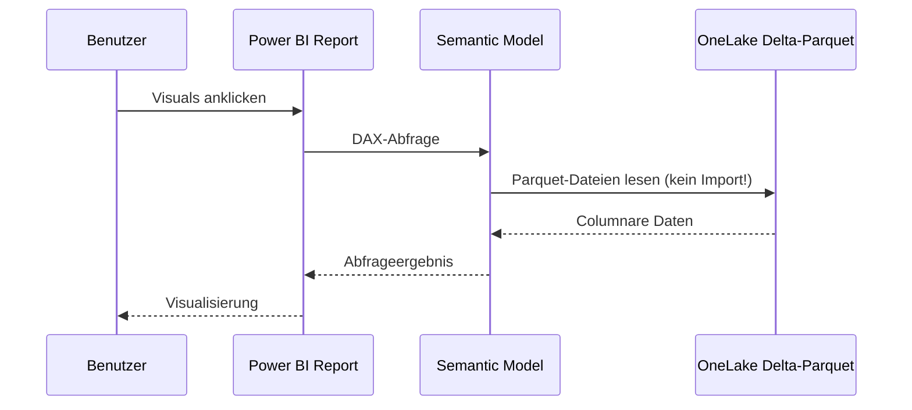
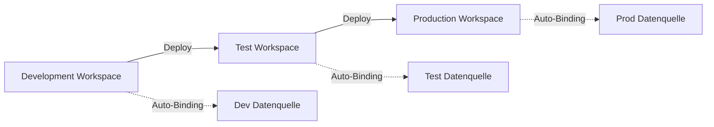
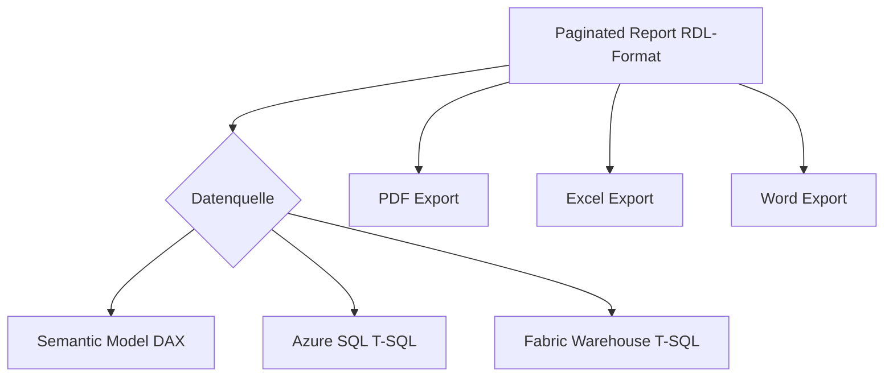
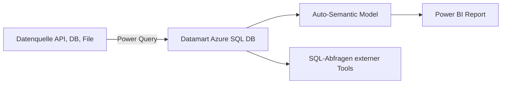
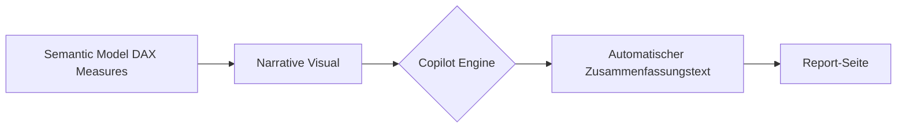
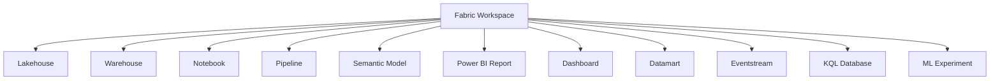
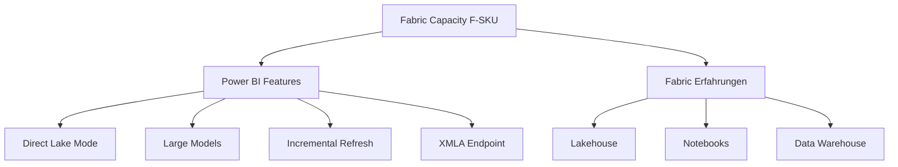

---
tags:
  - fabric
  - power-bi
  - microsoft-365
  - azure
  - analytics
  - semantic-model
  - direct-lake
  - deployment-pipeline
aliases:
  - Power BI Fabric
  - Fabric Power BI
  - Power BI Semantic Models
---

# Power BI in Fabric

> [!ABSTRACT]
> Power BI ist vollständig in Microsoft Fabric integriert und bildet die Visualisierungs- und Self-Service-Analytics-Schicht der Plattform. Der **Direct Lake Mode** ermöglicht blitzschnelle Abfragen direkt aus OneLake, ohne Daten zu importieren. Fabric-Workspaces und Power BI-Workspaces sind identisch — Power BI ist eine der Fabric-Erfahrungen (Experiences).

---

## Power BI als Fabric-Erfahrung

Microsoft Fabric vereint mehrere Analytics-Dienste unter einem Dach. Power BI ist dabei die **Reporting- und Visualisierungsschicht**. Seit der Fabric-GA (November 2023) sind Power BI-Workspaces und Fabric-Workspaces dasselbe Konstrukt.



### Was ändert sich mit Fabric?

| Aspekt | Früher (Power BI standalone) | Mit Fabric |
|---|---|---|
| Workspace | Power BI Workspace | Fabric Workspace (identisch) |
| Datenquelle | Import / DirectQuery | **+ Direct Lake** (neu) |
| Compute | Power BI Premium / Pro | Fabric Capacity (F-SKUs) |
| Datenspeicher | Power BI Datasets | OneLake / Delta-Parquet |
| Admin-Portal | admin.powerbi.com | admin.fabric.microsoft.com |
| Datenpipelines | Power BI Dataflows | Fabric Data Factory + Dataflows Gen2 |

---

## Semantic Models (früher: Datasets)

Ein **Semantic Model** ist das zentrale Datenobjekt in Power BI — es definiert Tabellen, Beziehungen, Measures (DAX), Hierarchien und Sicherheitsrollen (RLS/OLS).

### Struktur eines Semantic Models



### DAX-Beispiel: Measure erstellen

```dax
-- Umsatz aktuelles Jahr
Umsatz CY :=
CALCULATE(
    SUM(Faktura[Umsatz_EUR]),
    DATESYTD('Datum'[Datum])
)

-- Umsatz Vorjahr
Umsatz PY :=
CALCULATE(
    [Umsatz CY],
    SAMEPERIODLASTYEAR('Datum'[Datum])
)

-- Wachstum in Prozent
Umsatz YoY% :=
DIVIDE(
    [Umsatz CY] - [Umsatz PY],
    [Umsatz PY],
    BLANK()
)
```

### Semantic Model per REST API verwalten

```powershell
# Power BI / Fabric REST API: Dataset-Liste abrufen
$token = (Get-AzAccessToken -ResourceUrl "https://analysis.windows.net/powerbi/api").Token
$headers = @{ Authorization = "Bearer $token" }

$workspaceId = "xxxxxxxx-xxxx-xxxx-xxxx-xxxxxxxxxxxx"
$uri = "https://api.powerbi.com/v1.0/myorg/groups/$workspaceId/datasets"

$datasets = Invoke-RestMethod -Uri $uri -Headers $headers -Method Get
$datasets.value | Select-Object id, name, isRefreshable, configuredBy
```

---

## Direct Lake Mode

**Direct Lake** ist der innovativste Abfragemodus in Fabric. Daten liegen als **Delta-Parquet-Dateien in OneLake** — Power BI liest sie direkt, ohne Import oder DirectQuery-Übersetzung.

### Vergleich der Abfragemodi

| Kriterium | Import | DirectQuery | Direct Lake |
|---|---|---|---|
| Datenspeicherort | Im Semantic Model (RAM/SSD) | Datenquelle (live) | OneLake (Delta-Parquet) |
| Abfragegeschwindigkeit | ⚡⚡⚡ Schnellste | ⚡ Langsamste | ⚡⚡⚡ Wie Import |
| Datenaktualität | Refresh nötig | Immer aktuell | Automatisch aktuell |
| Datengröße | Begrenzt durch RAM | Unbegrenzt | Unbegrenzt |
| DAX-Unterstützung | Vollständig | Eingeschränkt | Vollständig |
| Fallback | – | – | DirectQuery (bei Bedarf) |
| Kosten | Capacity für Refresh | Capacity für Abfragen | Capacity (keine Kopie) |
| Verfügbarkeit | Alle SKUs | Alle SKUs | Fabric F-SKUs |

### Wie Direct Lake funktioniert



> [!NOTE]
> Direct Lake hat einen automatischen **Fallback auf DirectQuery**, wenn bestimmte DAX-Funktionen nicht nativ unterstützt werden oder wenn die Daten zu groß für den Arbeitsspeicher sind.

> [!IMPORTANT]
> Direct Lake erfordert, dass Daten als **Delta-Tabellen in einem Fabric Lakehouse oder Warehouse** liegen. Externe Quellen (z.B. Azure SQL) werden nicht direkt unterstützt.

### Direct Lake Limits (Stand 2024)

| Fabric SKU | Max. Tabellen | Max. Spalten | Max. Zeilen pro Tabelle |
|---|---|---|---|
| F2 | 1.000 | 10.000 | 300 Mio. |
| F4 | 1.000 | 10.000 | 300 Mio. |
| F8 | 1.000 | 10.000 | 300 Mio. |
| F16 | 1.000 | 10.000 | 300 Mio. |
| F32 | 1.000 | 10.000 | 300 Mio. |
| F64+ | 5.000 | 50.000 | Unbegrenzt |

---

## Deployment Pipelines

Deployment Pipelines ermöglichen **CI/CD für Power BI-Inhalte** — Berichte, Semantic Models und Dashboards können strukturiert von Dev über Test nach Prod deployed werden.



### Deployment Rules konfigurieren

Deployment Rules erlauben es, **Parameterverbindungen je Stage** zu überschreiben (z.B. andere Datenbank-URLs).

```powershell
# Deployment Pipeline per REST API ausführen
$pipelineId = "xxxxxxxx-xxxx-xxxx-xxxx-xxxxxxxxxxxx"
$uri = "https://api.powerbi.com/v1.0/myorg/pipelines/$pipelineId/stages/1/deployAll"

$body = @{
    sourceStageOrder = 0  # 0=Dev, 1=Test, 2=Prod
    options = @{
        allowOverwriteArtifact = $true
        allowCreateArtifact = $true
    }
} | ConvertTo-Json

Invoke-RestMethod -Uri $uri -Headers $headers -Method Post -Body $body -ContentType "application/json"
```

> [!TIP]
> Deployment Pipelines lassen sich mit **Fabric Git Integration** kombinieren: Änderungen werden in Git versioniert und dann per Pipeline deployed.

---

## Power BI-Berichte und -Dashboards

### Bericht vs. Dashboard

| Merkmal | Bericht (Report) | Dashboard |
|---|---|---|
| Datenquelle | Ein Semantic Model | Mehrere Quellen (Pinning) |
| Interaktivität | Hoch (Filter, Drill-through) | Gering (read-only) |
| Anzahl Seiten | Mehrere Seiten | Eine Seite (Canvas) |
| Mobiloptimierung | Via Layout-Editor | Eingebaut |
| Alerts | Nein | Ja (Datenwarnungen) |
| Einbettung | Power BI Embedded | Power BI Embedded |

### Paginated Reports in Fabric

Paginated Reports (früher: SSRS) sind für **druckoptimierte, pixelgenaue Berichte** gedacht:



---

## Datamarts (Preview)

Datamarts sind ein **Self-Service Data Warehouse** für Power BI-Benutzer ohne tiefes SQL-Wissen. Sie kombinieren:
- Automatisch generierte Azure SQL-Datenbank
- Power Query / Dataflows für ETL
- Automatisches Semantic Model

> [!WARNING]
> Datamarts sind als Preview-Feature verfügbar und für einfachere Szenarien gedacht. Für komplexe DWH-Anforderungen empfiehlt Microsoft das **Fabric Data Warehouse**.



---

## Power BI Copilot

Copilot in Power BI nutzt generative KI für Report-Erstellung und DAX-Unterstützung.

### Copilot-Funktionen in Power BI

| Funktion | Beschreibung |
|---|---|
| **Report erstellen** | Natürlichsprachige Beschreibung → automatischer Report |
| **Seite hinzufügen** | "Erstelle eine Übersichtsseite für Umsatz nach Region" |
| **DAX generieren** | Measure-Beschreibung → DAX-Code |
| **Narrative Visual** | Automatische Textzusammenfassung für Dashboards |
| **Q&A verbessert** | Natürliche Fragen an das Semantic Model |

> [!IMPORTANT]
> Power BI Copilot erfordert eine **Fabric Capacity von mindestens F64** (oder P1 Premium-Kapazität). Pro- und PPU-Lizenzen allein reichen nicht aus.

### Narrative Visual (Copilot-generierter Text)



---

## Fabric Workspace = Power BI Workspace

Mit Fabric sind Power BI-Workspaces und Fabric-Workspaces **identisch**. In einem Fabric-Workspace können alle Fabric-Artefakte nebeneinander existieren.

### Artefakte in einem Fabric Workspace



---

## Admin-Einstellungen für Power BI in Fabric

Zentrale Verwaltung unter `admin.fabric.microsoft.com`:

### Wichtige Tenant-Einstellungen

| Einstellung | Beschreibung | Standard |
|---|---|---|
| Direct Lake aktivieren | Direct Lake für Semantic Models erlauben | Aktiviert |
| Copilot aktivieren | KI-Features für Power BI | Deaktiviert |
| Export zu Excel | Datenexport erlauben/sperren | Aktiviert |
| Embed-Codes | Öffentliche Einbettung erlauben | Deaktiviert |
| Deployment Pipelines | CI/CD für Power BI | Aktiviert |
| Paginated Reports | RDL-Berichte zulassen | Aktiviert |
| Datamart erstellen | Self-Service DWH | Aktiviert |

```powershell
# Tenant-Einstellungen per API abrufen
$uri = "https://api.powerbi.com/v1.0/myorg/admin/tenantSettings"
$settings = Invoke-RestMethod -Uri $uri -Headers $headers -Method Get
$settings.tenantSettings | Where-Object { $_.settingName -like "*Copilot*" }
```

---

## Lizenzierung

### Lizenzmodell-Übersicht

| Lizenz | Enthält | Kosten | Empfohlen für |
|---|---|---|---|
| **Free** | Nur Viewer in Premium-Workspaces | – | Endnutzer in Org |
| **Pro** | Erstellen & Teilen (kein Premium) | ~10 €/Monat/User | Kleinere Teams |
| **PPU** (Premium Per User) | Alle Premium-Features per User | ~20 €/Monat/User | Einzelne Power-User |
| **Fabric Capacity F2–F2048** | Alle Fabric + Power BI Features | Azure-Kosten (CUs) | Org-weite Plattform |

### Fabric Capacity für Power BI



> [!NOTE]
> Eine **Fabric Capacity F64** ist erforderlich für Copilot-Features in Power BI und Fabric. Kleinere Kapazitäten unterstützen Power BI ohne Copilot.

### Power BI Premium Features in Fabric

| Feature | Pro | PPU | F/P SKU |
|---|---|---|---|
| Direct Lake | ❌ | ❌ | ✅ |
| XMLA Endpoint (Read) | ❌ | ✅ | ✅ |
| XMLA Endpoint (Write) | ❌ | ✅ | ✅ |
| Paginated Reports | ❌ | ✅ | ✅ |
| Large Datasets (>1GB) | ❌ | ✅ | ✅ |
| Deployment Pipelines | ❌ | ✅ | ✅ |
| Git Integration | ❌ | ❌ | ✅ |
| Copilot | ❌ | ❌ | ✅ (F64+) |

---

## Best Practices

> [!TIP]
> **Star-Schema verwenden:** Dimensionstabellen (klein, denormalisiert) und Faktentabellen (groß) für optimale DAX-Performance.

> [!TIP]
> **Direct Lake bevorzugen:** Wenn Daten in einem Fabric Lakehouse liegen, Direct Lake statt Import oder DirectQuery nutzen — schneller und kostengünstiger.

> [!WARNING]
> **Viele Many-to-Many-Beziehungen vermeiden:** Sie verschlechtern die DAX-Performance erheblich. Brückentabellen oder Datentransformationen vorziehen.

> [!IMPORTANT]
> **RLS (Row-Level Security) testen:** Sicherheitsrollen vor dem Deployment mit dem RLS-Test-Tool in Power BI Desktop prüfen.

---

## Verwandte Notizen

- [[Microsoft Fabric Grundlagen]]
- [[OneLake]]
- [[Fabric Lakehouse]]
- [[Fabric Copilot]]
- [[Fabric Administration]]
