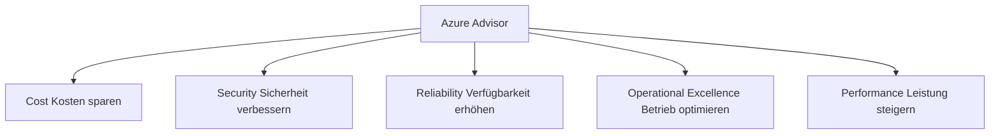
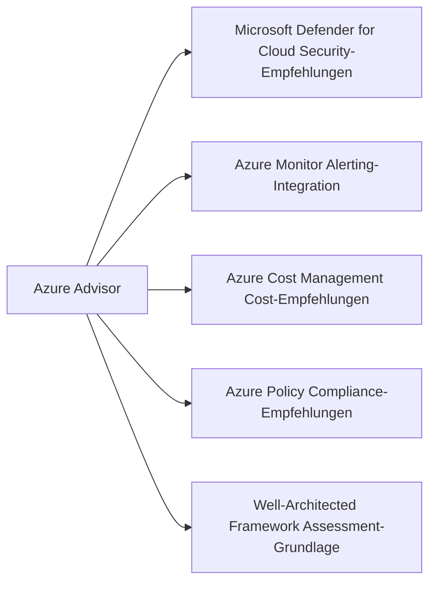

---
tags:
  - azure
  - grundlagen
  - advisor
  - optimierung
  - sicherheit
  - cost-management
  - empfehlungen
aliases:
  - Advisor
  - Azure Empfehlungen
  - Advisor Score
  - Azure Advisor Grundlagen
---

# Azure Advisor

> [!ABSTRACT] TL;DR
> Azure Advisor ist der kostenlose, personalisierte Cloud-Berater von Azure. Er analysiert Ressourcen-Konfiguration und Nutzungsmuster und liefert priorisierte Empfehlungen in 5 Kategorien: Cost, Security, Reliability, Operational Excellence und Performance — messbar über den Advisor Score.

---

## Was ist Azure Advisor?

**Azure Advisor** ist ein kostenloser Azure-Dienst, der:
- Ressourcen-Konfiguration und Nutzungsmuster analysiert
- Priorisierte, umsetzbare Empfehlungen liefert
- Den Advisor Score als Gesamtbewertung bereitstellt
- Direkt in das Azure Portal integriert ist

**Kein Agent nötig** — Advisor greift auf ARM-Metadaten und Azure Monitor-Metriken zurück, ohne Installation oder Konfiguration.

**Zugang:** Azure Portal → Advisor

---

## Die 5 Empfehlungs-Kategorien



| Kategorie | Deutsch | Fokus | Datenquelle |
|-----------|---------|-------|------------|
| **Cost** | Kosten | Ungenutzte Ressourcen, Right-Sizing, RIs | Nutzungsmetriken, Billing |
| **Security** | Sicherheit | Sicherheitslücken, Fehlkonfigurationen | Defender for Cloud |
| **Reliability** | Zuverlässigkeit | Verfügbarkeit, Backup, Redundanz | ARM-Konfiguration |
| **Operational Excellence** | Betriebliche Exzellenz | Monitoring, Diagnose, Prozesse | ARM, Monitor |
| **Performance** | Leistung | Latenz, Durchsatz, Skalierung | Metriken |

---

## Advisor Score

Der **Advisor Score** ist eine Gesamtbewertung von 0-100 für jede Kategorie und gesamt:

### Berechnung

```
Advisor Score = (Gewichtete umgesetzte Empfehlungen) / (Gewichtete Gesamt-Empfehlungen) × 100
```

- Jede Empfehlung hat ein **Impact-Level:** High, Medium, Low
- High-Impact-Empfehlungen haben mehr Gewicht im Score
- Score kann auf Subscription- oder Management-Group-Ebene eingesehen werden

### Score-Verbesserungs-Strategie

1. **High-Impact-Empfehlungen** zuerst (stärkster Score-Effekt)
2. **Security-Kategorie** priorisieren (oft höchste Gewichtung)
3. **Quick Wins** umsetzen (einfache Empfehlungen mit hohem Impact)
4. **Wöchentliche Reviews** einplanen

---

## Empfehlungen verwalten

### Status einer Empfehlung

| Status | Beschreibung |
|--------|-------------|
| **Active** | Empfehlung offen und relevant |
| **Postponed** | Manuell zurückgestellt (7/14/30/90 Tage oder unbegrenzt) |
| **Dismissed** | Empfehlung abgelehnt (mit Begründung) |
| **Completed** | Empfehlung wurde umgesetzt |

### Empfehlung zurückstellen oder ablehnen

```powershell
# Empfehlungen abrufen
$recommendations = Get-AzAdvisorRecommendation -Category Cost
$recommendations | Select-Object ResourceId, ShortDescriptionProblem, Impact

# Empfehlung zurückstellen (postpone) - 30 Tage
$rec = Get-AzAdvisorRecommendation -Category Cost | 
  Where-Object { $_.ShortDescriptionProblem -like "*unused*" } | 
  Select-Object -First 1

Set-AzAdvisorRecommendation `
  -RecommendationId $rec.Id `
  -SuppressionName "Postponed-Maintenance-Window" `
  -Ttl "30.00:00:00"

# Alle Empfehlungen einer Kategorie
Get-AzAdvisorRecommendation -Category Security | 
  Format-Table ResourceId, Impact, ShortDescriptionProblem
```

---

## Advisor Digest (wöchentliche E-Mail)

Der **Advisor Digest** ist eine wöchentliche E-Mail-Zusammenfassung:

- Neue und wichtige Empfehlungen der Woche
- Zusammenfassung nach Kategorie
- Konfigurierbar: welche Kategorien, welche Subscriptions
- Aktivierung: Azure Portal → Advisor → Configuration → Digest

> [!TIP] Advisor Digest für alle Subscription-Besitzer aktivieren
> Aktiviere den wöchentlichen Digest für alle Subscription-Owner und das FinOps-Team. So werden Empfehlungen nicht übersehen.

---

## Advisor Alerts

**Advisor Alerts** benachrichtigen bei neuen Empfehlungen:

```powershell
# Advisor Alert erstellen (bei neuen High-Impact Security-Empfehlungen)
$actionGroup = Get-AzActionGroup -ResourceGroupName "rg-monitoring" -Name "ag-ops-team"

New-AzActivityLogAlert `
  -ResourceGroupName "rg-monitoring" `
  -Name "Advisor-Security-High-Alert" `
  -Location "Global" `
  -Condition @(
    (New-AzActivityLogAlertCondition -Field "category" -Equal "Recommendation"),
    (New-AzActivityLogAlertCondition -Field "properties.recommendationImpact" -Equal "High")
  ) `
  -Action (New-AzActivityLogAlertActionGroupObject -ActionGroupId $actionGroup.Id) `
  -Enabled $true
```

---

## Wichtige Cost-Empfehlungen

| Empfehlung | Kriterium | Potenzial |
|-----------|----------|---------|
| **Nicht genutzte VMs herunterfahren** | < 5% CPU über 7 Tage | Bis 100% Einsparung |
| **VM Right-Sizing** | Überdimensionierte VMs | 20-60% Einsparung |
| **Reserved Instances kaufen** | Stabile VM-Nutzung | 30-65% Einsparung |
| **Ungenutzte Public IPs löschen** | Nicht zugeordnete IPs | ~4$/Monat pro IP |
| **Ungenutzte Managed Disks** | Nicht zugeordnet | Abhängig von Disk-Größe |
| **Azure Hybrid Benefit aktivieren** | Windows/SQL VMs ohne AHB | 20-40% Einsparung |
| **Ungenutzte App Service Plans** | Keine Apps, kein Traffic | App Service Plan-Kosten |
| **Savings Plan kaufen** | Variierende Compute-Nutzung | Bis 65% Einsparung |

> [!NOTE] Advisor analysiert 7 und 30 Tage Nutzung
> Advisor betrachtet die Nutzung der letzten 7 Tage als Standard. Für RI-Empfehlungen werden 7, 30 oder 60 Tage analysierbar.

---

## Wichtige Security-Empfehlungen

| Empfehlung | Risiko | Priorität |
|-----------|--------|----------|
| **MFA für alle Benutzer** | Konto-Kompromittierung | Hoch |
| **Offene Management-Ports (22, 3389)** | Direkter Angriff | Hoch |
| **Nicht verschlüsselte VM-Disks** | Datenverlust bei Diebstahl | Hoch |
| **Veraltete TLS-Versionen** | Man-in-the-Middle | Hoch |
| **SQL ohne Transparent Data Encryption** | Daten-Exposition | Hoch |
| **Key Vault ohne Soft Delete** | Datenverlust | Mittel |
| **Storage ohne HTTPS-Enforcement** | Daten-Exposition | Mittel |
| **VMs ohne Endpoint Protection** | Malware | Mittel |
| **Fehlende Diagnoselogs** | Kein Audit-Trail | Mittel |

---

## Wichtige Reliability-Empfehlungen

| Empfehlung | Problem | Lösung |
|-----------|---------|--------|
| **VMs ohne Availability Zone** | Kein SLA, Single Point of Failure | Availability Zone konfigurieren |
| **VMs ohne Backup** | Datenverlust möglich | Azure Backup aktivieren |
| **Single-Instance VMs** | Kein SLA (0% Uptime-Garantie) | Mindestens 2 Instanzen |
| **Keine Zone-redundante Gateways** | Gateway-Ausfall bei Zone-Ausfall | Zone-redundante SKU |
| **Datenbanken ohne Geo-Redundanz** | Regionaler Ausfall = Datenverlust | Geo-Replikation aktivieren |
| **Veraltete SDK-Versionen** | Bekannte Bugs und Instabilität | SDK aktualisieren |

---

## Integration mit anderen Azure-Diensten



- **Microsoft Defender for Cloud:** Security-Empfehlungen in Advisor werden von Defender gespeist
- **Azure Monitor:** Advisor Alerts nutzen Action Groups aus Azure Monitor
- **Azure Cost Management:** Cost-Analyse und Advisor-Empfehlungen ergänzen sich
- **Well-Architected Framework:** Advisor Score ist Teil des WAF-Assessments

---

## Advisor Score verbessern — Strategie

### Woche 1: Bestandsaufnahme
1. Advisor Score pro Kategorie notieren (Baseline)
2. Alle High-Impact-Empfehlungen exportieren
3. Quick Wins identifizieren (einfach umzusetzen, hoher Impact)

### Woche 2-4: Quick Wins umsetzen
- Security: MFA aktivieren, Ports schließen, TLS aktualisieren
- Cost: Ungenutzte Ressourcen löschen, Hybrid Benefit aktivieren
- Reliability: Backup für kritische VMs aktivieren

### Monat 2-3: Tiefgreifende Optimierungen
- Right-Sizing basierend auf Metriken (2 Wochen Daten sammeln)
- Reserved Instances nach Advisor-Empfehlung kaufen
- Zone-Redundanz für kritische Workloads aktivieren

### Dauerhaft: Governance etablieren
- Wöchentlichen Advisor Digest aktivieren
- Advisor Alerts für High-Impact Security-Empfehlungen
- Quartalsweise Advisor-Review als festen Termin
- Advisor Score als KPI für FinOps-Meetings

---

## Verwandte Notizen
- [[Azure Überblick]]
- [[Azure Cost Management]]
- [[Azure Well-Architected Framework]]
- [[Azure Policy]]
