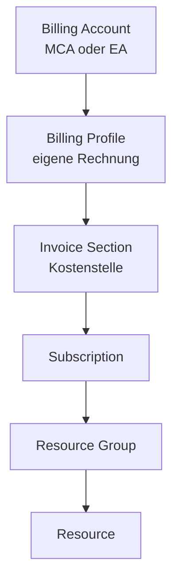
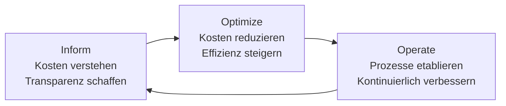

---
tags:
  - azure
  - grundlagen
  - cost-management
  - finops
  - billing
  - optimierung
  - kosten
aliases:
  - Cost Management
  - Azure Billing
  - FinOps Azure
  - Kostenoptimierung Azure
  - Azure Kosten
---

# Azure Cost Management

> [!ABSTRACT] TL;DR
> Azure Cost Management + Billing ist der zentrale Dienst für Kostentransparenz, Budgetierung und Optimierung in Azure. Mit Cost Analysis, Budgets, Advisor-Empfehlungen, Reserved Instances und Azure Savings Plans lassen sich Azure-Ausgaben erheblich reduzieren — FinOps als Kulturpraktik bringt Kosten-Ownership in die Teams.

---

## Azure Cost Management + Billing Übersicht

**Azure Cost Management + Billing** ist ein kostenloser Azure-Dienst, der:
- Kostenvisualisierung und -analyse ermöglicht
- Budgets und Alerts konfiguriert
- Optimierungsempfehlungen bereitstellt
- Rechnungen und Zahlungsmethoden verwaltet

**Zugang:** Azure Portal → Cost Management + Billing

### Billing Scopes (Kostenhierarchie)



---

## Cost Analysis

**Cost Analysis** ist das primäre Werkzeug zur Kostenvisualisierung:

### Wichtige Ansichten

| Ansicht | Beschreibung | Nutzung |
|---------|-------------|---------|
| **Accumulated costs** | Kumulierte Kosten über Zeit | Monatstracking |
| **Cost by service** | Kosten nach Azure-Dienst | Teure Services identifizieren |
| **Daily costs** | Tagesweise Kostenentwicklung | Ausreißer finden |
| **Invoice details** | Rechnungsposten | Billing-Reconciliation |

### Gruppierung und Filter

**Groupieren nach:**
- Service Name (was ist teuer?)
- Resource Group (welches Projekt?)
- Tag (welche Kostenstelle?)
- Location (welche Region?)
- Meter / Meter Category

**Filtern nach:**
- Subscription, Resource Group, Tag
- Zeitraum (letzte 7/30/90 Tage, benutzerdefiniert)
- Service / Ressourcentyp

### Cost Forecast

- Azure schätzt die Kosten bis Monatsende basierend auf aktuellem Verbrauch
- Sichtbar in Cost Analysis unter "Forecast"
- Basis für proaktive Budget-Alerts

### Kosten-Export automatisieren

```powershell
# Täglichen Export nach Storage Account konfigurieren
New-AzCostManagementExport `
  -Scope "/subscriptions/xxxxxxxx-xxxx-xxxx-xxxx-xxxxxxxxxxxx" `
  -Name "DailyExport" `
  -DefinitionType ActualCost `
  -DefinitionTimeframe MonthToDate `
  -ScheduleStatus Active `
  -ScheduleRecurrence Daily `
  -RecurrencePeriodFrom "2025-01-01T00:00:00Z" `
  -RecurrencePeriodTo "2025-12-31T00:00:00Z" `
  -DestinationResourceId "/subscriptions/{subId}/resourceGroups/rg-billing/providers/Microsoft.Storage/storageAccounts/stbillingexport" `
  -DestinationContainer "cost-exports" `
  -DestinationRootFolderPath "azure-costs"
```

---

## Budgets und Alerts

### Budget erstellen

Ein **Budget** definiert ein Kostenlimit und löst bei Überschreitung Benachrichtigungen aus:

```powershell
# Budget per PowerShell erstellen
New-AzConsumptionBudget `
  -Name "Prod-Subscription-Monatliches-Budget" `
  -Amount 5000 `
  -TimeGrain Monthly `
  -StartDate "2025-01-01" `
  -EndDate "2025-12-31" `
  -ContactEmail @("finops@contoso.com", "cto@contoso.com") `
  -Threshold @(50, 80, 100, 110)  # Alert bei 50%, 80%, 100%, 110% des Budgets
```

### Budget Alert-Stufen (Best Practice)

| Schwelle | Aktion | Empfänger |
|----------|--------|----------|
| **50%** | Info-E-Mail | FinOps-Team |
| **80%** | Warnung, Review einleiten | FinOps + Management |
| **100%** | Budget erreicht, sofortige Maßnahmen | Management + CTO |
| **110%** | Budget überschritten | Management + automatische Aktion |

> [!WARNING] Budgets stoppen keine Azure-Ressourcen automatisch
> Budget-Alerts sind nur Benachrichtigungen. Für automatisches Stoppen: Budget-Alert → Azure Monitor Action Group → Azure Automation Runbook (VMs stoppen, Ressourcen skalieren).

### Budget-Scopes

Budgets können auf verschiedenen Ebenen gesetzt werden:
- **Subscription:** Gesamtkosten der Subscription
- **Resource Group:** Kosten einer einzelnen RG
- **Management Group:** Aggregierte Kosten mehrerer Subscriptions

---

## Reserved Instances (RIs)

**Reserved Instances** sind Vorauszahlungs-Commitments für bestimmte Ressourcen — gegen erhebliche Rabatte:

### RI-Übersicht

| Laufzeit | Durchschnittliche Ersparnis | Zahlungsoptionen |
|----------|----------------------------|-----------------|
| **1 Jahr** | ~35-40% | All Upfront, Monthly |
| **3 Jahre** | ~55-65% | All Upfront, Monthly |

> [!NOTE] All Upfront vs. Monthly — kein Preisunterschied
> Bei Azure Reserved Instances gibt es keinen Preisunterschied zwischen All Upfront und monatlicher Zahlung (im Gegensatz zu AWS). Monatliche Zahlung ermöglicht mehr Liquiditätsflexibilität.

### Unterstützte Dienste für RIs

- Azure Virtual Machines (alle VM-Familien)
- Azure SQL Database (General Purpose, Business Critical)
- Azure Cosmos DB (Provisioned Throughput)
- Azure App Service (Dedicated Plans)
- Azure Cache for Redis
- Azure Databricks
- Azure Data Factory
- Und viele weitere

### RI-Scope-Optionen

| Scope | Beschreibung |
|-------|-------------|
| **Shared** | RI gilt für alle Subscriptions im Billing Account (empfohlen) |
| **Single Subscription** | RI gilt nur für eine Subscription |
| **Single Resource Group** | RI gilt nur für eine RG |

### RI-Management

```powershell
# Reservierungen anzeigen
Get-AzReservation | Select-Object DisplayName, Quantity, ReservedResourceType, ExpiryDate

# Reservation-Nutzung anzeigen (über Cost Management API)
# Im Portal: Reservations → Utilization
```

> [!TIP] RI-Empfehlung von Azure Advisor nutzen
> Azure Advisor analysiert den Verbrauch der letzten 7/30 Tage und empfiehlt welche RIs sich rechnen. Einfach die Advisor-Empfehlungen umsetzen statt selbst zu berechnen.

---

## Azure Savings Plans

**Azure Savings Plans** sind flexibler als Reserved Instances:

### Vergleich RI vs. Savings Plan

| Merkmal | Reserved Instances | Savings Plans |
|---------|-------------------|--------------|
| **Commitment** | Spezifische Ressource (VM-Typ, Region) | Stündliche Ausgabe (z.B. 10$/h) |
| **Flexibilität** | Niedrig (VM-Familie gebunden) | Hoch (beliebige Compute-Ressourcen) |
| **Laufzeit** | 1 oder 3 Jahre | 1 oder 3 Jahre |
| **Ersparnis** | Bis 65% | Bis 65% |
| **Wann sinnvoll** | Stabile, vorhersehbare Workloads | Variierende Workloads, verschiedene VM-Typen |

### Savings Plan Typen

| Typ | Gilt für |
|-----|---------|
| **Compute Savings Plan** | VMs, App Service, ACI, AKS (Azure CNI) |
| **Azure Savings Plan for Compute** | Breiteste Abdeckung |

---

## Spot VMs

**Azure Spot VMs** nutzen ungenutzte Azure-Kapazitäten zu massiv reduzierten Preisen:

- **Ersparnis:** Bis zu 90% gegenüber Pay-as-you-go
- **Risiko:** Können jederzeit von Azure entzogen werden (**Eviction**)
- **Eviction Policy:** `Deallocate` (VM bleibt erhalten, wird gestoppt) oder `Delete` (VM wird gelöscht)
- **Eviction Rate:** Abhängig von Region und VM-Größe (in Azure Portal einsehbar)

### Geeignete Workloads für Spot VMs

| Geeignet | Nicht geeignet |
|----------|---------------|
| Batch-Jobs (Rendering, Simulation) | Produktionsdatenbanken |
| CI/CD Build-Agents | Web-Apps mit SLA |
| Machine Learning Training | Zustandsbehaftete Anwendungen |
| Video-Encoding | SAP-Systeme |
| HPC (High Performance Computing) | Kritische Infrastruktur |

```powershell
# Spot VM erstellen
New-AzVM `
  -ResourceGroupName "rg-batch" `
  -Name "vm-batch-spot-01" `
  -Location "westeurope" `
  -Priority Spot `
  -EvictionPolicy Deallocate `
  -MaxPrice -1  # Zahlt bis zu aktuellem Spot-Preis (kein MaxPrice)
```

---

## Azure Hybrid Benefit

**Azure Hybrid Benefit (AHB)** ermöglicht die Nutzung bestehender on-premises Lizenzen in Azure:

| Lizenz | Vorteil | Ersparnis |
|--------|---------|---------|
| **Windows Server** (mit SA) | Windows VM-Lizenz inklusive | Bis zu 40% |
| **SQL Server** (mit SA) | SQL-Lizenz inklusive | Bis zu 55% |
| **Linux RHEL/SLES** | Eigene Red Hat/SUSE-Subscription | Variabel |

### Kombinationsoptimierung

```
SQL Server VM (PAYG) = ~150$/Monat
SQL Server VM (AHB) = ~95$/Monat
SQL Server VM (AHB + RI 3J) = ~40$/Monat  ← Maximale Ersparnis
```

```powershell
# Hybrid Benefit auf VM aktivieren
$vm = Get-AzVM -ResourceGroupName "rg-sql" -Name "vm-sql-01"
$vm.LicenseType = "Windows_Server"  # oder "RHEL_BYOS" für Red Hat
Update-AzVM -ResourceGroupName "rg-sql" -VM $vm
```

---

## FinOps Framework in Azure

**FinOps** (Financial Operations) ist eine kulturelle Praxis für Cloud-Kostentransparenz:



### FinOps-Prinzipien in Azure

1. **Kosten-Ownership:** Teams sind für ihre Azure-Kosten verantwortlich
2. **Showback vs. Chargeback:**
   - **Showback:** Teams sehen ihre Kosten (ohne direkte Verrechnung)
   - **Chargeback:** Kosten werden intern verrechnet (echtes P&L per Team)
3. **Tagging-Disziplin:** Tags für Kostenstellen konsequent einsetzen
4. **Cost Allocation:** Shared-Kosten (Monitoring, Hub-Netzwerk) auf Teams aufteilen
5. **Regelmäßige Reviews:** Monatliche FinOps-Meetings

---

## Kostenoptimierungs-Checkliste

### Sofort-Maßnahmen (Quick Wins)
- [ ] **Azure Advisor** Cost-Empfehlungen durcharbeiten
- [ ] Ungenutzte Ressourcen identifizieren und löschen (VMs, Public IPs, Disks)
- [ ] **Auto-Shutdown** für Dev/Test-VMs konfigurieren (täglich um 18:00)
- [ ] **Budget-Alerts** auf allen Subscriptions aktivieren
- [ ] **Hybid Benefit** für Windows Server und SQL Server aktivieren

### Mittelfristig (1-3 Monate)
- [ ] **Reserved Instances** für stabile Workloads kaufen (Advisor-Empfehlung nutzen)
- [ ] **Right-Sizing** von VMs basierend auf CPU/Memory-Metriken
- [ ] **Storage Lifecycle-Policies** einrichten (Cool/Archive Tier für alte Daten)
- [ ] **Spot VMs** für Batch-Workloads einführen
- [ ] **Cost Allocation Tags** auf alle Ressourcen erzwingen (per Policy)

### Langfristig (Architektur)
- [ ] **PaaS statt IaaS** wo möglich (App Service statt VMs)
- [ ] **Serverless** für event-driven Workloads (Functions, Logic Apps)
- [ ] **Multi-Region** nur wo wirklich nötig (Kosten vs. Resilienz abwägen)
- [ ] **Savings Plans** für dynamische Compute-Workloads

---

## Verwandte Notizen
- [[Azure Überblick]]
- [[Subscriptions und Management Groups]]
- [[Azure Advisor]]
- [[Azure Well-Architected Framework]]
