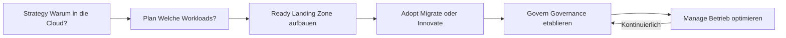
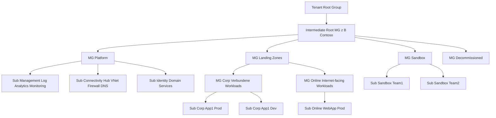
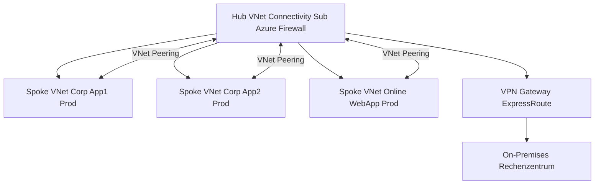

---
tags:
  - azure
  - grundlagen
  - landing-zones
  - cloud-adoption-framework
  - architektur
  - governance
  - netzwerk
aliases:
  - ALZ
  - Landing Zones
  - Cloud Adoption Framework
  - CAF
  - Azure Enterprise-Scale
---

# Azure Landing Zones

> [!ABSTRACT] TL;DR
> Azure Landing Zones (ALZ) sind vorkonfigurierte, governance-konforme Azure-Umgebungen, die auf dem Cloud Adoption Framework (CAF) basieren. Sie definieren eine standardisierte Management-Group-Hierarchie, Networking-Topologie (Hub-and-Spoke), Plattform-Subscriptions und Governance (Policies, RBAC) — damit Workloads in einer sicheren, skalierbare Umgebung "landen" können.

---

## Was sind Azure Landing Zones?

Eine **Azure Landing Zone** ist eine vorkonfigurierte Azure-Umgebung, die:
- **Governance** durch Azure Policies und RBAC von Anfang an implementiert
- **Networking** mit Hub-and-Spoke oder Virtual WAN bereitstellt
- **Identität** mit Entra ID und ggf. AD Domain Services integriert
- **Management** mit zentralem Monitoring und Backup einrichtet
- **Sicherheit** nach Microsoft-Best-Practices konfiguriert

**Ziel:** Workload-Teams sollen Applikationen deployen können, ohne sich um Basis-Infrastruktur kümmern zu müssen — die Landing Zone stellt die Guardrails und Services bereit.

> [!NOTE] Landing Zone ≠ nur ein VNet
> Eine Landing Zone ist die gesamte Umgebung (Management Groups, Subscriptions, Networking, Identity, Governance) — nicht nur ein Netzwerk.

---

## Cloud Adoption Framework (CAF)

Das **Cloud Adoption Framework** ist Microsofts strukturierter Leitfaden für Cloud-Migrationen und Cloud-Native-Entwicklung:



| Phase | Fokus | Ergebnis |
|-------|-------|---------|
| **Strategy** | Business-Ziele, Motivationen, ROI | Cloud-Strategie-Dokument |
| **Plan** | Workload-Inventar, Priorisierung, Skills | Cloud-Adoption-Plan |
| **Ready** | Landing Zone implementieren | Betriebsbereite Azure-Umgebung |
| **Adopt** | Migration oder Cloud-Native-Entwicklung | Migrierte/neue Workloads |
| **Govern** | Policies, Cost, Security Baseline | Governance-Disziplinen |
| **Manage** | Monitoring, Backup, Incident Response | Operations-Baseline |

---

## ALZ Management Group Hierarchie

Die Standard-ALZ-Hierarchie nach Microsoft:



### Management Group Erklärung

| Management Group | Zweck | Policies |
|-----------------|-------|---------|
| **Intermediate Root** | Zentraler Policy-Ankerpunkt | Compliance-Basis, Allowed Locations |
| **Platform** | Plattform-Subscriptions | Keine Workload-Restrictions |
| **Landing Zones** | Workload-Subscriptions | Netzwerk- und Security-Guardrails |
| **Corp** | Verbundene Workloads (Hub-Verbindung) | Keine Public IP direkt |
| **Online** | Internet-facing Workloads | WAF/Firewall-Anforderungen |
| **Sandbox** | Experimente, Dev-Labs | Wenige Restrictions, kein VNet-Peering zu Prod |
| **Decommissioned** | Stillgelegte Subscriptions | ReadOnly-Locks, keine Deployments |

---

## Platform Subscriptions

Die drei **Platform Subscriptions** bilden das Fundament der ALZ:

### Management Subscription
- **Log Analytics Workspace** (zentrales Logging aller Workloads)
- **Azure Monitor** Alerts und Dashboards
- **Microsoft Defender for Cloud** (Security Center)
- **Update Management** und **Change Tracking**
- **Automation Account** für Runbooks
- Policy-Remediation-Managed-Identity

### Connectivity Subscription
- **Hub Virtual Network** (zentrales Netzwerk)
- **Azure Firewall** (zentrales Egress/Ingress-Filtering)
- **VPN Gateway** oder **ExpressRoute Gateway**
- **Azure DNS Private Resolver**
- **Azure Bastion** (sicherer RDP/SSH-Zugang)
- **DDoS Protection Plan**

### Identity Subscription
- **Microsoft Entra Domain Services** (Managed LDAP/Kerberos) oder
- **Domain Controllers** für Active Directory in Azure
- **Entra ID Connect** Server (für Hybrid-Szenarien)

> [!TIP] Identity Subscription optional
> Bei reinen Cloud-Umgebungen ohne Legacy-AD-Anforderungen kann die Identity Subscription entfallen. Entra ID ist ausreichend.

---

## Application Landing Zone Typen

| Typ | Netzwerk | Zielgruppe | Beispiel |
|-----|----------|-----------|---------|
| **Corp** | Verbunden mit Hub via Peering | Interne Apps, kein direkter Internet-Zugang | ERP, SAP, interne APIs |
| **Online** | Optional verbunden, direkt internet-facing | Web-Apps, Kunden-Portale, APIs | E-Commerce, SaaS-Apps |
| **Sandbox** | Isoliert, kein Prod-Routing | Entwickler-Experimente | PoCs, Prototypen |

---

## Hub-and-Spoke Netzwerktopologie

Das **Hub-and-Spoke**-Modell ist die Standard-Netzwerktopologie für ALZ:



**Routing im Hub-and-Spoke:**
- Spoke → Internet: Über Azure Firewall im Hub (kein direkter Internet-Zugang)
- Spoke → Spoke: Über Azure Firewall im Hub (Ost-West-Traffic-Inspektion)
- Spoke → On-Premises: Über Hub VPN/ExpressRoute Gateway
- Internet → Spoke (Inbound): Über Azure Application Gateway oder Front Door

---

## Azure Virtual WAN als Alternative

**Azure Virtual WAN** ist Microsofts managed Hub-Lösung:

| Merkmal | Hub-and-Spoke (klassisch) | Azure Virtual WAN |
|---------|--------------------------|------------------|
| **Hub-Verwaltung** | Manuell (eigenes VNet) | Microsoft-managed |
| **Routing** | Manuell konfigurieren | Automatisch (Any-to-Any) |
| **Skalierung** | Manuelle VNet-Peerings | Automatisch |
| **Kosten** | VNet-Peering-Gebühren | vWAN Hub-Gebühren (teurer) |
| **Branches** | VPN Gateway (begrenzt) | Unbegrenzte Branches |
| **Komplexität** | Höher (selbst verwalten) | Geringer |
| **Empfehlung** | < 20 Spokes, statisch | Viele Standorte, dynamisch |

---

## ALZ Accelerator (schnelle Implementierung)

Der **ALZ Accelerator** implementiert die komplette Hierarchie in Stunden:

### Bicep ALZ Accelerator
```bash
# GitHub Repository
# https://github.com/Azure/ALZ-Bicep

# Deployment der Management Group Hierarchie
az deployment tenant create \
  --name "alz-mg-hierarchy" \
  --location "westeurope" \
  --template-file "infra-as-code/bicep/modules/managementGroups/managementGroups.bicep" \
  --parameters @"parameters/managementGroups.parameters.json"
```

### Portal-basierte Implementierung
- Azure Portal → Management Groups → "Start guided scenario"
- Wizard-basiert, keine Code-Kenntnisse nötig
- Geeignet für kleinere Implementierungen

### Terraform ALZ
```hcl
# AzureRM Provider Terraform Landing Zone
# https://registry.terraform.io/modules/Azure/caf-enterprise-scale/azurerm

module "enterprise_scale" {
  source  = "Azure/caf-enterprise-scale/azurerm"
  version = "~> 5.0"
  
  providers = {
    azurerm              = azurerm
    azurerm.connectivity = azurerm.connectivity
    azurerm.management   = azurerm.management
  }
  
  root_parent_id = data.azurerm_client_config.current.tenant_id
  root_id        = "contoso"
  root_name      = "Contoso"
  
  deploy_core_landing_zones   = true
  deploy_management_resources = true
  deploy_connectivity_resources = true
}
```

---

## ALZ Design Areas

Microsoft definiert 8 Design-Bereiche für Landing Zones:

| Design Area | Schlüsselfragen | Wichtige Dienste |
|-------------|----------------|-----------------|
| **Billing & Tenant** | EA oder MCA? Wie viele Subscriptions? | Cost Management, Management Groups |
| **Identity & Access** | Cloud-only oder Hybrid-AD? PIM? | Entra ID, AD DS, PIM |
| **Network Topology** | Hub-and-Spoke oder vWAN? ExpressRoute? | VNet, Firewall, DNS |
| **Resource Organization** | Naming, Tagging, MG-Hierarchie? | Resource Groups, Tags, Policy |
| **Security** | Zero Trust? Defender? SOC? | Defender for Cloud, Sentinel |
| **Management** | Zentrales Logging? Backup-Policy? | Log Analytics, Monitor, Backup |
| **Governance** | Welche Policies? Compliance-Frameworks? | Azure Policy, Blueprints |
| **Platform Automation** | IaC? CI/CD? GitOps? | Bicep, Terraform, DevOps |

---

## Enterprise-Scale vs. Start Small & Expand

| Ansatz | Beschreibung | Geeignet für |
|--------|-------------|-------------|
| **Enterprise-Scale** | Vollständige Hierarchie von Anfang an | Großunternehmen, komplexe Anforderungen |
| **Start Small & Expand** | Minimale Landing Zone, iterativ erweitern | KMU, Startups, überschaubare Umgebungen |

### Start Small — Minimale Landing Zone
```
Tenant Root Group
  └── [Firma] MG
        ├── Sub Produktion
        ├── Sub Entwicklung
        └── Sub Shared Services
```

- Keine Connectivity Sub (direkte VNet-Peerings oder kein Hub)
- Policy-Light: Nur kritische Policies (erlaubte Regionen, Pflicht-Tags)
- Monitoring: Ein Log Analytics Workspace in der Prod-Sub
- Später zu vollständiger ALZ-Hierarchie migrieren

> [!TIP] Für KMU: Start Small ist meist ausreichend
> Ein 3-Subscription-Modell (Prod/Dev/Shared) mit wenigen Policies erfüllt die Anforderungen der meisten KMU. Enterprise-Scale-Komplexität lohnt sich erst ab ca. 20+ Subscriptions.

---

## ALZ-Monitoring nach Rollout

Nach der ALZ-Implementierung:

1. **Azure Monitor Baseline Alerts** konfigurieren (VM CPU, Disk, etc.)
2. **Microsoft Defender for Cloud** Secure Score regelmäßig prüfen
3. **Azure Policy Compliance-Dashboard** wöchentlich reviewen
4. **Cost Management Budgets** pro Subscription setzen
5. **Azure Advisor** Empfehlungen wöchentlich abarbeiten
6. **Access Reviews** für privilegierte Rollen quartalsweise

---

## Verwandte Notizen
- [[Azure Überblick]]
- [[Subscriptions und Management Groups]]
- [[Resource Groups]]
- [[Azure RBAC]]
- [[Azure Policy]]
- [[Azure Cost Management]]
