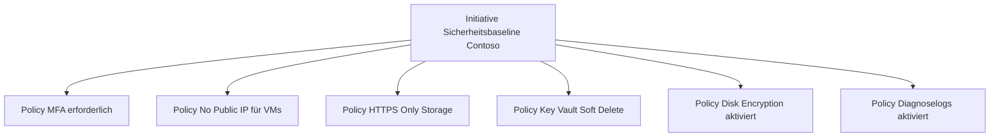
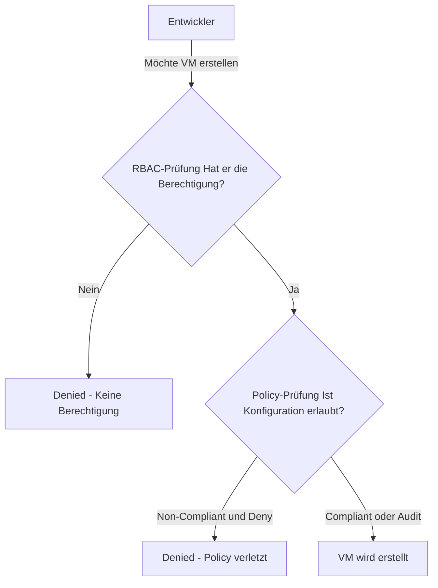

---
tags:
  - azure
  - grundlagen
  - policy
  - governance
  - compliance
  - sicherheit
  - guardrails
aliases:
  - Policy
  - Azure Governance
  - Policy-as-Code
  - Azure Compliance
---

# Azure Policy

> [!ABSTRACT] TL;DR
> Azure Policy ist der Governance-Dienst für Azure-Ressourcen. Er kontrolliert nicht wer etwas tun darf (das ist RBAC), sondern wie Ressourcen konfiguriert sein müssen. Über Policies, Initiatives und Assignments werden Unternehmensstandards automatisch durchgesetzt — von erlaubten Regionen über Pflicht-Tags bis hin zu Sicherheitsanforderungen.

---

## Was ist Azure Policy?

Azure Policy ermöglicht es, **Unternehmensstandards durchzusetzen und den Compliance-Status** aller Azure-Ressourcen zu bewerten und zu überwachen.

**Kernfunktionen:**
- Definiert Regeln für Ressourcen-Konfiguration
- Evaluiert Ressourcen bei Erstellung, Änderung und periodisch (alle 24h)
- Verhindert non-compliant Konfigurationen (Deny) oder markiert sie (Audit)
- Behebt bestehende non-compliant Ressourcen (Remediation)
- Misst Compliance-Score über alle Ressourcen

**Abgrenzung zu RBAC:**
| | Azure Policy | Azure RBAC |
|--|-------------|------------|
| **Frage** | Wie muss die Ressource aussehen? | Wer darf die Ressource verwalten? |
| **Beispiel** | VMs müssen in West Europe sein | Max darf VMs in RG-X erstellen |
| **Enforcement** | Bei Ressourcen-Properties | Bei Aktionen/Operations |

---

## Policy-Definitionen

### Built-in vs. Custom

| Typ | Beschreibung | Beispiel |
|-----|-------------|---------|
| **Built-in** | Von Microsoft vordefiniert, immer aktuell | "Allowed locations", "Require tag" |
| **Custom** | Eigene JSON-Definition | Unternehmens-spezifische Regeln |

### Policy Definition JSON-Struktur

```json
{
  "properties": {
    "displayName": "Erlaubte Azure-Regionen",
    "description": "Beschränkt Azure-Ressourcen auf definierte Regionen.",
    "mode": "All",
    "metadata": {
      "version": "1.0.0",
      "category": "General"
    },
    "parameters": {
      "allowedLocations": {
        "type": "Array",
        "metadata": {
          "description": "Liste der erlaubten Regionen",
          "displayName": "Erlaubte Regionen",
          "strongType": "location"
        },
        "defaultValue": ["westeurope", "northeurope", "germanywestcentral"]
      }
    },
    "policyRule": {
      "if": {
        "not": {
          "field": "location",
          "in": "[parameters('allowedLocations')]"
        }
      },
      "then": {
        "effect": "deny"
      }
    }
  }
}
```

### Policy-Modus (mode)

| Modus | Evaluiert | Wann nutzen |
|-------|----------|------------|
| `All` | Alle Ressourcentypen | Standard für die meisten Policies |
| `Indexed` | Nur Ressourcen mit Tags und Location | Wenn Policy auf Tags/Location zielt |
| `Microsoft.Kubernetes.Data` | AKS-Cluster-Inhalte | Kubernetes-Policies |

---

## Policy-Effekte

Die Effekte bestimmen, was passiert wenn eine Ressource die Policy-Bedingung erfüllt:

| Effekt | Beschreibung | Timing | Typischer Anwendungsfall |
|--------|-------------|--------|------------------------|
| **Deny** | Verhindert create/update | Bei API-Call | Nicht-erlaubte Regionen blockieren |
| **Audit** | Erlaubt, markiert als Non-Compliant | Bei API-Call | Monitoring ohne Blockierung |
| **Append** | Fügt Felder zur Ressource hinzu | Bei create/update | Tags hinzufügen falls nicht vorhanden |
| **Modify** | Ändert Ressourcen-Properties | Bei create/update + Remediation | Tags vererben, HTTP-Enforcement |
| **DeployIfNotExists** | Deployt eine Begleit-Ressource | Nach create/update + Remediation | Diagnoselogs aktivieren, Backup einrichten |
| **AuditIfNotExists** | Auditiert wenn Begleit-Ressource fehlt | Bei API-Call | Prüfen ob Diagnoselogs aktiv sind |
| **Disabled** | Policy ist definiert aber inaktiv | — | Temporär deaktivieren ohne zu löschen |

### Effekt-Hierarchie bei Konflikten

```
Disabled → Append → Deny → Audit → AuditIfNotExists / DeployIfNotExists
```

> [!IMPORTANT] DeployIfNotExists benötigt Managed Identity
> Policies mit dem Effekt `DeployIfNotExists` oder `Modify` benötigen eine **Managed Identity** auf der Policy-Assignment, die die entsprechenden RBAC-Rechte für die Remediation hat.

---

## Initiatives (Policy Sets)

Eine **Initiative** bündelt mehrere Policy-Definitionen zu einer zuweisbaren Einheit:



**Vorteile von Initiatives:**
- Einmalige Assignment für viele Policies
- Compliance wird auf Initiative-Ebene aggregiert
- Einfachere Verwaltung und Reporting
- Regulatory Compliance: Eine Initiative pro Framework (CIS, NIST, etc.)

---

## Policy Assignments

### Assignment konfigurieren

Eine **Policy Assignment** verknüpft eine Policy/Initiative mit einem Scope:

| Einstellung | Beschreibung |
|-------------|-------------|
| **Scope** | Wo gilt die Policy (MG, Sub, RG) |
| **Exclusions** | Scopes/Ressourcen ausschließen |
| **Parameters** | Policy-spezifische Werte setzen |
| **Managed Identity** | Für DeployIfNotExists/Modify |
| **Enforcement Mode** | Enabled (Deny aktiv) oder DoNotEnforce (nur Audit) |
| **Non-Compliance Message** | Fehlermeldung bei Deny |

### Enforcement Mode

| Modus | Verhalten | Wann nutzen |
|-------|----------|------------|
| **Enabled** | Deny/Modify/Append aktiv | Produktion |
| **DoNotEnforce** | Nur Audit, kein Deny | Testen neuer Policies, Pilotphase |

> [!TIP] Neue Policies erst im DoNotEnforce-Modus testen
> Setze neue Policies zunächst auf `DoNotEnforce`, um den Compliance-Impact zu messen, bevor du auf `Enabled` wechselst und Ressourcen-Erstellung blockierst.

### Policy Assignment per Bicep

```bicep
targetScope = 'subscription'

// Initiative/Policy-Definition referenzieren
var allowedLocationsPolicy = '/providers/Microsoft.Authorization/policyDefinitions/e56962a6-4747-49cd-b67b-bf8b01975c4c'

resource policyAssignment 'Microsoft.Authorization/policyAssignments@2022-06-01' = {
  name: 'allowed-locations-assignment'
  location: 'westeurope'
  identity: {
    type: 'SystemAssigned'
  }
  properties: {
    displayName: 'Erlaubte Regionen - Contoso Standard'
    policyDefinitionId: allowedLocationsPolicy
    enforcementMode: 'Default'
    parameters: {
      listOfAllowedLocations: {
        value: ['westeurope', 'northeurope', 'germanywestcentral']
      }
    }
    nonComplianceMessages: [
      {
        message: 'Ressourcen dürfen nur in West Europe, North Europe oder Germany West Central erstellt werden.'
      }
    ]
  }
}
```

---

## Compliance-Dashboard

Das Compliance-Dashboard zeigt den aktuellen Compliance-Status:

- **Overall Compliance %:** Anteil complianter Ressourcen
- **Per Policy/Initiative:** Drill-Down auf einzelne Policies
- **Non-Compliant Resources:** Liste aller nicht-konformen Ressourcen
- **Non-Compliant Events:** Kürzliche Compliance-Änderungen
- **Export:** Compliance-Report als CSV oder über Azure Monitor

> [!NOTE] Compliance-Evaluierung
> Nach einer neuen Policy-Assignment dauert es bis zu **30 Minuten**, bis der initiale Compliance-Scan abgeschlossen ist. Bei Ressourcen-Änderungen wird sofort evaluiert.

---

## Remediation Tasks

**Remediation** behebt bestehende non-compliant Ressourcen für `DeployIfNotExists` und `Modify`-Policies:

```powershell
# Remediation-Task starten
$assignment = Get-AzPolicyAssignment -Name "deploy-diagnostics-assignment"

Start-AzPolicyRemediation `
  -PolicyAssignmentId $assignment.PolicyAssignmentId `
  -Name "remediation-$(Get-Date -Format 'yyyyMMdd-HHmm')" `
  -ResourceDiscoveryMode ReEvaluateCompliance

# Remediation-Status prüfen
Get-AzPolicyRemediation -PolicyAssignmentId $assignment.PolicyAssignmentId |
  Select-Object Name, ProvisioningState, ResourcesSucceededCount, ResourcesFailedCount
```

> [!IMPORTANT] Managed Identity-Berechtigungen für Remediation
> Die Managed Identity der Policy-Assignment braucht ausreichende RBAC-Rechte am Remediation-Scope. Beispiel: `DeployIfNotExists` für Diagnoselogs benötigt `Contributor` auf der Subscription.

---

## Regulatory Compliance Initiatives

Azure Policy enthält vorkonfigurierte Initiatives für gängige Compliance-Frameworks:

| Framework | Built-in Initiative | Policies |
|-----------|-------------------|---------|
| **Microsoft Cloud Security Benchmark (MCSB)** | Microsofts eigener Standard | ~300 Policies |
| **CIS Microsoft Azure Foundations Benchmark** | CIS Controls v1.4 | ~90 Policies |
| **NIST SP 800-53 Rev. 5** | US-Regierungsstandard | ~700+ Policies |
| **ISO 27001:2013** | Internationaler Sicherheitsstandard | ~100 Policies |
| **PCI DSS v4** | Zahlungskarten-Datensicherheit | ~300 Policies |
| **EU DSGVO / GDPR** | Europäische Datenschutz-Grundverordnung | ~60 Policies |
| **BSI C5** | Bundesamt für Sicherheit, relevant für DE | ~50 Policies |

---

## Häufige Policies (Praxis-Übersicht)

| Policy | Effekt | Beschreibung |
|--------|--------|-------------|
| Allowed locations | Deny | Nur bestimmte Regionen erlaubt |
| Require tag on resources | Deny/Append | Pflicht-Tags erzwingen |
| Allowed virtual machine size SKUs | Deny | Nur genehmigte VM-Größen |
| Storage accounts should use HTTPS | Deny/Audit | HTTP-Only Storage blockieren |
| Enable Azure Defender for... | DeployIfNotExists | Security-Schutz aktivieren |
| Configure diagnostic settings | DeployIfNotExists | Diagnoselogs automatisch aktivieren |
| No public IP on VMs | Deny | VMs ohne öffentliche IP |
| Key vaults should have soft delete | Audit/Deny | Key Vault-Schutz |
| Allowed resource types | Deny | Nur genehmigte Ressourcentypen |
| Not allowed resource types | Deny | Bestimmte Ressourcen verbieten |

---

## Azure Policy für Kubernetes

**Azure Policy für AKS** nutzt **Gatekeeper** (OPA-basiert):

- Policies werden als Kubernetes-Constraints deployt
- Kontrolle über Pod-Konfigurationen (keine privilegierten Container, etc.)
- Add-on wird auf AKS-Cluster installiert
- Built-in Kubernetes-spezifische Policies verfügbar

---

## Policy vs. RBAC — Zusammenspiel



---

## Via Azure Portal (UI)

### Policy-Definition erstellen

1. Melde dich an beim **Azure Portal** unter [portal.azure.com](https://portal.azure.com)
2. Navigiere zu **Richtlinie** (Suchleiste: „Policy")
3. Klicke auf **Definitionen** → **+ Richtliniendefinition**
4. Konfiguriere:
   - **Definitionsspeicherort:** Subscription oder Management Group
   - **Name:** z.B. `Require tag on resources`
   - **Kategorie:** Neue oder vorhandene Kategorie wählen
   - **Richtlinienregel:** JSON-Regel eingeben oder aus Vorlage wählen
5. Klicke auf **Speichern**

### Policy zuweisen

1. **Richtlinie** → **Zuweisungen** → **+ Richtlinie zuweisen**
2. Konfiguriere:
   - **Umfang:** Subscription, Resource Group oder Management Group
   - **Richtliniendefinition:** Built-in oder Custom Policy wählen
   - **Parameter:** z.B. erlaubte SKUs oder Regionen
   - **Korrektur:** Managed Identity aktivieren wenn nötig
3. Klicke auf **Überprüfen + erstellen** → **Erstellen**

### Compliance-Status prüfen

1. **Richtlinie** → **Compliance** — Übersicht aller nicht-konformen Ressourcen
2. Klicke auf eine Policy → Detailansicht mit betroffenen Ressourcen
3. **Wartungsaufgabe** erstellen: Richtlinie → **Wartung** → **+ Wartungsaufgabe erstellen**

---

## Verwandte Notizen
- [[Azure Überblick]]
- [[Subscriptions und Management Groups]]
- [[Resource Groups]]
- [[Azure RBAC]]
- [[Azure Landing Zones]]
