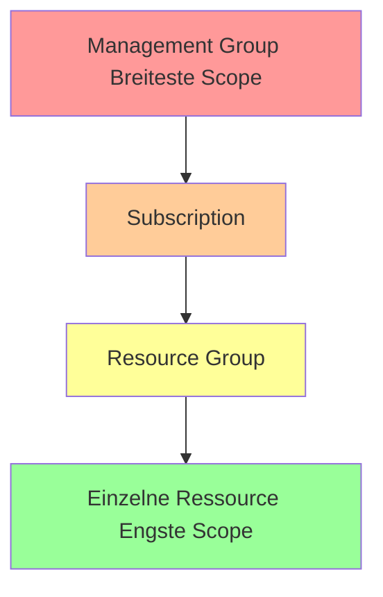
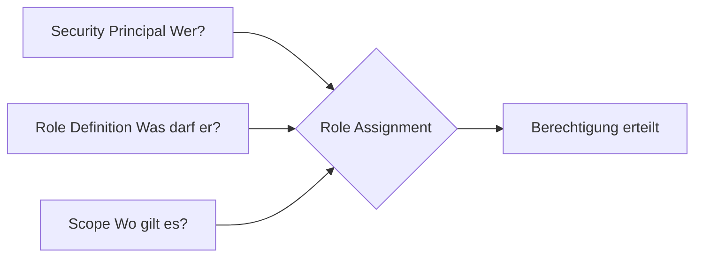
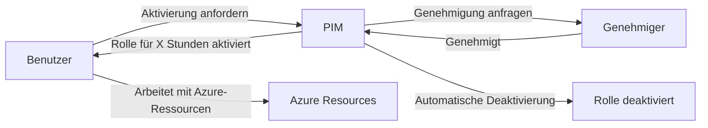

---
tags:
  - azure
  - grundlagen
  - rbac
  - sicherheit
  - identität
  - governance
  - zugriffssteuerung
aliases:
  - Role-Based Access Control
  - Azure Rollen
  - RBAC Azure
  - Rollenverwaltung Azure
---

# Azure RBAC

> [!ABSTRACT] TL;DR
> Azure RBAC (Role-Based Access Control) ist das Autorisierungssystem für Azure-Ressourcen. Es basiert auf dem Prinzip: Security Principal (Wer?) + Role Definition (Was darf er?) + Scope (Wo?). Rollen vererben sich hierarchisch von Management Group über Subscription und Resource Group bis zur einzelnen Ressource.

---

## Was ist Azure RBAC?

Azure RBAC ist das **Autorisierungssystem** für den Zugriff auf Azure-Ressourcen (nicht zu verwechseln mit der Anwendungsautorisierung innerhalb einer App).

**Kernfunktionen:**
- Kontrolliert, wer welche Azure-Ressourcen **verwalten** kann
- Granulare Berechtigungen auf Ressourcen-Ebene
- Vererbung der Berechtigungen durch die Management-Hierarchie
- Integration mit Microsoft Entra ID (früher Azure AD) für Identitäten

**Abgrenzung:**
| Aspekt | Azure RBAC | Microsoft Entra ID Rollen |
|--------|-----------|--------------------------|
| **Scope** | Azure-Ressourcen (VMs, Storage, etc.) | Entra ID-Verzeichnis-Objekte |
| **Beispiel** | VM starten/stoppen | Benutzer erstellen, Lizenzen vergeben |
| **Verwaltet in** | Azure Portal → IAM | Entra ID Portal → Roles |

---

## Scope-Hierarchie

Berechtigungen werden auf einer Ebene vergeben und nach unten vererbt:



**Vererbungsregel:** Eine Rolle auf einer höheren Ebene gilt automatisch für alle untergeordneten Ebenen.

Beispiel: Contributor auf der Subscription → automatisch Contributor auf allen RGs und Ressourcen darin.

---

## Kernkonzept: Role Assignment

Eine **Role Assignment** verbindet drei Elemente:



### Security Principals

| Typ | Beschreibung | Beispiel |
|-----|-------------|---------|
| **User** | Einzelner Entra ID-Benutzer | max.mustermann@contoso.com |
| **Group** | Entra ID-Sicherheitsgruppe | grp-azure-contributors |
| **Service Principal** | Anwendungsidentität | CI/CD Pipeline |
| **Managed Identity** | Azure-verwaltete Identität | VM, Function App |

> [!TIP] Gruppen statt einzelne User
> Weise Rollen immer an **Gruppen** zu, nicht an einzelne Benutzer. Bei Mitarbeiterwechsel reicht es, den Benutzer zur/aus der Gruppe hinzuzufügen/zu entfernen — keine RBAC-Änderung nötig.

---

## Built-in Roles

### Fundamental Roles

| Rolle | Beschreibung | Wann nutzen |
|-------|-------------|------------|
| **Owner** | Vollzugriff + Rollen vergeben | Subscription-Owner, sehr begrenzt vergeben |
| **Contributor** | Vollzugriff, keine Rollenvergabe | Teams die Ressourcen verwalten |
| **Reader** | Nur-Lese-Zugriff | Auditing, Reporting, Read-only Nutzer |
| **User Access Administrator** | Nur Rollenvergabe, kein Ressourcenzugriff | Separate Rollen-Vergabe-Delegation |

### Häufige Service-spezifische Rollen

| Rolle | Service | Zweck |
|-------|---------|-------|
| Virtual Machine Contributor | Compute | VMs verwalten (kein Netzwerk/Storage) |
| Storage Blob Data Contributor | Storage | Blob-Daten lesen/schreiben |
| Key Vault Secrets Officer | Key Vault | Secrets verwalten |
| AKS Cluster Admin | Kubernetes | Vollzugriff auf AKS-Cluster |
| SQL DB Contributor | SQL Database | SQL-Datenbanken verwalten |
| Network Contributor | Networking | Netzwerk-Ressourcen verwalten |
| Monitoring Contributor | Monitor | Alerts, Dashboards erstellen |
| Cost Management Reader | Billing | Kosten lesen (kein Ressourcenzugriff) |

---

## Custom Roles

### Wann Custom Roles sinnvoll sind
- Built-in Rolle erlaubt zu viel (Contributor = alles)
- Built-in Rolle erlaubt zu wenig (Reader = zu eingeschränkt)
- Spezifische Kombinationen von Berechtigungen erforderlich

### Custom Role Struktur

```json
{
  "Name": "VM Operator",
  "Description": "Kann VMs starten, stoppen und neu starten. Kein Erstellen/Löschen.",
  "IsCustom": true,
  "Actions": [
    "Microsoft.Compute/virtualMachines/read",
    "Microsoft.Compute/virtualMachines/start/action",
    "Microsoft.Compute/virtualMachines/deallocate/action",
    "Microsoft.Compute/virtualMachines/restart/action",
    "Microsoft.Compute/virtualMachines/instanceView/read",
    "Microsoft.Resources/subscriptions/resourceGroups/read"
  ],
  "NotActions": [],
  "DataActions": [
  ],
  "NotDataActions": [],
  "AssignableScopes": [
    "/subscriptions/xxxxxxxx-xxxx-xxxx-xxxx-xxxxxxxxxxxx"
  ]
}
```

### Actions vs. DataActions

| Typ | Beschreibung | Beispiel |
|-----|-------------|---------|
| **Actions** | Control Plane Operationen (ARM) | VM erstellen, Storage Account anlegen |
| **NotActions** | Ausnahmen aus Actions | Alle Actions außer löschen |
| **DataActions** | Daten-Plane Operationen | Blob lesen/schreiben, Queue-Nachrichten |
| **NotDataActions** | Ausnahmen aus DataActions | Alle DataActions außer löschen |

> [!NOTE] Actions ≠ DataActions
> Ein Contributor hat alle Actions, aber keine DataActions auf Storage-Daten. Um Blob-Daten zu lesen/schreiben, braucht man explizit `Storage Blob Data Contributor` oder `Storage Blob Data Reader`.

### Custom Role per PowerShell

```powershell
# Custom Role aus JSON erstellen
$roleDefinition = Get-Content "vm-operator-role.json" | ConvertFrom-Json
New-AzRoleDefinition -Role $roleDefinition

# Custom Role direkt erstellen
$role = [Microsoft.Azure.Commands.Resources.Models.Authorization.PSRoleDefinition]::new()
$role.Name = "VM Operator"
$role.Description = "Kann VMs starten und stoppen"
$role.IsCustom = $true
$role.Actions = @(
    "Microsoft.Compute/virtualMachines/read",
    "Microsoft.Compute/virtualMachines/start/action",
    "Microsoft.Compute/virtualMachines/deallocate/action"
)
$role.AssignableScopes = @("/subscriptions/xxxxxxxx-xxxx-xxxx-xxxx-xxxxxxxxxxxx")
New-AzRoleDefinition -Role $role

# Custom Role aktualisieren
$existingRole = Get-AzRoleDefinition -Name "VM Operator"
$existingRole.Actions.Add("Microsoft.Compute/virtualMachines/restart/action")
Set-AzRoleDefinition -Role $existingRole
```

---

## Privileged Identity Management (PIM) für Azure-Rollen

PIM ermöglicht **Just-in-Time (JIT)** Rollenzuweisungen für privilegierte Azure-Rollen.

### Assignment-Typen

| Typ | Beschreibung | Wann nutzen |
|-----|-------------|------------|
| **Eligible** | Benutzer kann die Rolle aktivieren wenn nötig | Privilegierte Rollen (Owner, Contributor) |
| **Active** | Benutzer hat die Rolle dauerhaft aktiv | Alltags-Rollen (Reader, spezifische) |

### PIM-Workflow



### PIM-Konfiguration (Best Practices)

- **Max. Aktivierungsdauer:** 4-8 Stunden (nicht 24h)
- **Approval erforderlich:** Für Owner und Contributor
- **MFA bei Aktivierung:** Immer aktivieren
- **Begründung erforderlich:** Pflichtfeld für Audit
- **Benachrichtigungen:** Alert bei Owner/Contributor-Aktivierung

> [!IMPORTANT] PIM-Voraussetzungen
> PIM für Azure-Rollen erfordert **Microsoft Entra ID P2** oder **Microsoft Entra ID Governance** Lizenz.

---

## RBAC vs. Azure Policy

Häufig verwechselt — aber grundlegend unterschiedlich:

| Aspekt | Azure RBAC | Azure Policy |
|--------|-----------|-------------|
| **Frage** | Wer darf was tun? | Was darf wie konfiguriert sein? |
| **Fokus** | Aktionen / Operationen | Ressourcen-Eigenschaften / -Zustände |
| **Beispiel** | Nur Contributor in RG-X | Alle VMs müssen in West Europe sein |
| **Durchsetzung** | Bei API-Call (Authentifizierung) | Bei Resource-Create/Update und periodisch |
| **Ziel** | Access Control | Compliance / Governance |

> [!NOTE] Beide ergänzen sich
> RBAC kontrolliert WER eine VM erstellen darf. Azure Policy kontrolliert WIE die VM konfiguriert sein muss (z.B. in welcher Region, welche SKU erlaubt ist).

---

## RBAC Best Practices

1. **Least Privilege:** Nur die minimal notwendigen Berechtigungen vergeben
2. **Gruppen statt User:** Rollen an Entra ID-Gruppen vergeben, Mitarbeiter in Gruppen
3. **Scope so niedrig wie möglich:** RG-Scope statt Sub-Scope wenn möglich
4. **Owner-Rolle minimieren:** Owner sparsam vergeben (kann alles inklusive Rollen vergeben)
5. **PIM für privilegierte Rollen:** Owner, Contributor → JIT mit PIM
6. **Custom Roles dokumentieren:** JSON-Definition in Git versionieren
7. **Regelmäßige Access Reviews:** Vierteljährlich RBAC-Zuweisungen prüfen
8. **Service Principals mit eigenen Rollen:** Keine menschlichen User-Credentials in Pipelines

---

## Deny Assignments

**Deny Assignments** verhindern bestimmte Aktionen auch wenn eine Rolle sie erlaubt:
- Werden **nicht manuell** erstellt (nur über Azure Blueprints oder Managed Applications)
- Azure Landing Zone Blueprints setzen Deny Assignments für kritische Policies
- Sichtbar in Azure Portal unter IAM → Deny Assignments

---

## Role Assignment Limits

| Limit | Wert |
|-------|------|
| Role Assignments pro Subscription | 4.000 (erhöht von 2.000) |
| Custom Role Definitions pro Tenant | 5.000 |
| Rollen-Definitionen (built-in + custom) | Unbegrenzt |

> [!WARNING] 4.000 Role Assignment Limit
> Bei 4.000 Role Assignments pro Subscription sind keine weiteren möglich. Lösung: Gruppen statt einzelne User verwenden. Eine Gruppe = ein Role Assignment, aber beliebig viele Mitglieder.

---

## RBAC über CLI

```bash
# Rolle zuweisen (Azure CLI)
az role assignment create \
  --assignee "max.mustermann@contoso.com" \
  --role "Contributor" \
  --resource-group "rg-webapp-prod"

# Rollenzuweisungen anzeigen
az role assignment list \
  --resource-group "rg-webapp-prod" \
  --output table

# Alle Rollen auf Sub-Ebene anzeigen
az role assignment list \
  --all \
  --output table

# Rolle entfernen
az role assignment delete \
  --assignee "max.mustermann@contoso.com" \
  --role "Contributor" \
  --resource-group "rg-webapp-prod"
```

```powershell
# Rolle zuweisen (PowerShell)
New-AzRoleAssignment `
  -SignInName "max.mustermann@contoso.com" `
  -RoleDefinitionName "Contributor" `
  -ResourceGroupName "rg-webapp-prod"

# Rolle an Service Principal vergeben
New-AzRoleAssignment `
  -ObjectId (Get-AzADServicePrincipal -DisplayName "myapp-sp").Id `
  -RoleDefinitionName "Storage Blob Data Contributor" `
  -Scope "/subscriptions/{subId}/resourceGroups/rg-storage"

# Rollenzuweisungen anzeigen
Get-AzRoleAssignment -ResourceGroupName "rg-webapp-prod" | 
  Format-Table DisplayName, RoleDefinitionName, Scope

# Rolle entfernen
Remove-AzRoleAssignment `
  -SignInName "max.mustermann@contoso.com" `
  -RoleDefinitionName "Contributor" `
  -ResourceGroupName "rg-webapp-prod"
```

---

## Verwandte Notizen
- [[Azure Überblick]]
- [[Subscriptions und Management Groups]]
- [[Resource Groups]]
- [[Azure Policy]]
- [[Azure Landing Zones]]
