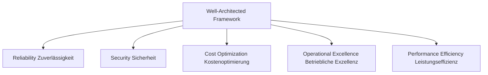
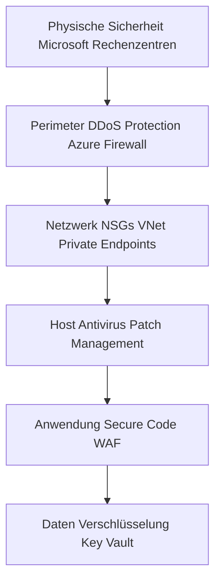
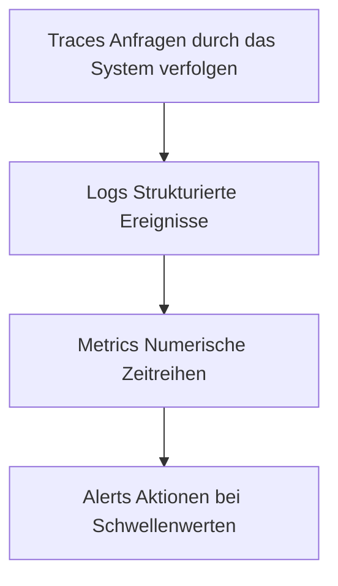
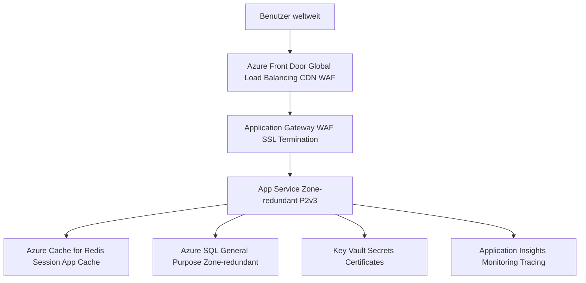

---
tags:
  - azure
  - grundlagen
  - well-architected-framework
  - architektur
  - best-practices
  - reliability
  - security
  - performance
  - cost
  - operations
aliases:
  - WAF
  - Well-Architected Framework
  - Azure WAF
  - Azure Architektur Best Practices
  - Azure Qualitätssäulen
---

# Azure Well-Architected Framework

> [!ABSTRACT] TL;DR
> Das Azure Well-Architected Framework (WAF) ist Microsofts Leitfaden für qualitativ hochwertige Cloud-Architekturen, strukturiert in 5 Säulen: Reliability, Security, Cost Optimization, Operational Excellence und Performance Efficiency. Mit dem WAF Review Tool lassen sich Architekturen bewerten und konkrete Verbesserungsmaßnahmen ableiten.

---

## Was ist das Azure Well-Architected Framework?

Das **Azure Well-Architected Framework (WAF)** ist ein Satz von Leitprinzipien, Best Practices und Designrichtlinien für die Bewertung und Verbesserung von Cloud-Architekturen.

**Kerngedanke:** Jede Architekturentscheidung hat Tradeoffs — das WAF hilft, diese Tradeoffs bewusst und strukturiert zu treffen.

**Abgrenzung zu anderen Frameworks:**

| Framework | Fokus | Wann nutzen |
|-----------|-------|------------|
| **Cloud Adoption Framework (CAF)** | Cloud-Einführungs-Journey | Migration, Landung Zone |
| **Well-Architected Framework (WAF)** | Qualität einzelner Workloads | Architektur-Design und Review |
| **Azure Architecture Center** | Referenz-Architekturen | Konkrete Muster und Blueprints |

> [!NOTE] WAF ist kostenlos
> Das Well-Architected Framework ist eine Dokumentation und ein Assessment-Tool — kein kostenpflichtiger Azure-Dienst. Die Nutzung ist kostenlos.

---

## Die 5 Säulen im Überblick



| Säule | Kernfrage | Hauptziel |
|-------|----------|---------|
| **Reliability** | Wie widerstandsfähig ist das System? | Ausfälle verhindern und schnell erholen |
| **Security** | Wie sicher ist das System? | Daten und Systeme schützen |
| **Cost Optimization** | Kosten wir effizient verwendet? | Maximaler Wert für minimale Kosten |
| **Operational Excellence** | Wie gut ist der Betrieb? | Prozesse und Tools optimieren |
| **Performance Efficiency** | Erfüllt das System die Anforderungen? | Skalierbarkeit und Effizienz |

---

## Säule 1: Reliability (Zuverlässigkeit)

### Design Principles

1. **Design for failure** — Ausfälle sind unvermeidlich, System muss sie tolerieren
2. **Redundanz auf allen Ebenen** — Keine Single Points of Failure
3. **Recovery-Ziele definieren** — RTO und RPO festlegen
4. **Graceful Degradation** — Teilfunktionsfähigkeit bei Teilausfällen
5. **Regelmäßige Resilienz-Tests** — Chaos Engineering

### Schlüsselkonzepte

| Konzept | Beschreibung | Azure-Dienst |
|---------|-------------|-------------|
| **Availability Zones** | Redundanz innerhalb einer Region | VM Scale Sets, SQL, AKS |
| **Region Pairs** | Geografische DR-Redundanz | Traffic Manager, Cosmos DB |
| **Health Endpoints** | Liveness/Readiness Checks | App Service, AKS |
| **Retry-Pattern** | Automatische Wiederholung bei Fehlern | SDK-integriert |
| **Circuit Breaker** | Fehlerkaskaden verhindern | API Management |
| **Bulkhead** | Fehler-Isolation zwischen Komponenten | AKS Namespaces |

### RTO und RPO

```
RTO (Recovery Time Objective): Wie lange darf das System ausfallen?
RPO (Recovery Point Objective): Wie viel Datenverlust ist akzeptabel?

Beispiel Web-App:
  RTO = 30 Minuten
  RPO = 1 Stunde

→ Architektur muss diese Ziele garantieren können
```

> [!TIP] SLA zusammengesetzt berechnen
> Composite SLA = SLA(VM) × SLA(SQL) × SLA(Storage) = 0,999 × 0,9999 × 0,9999 ≈ 99,88%
> Jede Abhängigkeit reduziert die Gesamt-Verfügbarkeit!

---

## Säule 2: Security (Sicherheit)

### Design Principles

1. **Zero Trust** — Never trust, always verify (kein implizites Vertrauen)
2. **Defense in Depth** — Mehrere Sicherheitsebenen (Perimeter → Netzwerk → Host → App → Daten)
3. **Least Privilege** — Nur minimale Berechtigungen
4. **Assume Breach** — Planen als ob bereits kompromittiert
5. **Secrets schützen** — Credentials nie in Code oder Config-Dateien

### Defense in Depth Modell



### Wichtige Security-Patterns

| Pattern | Beschreibung | Azure-Dienst |
|---------|-------------|-------------|
| **Managed Identities** | Keine Credentials im Code | System/User-assigned Managed Identity |
| **Private Endpoints** | Dienste ins VNet bringen | Private Link |
| **Network Segmentation** | Isolation durch Subnets und NSGs | VNet, NSG, Azure Firewall |
| **Secrets Management** | Zentralisierte Secrets-Verwaltung | Azure Key Vault |
| **Security Posture** | Kontinuierliches Security-Monitoring | Microsoft Defender for Cloud |
| **SIEM/SOAR** | Threat Detection und Response | Microsoft Sentinel |

---

## Säule 3: Cost Optimization (Kostenoptimierung)

### Design Principles

1. **Cloud Spend verstehen** — Vollständige Kostentransparenz (FinOps)
2. **Richtige Ressourcen wählen** — PaaS/Serverless statt IaaS wo möglich
3. **Dynamisch skalieren** — Nur zahlen was wirklich genutzt wird
4. **Kosten vs. Wert abwägen** — Nicht jede Optimierung lohnt sich
5. **Kontinuierlich optimieren** — Kosten sind kein einmaliges Thema

### Optimierungsstrategien

| Strategie | Einsparung | Aufwand |
|-----------|-----------|--------|
| Ungenutzte Ressourcen löschen | 100% | Niedrig |
| Right-Sizing (VM-Größen) | 20-60% | Mittel |
| Reserved Instances | 35-65% | Mittel |
| Spot VMs für Batch | Bis 90% | Hoch |
| PaaS statt IaaS | Variable | Hoch (Refactoring) |
| Serverless | Sehr variabel | Hoch (Redesign) |

---

## Säule 4: Operational Excellence (Betriebliche Exzellenz)

### Design Principles

1. **Everything as Code** — IaC, Konfiguration, Policies versionieren
2. **Automatisierung** — Manuelle Prozesse durch Automatisierung ersetzen
3. **Observability** — Logs, Metrics, Traces für alle Komponenten
4. **Continuous Improvement** — Regelmäßige Reviews und Postmortems
5. **Dokumentation** — Runbooks, Playbooks, Architektur-Entscheidungen

### Wichtige Tools

| Bereich | Azure-Dienst |
|---------|-------------|
| **IaC** | Bicep, Terraform, ARM Templates |
| **CI/CD** | Azure DevOps, GitHub Actions |
| **Monitoring** | Azure Monitor, Application Insights |
| **Logging** | Log Analytics Workspace |
| **Alerting** | Azure Monitor Alerts, Action Groups |
| **Automatisierung** | Azure Automation, Logic Apps, Functions |
| **Incident Management** | Azure Monitor, PagerDuty-Integration |

### Observability-Pyramide



---

## Säule 5: Performance Efficiency (Leistungseffizienz)

### Design Principles

1. **Richtigen Dienst wählen** — SQL vs. Cosmos DB vs. Cache (Anforderungs-Match)
2. **Horizontal skalieren** — Scale-out statt Scale-up bevorzugen
3. **Caching strategisch** — Wiederholte, teure Operationen cachen
4. **Netzwerk-Latenz minimieren** — Dienste nah zueinander platzieren
5. **Performance-Tests** — Baseline messen, kontinuierlich testen

### Skalierungsoptionen

| Strategie | Beschreibung | Azure-Dienst |
|-----------|-------------|-------------|
| **Auto-Scaling** | Automatisch skalieren | VM Scale Sets, App Service, AKS+KEDA |
| **Global Distribution** | Nutzer nah an Content | Azure Front Door, CDN |
| **Caching** | Datenbankabfragen cachen | Azure Cache for Redis |
| **Async Processing** | Queue-basierte Entkopplung | Service Bus, Event Hub |
| **Read Replicas** | Lesezugriffe verteilen | Azure SQL Read Scale-out |

---

## Well-Architected Review Tool

### Nutzung

Das **WAF Review Tool** ist ein Online-Assessment unter [aka.ms/assessments](https://aka.ms/assessments):

1. **Workload auswählen** (allgemein oder spezifisch: SAP, AVD, AI, etc.)
2. **Fragen beantworten** (~30-60 Fragen pro Säule)
3. **Score erhalten** (0-100 pro Säule)
4. **Empfehlungen reviewen** (priorisierte Liste mit Kontext)
5. **Aktionsplan erstellen** (Export als Excel oder Guidance-Links)

### Assessment-Kategorien (Beispiel-Fragen)

| Säule | Beispiel-Frage |
|-------|--------------|
| Reliability | "Haben Sie Ihre Recovery-Ziele (RTO/RPO) definiert und getestet?" |
| Security | "Nutzen Sie Managed Identities für die Authentifizierung?" |
| Cost | "Haben Sie Reserved Instances für stabile Workloads?" |
| Operations | "Gibt es Alerts für alle kritischen Metriken?" |
| Performance | "Haben Sie Performance-Benchmarks für Ihre Anwendung?" |

> [!TIP] Quartalsweise wiederholen
> Führe das WAF-Assessment alle 3-6 Monate durch, um den Fortschritt zu messen und neue Empfehlungen zu identifizieren.

---

## Tradeoffs zwischen Säulen

Architekturentscheidungen betreffen oft mehrere Säulen gleichzeitig:

| Tradeoff | Säule A | vs. | Säule B |
|---------|---------|-----|---------|
| Mehr Redundanz = mehr Kosten | Reliability | ↔ | Cost Optimization |
| Mehr Sicherheit = mehr Latenz | Security | ↔ | Performance |
| Mehr Automatisierung = Aufwand | Operational Excellence | ↔ | Cost (kurzfristig) |
| Mehr Datenbanken = mehr Kosten | Performance | ↔ | Cost Optimization |
| Zone-Redundanz = höhere Kosten | Reliability | ↔ | Cost Optimization |

> [!IMPORTANT] Tradeoffs dokumentieren
> Dokumentiere bewusst getroffene Tradeoffs in einem Architecture Decision Record (ADR). "Wir haben auf Zone-Redundanz verzichtet, weil der Kostenanstieg (60%) den Mehrwert (RPO 15min statt 1h) für diesen Workload nicht rechtfertigt."

---

## WAF für spezifische Workloads

Microsoft stellt WAF-Guidance für spezifische Workload-Typen bereit:

| Workload | WAF-Guidance | Besonderheiten |
|---------|-------------|---------------|
| **SAP on Azure** | SAP-spezifische Reliability und Sizing | HANA Large Instances, ANF |
| **Azure Virtual Desktop** | AVD Best Practices | Session Hosts, Profile-Storage |
| **KI/ML Workloads** | GPU-Optimierung, Datenpipelines | Azure ML, Training vs. Inference |
| **Mission Critical** | Höchste Reliability-Tier | 99,999% Ziel, Multi-Region Active-Active |
| **IoT** | Geräte-Management, Edge-Computing | IoT Hub, IoT Edge |

---

## Praxis: WAF für eine einfache Web-App

Beispiel: 3-Tier-Web-App (Frontend, API, Datenbank) in Azure

### Ausgangssituation (unoptimiert)
- Einzelne VM für Web und API
- Azure SQL Basic Tier
- Keine Backups
- Manuelles Deployment

### WAF-Verbesserungen pro Säule

| Säule | Maßnahme | Dienst |
|-------|---------|--------|
| **Reliability** | Zone-redundante App Service, SQL Zone-Redundanz, Backup | App Service P2v3, Azure SQL General Purpose |
| **Security** | Managed Identity, Private Endpoints, WAF | Key Vault, Private Link, Application Gateway WAF |
| **Cost** | Auto-Scaling, richtige App Service Plan SKU, RI | App Service P1v3 mit RI |
| **Operations** | Application Insights, Deployment Slots, IaC | App Insights, Bicep, Azure DevOps |
| **Performance** | Azure Front Door CDN, Redis Cache | Front Door Standard, Azure Cache for Redis |

### Referenz-Architektur (optimiert)



---

## Well-Architected Assessment in Azure Advisor

Azure Advisor integriert WAF-Empfehlungen direkt:

- Advisor Empfehlungen sind WAF-Säulen zugeordnet
- **Advisor Score** ≈ vereinfachter WAF-Score
- Advisor → Well-Architected → "Run assessment" startet WAF-Review-Tool
- Empfehlungen können direkt umgesetzt werden

---

## Via Azure Portal (UI)

### Well-Architected Review starten

1. Melde dich an beim **Azure Portal** unter [portal.azure.com](https://portal.azure.com)
2. Navigiere zu **Azure Advisor** → **Well-Architected Assessment**
   - Alternativ: Direkt zu [aka.ms/assessments](https://aka.ms/assessments) → **Azure Well-Architected Review**
3. Klicke auf **Bewertung starten**
4. Wähle die **Workload-Kategorie** (z.B. `Web Application`, `SAP`, `Mission Critical`)
5. Beantworte die Fragen zu den 5 Säulen:
   - Zuverlässigkeit, Sicherheit, Kostenoptimierung, Betriebliche Exzellenz, Leistungseffizienz
6. Nach Abschluss: **Bericht anzeigen** mit priorisierten Empfehlungen und Scores

### Assessment-Ergebnisse im Advisor anzeigen

1. **Azure Advisor** → **Well-Architected** Tab
2. Empfehlungen nach Priorität und Säule gefiltert anzeigen
3. Direkt zur Ressource springen und Verbesserungen umsetzen

> [!TIP] Tipp
> Das Well-Architected Review-Tool ist auch unter [learn.microsoft.com/assessments](https://learn.microsoft.com/assessments) verfügbar und speichert Ergebnisse für Vergleiche über Zeit.

---

## Verwandte Notizen
- [[Azure Überblick]]
- [[Azure Advisor]]
- [[Azure Cost Management]]
- [[Azure Landing Zones]]
- [[Azure RBAC]]
- [[Azure Policy]]
