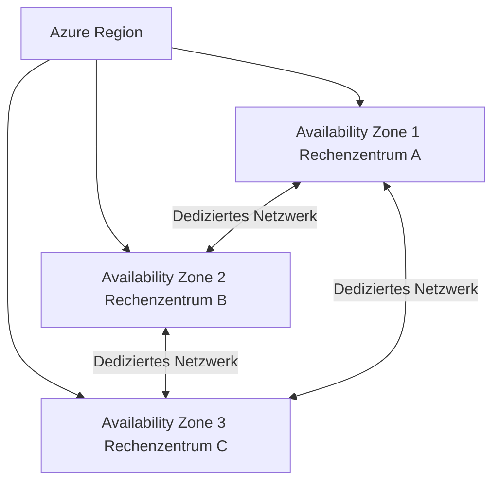
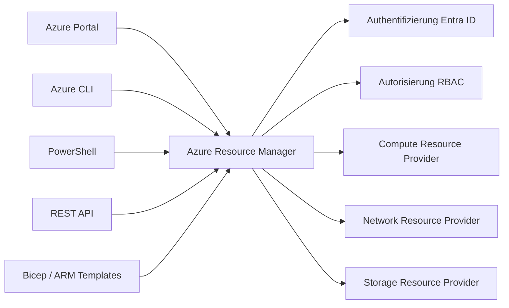
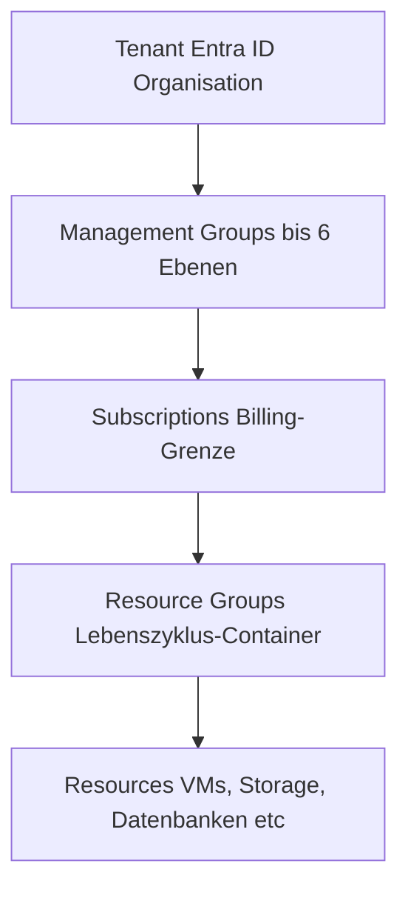

---
tags:
  - azure
  - grundlagen
  - cloud
  - infrastruktur
aliases:
  - Azure Grundlagen
  - Microsoft Azure
  - Azure Einführung
---

# Azure Überblick

> [!ABSTRACT] TL;DR
> Microsoft Azure ist die Cloud-Plattform von Microsoft mit 60+ Regionen weltweit und über 200 Diensten aus den Bereichen Compute, Storage, Netzwerk, Datenbanken, KI, Sicherheit und DevOps. Alle Ressourcen werden durch den Azure Resource Manager (ARM) als einheitliche Steuerungsebene verwaltet — strukturiert in der Hierarchie Tenant → Management Groups → Subscriptions → Resource Groups → Resources.

---

## Was ist Microsoft Azure?

Microsoft Azure ist die Cloud-Computing-Plattform von Microsoft, die seit 2010 kommerziell verfügbar ist. Azure bietet Infrastructure as a Service (IaaS), Platform as a Service (PaaS) und Software as a Service (SaaS) in einem einheitlichen Ökosystem.

**Kerncharakteristiken:**
- **Global:** 60+ Regionen auf allen Kontinenten
- **Integriert:** Nahtlose Verbindung mit Microsoft 365, Entra ID und on-premises Systemen
- **Hybrid-fähig:** Azure Arc ermöglicht die Verwaltung von on-premises und Multi-Cloud-Ressourcen
- **Compliant:** Über 90 Compliance-Zertifizierungen (ISO, SOC, DSGVO, BSI C5, etc.)

### Cloud-Modelle im Vergleich

| Modell | Verantwortung Microsoft | Beispiel |
|--------|------------------------|---------|
| IaaS | Hardware, Netzwerk, Virtualisierung | Azure Virtual Machines |
| PaaS | + OS, Runtime, Middleware | Azure App Service, Azure SQL |
| SaaS | + Anwendung, Daten | Microsoft 365, Dynamics 365 |

---

## Azure Globale Infrastruktur

### Regionen

Eine **Azure-Region** ist ein geografisches Gebiet mit mindestens einem (meist mehreren) Rechenzentrum(en). Regionen sind über dedizierte Glasfaser-Backbones mit geringer Latenz verbunden.

**Wichtige Fakten:**
- 60+ Regionen weltweit (Stand 2025)
- Regionen werden nach Latenz, Compliance und Verfügbarkeit ausgewählt
- Nicht alle Dienste sind in allen Regionen verfügbar
- Beispiele für Europa: West Europe (Amsterdam), North Europe (Dublin), Germany West Central (Frankfurt), Switzerland North

> [!TIP] Empfehlung für Deutschland
> Für Daten-Residenz in Deutschland: **Germany West Central** (Frankfurt) oder **Germany North** (Berlin, noch begrenzte Dienste). Für DSGVO-Compliance reicht West Europe (Niederlande) aus — die DSGVO gilt EU-weit.

### Availability Zones (AZs)

**Availability Zones** sind physisch getrennte Rechenzentren innerhalb einer Region, die:
- Unabhängige Stromversorgung, Kühlung und Netzwerk haben
- Durch dedizierte Leitungen mit < 2 ms Latenz verbunden sind
- Schutz vor Rechenzentrumsausfällen bieten



> [!NOTE] Nicht alle Regionen haben Availability Zones
> AZs sind in größeren Regionen verfügbar (West Europe, North Europe, Germany West Central, East US 2, etc.). Kleinere Regionen haben oft nur einzelne Rechenzentren.

### Region Pairs

Jede Azure-Region ist mit einer **Partner-Region** (Region Pair) verknüpft:
- Mindestens 300 Meilen (ca. 480 km) Abstand
- Sequenzielle Updates (nicht beide gleichzeitig)
- Bei Azure-Ausfällen: Priorisierte Wiederherstellung einer Region aus dem Pair
- Beispiele: West Europe ↔ North Europe, Germany West Central ↔ Germany North

### Sovereign Clouds

| Cloud | Zielgruppe | Besonderheit |
|-------|-----------|-------------|
| Azure Government | US-Behörden | FedRAMP High, DoD IL5, eigene Infrastruktur |
| Azure China (21Vianet) | China-Markt | Betrieben von 21Vianet, chinesische Regulierung |
| Azure Government Secret/Top Secret | Nachrichtendienste | Höchste Klassifizierung |

---

## Dienst-Kategorien

Azure bietet über 200 Dienste in folgenden Kategorien:

| Kategorie | Beispiel-Dienste |
|-----------|----------------|
| **Compute** | Virtual Machines, App Service, AKS, Functions, Container Instances |
| **Netzwerk** | Virtual Network, Load Balancer, Application Gateway, Front Door, ExpressRoute |
| **Storage** | Blob Storage, Azure Files, Queue Storage, Table Storage, Data Lake Gen2 |
| **Datenbanken** | Azure SQL, Cosmos DB, Azure Database for PostgreSQL/MySQL, Redis Cache |
| **KI & Machine Learning** | Azure OpenAI, Cognitive Services, Azure ML, Bot Service |
| **Sicherheit** | Microsoft Defender for Cloud, Key Vault, Microsoft Sentinel, DDoS Protection |
| **Identität** | Microsoft Entra ID, Managed Identities, Privileged Identity Management |
| **DevOps** | Azure DevOps, GitHub Actions, Azure Artifacts, Test Plans |
| **Analytics** | Synapse Analytics, Event Hubs, Stream Analytics, Power BI Embedded |
| **Integration** | Service Bus, API Management, Logic Apps, Event Grid |
| **IoT** | IoT Hub, IoT Central, Digital Twins, Time Series Insights |
| **Hybrid** | Azure Arc, Azure Stack Hub/Edge, Azure Site Recovery |

---

## SLAs und Uptime-Garantien

Azure-SLAs definieren die garantierte monatliche Verfügbarkeit:

| SLA-Stufe | Monatliche Downtime | Dienst-Beispiele |
|-----------|--------------------|--------------------|
| 99,9% | ~43 Minuten | Single VM mit Premium SSD |
| 99,95% | ~22 Minuten | App Service (Standard+), SQL DB |
| 99,99% | ~4 Minuten | Zone-redundante VMs, Cosmos DB Multi-Region |
| 99,999% | ~26 Sekunden | Traffic Manager, Front Door |

> [!IMPORTANT] Kein SLA für Free Tiers und Single-Instance VMs ohne Premium Storage
> Eine einzelne VM ohne Availability Zone oder Availability Set hat **kein SLA**. Erst mit Availability Zone oder Set gilt mind. 99,9%.

**Composite SLA:** Bei mehreren abhängigen Diensten multiplizieren sich die SLAs:
- VM (99,9%) × SQL (99,99%) = 99,89% Gesamt-SLA

---

## Azure Zugangspunkte

### Azure Portal
- Webbasierte GUI unter [portal.azure.com](https://portal.azure.com)
- Vollständige Ressourcenverwaltung, Monitoring und Konfiguration
- Anpassbare Dashboards und Favoritenleiste

### Azure CLI
```bash
# Anmelden
az login

# Subscription wechseln
az account set --subscription "Meine Subscription"

# Ressourcengruppe erstellen
az group create --name rg-webapp-prod --location westeurope

# VM erstellen
az vm create \
  --resource-group rg-webapp-prod \
  --name vm-webserver-01 \
  --image Ubuntu2204 \
  --admin-username azureuser \
  --generate-ssh-keys
```

### Azure PowerShell
```powershell
# Anmelden
Connect-AzAccount

# Subscription wechseln
Set-AzContext -SubscriptionName "Meine Subscription"

# Ressourcengruppe erstellen
New-AzResourceGroup -Name "rg-webapp-prod" -Location "westeurope"
```

### Weitere Zugangspunkte
- **Azure Mobile App:** iOS und Android — Monitoring, Alerts, Cloud Shell
- **Azure Cloud Shell:** Browser-basierte Shell (Bash oder PowerShell) direkt im Portal
- **REST API:** Direkte HTTP-Calls an management.azure.com
- **ARM/Bicep/Terraform:** Infrastructure as Code

---

## Azure Resource Manager (ARM)

ARM ist die **einheitliche Steuerungsebene** für alle Azure-Ressourcen. Alle Verwaltungstools (Portal, CLI, PowerShell, REST API) kommunizieren über ARM.



**ARM-Vorteile:**
- Konsistente API für alle Ressourcen
- Deklarative Deployments (ARM-Templates, Bicep)
- Dependency-Management bei Deployments
- Role-Based Access Control auf Ressourcen-Ebene
- Tagging und Gruppierung via Resource Groups
- Deployment History und Rollback

---

## Management-Hierarchie



| Ebene | Zweck | Beispiel |
|-------|-------|---------|
| **Tenant** | Entra ID-Organisation, Root aller Azure-Ressourcen | contoso.onmicrosoft.com |
| **Management Group** | Policies und RBAC für viele Subscriptions | MG-Produktion |
| **Subscription** | Billing-Einheit, Trust-Grenze | Sub-Webapp-Prod |
| **Resource Group** | Lebenszyklus-Container für Ressourcen | rg-webapp-prod-westeu |
| **Resource** | Einzelne Azure-Ressource | vm-webserver-01 |

---

## Azure Account-Typen und Angebote

### Vergleich der häufigsten Modelle

| Typ | Zielgruppe | Zahlung | Besonderheiten |
|-----|-----------|---------|----------------|
| **Free Account** | Einsteiger | 200$ Credit (30 Tage) | 12 Monate kostenlose Services danach |
| **Pay-as-you-go (PAYG)** | KMU, Startups | Monatlich | Kein Commitment, höchste Listenpreise |
| **Enterprise Agreement (EA)** | Großunternehmen | Jährlich/3-jährig Prepaid | Rabatte, EA Portal, zentrales Billing |
| **Microsoft Customer Agreement (MCA)** | Alle | Monatlich/Jährlich | Moderner EA-Nachfolger, flexibler |
| **CSP (Cloud Solution Provider)** | Über Partner | Über MSP | Support durch Partner, Bündelangebote |
| **Azure für Studenten** | Studenten | Kostenlos (100$) | Keine Kreditkarte erforderlich, 12 Monate |
| **Dev/Test** | VS-Subscriber | Reduziert | Windows VMs ohne Lizenzkosten |

> [!TIP] Für neue Azure-Kunden
> Mit einem **Free Account** starten: 200$ Credit für 30 Tage + 12 Monate ausgewählte kostenlose Dienste (B1s VM, 5 GB Blob, 250 GB SQL, etc.). Keine automatischen Kosten nach Ablauf — erst nach Upgrade auf PAYG.

---

## Azure Preisrechner und TCO

### Azure Preisrechner
- URL: [azure.microsoft.com/de-de/pricing/calculator](https://azure.microsoft.com/de-de/pricing/calculator/)
- Schätzt monatliche Kosten für gewählte Azure-Dienste
- Konfigurierbar nach Region, SKU, Redundanz, Reservierungen
- Export als Excel für Angebote/Budgetplanung

### Total Cost of Ownership (TCO) Rechner
- URL: [azure.microsoft.com/de-de/pricing/tco/calculator](https://azure.microsoft.com/de-de/pricing/tco/calculator/)
- Vergleicht on-premises Kosten mit Azure
- Berücksichtigt Hardware, Strom, Kühlung, Personal, Lizenzen
- Nützlich für Business Cases / Migration-Entscheidungen

---

## Via Azure Portal (UI)

### Azure Portal erkunden

1. Melde dich an beim **Azure Portal** unter [portal.azure.com](https://portal.azure.com)
2. Das **Dashboard** zeigt eine Übersicht aller angehefteten Ressourcen und Dienste
3. Nutze die **Suchleiste** oben, um Dienste, Ressourcen oder Dokumentation zu finden
4. Unter **Alle Dienste** findest du alle Azure-Dienste kategorisiert
5. Über das **Burger-Menü** (☰) links erreichst du:
   - **Start** — angepasstes Dashboard
   - **Abonnements** — Subscription-Übersicht
   - **Ressourcengruppen** — alle RGs
   - **Alle Ressourcen** — vollständige Ressourcenliste
6. Oben rechts: **Einstellungen** → Portal-Sprache, Theme und Standardverzeichnis anpassen
7. Das **Cloud Shell**-Symbol (>_) öffnet eine Browser-basierte Bash/PowerShell-Umgebung

---

## Verwandte Notizen
- [[Subscriptions und Management Groups]]
- [[Resource Groups]]
- [[Azure RBAC]]
- [[Azure Policy]]
- [[Azure Landing Zones]]
- [[Azure Cost Management]]
- [[Azure Advisor]]
- [[Azure Well-Architected Framework]]
