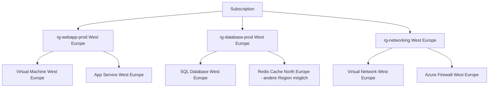

---
tags:
  - azure
  - grundlagen
  - resource-groups
  - governance
  - arm
  - tagging
aliases:
  - RG
  - Azure RG
  - Ressourcengruppen
  - Resource Group Azure
---

# Resource Groups

> [!ABSTRACT] TL;DR
> Eine Resource Group (RG) ist ein logischer Container für Azure-Ressourcen, der als Lebenszykluscontainer fungiert — alle Ressourcen darin werden gemeinsam verwaltet, deployed und gelöscht. Resource Groups sind das primäre Werkzeug für Organisation, Tagging, Locking und Deployment-Scopes in Azure.

---

## Was ist eine Resource Group?

Eine **Resource Group** ist ein Container in Azure, der:
- Logisch zusammengehörige Ressourcen gruppiert
- Als **Lebenszykluscontainer** dient (Deploy zusammen → Delete zusammen)
- Die **Einheit für Tagging, Locking und Deployment** ist
- Zur **Kostenzuordnung** in Azure Cost Management dient

**Wichtige Eigenschaften:**
- Jede Azure-Ressource gehört **genau einer** Resource Group
- Eine Ressource kann nicht gleichzeitig in zwei RGs sein
- Die RG hat eine **eigene Region** (Speicherort der Metadaten), Ressourcen darin können in anderen Regionen sein
- RG-Löschung löscht **alle** enthaltenen Ressourcen (kaskadierend)
- Keine Ressource existiert ohne RG



---

## RG-Design-Prinzipien

### Empfehlung: Nach Workload und Lebenszyklus

Das wichtigste Prinzip: **Ressourcen, die zusammen deployt und gelöscht werden, gehören in dieselbe RG.**

```
rg-webapp-prod-westeu       ← Web-App Produktion (App Service + Redis)
rg-database-prod-westeu     ← Datenbanken Produktion (SQL + Backup)
rg-networking-shared        ← Geteiltes Netzwerk (VNet, NSG, Bastion)
rg-monitoring               ← Monitoring (Log Analytics, Alerts)
rg-webapp-dev-westeu        ← Web-App Entwicklung
```

### Naming Convention (Empfehlung)

```
rg-[workload]-[environment]-[region]
```

Beispiele:
- `rg-ecommerce-prod-westeu`
- `rg-analytics-dev-northeu`
- `rg-shared-infra-westeu`

### Design-Ansätze im Vergleich

| Ansatz | Wann sinnvoll | Beispiel |
|--------|--------------|---------|
| **Nach Workload** | Standard-Empfehlung | rg-webapp-prod, rg-api-prod |
| **Nach Umgebung** | Alle Prod-Ressourcen zusammen | rg-prod, rg-dev |
| **Nach Lebenszyklus** | Temporäre Deployments | rg-hackathon-2025, rg-migration |
| **Nach Region** | Multi-Region-Setups | rg-prod-westeu, rg-prod-eastus |
| **Nach Team** | Autonome Teams | rg-teamA-prod, rg-teamB-prod |

> [!WARNING] Anti-Pattern: Alles in eine RG
> Eine einzige RG für alle Ressourcen erschwert RBAC, Tagging, Cost Allocation und das gezielte Löschen von Ressourcen erheblich.

---

## Tags

### Grundkonzept

Tags sind **Key-Value-Paare** auf Ressourcen und Resource Groups:
- Bis zu **50 Tags** pro Ressource oder RG
- Key: max. 512 Zeichen, Value: max. 256 Zeichen
- Tags vererben sich **nicht automatisch** von RG auf Ressourcen
- Großbuchstaben-Insensitiv bei der Abfrage

### Pflicht-Tags (Best Practices)

| Tag-Key | Beispiel-Value | Zweck |
|---------|---------------|-------|
| `Environment` | prod, dev, test, staging | Umgebungsidentifikation |
| `CostCenter` | CC-1234 | Kostenstellen-Zuordnung |
| `Owner` | team-webdev | Verantwortlicher |
| `Project` | ecommerce-v2 | Projektzuordnung |
| `ManagedBy` | terraform, manual | Lifecycle-Management |
| `BusinessUnit` | IT, Marketing, Sales | Abteilungszuordnung |

### Tags per PowerShell verwalten

```powershell
# Tags auf Resource Group setzen
$tags = @{
    Environment = "prod"
    CostCenter  = "CC-1234"
    Owner       = "team-webdev"
    Project     = "ecommerce-v2"
}
Set-AzResourceGroup -Name "rg-webapp-prod" -Tag $tags

# Tags auf einzelne Ressource setzen
$resource = Get-AzResource -ResourceGroupName "rg-webapp-prod" -Name "vm-web-01"
Update-AzTag -ResourceId $resource.Id -Tag $tags -Operation Merge

# Alle Ressourcen ohne Tag 'Environment' finden
Get-AzResource | Where-Object { $_.Tags.Environment -eq $null }
```

### Tag-Governance mit Azure Policy

Tags können per Policy erzwungen werden:

```json
{
  "if": {
    "allOf": [
      {
        "field": "tags['Environment']",
        "exists": "false"
      },
      {
        "field": "type",
        "notEquals": "Microsoft.Resources/resourceGroups"
      }
    ]
  },
  "then": {
    "effect": "deny"
  }
}
```

> [!TIP] Tag-Vererbung mit Policy erzwingen
> Azure Policy Effect `Modify` kann Tags von der Resource Group auf alle Ressourcen vererben. So müssen Tags nur einmal auf der RG gesetzt werden.

---

## Resource Locks

Resource Locks schützen kritische Ressourcen vor versehentlicher Änderung oder Löschung.

### Lock-Typen

| Lock | Erlaubt | Verhindert | Wann nutzen |
|------|---------|-----------|------------|
| **CanNotDelete** | Lesen, Ändern | Löschen | Produktions-Ressourcen |
| **ReadOnly** | Nur Lesen | Ändern und Löschen | Kritische, unveränderliche Infrastruktur |

> [!WARNING] ReadOnly-Lock Fallstricke
> ReadOnly verhindert auch Operationen, die intern eine "Write"-Aktion auslösen, obwohl sie sich wie Lesevorgänge anfühlen. Beispiele: VM-Größe anzeigen (interne API-Call), Storage-Account-Keys anzeigen, App Service-Konfiguration lesen. **Nur für sehr kritische, statische Ressourcen nutzen.**

> [!DANGER] Lock-Vererbung
> Ein Lock auf einer Resource Group gilt für **alle Ressourcen darin**. Ein ReadOnly-Lock auf einer RG sperrt alle VMs, Storage Accounts etc. in der RG.

### Locks per PowerShell

```powershell
# Lock erstellen (Resource Group)
New-AzResourceLock `
  -LockName "Prod-No-Delete" `
  -LockLevel CanNotDelete `
  -ResourceGroupName "rg-webapp-prod" `
  -Notes "Produktionsumgebung - kein versehentliches Löschen" `
  -Force

# Lock auf einzelner Ressource
New-AzResourceLock `
  -LockName "KeyVault-ReadOnly" `
  -LockLevel ReadOnly `
  -ResourceGroupName "rg-security" `
  -ResourceName "kv-contoso-prod" `
  -ResourceType "Microsoft.KeyVault/vaults" `
  -Force

# Alle Locks auflisten
Get-AzResourceLock -ResourceGroupName "rg-webapp-prod"

# Lock entfernen
Remove-AzResourceLock `
  -LockName "Prod-No-Delete" `
  -ResourceGroupName "rg-webapp-prod" `
  -Force
```

---

## Deployment Scopes

ARM-Deployments können auf verschiedenen Scopes stattfinden:

| Scope | Zweck | Bicep targetScope |
|-------|-------|------------------|
| **Resource Group** | Standard — Ressourcen in einer RG deployen | `'resourceGroup'` |
| **Subscription** | RGs erstellen, Sub-level Policies | `'subscription'` |
| **Management Group** | MG-level Policies, Initiatives | `'managementGroup'` |
| **Tenant** | Root Management Groups | `'tenant'` |

### Bicep-Beispiele

```bicep
// Resource Group Scope (Standard)
targetScope = 'resourceGroup'

resource storageAccount 'Microsoft.Storage/storageAccounts@2023-01-01' = {
  name: 'stprodwesteu001'
  location: resourceGroup().location
  sku: {
    name: 'Standard_LRS'
  }
  kind: 'StorageV2'
  properties: {
    supportsHttpsTrafficOnly: true
    minimumTlsVersion: 'TLS1_2'
  }
}
```

```bicep
// Subscription Scope — Resource Group erstellen
targetScope = 'subscription'

resource resourceGroup 'Microsoft.Resources/resourceGroups@2023-07-01' = {
  name: 'rg-webapp-prod-westeu'
  location: 'westeurope'
  tags: {
    Environment: 'prod'
    ManagedBy: 'bicep'
  }
}
```

> [!IMPORTANT] Complete Mode vs. Incremental Mode
> **Incremental Mode** (Standard): Fügt nur neue Ressourcen hinzu, lässt bestehende unberührt.
> **Complete Mode**: Löscht ALLE Ressourcen in der RG, die nicht im Template definiert sind!

---

## Ressourcen zwischen RGs/Subscriptions verschieben

### Was ist verschiebbar?

Die meisten Ressourcen können zwischen RGs und Subscriptions verschoben werden. Ausnahmen:
- Azure Kubernetes Service (AKS) — eingeschränkt
- Azure Active Directory Domain Services
- Recovery Services Vault (Backup) — nur innerhalb der Sub möglich

### Verschieben per PowerShell

```powershell
# Ressource zwischen Resource Groups verschieben
Move-AzResource `
  -DestinationResourceGroupName "rg-neu" `
  -ResourceId "/subscriptions/{subId}/resourceGroups/rg-alt/providers/Microsoft.Storage/storageAccounts/mystorage"

# Ressource in andere Subscription verschieben
Move-AzResource `
  -DestinationResourceGroupName "rg-ziel" `
  -DestinationSubscriptionId "xxxxxxxx-xxxx-xxxx-xxxx-xxxxxxxxxxxx" `
  -ResourceId "/subscriptions/{subId}/resourceGroups/rg-quelle/providers/Microsoft.Compute/virtualMachines/myvm"
```

> [!WARNING] Kurze Unterbrechung beim Verschieben
> Das Verschieben von Ressourcen kann je nach Ressourcentyp zu einer kurzen Unterbrechung (Lock auf die Ressource) führen. Vor dem Verschieben die [Move-Unterstützungs-Dokumentation](https://learn.microsoft.com/de-de/azure/azure-resource-manager/management/move-support-resources) prüfen.

---

## RG löschen und Ressourcen-Cleanup

```powershell
# RG und ALLE Ressourcen darin löschen
Remove-AzResourceGroup -Name "rg-test-cleanup" -Force

# Asynchron löschen (gibt sofort zurück)
Remove-AzResourceGroup -Name "rg-test-cleanup" -Force -AsJob
```

> [!DANGER] RG-Löschung ist irreversibel
> Das Löschen einer Resource Group löscht alle enthaltenen Ressourcen sofort und unwiderruflich — außer Ressourcen mit Soft Delete (Key Vault, Storage mit Blob Soft Delete).

**Soft Delete beachten:**
- Azure Key Vault: 7-90 Tage Recovery-Fenster (Standard: 90 Tage)
- Azure Blob Storage: Konfigurierbar 1-365 Tage
- Nach RG-Löschung: Soft-deleted Ressourcen trotzdem separat löschen

---

## Azure Resource Graph

Resource Graph ermöglicht schnelle Abfragen über alle Ressourcen einer Subscription oder Management Group:

```kusto
// Alle Ressourcen in einer RG mit ihren Tags
Resources
| where resourceGroup == "rg-webapp-prod"
| project name, type, location, tags
| order by type asc

// Ressourcen ohne 'Environment'-Tag
Resources
| where isnull(tags.Environment)
| project name, resourceGroup, type, subscriptionId

// Alle Resource Groups mit ihren Tags
ResourceContainers
| where type == "microsoft.resources/subscriptions/resourcegroups"
| project name, location, tags, subscriptionId

// Kosten-Überblick: Ressourcen nach Typ zählen
Resources
| summarize count() by type
| order by count_ desc
```

---

## Verwandte Notizen
- [[Azure Überblick]]
- [[Subscriptions und Management Groups]]
- [[Azure RBAC]]
- [[Azure Policy]]
- [[Azure Landing Zones]]
