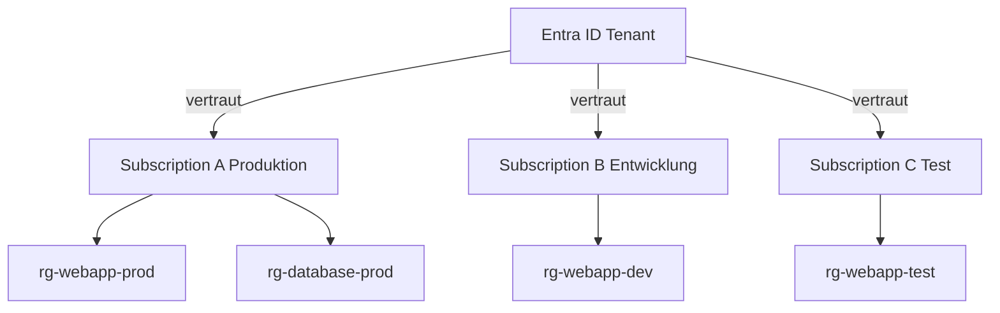
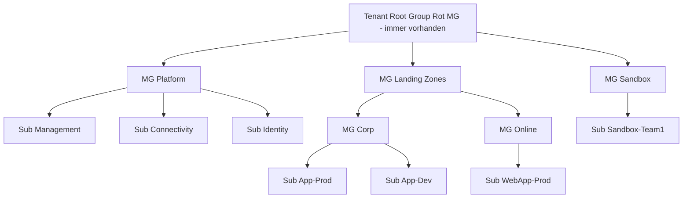
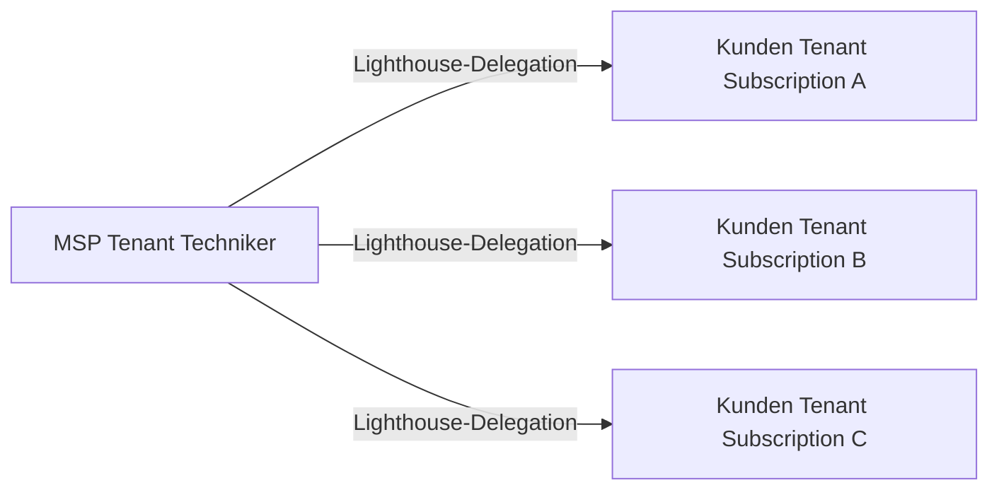

---
tags:
  - azure
  - grundlagen
  - subscriptions
  - management-groups
  - billing
  - governance
aliases:
  - Azure Subscriptions
  - Management Groups Azure
  - Azure Billing Hierarchie
---

# Subscriptions und Management Groups

> [!ABSTRACT] TL;DR
> Azure Subscriptions sind die Billing- und Access-Grenze für Azure-Ressourcen. Management Groups gruppieren Subscriptions hierarchisch (bis 6 Ebenen), sodass Policies und RBAC-Rollen auf viele Subscriptions gleichzeitig angewendet werden können. Zusammen bilden sie die Grundlage für Governance, Kostenkontrolle und Skalierung in Azure.

---

## Was ist eine Azure Subscription?

Eine **Azure Subscription** ist ein logischer Container, der:
- Als **Billing-Grenze** dient (alle Ressourcen in einer Subscription erscheinen auf einer Rechnung)
- Als **Access-Grenze** dient (Entra ID-Tenant vertraut der Subscription)
- Eine eindeutige **Subscription ID** (GUID) hat
- **Ressourcen-Limits und Quotas** pro Subscription gelten



**Wichtige Konzepte:**
- Eine Subscription kann nur einem Entra ID-Tenant vertrauen
- Ein Tenant kann mehrere Subscriptions haben
- Ressourcen können zwischen Subscriptions verschoben werden (einige Einschränkungen)
- Subscription ist die **Grenze für die meisten Azure-Limits** (VMs, Storage Accounts, etc.)

---

## Subscription-Typen

| Typ | Zielgruppe | Zahlung | Besonderheiten |
|-----|-----------|---------|----------------|
| **Pay-as-you-go (PAYG)** | KMU, Projekte | Monatlich, Kreditkarte | Höchste Listenpreise, kein Commitment |
| **Enterprise Agreement (EA)** | Großunternehmen | Jährlich/3-jährig Prepaid | Azure Prepayment (Monetary Commitment) |
| **Microsoft Customer Agreement (MCA)** | Alle Unternehmensgrößen | Flexibel | Moderner EA-Nachfolger, API-basiertes Billing |
| **Cloud Solution Provider (CSP)** | Über Microsoft-Partner | Über MSP-Rechnung | Support durch Partner, Rabatte möglich |
| **Free** | Einsteiger | 200$ Credit (30 Tage) | 12 Monate kostenlose Services |
| **Visual Studio / MSDN** | Entwickler | Monatliches Credit | VS Enterprise: 150$/Monat Credit |
| **Dev/Test** | Test-Umgebungen | Reduzierte Preise | Kein SLA, Windows ohne Lizenzkosten |

> [!NOTE] EA vs. MCA
> Das Enterprise Agreement (EA) ist der klassische 3-Jahres-Vertrag. Der Microsoft Customer Agreement (MCA) ist seit 2020 der Nachfolger — flexibler, moderner Billing-API, kein fixes 3-Jahres-Commitment erforderlich. Neue Großkunden sollten MCA bevorzugen.

---

## Management Groups

### Konzept

**Management Groups** ermöglichen die hierarchische Gruppierung von Subscriptions. Azure Policies und RBAC-Rollenzuweisungen auf einer Management Group vererben sich auf alle enthaltenen Subscriptions und Resources.



### Technische Limits

| Parameter | Limit |
|-----------|-------|
| Management Groups pro Tenant | 10.000 |
| Hierarchie-Tiefe (ohne Root + Sub) | 6 Ebenen |
| Subscriptions pro Management Group | Unbegrenzt |
| Root Management Group | 1 pro Tenant, nicht löschbar |

> [!IMPORTANT] Root Management Group
> Die **Tenant Root Group** existiert automatisch für jeden Tenant. Policies und Rollen auf Root-Ebene gelten für ALLE Subscriptions. Mit Vorsicht verwenden — nur Globale Administratoren können hier agieren.

### Management Groups erstellen (PowerShell)
```powershell
# Management Group erstellen
New-AzManagementGroup -GroupName "MG-LandingZones" `
  -DisplayName "Landing Zones" `
  -ParentId "/providers/Microsoft.Management/managementGroups/TenantRootGroup"

# Subscription zu MG hinzufügen
New-AzManagementGroupSubscription `
  -GroupName "MG-LandingZones" `
  -SubscriptionId "xxxxxxxx-xxxx-xxxx-xxxx-xxxxxxxxxxxx"
```

---

## Subscription-Design-Strategien

### Ansatz 1: Eine Subscription für alles
- **Geeignet für:** Kleinunternehmen, Startups, Labs
- **Vorteil:** Einfach, kein overhead
- **Nachteil:** Keine Isolation, Limit-Risiken, keine klare Kostentrennung

### Ansatz 2: Per Umgebung (empfohlen für KMU)
```
Sub-Produktion
Sub-Entwicklung
Sub-Test
```
- **Geeignet für:** KMU bis Mittelstand
- **Vorteil:** Klare Trennung Prod/Dev, eigene Budgets, Policies per Umgebung

### Ansatz 3: Per Business Unit / Abteilung
```
Sub-IT-Infrastruktur
Sub-Entwicklung-TeamA
Sub-Entwicklung-TeamB
Sub-Marketing
```
- **Geeignet für:** Große Unternehmen, mehrere Teams
- **Vorteil:** Klare Kostenzuordnung (Chargeback), Autonomie pro Team

### Ansatz 4: Per Workload (Enterprise)
```
Sub-SAP-Produktion
Sub-WebApp-Produktion
Sub-Datenbank-Produktion
Sub-Plattform-Management
```
- **Geeignet für:** Enterprise, kritische Workloads
- **Vorteil:** Maximale Isolation, eigene Limits pro Workload

> [!TIP] Subscription-Limits als Entscheidungskriterium
> Wenn eine Subscription nahe an einem Limit (z.B. 2000 RBAC-Assignments, 980 Resource Groups) ist, ist das ein Signal für eine neue Subscription. Limits: [learn.microsoft.com/de-de/azure/azure-resource-manager/management/azure-subscription-service-limits](https://learn.microsoft.com/de-de/azure/azure-resource-manager/management/azure-subscription-service-limits)

---

## Azure Cost Management + Billing

### Cost Analysis

**Cost Analysis** visualisiert die Kosten über Zeit und ermöglicht Drill-Down:

- **Granularität:** Täglich, monatlich, kumulativ
- **Gruppierung:** Service, Resource Group, Tag, Location, Resource, Subscription
- **Filter:** Nur bestimmte Services, Tags oder Ressourcen anzeigen
- **Forecast:** Geschätzte Kosten für den Rest des Monats/Quartals
- **Export:** Automatischer Export nach Azure Storage Account (CSV)

### Budgets und Alerts

Budgets definieren Kostenlimits und lösen bei Überschreitung Alerts aus:

```powershell
# Budget per PowerShell erstellen
New-AzConsumptionBudget `
  -Name "Prod-Monatliches-Budget" `
  -Amount 2000 `
  -TimeGrain Monthly `
  -StartDate "2025-01-01" `
  -EndDate "2025-12-31" `
  -ContactEmail @("finops@contoso.com", "admin@contoso.com") `
  -Threshold 80  # Alert bei 80% des Budgets
```

**Budget-Alert-Schwellen (Best Practice):**
- 50% — Frühwarnung
- 80% — Handlungsbedarf
- 100% — Budget erreicht
- 110% — Überschreitung

> [!WARNING] Budgets stoppen keine Ressourcen automatisch
> Ein Budget-Alert benachrichtigt nur. Zum automatischen Stoppen: Budget-Alert → Action Group → Azure Automation Runbook (VM stoppen).

### Billing Hierarchy (MCA)

```
Billing Account
  └── Billing Profile (eigene Rechnung/Zahlungsmethode)
        └── Invoice Section (Kostenstelle/Abteilung)
              └── Subscription
```

---

## Enterprise Agreement (EA) vs. Microsoft Customer Agreement (MCA)

| Merkmal | Enterprise Agreement (EA) | Microsoft Customer Agreement (MCA) |
|---------|--------------------------|-------------------------------------|
| **Laufzeit** | 3 Jahre (fix) | Flexibel (monatlich oder Commitment) |
| **Mindestgröße** | ~500 Lizenzen / ~1M$ | Keine Mindestgröße |
| **Portal** | ea.azure.com (veraltet) | Azure Portal → Cost Management |
| **Rabatte** | Verhandelte Rabatte | Standardrabatte |
| **Azure Prepayment** | Ja (Monetary Commitment) | Ja (Azure Prepayment) |
| **Neue Kunden** | Nein (EA wird durch MCA ersetzt) | Ja (empfohlen) |
| **API-Zugang** | Eingeschränkt | Vollständig (Billing API) |

---

## Subscription Limits und Quotas

Wichtige Limits pro Subscription (Stand 2025):

| Resource | Standard-Limit | Max-Limit |
|----------|---------------|-----------|
| Resource Groups | 980 | 980 |
| RBAC-Zuweisungen | 2.000 | 4.000 (auf Anfrage) |
| Storage Accounts | 250 | 250 |
| VMs (Standard Cores) | 20 | Auf Anfrage erhöhbar |
| VNets | 50 | 500 |
| Public IP-Adressen | 20 | 1.200 |
| NSGs | 100 | 5.000 |

> [!NOTE] Quota-Erhöhungen
> Die meisten Limits können über Azure Portal → Help + Support → "Service and subscription limits (quotas)" erhöht werden. Einige Limits (z.B. Resource Groups auf 980) sind absolut.

---

## Subscription Transfer und Tenant-Migration

### Billing Ownership Transfer
- Subscription zu einem anderen Billing Account übertragen
- Ressourcen bleiben unverändert
- RBAC-Zuweisungen bleiben erhalten
- Durchführung: Azure Portal → Subscriptions → Billing transfer

### Tenant-Transfer (Directory Change)
- Subscription einem anderen Entra ID-Tenant zuordnen
- **Risiken:** RBAC-Zuweisungen werden gelöscht! Managed Identities werden gelöscht!
- Empfehlung: Ressourcen-spezifische Dienste vorab dokumentieren
- Durchführung: Azure Portal → Subscriptions → Change directory

> [!DANGER] Tenant-Transfer löscht alle RBAC-Zuweisungen
> Nach einem Directory-Wechsel müssen alle Rollen neu vergeben werden. Managed Identities und Key Vault Access Policies müssen neu konfiguriert werden.

---

## Azure Lighthouse für MSPs

**Azure Lighthouse** ermöglicht Managed Service Providern (MSPs), Kunden-Subscriptions mandantenübergreifend zu verwalten:

- **Delegiertes Ressourcen-Management:** MSP-Techniker sehen Kunden-Ressourcen im eigenen Portal
- **Kein Gastzugang nötig:** Kein B2B-Invite oder Gast-Account im Kunden-Tenant
- **RBAC-Schutz:** Kunden definieren genau welche Berechtigungen der MSP erhält
- **Audit-Trail:** Alle MSP-Aktionen sind im Kunden-Tenant sichtbar



---

## Via Azure Portal (UI)

### Abonnements anzeigen

1. Melde dich an beim **Azure Portal** unter [portal.azure.com](https://portal.azure.com)
2. Navigiere zu **Abonnements** (Suchleiste oder linkes Menü)
3. Alle verfügbaren Subscriptions werden aufgelistet
4. Klicke auf eine Subscription → **Übersicht** zeigt Ausgaben, Ressourcen, IAM

### Management Groups verwalten

1. Navigiere zu **Verwaltungsgruppen** (Suchleiste)
2. Klicke auf **+ Verwaltungsgruppe erstellen**
3. Konfiguriere:
   - **ID der Verwaltungsgruppe:** Eindeutige ID (z.B. `mg-corp`)
   - **Anzeigename:** Lesbarer Name (z.B. `Corp Root`)
4. Klicke auf **Senden**
5. Zum Verschieben einer Subscription: Subscription auswählen → **Details** → **Übergeordnete Verwaltungsgruppe ändern**

> [!TIP] Tipp
> Management Groups sind unter **Entra ID → Verwaltungsgruppen** oder direkt über die Suchleiste erreichbar.

---

## Verwandte Notizen
- [[Azure Überblick]]
- [[Resource Groups]]
- [[Azure RBAC]]
- [[Azure Policy]]
- [[Azure Landing Zones]]
- [[Azure Cost Management]]
