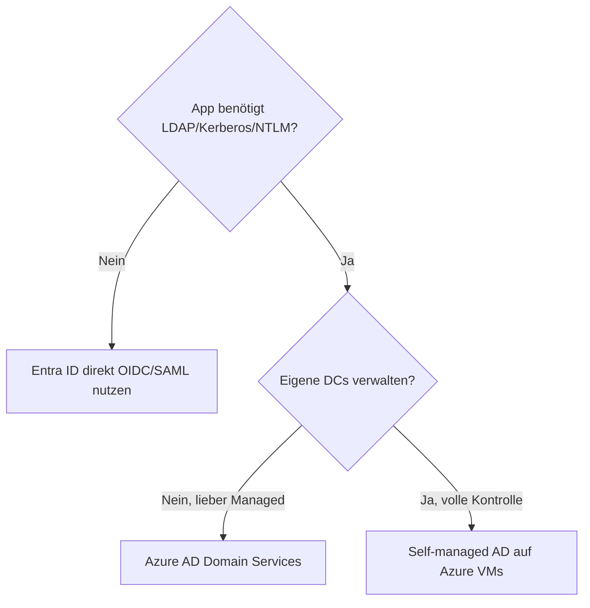
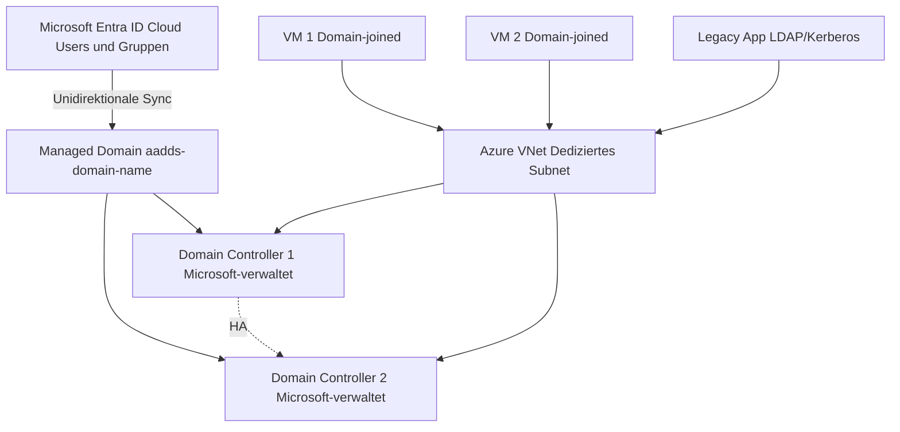
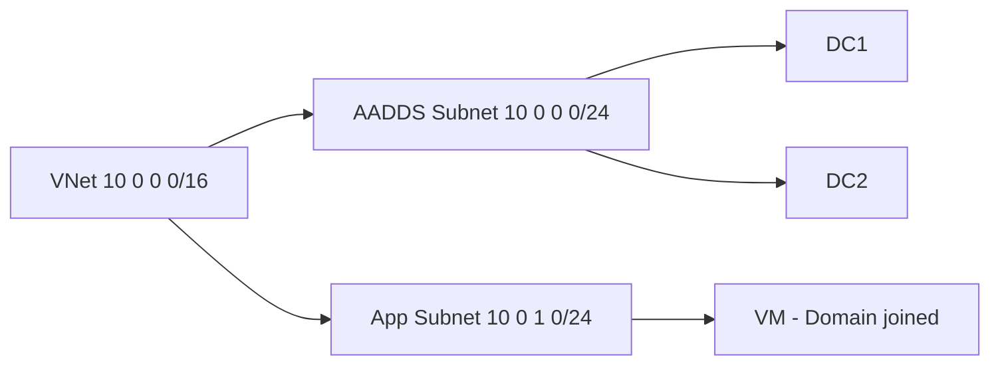
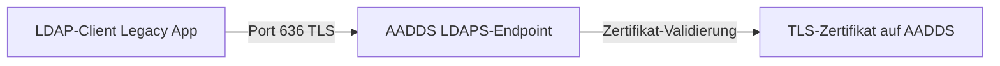
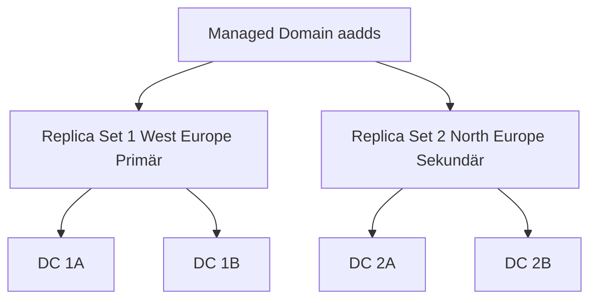

---
tags:
  - azure
  - domain-services
  - aadds
  - active-directory
  - ldap
  - kerberos
  - identität
  - legacy
aliases:
  - AADDS
  - Azure Active Directory Domain Services
  - Entra Domain Services
  - Microsoft Entra Domain Services
---

# Azure AD Domain Services

> [!ABSTRACT] TL;DR
> Azure AD Domain Services (AADDS), heute **Microsoft Entra Domain Services**, ist ein Managed Domain Service der einen Windows Server Active Directory-kompatiblen Domänencontroller in Azure bereitstellt — ohne selbst DCs verwalten zu müssen. Hauptanwendungsfall: Legacy-Anwendungen die LDAP, Kerberos oder NTLM benötigen, aber kein klassisches AD auf VMs.

---

## Was ist Azure AD Domain Services?

Azure AD Domain Services (offizieller Name: **Microsoft Entra Domain Services**) stellt eine **verwaltete Active Directory-Domäne** in Azure bereit:

- Voll kompatibel mit Windows Server Active Directory (LDAP, Kerberos, NTLM, Group Policy)
- Microsoft verwaltet die Domain Controller — kein Patching, kein Backup der DCs nötig
- Automatische Synchronisation von Benutzern und Gruppen aus Microsoft Entra ID (früher Azure AD)
- Hochverfügbar: zwei Domain Controller pro Managed Domain (in verschiedenen Update-Domänen)

### Abgrenzung zu anderen Diensten

| Dienst | Beschreibung |
|--------|-------------|
| **Microsoft Entra ID** | Cloud-nativer Identity Provider (SAML, OIDC, OAuth) — kein LDAP/Kerberos |
| **Azure AD Domain Services** | Managed Domain mit LDAP/Kerberos/NTLM für Legacy-Apps |
| **Self-managed AD auf VMs** | Eigene DCs in Azure VMs — volle Kontrolle, aber selbst verwalten |
| **On-Premises AD** | Klassisches AD im eigenen Rechenzentrum |

---

## Anwendungsfälle

### Wann AADDS sinnvoll ist



**Typische Anwendungsfälle:**
- **Lift-and-Shift** von Legacy-Anwendungen die Domain Join benötigen
- Ältere Java/Python-Anwendungen mit LDAP-Authentifizierung
- SharePoint Server, SQL Server mit Windows-Authentifizierung
- Remote Desktop Services (RDS) mit Domain Join
- File Shares mit Kerberos-Authentifizierung
- Anwendungen die Group Policy für Konfiguration verwenden

> [!NOTE] Kein Ersatz für On-Prem AD
> AADDS ist kein vollständiger Ersatz für On-Premises Active Directory. Es unterstützt keine Schema-Erweiterungen, keine DC-Replikation zu On-Prem, und kein Kerberos-Delegation zu On-Prem-Diensten.

---

## Architektur



### Synchronisations-Richtung

**Wichtig:** Die Synchronisation ist **unidirektional** — von Entra ID zu AADDS:

```
Microsoft Entra ID → Azure AD Domain Services
```

- Benutzer, Gruppen und Credentials werden von Entra ID nach AADDS synchronisiert
- Änderungen in AADDS (z.B. über ADUC) werden **nicht** zurück nach Entra ID synchronisiert
- Entra ID ist immer die "Source of Truth"

**Was wird synchronisiert:**
- Benutzerkonten (UPN, Display Name, etc.)
- Sicherheitsgruppen (keine Microsoft 365 Gruppen)
- Password Hashes (Kerberos-kompatibel — nur bei aktiviertem SSPR oder bei nativen Cloud-Benutzern)

> [!IMPORTANT] Password Hash Sync für On-Prem Hybrid
> Bei hybriden Umgebungen (On-Prem AD → Entra ID → AADDS): Entra Connect muss **Password Hash Sync** aktiviert haben. Mit Pass-Through Authentication allein funktioniert AADDS nicht für On-Prem-Benutzer.

---

## Netzwerk-Anforderungen

AADDS benötigt ein **dediziertes Subnet** in einem Azure VNet:



**NSG-Anforderungen für das AADDS Subnet** (Microsoft-vorgeschrieben):

| Richtung | Port | Protokoll | Quelle | Zweck |
|----------|------|-----------|--------|-------|
| Inbound | 443 | TCP | AzureActiveDirectoryDomainServices | Managed Service-Kommunikation |
| Inbound | 5986 | TCP | AzureActiveDirectoryDomainServices | PowerShell Remoting (Monitoring) |
| Inbound | 3389 | TCP | CorpNetSaw | Microsoft Support (selten) |
| Outbound | Alle | Alle | VirtualNetwork → Internet | Azure-Infrastruktur-Kommunikation |

> [!WARNING] NSG nicht überschreiben
> Microsoft deployt automatisch eine NSG auf das AADDS-Subnet. Eigene Regeln können hinzugefügt werden, aber die von Microsoft gesetzten Regeln dürfen nicht gelöscht werden — sonst wird die Managed Domain ungesund.

---

## AADDS deployen

```powershell
# AADDS-Instanz erstellen (dauert ~30-45 Minuten)
New-AzResource `
  -ResourceGroupName "rg-aadds" `
  -ResourceType "Microsoft.AAD/DomainServices" `
  -ApiVersion "2021-05-01" `
  -ResourceName "aadds.mycompany.onmicrosoft.com" `
  -Location "westeurope" `
  -PropertyObject @{
    domainName = "aadds.mycompany.onmicrosoft.com"
    filteredSync = "Enabled" # Nur bestimmte Gruppen synchronisieren
    domainConfigurationType = "FullySynced"
    replicaSets = @(
      @{
        subnetId = "/subscriptions/{id}/resourceGroups/rg-aadds/providers/Microsoft.Network/virtualNetworks/vnet-aadds/subnets/snet-aadds"
        location = "westeurope"
      }
    )
    ldapsSettings = @{
      ldaps = "Disabled"
    }
  }
```

---

## LDAP konfigurieren (Secure LDAP / LDAPS)

Standard-LDAP (Port 389) ist unverschlüsselt — für Produktionsumgebungen muss **Secure LDAP (LDAPS)** auf Port 636 konfiguriert werden:



**Schritte für LDAPS:**
1. Zertifikat erstellen (von vertrauenswürdiger CA oder selbst-signiert für Dev)
2. Zertifikat muss `Subject Alternative Name (SAN)` für AADDS-Domäne enthalten
3. Im Portal: AADDS → Secure LDAP → Enable, Zertifikat hochladen
4. Firewall: Port 636 nur für notwendige Quell-IPs öffnen (LDAP ist sensitiv!)

```powershell
# LDAPS-Zertifikat erstellen (selbst-signiert für Tests)
$cert = New-SelfSignedCertificate `
  -Subject "CN=aadds.mycompany.onmicrosoft.com" `
  -DnsName "aadds.mycompany.onmicrosoft.com", "*.aadds.mycompany.onmicrosoft.com" `
  -KeyUsage "DigitalSignature", "KeyEncipherment" `
  -KeyLength 4096 `
  -NotAfter (Get-Date).AddYears(2)

$certPassword = ConvertTo-SecureString "CertPassword!" -AsPlainText -Force
Export-PfxCertificate -Cert $cert -FilePath "aadds-ldaps.pfx" -Password $certPassword
```

---

## Gruppenrichtlinien in AADDS

AADDS enthält zwei vorkonfigurierte GPOs (Group Policy Objects):

| GPO | Scope | Inhalt |
|-----|-------|--------|
| **AADDC Computers** | Alle Computer-Objekte | Security-Einstellungen von Microsoft |
| **AADDC Users** | Alle Benutzer-Objekte | Security-Einstellungen von Microsoft |

**Eigene GPOs erstellen:**
- Eigene GPOs können in der OU `AADDC Computers` und `AADDC Users` verknüpft werden
- Verwaltung über eine Domain-joined VM mit RSAT (Remote Server Administration Tools)
- Mitglieder der Gruppe **AAD DC Administrators** können GPOs verwalten

```powershell
# RSAT auf Domain-joined VM installieren
Install-WindowsFeature -Name "GPMC", "RSAT-AD-AdminCenter", "RSAT-ADDS"

# Danach Group Policy Management Console nutzen (gpmc.msc)
```

---

## Einschränkungen von AADDS

> [!IMPORTANT] AADDS-Einschränkungen kennen

| Einschränkung | Details |
|--------------|---------|
| **Kein Domain Admin** | Kein Zugriff auf die DCs, kein `Domain Admins`-Mitglied; `AAD DC Administrators` ist die höchste Gruppe |
| **Kein Schema-Erweiterung** | Das AD-Schema kann nicht erweitert werden |
| **Kein Write-back zu Entra ID** | Änderungen in AADDS (z.B. via ADUC) werden nicht zu Entra ID synchronisiert |
| **Kein On-Prem Kerberos-Delegation** | Kein Kerberos-Delegation zu On-Prem-Ressourcen über AD-Trust |
| **Keine Forest Trusts** | Kein AD-Trust zu On-Prem-AD oder anderen Forests |
| **Kein LDAP Write** | Attribute können nicht via LDAP geschrieben werden (read-only LDAP) |
| **Eingeschränkte PowerShell** | Nur Befehle über Domain-joined VMs (kein direkter DC-Zugriff) |

---

## Replica Sets (Geo-Redundanz)

Ab Standard SKU: Managed Domain kann auf **mehrere Azure-Regionen** ausgedehnt werden:



- Automatische Replikation zwischen Replica Sets
- VMs in Region 2 können DCs in Region 2 nutzen (niedrigere Latenz)
- Bei Ausfall einer Region: automatisches Failover zum anderen Replica Set

---

## AADDS vs. Self-managed AD auf VMs

| Merkmal | AADDS | Self-managed AD auf VMs |
|---------|-------|------------------------|
| **DC-Verwaltung** | Microsoft-verwaltet | Selbst verwalten |
| **Patching** | Automatisch | Selbst verantwortlich |
| **Backup DCs** | Automatisch | Selbst einrichten |
| **Schema-Erweiterung** | Nicht möglich | Möglich |
| **Forest Trusts** | Nicht unterstützt | Möglich |
| **Kosten** | ~$0,07-0,10/Stunde | VM-Kosten (2x DC-VMs) |
| **Domain Admin-Zugriff** | Eingeschränkt | Vollständig |
| **LDAP Write** | Nicht unterstützt | Vollständig |
| **Setup-Aufwand** | Gering (30-45 Min) | Hoch (eigene DC-Konfiguration) |
| **Empfohlen für** | Lift-and-Shift ohne DC-Admin | Vollständige AD-Kontrolle nötig |

---

## Kosten

AADDS wird per **Stunde** abgerechnet, basierend auf der SKU:

| SKU | Preis (westeurope) | Included | Replica Sets |
|-----|-------------------|----------|-------------|
| **Standard** | ~$0,07/Stunde (~$52/Monat) | Bis 25.000 Objekte | 1 |
| **Enterprise** | ~$0,27/Stunde (~$200/Monat) | Bis 100.000 Objekte | Bis 3 |
| **Premium** | ~$0,54/Stunde (~$400/Monat) | Bis 500.000 Objekte | Bis 5 |

> [!NOTE] Kostenoptimierung
> AADDS läuft 24/7 — es gibt keine Möglichkeit, die Instanz zu stoppen. Der Kostenfaktor ist für viele Teams ein Argument für Self-managed DCs (wenn die VMs ohnehin gebraucht werden).

---

## Fehlerbehebung

### Häufige Probleme

| Problem | Ursache | Lösung |
|---------|---------|--------|
| **Sync-Fehler** | Benutzer hat kein kompatibles Password Hash | Benutzer muss Passwort zurücksetzen (SSPR oder Admin) |
| **LDAPS-Verbindung fehlgeschlagen** | Zertifikat abgelaufen oder falsch | Neues Zertifikat hochladen |
| **Domain-Join schlägt fehl** | DNS nicht auf AADDS-DCs zeigend | VM DNS auf AADDS-IP-Adressen setzen |
| **Health Alert** | NSG-Regel falsch | NSG-Regeln mit Anforderungen vergleichen |
| **Benutzer kann nicht einloggen** | Kein Password Hash synchronisiert | Passwort-Reset für On-Prem-Hybrid-Benutzer |
| **GPO wird nicht angewandt** | Computer nicht in richtiger OU | ADUC prüfen, Computer in AADDC Computers OU |

```powershell
# AADDS Health Status prüfen
Get-AzResource `
  -ResourceGroupName "rg-aadds" `
  -ResourceType "Microsoft.AAD/DomainServices" | `
  Select-Object -ExpandProperty Properties | `
  Select-Object -ExpandProperty serviceStatus
```

### DNS konfigurieren (kritisch!)

```powershell
# VNet DNS auf AADDS Domain Controller IPs setzen
# AADDS-IPs aus Portal: AADDS → Overview → IP-Adressen
$vnet = Get-AzVirtualNetwork -Name "vnet-prod" -ResourceGroupName "rg-prod"
$vnet.DhcpOptions.DnsServers = @("10.0.0.4", "10.0.0.5") # AADDS DC IPs
Set-AzVirtualNetwork -VirtualNetwork $vnet
```

---

## Verwandte Notizen

- [[Azure RBAC]]
- [[Azure Managed Identities]]
- [[Microsoft Entra Workload ID]]
