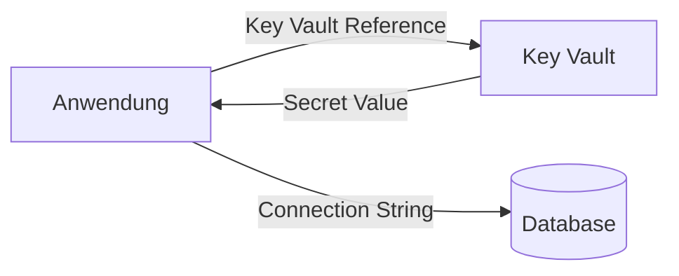
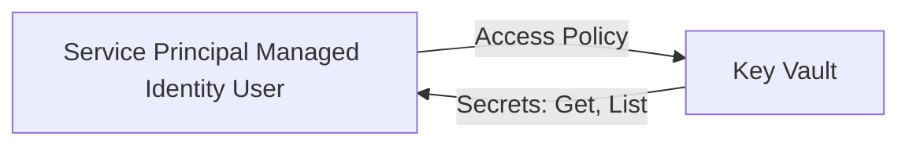
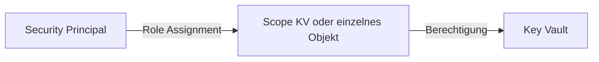
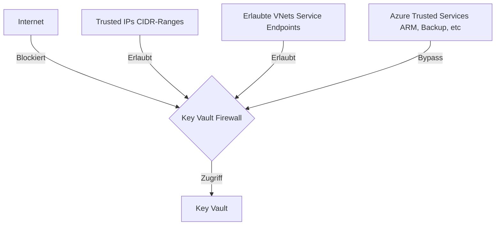
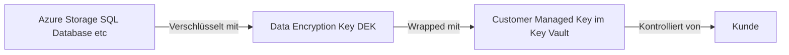

---
tags:
  - azure
  - key-vault
  - security
  - secrets
  - verschlüsselung
  - zertifikate
  - compliance
aliases:
  - Key Vault
  - AKV
  - Azure Schlüsseltresor
  - Azure Key Vault Secrets
---

# Azure Key Vault

> [!ABSTRACT] TL;DR
> Azure Key Vault ist der zentrale Speicher für Secrets (Passwörter, Connection Strings), Keys (Verschlüsselungsschlüssel) und Certificates (TLS-Zertifikate) in Azure. Kernprinzip: Keine Secrets im Code oder in Konfigurationsdateien — alles in Key Vault, Zugriff über Managed Identity oder RBAC.

---

## Was ist Azure Key Vault?

Azure Key Vault ist ein **Managed Service** für die sichere Verwaltung von:
- **Secrets** — Passwörter, Connection Strings, API-Keys, beliebige Texte (bis 25 KB)
- **Keys** — RSA- und EC-Schlüssel für Verschlüsselung, Signing, Wrapping (in Software oder HSM)
- **Certificates** — TLS/SSL-Zertifikate mit automatischer Erneuerung

**Kernvorteile:**
- Zentralisierte, auditierbare Secret-Verwaltung
- Integration mit Azure Diensten (App Service, Functions, AKS, etc.)
- Soft Delete und Purge Protection verhindern versehentlichen Datenverlust
- HSM-backed Keys für höchste Sicherheitsanforderungen (FIPS 140-2 Level 2/3)

---

## Objekt-Typen

### Secrets



Secrets haben:
- **Name** (z.B. `db-connection-string-prod`)
- **Value** (der tatsächliche Wert)
- **Version** (automatisch bei jeder Aktualisierung)
- **Ablaufdatum** (optional, aber empfohlen)
- **Tags** für Kategorisierung

### Keys

Kryptographische Schlüssel für:
- **Encrypt/Decrypt** — Datenverschlüsselung
- **Sign/Verify** — Digitale Signaturen
- **WrapKey/UnwrapKey** — Schlüsselverschlüsselung (Customer Managed Keys)

Schlüsseltypen:

| Typ | Größen | Anwendungsfall |
|-----|--------|---------------|
| **RSA** | 2048, 3072, 4096 Bit | Allgemein, TLS, CMK |
| **RSA-HSM** | 2048, 3072, 4096 Bit | Premium SKU, FIPS 140-2 L2/3 |
| **EC** | P-256, P-384, P-521 | Signing, kleinere Keys |
| **EC-HSM** | P-256, P-384, P-521 | Premium SKU, HSM-backed |
| **Oct** (Symmetric) | 128, 192, 256 Bit | Nur Managed HSM |

### Certificates

Key Vault verwaltet TLS-Zertifikate komplett:
- **Selbst-signierte Zertifikate** (für Dev/Test)
- **DigiCert/GlobalSign** (integrierte CA, automatische Erneuerung)
- **Let's Encrypt** (via ACME-Integration, benötigt Custom Policy)
- **Eigene CA / importierte Zertifikate**

Bei jedem Zertifikat erstellt Key Vault automatisch:
1. Das Zertifikat selbst (abrufbar als Certificate)
2. Den privaten Schlüssel (abrufbar als Key)
3. Die Zertifikat-Metadaten (abrufbar als Secret im PFX-Format)

---

## SKUs: Standard vs. Premium

| Merkmal | Standard | Premium |
|---------|----------|---------|
| **Secrets** | ✅ Software-geschützt | ✅ Software-geschützt |
| **Keys** | Software-backed | **HSM-backed** (RSA-HSM, EC-HSM) |
| **FIPS Level** | 140-2 Level 1 | **140-2 Level 2/3** (HSM) |
| **Preis Keys** | ~0,03 $/10.000 Ops | ~1 $/10.000 Ops (HSM) |
| **Preis Secrets** | ~0,03 $/10.000 Transaktionen | Gleich |
| **Anwendungsfall** | Standard-Workloads | Compliance (PCI-DSS, HIPAA), Finanzsektor |

> [!NOTE] Managed HSM
> Für höchste Sicherheitsanforderungen (FIPS 140-2 Level 3, Single-Tenant HSM) gibt es **Managed HSM** als separaten Dienst. Deutlich teurer (~4.300 $/Monat für einen HSM-Pool), aber dedizierte Hardware.

---

## Zugriffsmodelle

### Access Policies (Legacy)

Das ältere Modell — direkt auf Key Vault konfiguriert:



**Probleme mit Access Policies:**
- Keine Scope-Vererbung (gilt immer für den gesamten Key Vault)
- Bis zu 1024 Access Policies pro Vault
- Keine bedingten Zugriffe (Conditional Access)
- Schwerer zu auditieren

### RBAC (Empfohlen)



**Vorteile von RBAC:**
- Standard Azure RBAC — einheitliches Berechtigungsmodell
- Scope auf einzelne Secrets/Keys/Zertifikate möglich
- Conditional Access nutzbar
- Audit über Azure Activity Log

**Wichtige RBAC-Rollen für Key Vault:**

| Rolle | Beschreibung |
|-------|-------------|
| **Key Vault Administrator** | Vollzugriff auf alle Objekte |
| **Key Vault Secrets Officer** | Secrets verwalten (CRUD) |
| **Key Vault Secrets User** | Secrets lesen (Get, List) |
| **Key Vault Crypto Officer** | Keys verwalten |
| **Key Vault Crypto User** | Keys nutzen (Encrypt, Sign, etc.) |
| **Key Vault Certificate Officer** | Zertifikate verwalten |
| **Key Vault Reader** | Metadaten lesen (keine Werte) |

### Wann welches Modell?

| Szenario | Empfehlung |
|----------|-----------|
| Neue Key Vaults | **RBAC** (Microsoft-Empfehlung seit 2021) |
| Bestehende Vaults mit Access Policies | Migration zu RBAC planen |
| Granularer Zugriff auf einzelne Secrets | **RBAC** (einzige Option für Objekt-Scope) |
| Legacy-Anforderungen | Access Policies (wenn Migration nicht möglich) |

> [!IMPORTANT] Umstieg auf RBAC
> Bei neuen Key Vaults immer RBAC verwenden. Im Portal beim Erstellen: "Permission model" → "Azure role-based access control" wählen. Access Policies und RBAC können **nicht** gleichzeitig aktiv sein.

---

## Soft Delete und Purge Protection

**Soft Delete** (seit 2021 standardmäßig aktiviert, kann nicht deaktiviert werden):
- Gelöschte Objekte bleiben 7–90 Tage wiederherstellbar
- Gelöschter Key Vault selbst bleibt ebenfalls wiederherstellbar
- Retention Period konfigurierbar (Standard: 90 Tage)

**Purge Protection** (optional, empfohlen für Produktion):
- Verhindert endgültiges Löschen während Retention Period
- Auch Admins können Objekte nicht sofort endgültig löschen
- Wichtig für Compliance (CMK-geschützte Daten können sonst unzugänglich werden)

```powershell
# Key Vault mit Purge Protection erstellen
New-AzKeyVault `
  -Name "kv-prod-001" `
  -ResourceGroupName "rg-prod" `
  -Location "westeurope" `
  -Sku "Standard" `
  -EnableRbacAuthorization `
  -EnableSoftDelete `
  -SoftDeleteRetentionInDays 90 `
  -EnablePurgeProtection

# Gelöschtes Secret wiederherstellen
Undo-AzKeyVaultSecretRemoval `
  -VaultName "kv-prod-001" `
  -Name "db-password"
```

---

## Key Vault Firewall und Private Endpoint

### Firewall-Konfiguration



```powershell
# Firewall aktivieren — nur bestimmte VNets erlauben
Add-AzKeyVaultNetworkRule `
  -VaultName "kv-prod-001" `
  -VirtualNetworkResourceId "/subscriptions/{id}/resourceGroups/rg-prod/providers/Microsoft.Network/virtualNetworks/vnet-prod/subnets/snet-app"

# Standardmäßig alles blockieren
Update-AzKeyVaultNetworkRuleSet `
  -VaultName "kv-prod-001" `
  -DefaultAction Deny `
  -Bypass AzureServices
```

### Private Endpoint (Empfohlen für Produktion)

```bicep
resource kvPrivateEndpoint 'Microsoft.Network/privateEndpoints@2023-09-01' = {
  name: 'pe-kv-prod-001'
  location: location
  properties: {
    subnet: {
      id: privateEndpointSubnet.id
    }
    privateLinkServiceConnections: [
      {
        name: 'kv-prod-001-connection'
        properties: {
          privateLinkServiceId: keyVault.id
          groupIds: ['vault']
        }
      }
    ]
  }
}
```

> [!WARNING] DNS bei Private Endpoints
> Mit Private Endpoint muss eine **Private DNS Zone** (`privatelink.vaultcore.azure.net`) erstellt und mit dem VNet verknüpft werden. Sonst löst der Hostname auf die öffentliche IP auf und der Zugriff schlägt fehl.

---

## Key Vault in CI/CD (DevOps/GitHub Actions)

### Azure DevOps

```yaml
# azure-pipelines.yml
- task: AzureKeyVault@2
  inputs:
    azureSubscription: 'prod-service-connection'
    KeyVaultName: 'kv-prod-001'
    SecretsFilter: 'db-password,api-key-ext'
    RunAsPreJob: true

- script: |
    echo "Verbinde mit DB..."
    # $(db-password) ist jetzt als Pipeline-Variable verfügbar
  env:
    DB_PASSWORD: $(db-password)
```

### GitHub Actions (mit Federated Identity)

```yaml
jobs:
  deploy:
    permissions:
      id-token: write
      contents: read
    steps:
      - uses: azure/login@v2
        with:
          client-id: ${{ secrets.AZURE_CLIENT_ID }}
          tenant-id: ${{ secrets.AZURE_TENANT_ID }}
          subscription-id: ${{ secrets.AZURE_SUBSCRIPTION_ID }}
      
      - name: Get Key Vault Secrets
        uses: azure/get-keyvault-secrets@v1
        with:
          keyvault: "kv-prod-001"
          secrets: "db-password, api-key"
        id: kvSecrets
      
      - name: Use Secret
        run: echo "Deploying..." 
        env:
          DB_PASSWORD: ${{ steps.kvSecrets.outputs.db-password }}
```

---

## Key Vault References (App Service / Functions / Container Apps)

Statt Secrets in App-Einstellungen zu speichern, referenziert die App sie direkt aus Key Vault:

```
@Microsoft.KeyVault(SecretUri=https://kv-prod-001.vault.azure.net/secrets/db-connection-string/abc123)
```

Oder mit automatischer Versions-Auflösung (immer aktuelle Version):
```
@Microsoft.KeyVault(VaultName=kv-prod-001;SecretName=db-connection-string)
```

**Voraussetzung:** Die App Service / Function App muss eine Managed Identity haben, die `Key Vault Secrets User` Rolle auf dem Key Vault besitzt.

```powershell
# App Setting mit Key Vault Reference
$settings = @{
  "ConnectionStrings__DefaultConnection" = "@Microsoft.KeyVault(VaultName=kv-prod-001;SecretName=db-connection-string)"
}
Set-AzWebApp -ResourceGroupName "rg-prod" -Name "app-myapp" -AppSettings $settings
```

> [!TIP] Referenz-Status prüfen
> Im Azure Portal → App Service → Configuration → App Settings: Neben dem Key Vault Reference steht ein grünes Häkchen (aufgelöst) oder rotes X (Fehler — meist fehlende Managed Identity oder Berechtigung).

---

## Customer Managed Keys (CMK)

Azure-Dienste können ihre Daten mit eigenen Keys in Key Vault verschlüsseln:



```powershell
# Storage Account mit CMK konfigurieren
Set-AzStorageAccount `
  -ResourceGroupName "rg-prod" `
  -Name "stprod001" `
  -KeyvaultEncryption `
  -KeyName "cmk-storage" `
  -KeyVaultUri "https://kv-prod-001.vault.azure.net" `
  -KeyVersion "" # Leer = immer aktuelle Version
```

> [!DANGER] CMK und Purge Protection
> Wenn der CMK-Key im Key Vault gelöscht oder der Key Vault selbst gelöscht wird, werden die verschlüsselten Daten **dauerhaft unzugänglich**. Purge Protection muss bei CMK-Nutzung aktiviert sein!

---

## Certificate Management

### Auto-Renewal mit DigiCert

```powershell
# Certificate Policy für Auto-Renewal konfigurieren
$policy = New-AzKeyVaultCertificatePolicy `
  -IssuerName "DigiCert" `
  -SubjectName "CN=myapp.example.com" `
  -ValidityInMonths 12 `
  -ReuseKeyOnRenewal `
  -RenewAtNumberOfDaysBeforeExpiry 30

Add-AzKeyVaultCertificate `
  -VaultName "kv-prod-001" `
  -Name "cert-myapp-prod" `
  -CertificatePolicy $policy
```

### Zertifikat in App Service binden

1. Key Vault Zertifikat importieren: App Service → TLS/SSL Settings → Private Key Certificates → Import from Key Vault
2. Zertifikat an Custom Domain binden

---

## Key Vault Logging und Monitoring

```powershell
# Diagnostic Settings aktivieren
Set-AzDiagnosticSetting `
  -ResourceId $keyVault.ResourceId `
  -WorkspaceId $logAnalyticsWorkspaceId `
  -Enabled $true `
  -Category AuditEvent, AzurePolicyEvaluationDetails
```

### Nützliche KQL-Abfragen

```kusto
// Alle Secret-Zugriffe der letzten 24h
AzureDiagnostics
| where ResourceType == "VAULTS"
| where OperationName == "SecretGet"
| where TimeGenerated > ago(24h)
| summarize count() by CallerIPAddress, identity_claim_upn_s
| order by count_ desc

// Fehlgeschlagene Zugriffe
AzureDiagnostics
| where ResourceType == "VAULTS"
| where httpStatusCode_d >= 400
| project TimeGenerated, OperationName, ResultDescription, CallerIPAddress
```

---

## Key Vault Backup und Restore

> [!WARNING] Backup-Einschränkungen
> Key Vault Backups sind **innerhalb desselben Tenants und derselben Region** wiederherstellbar. Backup von einem Production-Vault kann NICHT in einem anderen Tenant restored werden. Für Geo-Redundanz: Secrets in zwei Key Vaults synchron halten oder Geo-Replikation über Scripts.

```powershell
# Einzelnes Secret sichern
Backup-AzKeyVaultSecret `
  -VaultName "kv-prod-001" `
  -Name "db-password" `
  -OutputFile "C:\Backup\db-password-backup.blob"

# Secret wiederherstellen
Restore-AzKeyVaultSecret `
  -VaultName "kv-prod-001" `
  -InputFile "C:\Backup\db-password-backup.blob"
```

---

## Fehlerbehebung

| Fehler | Ursache | Lösung |
|--------|---------|--------|
| **403 Forbidden** | Fehlende Berechtigung | RBAC Role Assignment prüfen oder Access Policy hinzufügen |
| **403 — Firewall** | IP/VNet nicht erlaubt | Firewall-Regeln prüfen, Trusted Services Bypass aktivieren |
| **Secret not found** | Falscher Name oder Vault | Name exakt prüfen (case-sensitiv), Vault-Name prüfen |
| **Soft-deleted Secret** | Secret im Soft-Delete | `Undo-AzKeyVaultSecretRemoval` oder Portal "Manage deleted secrets" |
| **Reference nicht aufgelöst** | Managed Identity fehlt oder Rolle fehlt | App Service Identity aktivieren, Key Vault Secrets User Rolle |
| **Certificate expired** | Auto-Renewal nicht konfiguriert | Certificate Policy mit Renewal Days setzen |

---

## Via Azure Portal (UI)

### Key Vault erstellen

1. Melde dich an beim **Azure Portal** unter [portal.azure.com](https://portal.azure.com)
2. Navigiere zu **Schlüsseltresore** (Suchleiste: „Key Vault") → Klicke auf **+ Erstellen**
3. Konfiguriere auf dem Tab **Grundlagen**:
   - **Abonnement:** Gewünschtes Abonnement
   - **Ressourcengruppe:** z.B. `rg-security`
   - **Name des Schlüsseltresors:** Eindeutiger Name (z.B. `kv-myapp-prod`)
   - **Region:** z.B. `West Europe`
   - **Tarif:** `Standard` oder `Premium`
   - **Soft-Delete:** Aktiviert (empfohlen, Standardeinstellung)
   - **Aufbewahrungsdauer für gelöschte Tresore:** 7–90 Tage
4. Tab **Zugriffsrichtlinie** oder **Azure RBAC** wählen als Zugriffsmodell
5. Tab **Netzwerk:** Öffentlich, ausgewählte Netzwerke oder Privater Endpunkt
6. Klicke auf **Überprüfen + erstellen** → **Erstellen**

### Secret hinzufügen

1. Key Vault öffnen → **Geheimnisse** im linken Menü → **+ Generieren/Importieren**
2. Konfiguriere:
   - **Uploadoption:** `Manuell`
   - **Name:** z.B. `database-password`
   - **Wert:** Den geheimen Wert eingeben
   - **Inhaltstyp:** Optional (z.B. `text/plain`)
   - **Aktivierungsdatum / Ablaufdatum:** Optional setzen
3. Klicke auf **Erstellen**

### Zugriffsrichtlinie hinzufügen (Vault Access Policy Modell)

1. Key Vault → **Zugriffsrichtlinien** → **+ Erstellen**
2. Berechtigungen wählen: Schlüssel, Geheimnis, Zertifikat-Operationen auswählen
3. Prinzipal auswählen: Benutzer, Gruppe oder Managed Identity
4. Klicke auf **Erstellen**

### RBAC-Berechtigung zuweisen (RBAC-Modell)

1. Key Vault → **Zugriffssteuerung (IAM)** → **+ Hinzufügen** → **Rollenzuweisung hinzufügen**
2. Rolle wählen: z.B. `Key Vault Secrets User` (lesen) oder `Key Vault Secrets Officer` (lesen/schreiben)
3. Mitglied auswählen → **Überprüfen + zuweisen**

---

## Verwandte Notizen

- [[Azure RBAC]]
- [[Azure Managed Identities]]
- [[Microsoft Entra Workload ID]]
- [[Azure Policy]]
