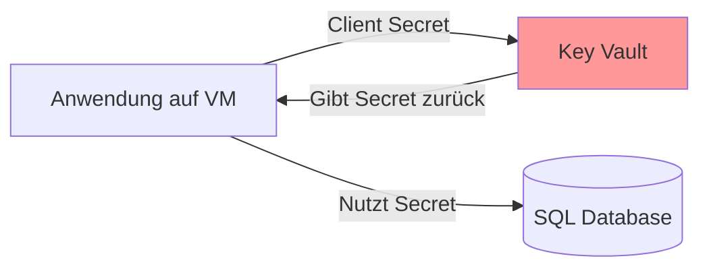
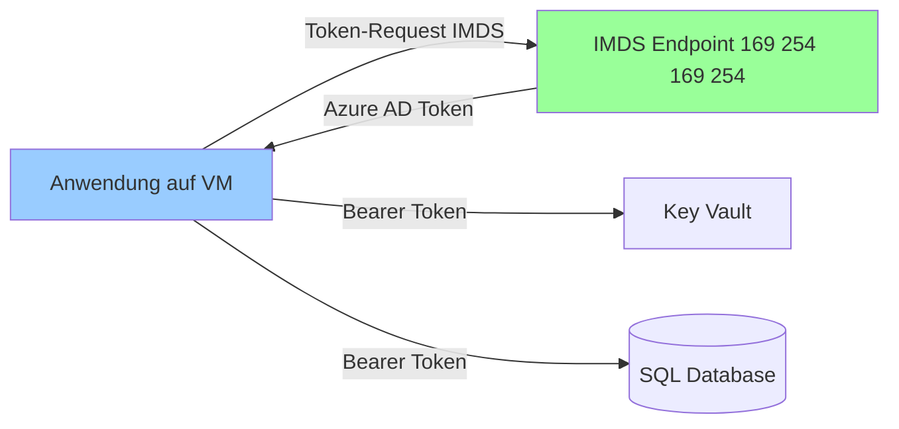
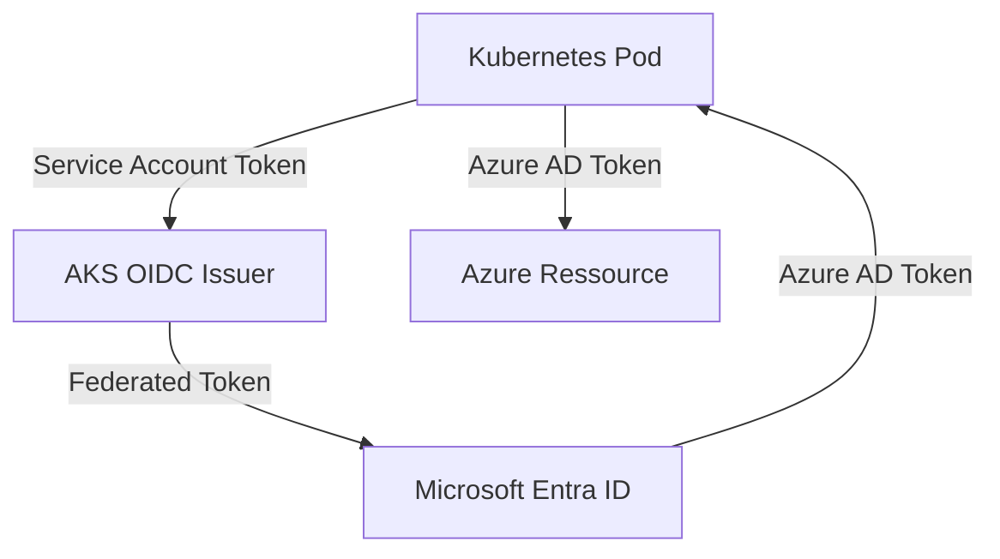
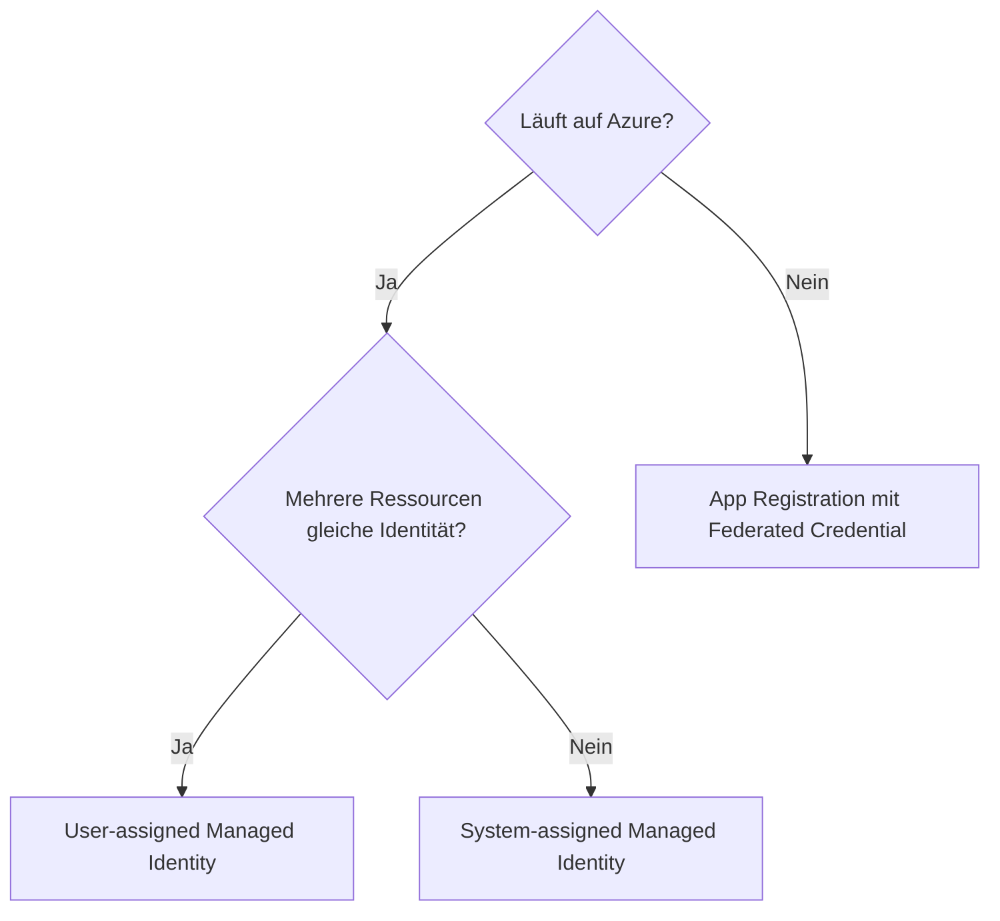
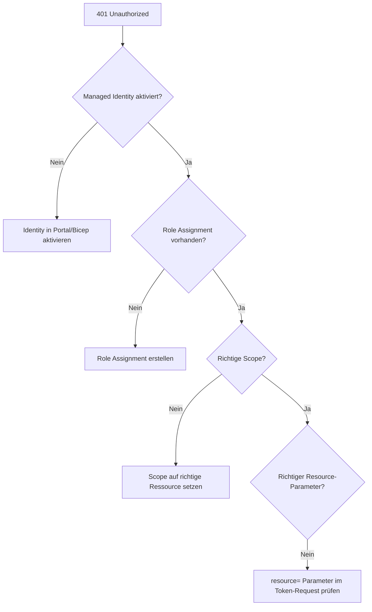

---
tags:
  - azure
  - identität
  - managed-identity
  - security
  - workload-identity
  - zero-trust
aliases:
  - Managed Identity Azure
  - System-assigned Identity
  - User-assigned Identity
  - Azure MSI
---

# Azure Managed Identities

> [!ABSTRACT] TL;DR
> Managed Identities ermöglichen Azure-Ressourcen, sich gegenüber anderen Azure-Diensten zu authentifizieren — ohne Credentials im Code oder in Konfigurationsdateien. Azure verwaltet das Erstellen, Rotieren und Löschen von Zertifikaten vollautomatisch. Das Ergebnis: keine Secrets, keine Passwörter, kein Rotation-Stress.

---

## Was sind Managed Identities?

Eine **Managed Identity** ist eine Identität in Microsoft Entra ID (früher Azure AD), die automatisch für eine Azure-Ressource erstellt wird. Der entscheidende Unterschied zu normalen Service Principals: **Azure verwaltet die Credentials vollständig**.

### Das Problem ohne Managed Identities



**Problem:** Das Secret zum Zugriff auf den Key Vault muss irgendwo gespeichert werden — ein klassisches Henne-Ei-Problem. Außerdem: Rotation vergessen, Secret abgelaufen → Produktionsausfall.

### Die Lösung mit Managed Identities



**Kein Secret nötig.** Azure liefert automatisch ein kurzlebiges Token.

**Kernvorteile:**
- Keine Credentials im Code, in Konfigurationsdateien oder in Pipeline-Variablen
- Automatische Rotation der Credentials durch Azure
- Nahtlose Integration mit Azure RBAC
- Unterstützt von fast allen Azure-Diensten

---

## System-assigned vs. User-assigned

| Merkmal | System-assigned | User-assigned |
|---------|----------------|--------------|
| **Lebenszyklus** | Gebunden an Ressource | Unabhängige Ressource |
| **Gelöscht wenn** | Ressource gelöscht | Explizit gelöscht |
| **1:1 Bindung** | Ja — eine Ressource | Nein — mehrere Ressourcen möglich |
| **Deployment** | Direkt auf Ressource | Separat erstellt, dann zugewiesen |
| **Identität in Entra ID** | Automatisch erstellt | Manuell erstellt |
| **Anwendungsfall** | Einzelne Ressource, kurze Lebensdauer | Shared Identity, mehrere VMs/Apps |

### Wann System-assigned?
- VM soll auf einen Storage Account zugreifen → eindeutige 1:1-Beziehung
- Die Identität wird nicht mehr gebraucht wenn die VM gelöscht wird
- Einfachste Option für einzelne Ressourcen

### Wann User-assigned?
- Mehrere VMs sollen dieselbe Identität haben (z.B. eine VMSS oder eine Gruppe von App Services)
- Identität muss vor der eigentlichen Ressource existieren (z.B. bei ARM-Templates mit Chicken-Egg-Problem)
- Identität soll VM-Neuerstellungen überleben (Zero-Downtime-Deployments)
- Gemeinsame Berechtigungen für eine Gruppe von Ressourcen

> [!TIP] Empfehlung
> **User-assigned** ist meist die bessere Wahl in Produktionsumgebungen: Die Berechtigungen (Role Assignments) können vorab erstellt werden, bevor die eigentliche Ressource deployed wird. Das verhindert Race Conditions bei automatisierten Deployments.

---

## Wie funktioniert es? (IMDS & Token-Abruf)

Azure stellt auf jeder VM den **Instance Metadata Service (IMDS)** bereit:

```
http://169.254.169.254/metadata/identity/oauth2/token
```

Diese IP-Adresse ist eine **link-local Adresse** — sie ist nur von der VM selbst erreichbar, nicht über das Netzwerk routbar.

### Token-Abruf per curl (auf einer Azure VM)

```bash
# Token für Key Vault anfordern
curl -s \
  'http://169.254.169.254/metadata/identity/oauth2/token?api-version=2018-02-01&resource=https://vault.azure.net' \
  -H 'Metadata: true' | python3 -m json.tool
```

### Token-Abruf per PowerShell

```powershell
# Managed Identity Token für Azure Resource Manager
$response = Invoke-RestMethod `
  -Uri 'http://169.254.169.254/metadata/identity/oauth2/token?api-version=2018-02-01&resource=https://management.azure.com/' `
  -Headers @{Metadata='true'} `
  -Method GET

$token = $response.access_token
Write-Output "Token expires: $($response.expires_on)"
```

### Token-Abruf in Anwendungen (Python)

```python
from azure.identity import ManagedIdentityCredential
from azure.keyvault.secrets import SecretClient

# Automatisch IMDS verwenden
credential = ManagedIdentityCredential()

client = SecretClient(
    vault_url="https://myvault.vault.azure.net",
    credential=credential
)

secret = client.get_secret("my-secret")
```

> [!NOTE] DefaultAzureCredential
> In Produktionscode empfiehlt sich `DefaultAzureCredential` statt `ManagedIdentityCredential` — es funktioniert sowohl lokal (mit az login / VS Code / IDE) als auch in Azure mit Managed Identity automatisch.

---

## Managed Identity auf verschiedenen Azure-Diensten

### Virtual Machines (VMs)

```powershell
# System-assigned Identity aktivieren
$vm = Get-AzVM -ResourceGroupName "rg-prod" -Name "vm-app01"
Update-AzVM -ResourceGroupName "rg-prod" -VM $vm -IdentityType SystemAssigned

# User-assigned Identity zuweisen
$identity = Get-AzUserAssignedIdentity -ResourceGroupName "rg-identities" -Name "id-app-prod"
Update-AzVM -ResourceGroupName "rg-prod" -VM $vm `
  -IdentityType UserAssigned `
  -IdentityID $identity.Id
```

### App Service & Azure Functions

Im Portal: App Service → Identity → System assigned → On

```bicep
resource appService 'Microsoft.Web/sites@2023-01-01' = {
  name: 'app-myapp-prod'
  location: location
  identity: {
    type: 'SystemAssigned'
    // Oder: 'UserAssigned' mit userAssignedIdentities
  }
  properties: {
    // ...
  }
}
```

### AKS (Workload Identity)

AKS verwendet **Workload Identity** (OIDC-basiert) statt des älteren Pod Identity Add-ons:



```bash
# AKS mit OIDC Issuer und Workload Identity aktivieren
az aks update \
  --resource-group rg-aks \
  --name aks-prod \
  --enable-oidc-issuer \
  --enable-workload-identity

# User-assigned Identity erstellen
az identity create --name id-app --resource-group rg-identities

# Federated Credential für Kubernetes Service Account
az identity federated-credential create \
  --name "aks-federated-cred" \
  --identity-name "id-app" \
  --resource-group "rg-identities" \
  --issuer "$(az aks show --resource-group rg-aks --name aks-prod --query oidcIssuerProfile.issuerUrl -o tsv)" \
  --subject "system:serviceaccount:default:myapp-sa" \
  --audience "api://AzureADTokenExchange"
```

### Logic Apps

Im Portal: Logic App → Identity → aktivieren. Dann in HTTP-Aktionen "Managed Identity" als Authentication auswählen.

### Container Instances (ACI)

```bicep
resource aci 'Microsoft.ContainerInstance/containerGroups@2023-05-01' = {
  name: 'aci-myapp'
  location: location
  identity: {
    type: 'UserAssigned'
    userAssignedIdentities: {
      '${identity.id}': {}
    }
  }
  // ...
}
```

### Azure Automation

Automation Accounts haben seit 2021 eine System-assigned Identity standardmäßig. Runbooks können damit ARM-API-Calls ohne Credentials machen.

---

## Berechtigungen erteilen (RBAC)

Eine Managed Identity selbst hat **keine Berechtigungen** — diese müssen explizit über Role Assignments erteilt werden.

```powershell
# System-assigned Identity einer VM Berechtigungen auf Key Vault geben
$vm = Get-AzVM -ResourceGroupName "rg-prod" -Name "vm-app01"
$principalId = $vm.Identity.PrincipalId

New-AzRoleAssignment `
  -ObjectId $principalId `
  -RoleDefinitionName "Key Vault Secrets User" `
  -Scope "/subscriptions/{subId}/resourceGroups/rg-prod/providers/Microsoft.KeyVault/vaults/kv-prod"
```

```bash
# Mit Azure CLI
PRINCIPAL_ID=$(az vm show --resource-group rg-prod --name vm-app01 \
  --query identity.principalId -o tsv)

az role assignment create \
  --assignee-object-id $PRINCIPAL_ID \
  --assignee-principal-type ServicePrincipal \
  --role "Storage Blob Data Contributor" \
  --scope "/subscriptions/{subId}/resourceGroups/rg-prod/providers/Microsoft.Storage/storageAccounts/stprod"
```

> [!WARNING] Scope wählen
> Weise Berechtigungen **so eng wie möglich** zu (spezifische Ressource, nicht Subscription). Eine VM mit Contributor auf der ganzen Subscription wäre ein massives Sicherheitsrisiko.

---

## Vergleich: Managed Identity vs. Service Principal vs. App Registration

| Merkmal | Managed Identity | Service Principal | App Registration |
|---------|-----------------|-------------------|-----------------|
| **Credentials verwaltet von** | Azure (automatisch) | Entwickler/Team | Entwickler/Team |
| **Secret/Zertifikat nötig** | Nein | Ja | Ja (als SP) |
| **Rotation nötig** | Nein | Ja (empfohlen alle 90 Tage) | Ja |
| **Wo einsetzbar** | Azure-Ressourcen (VMs, Apps, etc.) | Überall | Überall |
| **Multi-Tenant möglich** | Nein | Ja (via App Registration) | Ja |
| **Für CI/CD geeignet** | Begrenzt (GitHub via Federated) | Ja | Ja |
| **Komplexität** | Niedrig | Mittel | Mittel-Hoch |

**Entscheidungsbaum:**


---

## Via Azure Portal (UI)

### System-assigned Managed Identity aktivieren

1. Melde dich an beim **Azure Portal** unter [portal.azure.com](https://portal.azure.com)
2. Navigiere zur gewünschten Ressource (z.B. Virtual Machine, App Service, Function App)
3. Klicke im linken Menü auf **Identität**
4. Wähle den Tab **Systemseitig zugewiesen**
5. Setze **Status** auf **Ein**
6. Klicke auf **Speichern** → Bestätige mit **Ja**
7. Die **Objekt-ID** der neuen Managed Identity wird angezeigt — diese wird für RBAC-Zuweisungen benötigt

### User-assigned Managed Identity erstellen

1. Navigiere zu **Verwaltete Identitäten** (Suchleiste: „Managed Identities")
2. Klicke auf **+ Erstellen**
3. Konfiguriere:
   - **Abonnement:** Gewünschtes Abonnement
   - **Ressourcengruppe:** z.B. `rg-identities`
   - **Region:** z.B. `West Europe`
   - **Name:** z.B. `id-myapp-prod`
4. Klicke auf **Überprüfen + erstellen** → **Erstellen**

### User-assigned Identity einer Ressource zuweisen

1. Zur Ressource navigieren (z.B. VM) → **Identität** → Tab **Benutzerseitig zugewiesen**
2. Klicke auf **+ Hinzufügen**
3. Vorhandene User-assigned Identity auswählen
4. Klicke auf **Hinzufügen**

### RBAC-Berechtigung für Managed Identity erteilen

1. Zur Zielressource navigieren (z.B. Key Vault, Storage Account)
2. **Zugriffssteuerung (IAM)** → **+ Hinzufügen** → **Rollenzuweisung hinzufügen**
3. Rolle auswählen (z.B. `Key Vault Secrets User`)
4. **Zugriff zuweisen an:** `Verwaltete Identität` wählen
5. Managed Identity auswählen → **Überprüfen + zuweisen**

---

## Managed Identity erstellen — Portal, PowerShell, Bicep

### Portal
1. Azure Portal → Ressource (z.B. VM) → **Identity** im linken Menü
2. **System assigned** Tab → Status auf **On** setzen → **Save**
3. Oder: **User assigned** Tab → **Add** → vorhandene User-assigned Identity auswählen

### PowerShell — User-assigned Identity erstellen

```powershell
# User-assigned Identity erstellen
New-AzUserAssignedIdentity `
  -ResourceGroupName "rg-identities" `
  -Name "id-app-prod" `
  -Location "westeurope"

# Identity-Objekt abrufen
$identity = Get-AzUserAssignedIdentity `
  -ResourceGroupName "rg-identities" `
  -Name "id-app-prod"

Write-Output "Principal ID: $($identity.PrincipalId)"
Write-Output "Client ID: $($identity.ClientId)"
```

### Bicep

```bicep
// User-assigned Identity als eigene Ressource
resource managedIdentity 'Microsoft.ManagedIdentity/userAssignedIdentities@2023-01-31' = {
  name: 'id-app-prod'
  location: resourceGroup().location
  tags: {
    Environment: 'Production'
    Workload: 'AppProd'
  }
}

// Role Assignment für die Identity
resource roleAssignment 'Microsoft.Authorization/roleAssignments@2022-04-01' = {
  name: guid(managedIdentity.id, keyVault.id, 'KeyVaultSecretsUser')
  scope: keyVault
  properties: {
    roleDefinitionId: subscriptionResourceId('Microsoft.Authorization/roleDefinitions', '4633458b-17de-408a-b874-0445c86b69e6') // Key Vault Secrets User
    principalId: managedIdentity.properties.principalId
    principalType: 'ServicePrincipal'
  }
}

// App Service mit User-assigned Identity
resource appService 'Microsoft.Web/sites@2023-01-01' = {
  name: 'app-myapp-prod'
  location: resourceGroup().location
  identity: {
    type: 'UserAssigned'
    userAssignedIdentities: {
      '${managedIdentity.id}': {}
    }
  }
  properties: {
    serverFarmId: appServicePlan.id
  }
}
```

---

## Fehlerbehebung

### 401 Unauthorized beim API-Aufruf



### Häufige Fehler und Lösungen

| Fehler | Ursache | Lösung |
|--------|---------|--------|
| `AADSTS50020` | Identity nicht im Tenant | System-assigned Identity prüfen ob aktiviert |
| `403 Forbidden` | Rolle fehlt oder falscher Scope | Role Assignment erstellen |
| `connection refused` auf 169.254.169.254 | Nicht auf Azure VM / IMDS nicht erreichbar | Nur auf Azure-Ressourcen funktioniert IMDS |
| Token-Audience falsch | `resource` Parameter im Request falsch | Richtigen Resource-URI verwenden (z.B. `https://vault.azure.net`) |
| Role Assignment neu, aber 401 | Propagation dauert bis zu 5 Minuten | Kurz warten, dann erneut versuchen |

### Token debuggen

```bash
# Token dekodieren (Base64)
TOKEN="eyJ..."
echo $TOKEN | cut -d'.' -f2 | base64 -d 2>/dev/null | python3 -m json.tool
# → zeigt: iss, aud, sub, oid, exp, roles, etc.
```

> [!TIP] Azure Resource Explorer
> Im [Azure Resource Explorer](https://resources.azure.com) oder via `az ad sp show --id {principalId}` kann man prüfen, ob die Managed Identity korrekt im Entra ID-Verzeichnis existiert.

---

## Best Practices

> [!IMPORTANT] Checkliste Managed Identities
> - ✅ **User-assigned für Produktions-Workloads** — bessere Kontrolle über Lifecycle
> - ✅ **Least Privilege** — nur nötige Rollen, auf kleinstmöglichem Scope
> - ✅ **Keine Secrets im Code** — immer DefaultAzureCredential oder ManagedIdentityCredential nutzen
> - ✅ **Role Assignments dokumentieren** — wer hat Zugriff auf was
> - ✅ **Access Reviews** — regelmäßig prüfen ob Berechtigungen noch nötig
> - ✅ **User-assigned Identity vorab erstellen** — verhindert Race Conditions in Deployments
> - ❌ **Keine Owner/Contributor auf Subscription-Ebene** — zu weitreichend
> - ❌ **Keine geteilten Identities für unterschiedliche Zwecke** — Separation of Concerns

### Naming Convention

```
id-{workload}-{environment}
id-app-prod
id-aks-workload-prod
id-automation-dev
```

---

## Verwandte Notizen

- [[Azure RBAC]]
- [[Azure Key Vault]]
- [[Microsoft Entra Workload ID]]
- [[Azure AD Domain Services]]
