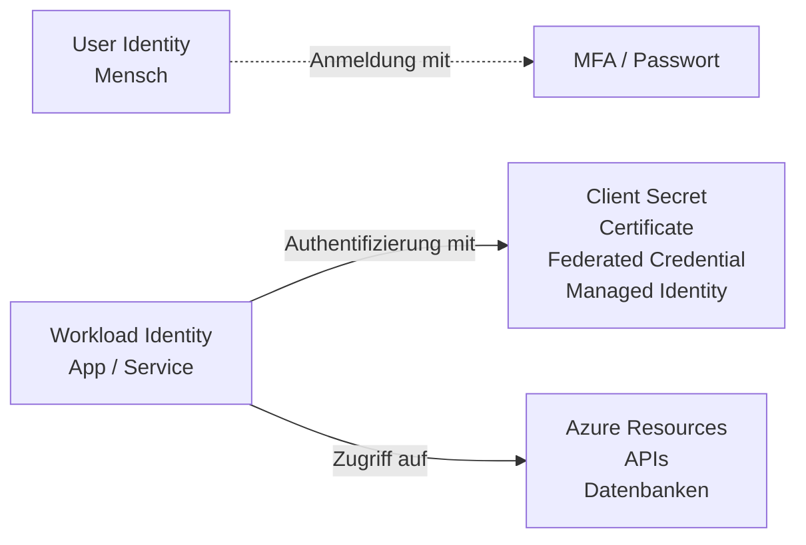
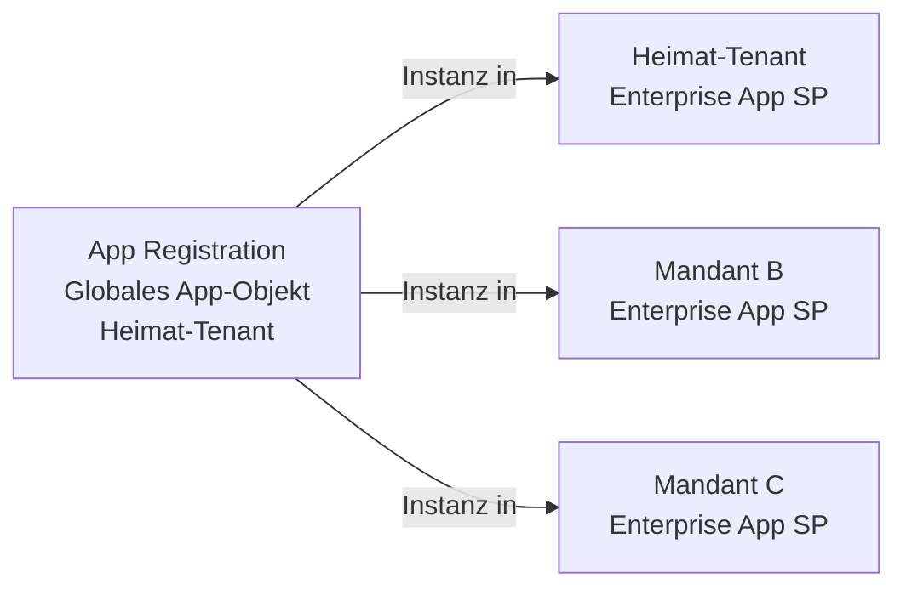
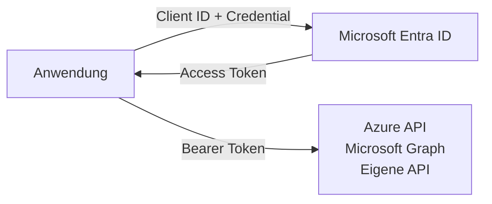
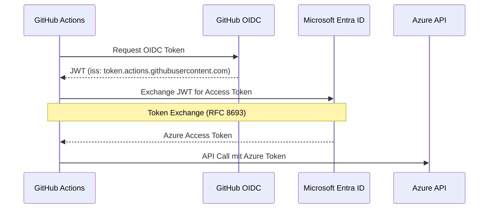
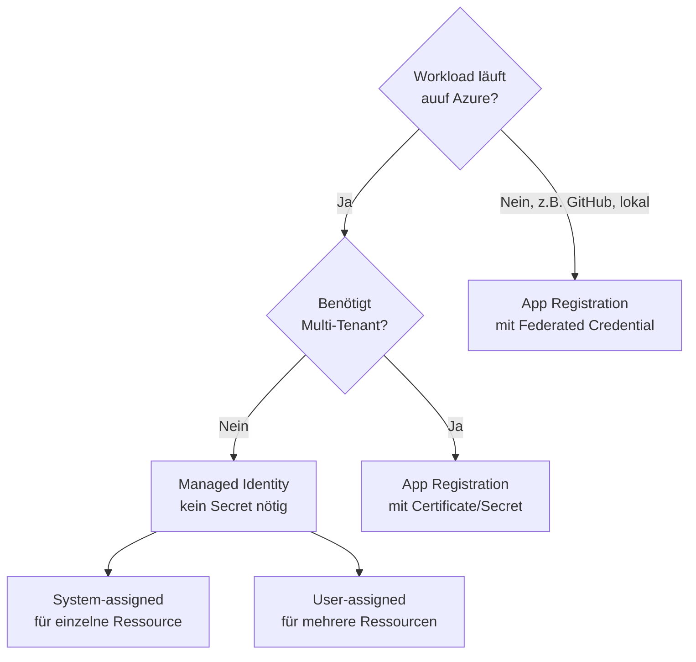
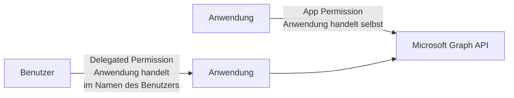
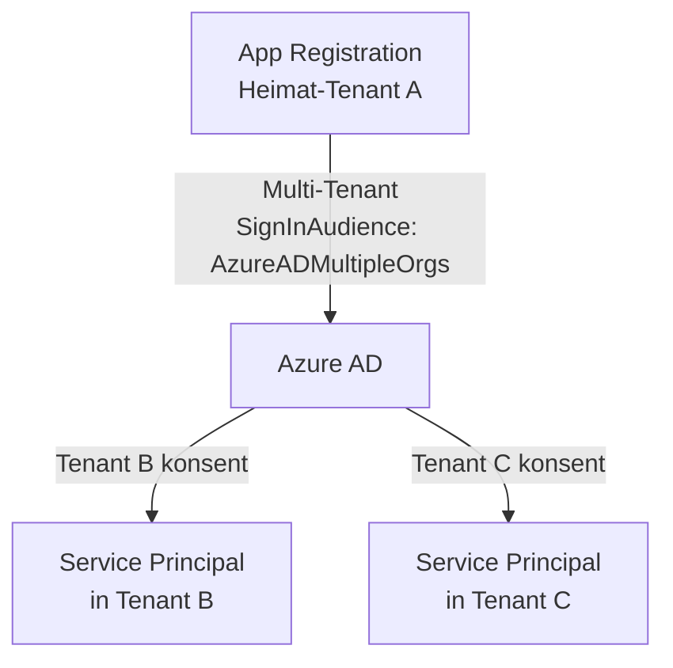

---
tags:
  - azure
  - workload-identity
  - service-principal
  - app-registration
  - oauth
  - oidc
  - identität
  - federated-credentials
aliases:
  - Workload Identity
  - Service Principal Azure
  - App Registration Azure
  - Federated Credentials Azure
  - Entra Workload ID
---

# Microsoft Entra Workload ID

> [!ABSTRACT] TL;DR
> Workload Identities sind Identitäten für Software-Workloads (Apps, Services, Scripts, CI/CD Pipelines) — nicht für Menschen. Microsoft Entra bietet drei Haupttypen: **App Registrations** (Multi-Tenant, für externe Apps), **Service Principals** (mandantenspezifische Instanz) und **Managed Identities** (Azure-only, kein Secret nötig). Die moderne Empfehlung: Managed Identity für Azure-Ressourcen, Federated Credentials für CI/CD und Kubernetes.

---

## Was sind Workload Identities?

Eine **Workload Identity** ist eine Identität, die einer Softwareanwendung, einem Service, einem Script oder einer CI/CD-Pipeline zugeordnet wird — im Gegensatz zu User Identities (für Menschen).



**Warum separat von User Identities?**
- Apps müssen sich ohne menschliche Interaktion authentifizieren
- Apps brauchen andere Berechtigungen als Menschen
- Lifecycle-Management unterschiedlich (App lebt länger als Mitarbeiter)
- Separate Überwachung und Audit möglich

---

## App Registration vs. Enterprise Application

Das ist ein häufiges Missverständnis:



| Aspekt | App Registration | Enterprise Application (Service Principal) |
|--------|-----------------|------------------------------------------|
| **Was ist es?** | Globale App-Definition (Blueprint) | Lokale Instanz der App im Tenant |
| **Wo verwaltet** | Entra ID → App Registrations | Entra ID → Enterprise Applications |
| **Scope** | Anwendungsübergreifend (Multi-Tenant möglich) | Immer mandantenspezifisch |
| **Credentials** | Client Secrets, Certificates, Federated Credentials | — (erbt von App Registration) |
| **Berechtigungen** | App Permissions definieren | Admin Consent erteilen, Conditional Access |
| **Erstellt durch** | Entwickler/Admin manuell | Automatisch bei Consent oder Service-Erstellung |

> [!NOTE] Single-Tenant App
> Bei einer Single-Tenant App Registration wird automatisch ein Service Principal im eigenen Tenant erstellt. Bei Multi-Tenant wird für jeden Tenant, der der App zustimmt, ein Service Principal erstellt.

---

## Service Principals

Drei Typen von Service Principals in Entra ID:

| Typ | Erstellt durch | Beschreibung |
|-----|---------------|-------------|
| **Application SP** | App Registration | Instanz einer registrierten App |
| **Managed Identity SP** | Azure-Dienste | Automatisch für Azure-Ressourcen (VM, App Service, etc.) |
| **Legacy SP** | Ältere Azure-Services | Z.B. von klassischen Azure-Diensten (selten) |

```powershell
# Service Principal anzeigen
Get-AzADServicePrincipal -DisplayName "myapp-prod"

# Service Principal für Managed Identity anzeigen
Get-AzADServicePrincipal -ObjectId "00000000-0000-0000-0000-000000000000"
```

---

## Client Credentials

Apps authentifizieren sich gegenüber Entra ID mit **Client Credentials**:



### Vergleich der Credential-Typen

| Credential | Sicherheit | Rotation | Empfehlung |
|-----------|-----------|----------|-----------|
| **Client Secret** | Niedrig (String) | Manuell, Ablaufdatum | Nur wenn keine Alternative |
| **Certificate** | Mittel-Hoch (Private Key) | Manuell, Ablaufdatum | Besser als Secret |
| **Federated Credential** | Hoch (kein Secret) | Nicht nötig | **Bevorzugt für CI/CD** |
| **Managed Identity** | Hoch (Azure-verwaltet) | Automatisch | **Bevorzugt für Azure** |

### Client Secret

```powershell
# App Registration erstellen
$app = New-AzADApplication -DisplayName "myapp-prod" -SignInAudience "AzureADMyOrg"

# Client Secret erstellen (Ablauf: 1 Jahr)
$secret = New-AzADAppCredential `
  -ApplicationId $app.AppId `
  -EndDate (Get-Date).AddYears(1)

Write-Output "Client ID: $($app.AppId)"
Write-Output "Client Secret: $($secret.SecretText)" # Nur einmal sichtbar!
```

> [!DANGER] Client Secrets sind gefährlich
> Client Secrets sind im Grunde Passwörter. Sie können kopiert, weitergegeben und vergessen (nicht rotiert) werden. Wenn sie kompromittiert werden, ist der gesamte Zugriff der App gefährdet. Immer Federated Credentials oder Managed Identity bevorzugen.

### Certificate

```powershell
# Selbst-signiertes Zertifikat erstellen
$cert = New-SelfSignedCertificate `
  -Subject "CN=myapp-prod" `
  -KeyExportPolicy Exportable `
  -NotAfter (Get-Date).AddYears(1) `
  -KeySpec Signature

# Zertifikat als App-Credential hinzufügen
$certBase64 = [Convert]::ToBase64String($cert.GetRawCertData())
New-AzADAppCredential `
  -ApplicationId $app.AppId `
  -CertValue $certBase64 `
  -EndDate $cert.NotAfter
```

---

## Federated Identity Credentials (Kein Secret nötig!)

**Federated Credentials** ermöglichen es externen Identity Providern (GitHub, Kubernetes, etc.), Token auszustellen, die direkt gegen Entra ID getauscht werden:



**Vorteile:**
- Kein Secret wird gespeichert (weder in GitHub noch in Azure)
- Keine Rotation nötig
- Der externe IdP stellt sicher, dass nur der richtige Workflow ein Token bekommt

### GitHub Actions Federated Credential

```powershell
# App Registration erstellen
$app = New-AzADApplication -DisplayName "github-actions-prod"

# Federated Credential für GitHub Actions hinzufügen
New-AzADAppFederatedIdentityCredential `
  -ApplicationObjectId $app.Id `
  -Audience "api://AzureADTokenExchange" `
  -Issuer "https://token.actions.githubusercontent.com" `
  -Name "github-actions-main-branch" `
  -Subject "repo:myorg/myrepo:ref:refs/heads/main"
```

**GitHub Actions Workflow:**

```yaml
name: Deploy to Azure
on:
  push:
    branches: [main]

permissions:
  id-token: write
  contents: read

jobs:
  deploy:
    runs-on: ubuntu-latest
    steps:
      - uses: azure/login@v2
        with:
          client-id: ${{ secrets.AZURE_CLIENT_ID }}
          tenant-id: ${{ secrets.AZURE_TENANT_ID }}
          subscription-id: ${{ secrets.AZURE_SUBSCRIPTION_ID }}
      
      - name: Deploy
        run: az webapp deployment source config-zip ...
```

### Kubernetes / AKS Workload Identity

```powershell
# Federated Credential für Kubernetes Service Account
New-AzADAppFederatedIdentityCredential `
  -ApplicationObjectId $app.Id `
  -Audience "api://AzureADTokenExchange" `
  -Issuer "https://oidc.prod-aks.azure.com/{tenant-id}/" `
  -Name "aks-workload-identity" `
  -Subject "system:serviceaccount:production:myapp-sa"
```

**Subject-Formate für verschiedene Plattformen:**

| Plattform | Subject-Format |
|-----------|---------------|
| GitHub Actions (Branch) | `repo:org/repo:ref:refs/heads/main` |
| GitHub Actions (Environment) | `repo:org/repo:environment:production` |
| GitHub Actions (PR) | `repo:org/repo:pull_request` |
| Kubernetes | `system:serviceaccount:namespace:serviceaccount-name` |
| Azure DevOps | `sc://org/project/service-connection` |

---

## Managed Identity vs. App Registration



| Kriterium | Managed Identity | App Registration |
|-----------|-----------------|-----------------|
| **Azure-Ressource** | ✅ Beste Wahl | Möglich |
| **CI/CD Pipeline** | Begrenzt | ✅ Mit Federated Cred |
| **Kubernetes** | ✅ AKS Workload Identity | ✅ Federated Cred |
| **On-Premises** | ❌ Nicht möglich | ✅ |
| **Multi-Tenant** | ❌ Single-Tenant only | ✅ |
| **Secret Rotation** | Automatisch | Manuell nötig |
| **Komplexität** | Gering | Mittel |

---

## Entra Workload ID Premium

**Premium-Features** (zusätzliche Lizenz erforderlich):

| Feature | Beschreibung |
|---------|-------------|
| **Conditional Access für Workloads** | Policies für Service Principals (IP-Beschränkung, etc.) |
| **Anomaly Detection** | Erkennung ungewöhnlicher Sign-in-Muster bei Service Principals |
| **Access Reviews für Service Principals** | Regelmäßige Überprüfung von SP-Zugriffen |
| **Identity Protection für Workloads** | Risikobasierte Richtlinien für App-Identitäten |

> [!NOTE] Lizenzierung
> Entra Workload ID Premium kostet ca. $3/Workload Identity/Monat (Stand 2024). Freie Features sind ausreichend für die meisten Szenarien — Premium lohnt sich bei hohen Compliance-Anforderungen.

---

## App Permissions vs. Delegated Permissions



| Aspekt | App Permission | Delegated Permission |
|--------|---------------|---------------------|
| **Wer handelt** | Die Anwendung selbst | Die Anwendung im Namen eines Benutzers |
| **Auth-Flow** | Client Credentials Flow | Authorization Code Flow / On-Behalf-Of |
| **Einwilligung** | Admin Consent erforderlich | User Consent (oder Admin Consent) |
| **Bereich** | Global (alle Ressourcen) | Auf Benutzerkontext beschränkt |
| **Anwendungsfall** | Background Services, Daemons | Interaktive Apps mit Benutzer-Login |

### Admin Consent

```powershell
# Admin Consent für App-Berechtigungen erteilen (via Graph API)
$graphApiId = "00000003-0000-0000-c000-000000000000" # Microsoft Graph

# Mail.Send-Berechtigung hinzufügen
Add-AzADAppPermission `
  -ApplicationId $app.AppId `
  -ApiId $graphApiId `
  -PermissionId "b633e1c5-b582-4048-a93e-9f11b44c7e96" ` # Mail.Send (Application)
  -Type Role

# Admin Consent erteilen (erfordert Global Admin oder Privileged Role Admin)
# Im Portal: App Registration → API Permissions → Grant admin consent
```

---

## Häufige Microsoft Graph Permissions

| Permission | Typ | Beschreibung |
|-----------|-----|-------------|
| `User.Read` | Delegated | Eigenes Profil lesen |
| `User.Read.All` | Application | Alle Benutzerprofile lesen |
| `Mail.Send` | Application | E-Mails im Namen beliebiger Benutzer senden |
| `Mail.ReadWrite` | Application | E-Mails lesen/schreiben |
| `Directory.Read.All` | Application | Verzeichnis-Objekte lesen |
| `GroupMember.Read.All` | Application | Gruppenmitgliedschaften lesen |
| `Sites.ReadWrite.All` | Application | SharePoint Sites lesen/schreiben |
| `Calendars.ReadWrite` | Application | Kalender verwalten |

> [!WARNING] Principle of Least Privilege
> Immer nur die minimal nötigen Permissions beantragen. `Directory.ReadWrite.All` sollte selten vergeben werden — fast immer gibt es eine spezifischere Permission.

---

## Multi-Tenant Apps



```powershell
# Multi-Tenant App erstellen
New-AzADApplication `
  -DisplayName "myapp-multitenant" `
  -SignInAudience "AzureADMultipleOrgs"

# Redirect URI für Multi-Tenant-Consent
# https://login.microsoftonline.com/common/oauth2/v2.0/authorize?...&prompt=admin_consent
```

---

## App Secret Rotation Best Practices

> [!DANGER] Ablaufende Secrets = Produktionsausfälle
> Abgelaufene Client Secrets sind eine der häufigsten Ursachen für ungeplante Ausfälle. Ohne automatisches Monitoring werden ablaufende Secrets oft erst bemerkt, wenn sie bereits abgelaufen sind.

**Monitoring ablaufender Secrets:**

```kusto
// Azure Monitor Alert — App Registrations mit bald ablaufenden Secrets
// (via Microsoft Graph und Logic App oder Azure Function)
```

```powershell
# Alle App Registrations mit ablaufenden Secrets (PowerShell)
Get-AzADApplication | ForEach-Object {
  $app = $_
  Get-AzADAppCredential -ApplicationId $app.AppId | Where-Object {
    $_.EndDate -lt (Get-Date).AddDays(30)
  } | ForEach-Object {
    [PSCustomObject]@{
      AppName = $app.DisplayName
      AppId = $app.AppId
      ExpiresOn = $_.EndDate
      DaysLeft = ($_.EndDate - (Get-Date)).Days
    }
  }
} | Sort-Object DaysLeft | Format-Table
```

**Rotation-Strategie:**
1. Neues Secret/Zertifikat erstellen (beide noch gültig)
2. Anwendung auf neues Secret umstellen und deployen
3. Altes Secret löschen
4. Erinnerung 60 Tage vor nächstem Ablauf setzen

---

## Fehlerbehebung: AADSTS Fehler

| Fehlercode | Beschreibung | Lösung |
|-----------|-------------|--------|
| **AADSTS70011** | Ungültiger Scope (`invalid_scope`) | Scope-Parameter prüfen, muss korrekte API enthalten |
| **AADSTS700016** | App nicht im Tenant gefunden | Tenant-ID prüfen, App korrekt registriert? |
| **AADSTS65001** | Admin Consent fehlt | Admin Consent im Portal erteilen |
| **AADSTS50105** | Benutzer nicht in App-Rolle | Enterprise App → Users and groups → User zuweisen |
| **AADSTS7000215** | Ungültiges Client Secret | Secret korrekt, nicht abgelaufen? |
| **AADSTS700024** | Client Assertion abgelaufen | Systemzeit auf Client prüfen (Zeitdrift!) |
| **AADSTS70021** | Kein Matching Federated Credential | Subject-Claim prüft auf exakten Match |

```powershell
# Token-Details für Debugging anzeigen (auf Claims prüfen)
$tokenPayload = $accessToken.Split('.')[1]
$tokenPayload = $tokenPayload + '=' * (4 - $tokenPayload.Length % 4)
[System.Text.Encoding]::UTF8.GetString([Convert]::FromBase64String($tokenPayload)) | 
  ConvertFrom-Json | Format-List
```

---

## Verwandte Notizen

- [[Azure RBAC]]
- [[Azure Managed Identities]]
- [[Azure Key Vault]]
