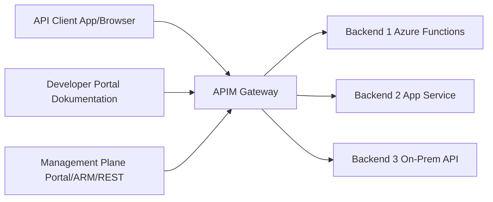
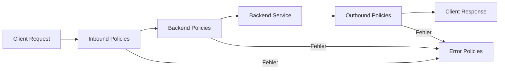
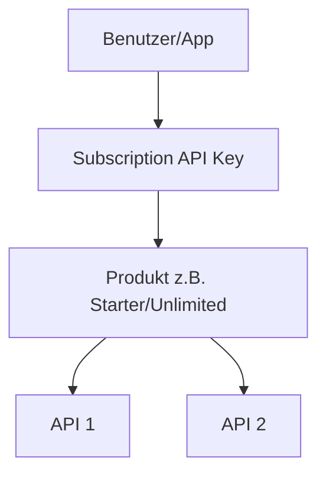
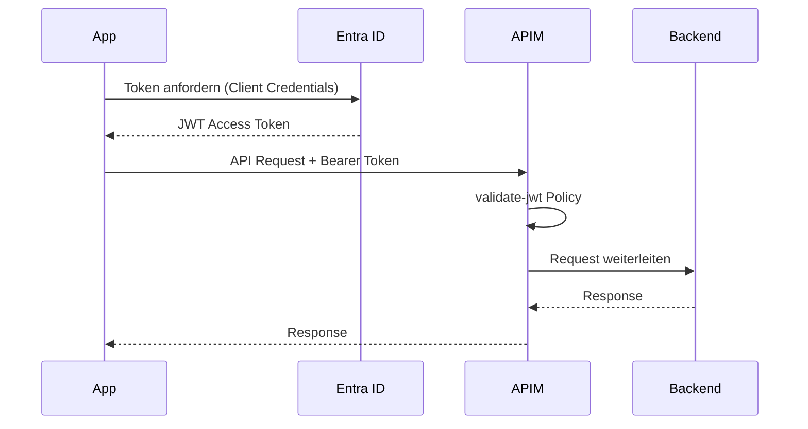
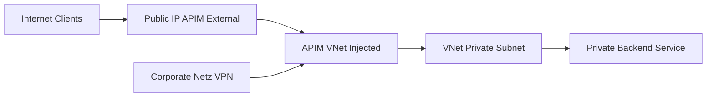

# Azure API Management

> [!ABSTRACT]
> Azure API Management (APIM) ist ein vollständig verwalteter API-Gateway-Dienst, der Unternehmen ermöglicht, APIs zu veröffentlichen, zu sichern, zu überwachen und zu monetarisieren. APIM fungiert als zentrale Kontrollebene für alle APIs – intern und extern.

---

## Was ist Azure API Management?

APIM ist die **zentrale API-Plattform** in der Azure Integration Services-Familie. Sie trennt API-Konsumenten von Backend-Implementierungen und bietet Querschnittsfunktionen wie Authentifizierung, Rate Limiting, Caching und Transformation.



---

## Architektur

### Gateway
- Nimmt API-Anfragen entgegen und leitet sie ans Backend weiter
- Wendet **Policies** an (Inbound → Backend → Outbound → Error)
- Handhabt Authentifizierung, Rate Limiting, Caching, Transformation
- Verfügbar als gehosteter Azure-Dienst oder als **Self-Hosted Gateway**

### Management Plane
- Azure Portal, ARM/Bicep, REST API, PowerShell
- Konfiguration von APIs, Produkten, Abonnements, Benutzern
- Publisher Portal für API-Anbieter

### Developer Portal
- Automatisch generiertes Portal für API-Konsumenten
- Interaktive API-Dokumentation (Try-it)
- Self-Service API-Abonnements
- Anpassbar per CMS (eigenes Branding, Custom-Domain)

---

## APIM Tiers

| Tier | SLA | Einheiten | VNet | Self-Hosted GW | Einsatz |
|---|---|---|---|---|---|
| **Consumption** | 99,95 % | Serverlos | ❌ | ❌ | Prototypen, Dev/Test |
| **Developer** | Kein SLA | 1 | VNet Injection | ❌ | Entwicklung/Test |
| **Basic** | 99,95 % | 1–2 | ❌ | ❌ | Kleine Projekte |
| **Basic v2** | 99,95 % | 1–3 | VNet Integration | ❌ | Kleine Projekte |
| **Standard** | 99,95 % | 1–4 | ❌ | ✅ | Produktion mittelgroß |
| **Standard v2** | 99,95 % | 1–10 | VNet Integration | ✅ | Produktion mittelgroß |
| **Premium** | 99,99 % | Multi-Region | VNet Injection | ✅ | Enterprise/Multi-Region |

> [!NOTE]
> Die **v2-Tiers** (Basic v2, Standard v2) sind die neue Generation – schnellere Bereitstellung (~Minuten statt Stunden), bessere VNet-Integration. Empfohlen für neue Deployments.

---

## API-Import

APIM unterstützt den Import aus verschiedenen Quellen:

| Quelle | Format | Beschreibung |
|---|---|---|
| **OpenAPI** | YAML/JSON | Swagger 2.0 oder OpenAPI 3.0 |
| **WSDL** | XML | SOAP-Webservices (SOAP-to-REST möglich) |
| **WADL** | XML | Web Application Description Language |
| **Azure App Service** | Automatisch | Direkte Integration |
| **Azure Functions** | Automatisch | Function Keys als Backend-Auth |
| **AKS / Container Apps** | via URL | Cluster-Services |
| **Logic Apps** | Automatisch | HTTP-Trigger Workflows |
| **GraphQL** | Schema | GraphQL-Passthrough oder synthetisch |

```powershell
# API aus OpenAPI-Spec importieren
az apim api import `
  --resource-group myRG `
  --service-name myAPIM `
  --api-id petstore-api `
  --path /petstore `
  --specification-format OpenApiJson `
  --specification-url "https://petstore3.swagger.io/api/v3/openapi.json"
```

---

## Policies

Policies sind das Herzstück von APIM. Sie werden als XML-Dokument definiert und in vier Phasen ausgeführt:



### Wichtige Policy-Beispiele

**Rate Limiting:**
```xml
<rate-limit-by-key calls="100" renewal-period="60"
  counter-key="@(context.Subscription.Id)" />
```

**JWT Validierung (Entra ID):**
```xml
<validate-jwt header-name="Authorization" failed-validation-httpcode="401">
  <openid-config url="https://login.microsoftonline.com/{tenant}/v2.0/.well-known/openid-configuration" />
  <required-claims>
    <claim name="aud">
      <value>api://myapi-client-id</value>
    </claim>
  </required-claims>
</validate-jwt>
```

**URL Rewrite:**
```xml
<rewrite-uri template="/api/v2/{resource}" copy-unmatched-params="true" />
```

**Response Caching:**
```xml
<cache-lookup vary-by-developer="false" vary-by-developer-groups="false">
  <vary-by-header>Accept</vary-by-header>
</cache-lookup>
<!-- im Outbound: -->
<cache-store duration="3600" />
```

**Mock Response:**
```xml
<mock-response status-code="200" content-type="application/json" />
```

**Header setzen:**
```xml
<set-header name="X-Forwarded-For" exists-action="override">
  <value>@(context.Request.IpAddress)</value>
</set-header>
```

**CORS:**
```xml
<cors allow-credentials="true">
  <allowed-origins>
    <origin>https://myapp.example.com</origin>
  </allowed-origins>
  <allowed-methods>
    <method>GET</method>
    <method>POST</method>
  </allowed-methods>
</cors>
```

---

## API Subscriptions und API Keys



- **Produkte** bündeln mehrere APIs
- **Subscriptions** geben Zugriff auf ein Produkt
- Jede Subscription hat einen **Primary** und **Secondary Key**
- Übermittlung per Header (`Ocp-Apim-Subscription-Key`) oder Query Parameter

```powershell
# Subscription erstellen
az apim subscription create `
  --resource-group myRG `
  --service-name myAPIM `
  --name my-app-subscription `
  --display-name "My App" `
  --scope "/products/starter"
```

---

## OAuth 2.0 / JWT Validation mit Entra ID



> [!IMPORTANT]
> Für Backend-zu-Backend (M2M) nutze den **Client Credentials Flow**. Für User-kontext-sensitive APIs nutze **Authorization Code Flow mit PKCE**.

---

## Developer Portal

- Automatisch generiert aus API-Definitionen
- Unterstützt **OpenAPI Try-It** direkt im Browser
- Anpassbar: eigene CSS, JavaScript, Seiten
- Custom-Domain und eigene AAD-Authentifizierung möglich
- Self-Service-Registrierung und API-Key-Verwaltung für Entwickler

```powershell
# Developer Portal publizieren
az apim portal publish --resource-group myRG --name myAPIM
```

---

## Versionierung und Revisionen

### Versionen
Ermöglicht parallelen Betrieb mehrerer API-Versionen:
- **URL-Pfad:** `/api/v1/`, `/api/v2/`
- **Query-Parameter:** `?api-version=2024-01-01`
- **HTTP-Header:** `Api-Version: 2.0`

### Revisionen
Ermöglicht nicht-breaking Changes ohne neue Version:
- Revision = Draft-Version einer API
- Kann getestet werden ohne Produktions-Traffic zu beeinflussen
- Nach Freigabe wird sie zur aktuellen Revision

> [!TIP]
> **Versionen** für breaking changes (neue URL, geändertes Schema). **Revisionen** für kleine, nicht-breaking Änderungen (neue optionale Parameter, Dokumentations-Updates).

---

## Backends und Backend Load Balancing

APIM unterstützt **Backend-Entitäten** für zentrales Management:

```xml
<!-- Backend mit Circuit Breaker -->
<backends>
  <backend id="mybackend">
    <url>https://my-api.internal.azure.com</url>
    <circuit-breaker>
      <rules>
        <rule name="myBreaker" trip-duration="PT10S"
          accept-retry-after="false">
          <conditions>
            <status-code status-code-range-start="500"
              status-code-range-end="599" />
          </conditions>
        </rule>
      </rules>
    </circuit-breaker>
  </backend>
</backends>
```

**Load Balancing Pool:**
```xml
<set-backend-service backend-id="mypool" />
<!-- Pool mit mehreren Backends und Gewichtung -->
```

---

## VNet-Integration

### External Mode (VNet Injection)
- APIM erhält eine öffentliche IP + private IP im VNet
- Internet-Traffic erreicht APIM
- APIM kann private Backends im VNet ansprechen

### Internal Mode (VNet Injection)
- APIM hat **keine** öffentliche IP
- Nur über Private Endpoint oder VPN/ExpressRoute erreichbar
- Maximale Isolation für interne APIs

### Private Endpoint (v2 Tiers)
- Einfachere Alternative zu VNet Injection
- APIM bleibt multi-tenant, aber Inbound via Private Endpoint



---

## Monitoring

### Application Insights Integration
```powershell
# Application Insights mit APIM verknüpfen
az apim update `
  --resource-group myRG `
  --name myAPIM `
  --enable-application-insights true `
  --app-insights-connection-string "InstrumentationKey=..."
```

Verfügbare Telemetrie:
- Requests (alle API-Aufrufe mit Metadaten)
- Response Times
- Fehler-Rate
- Backend-Latenz
- Policy-Ausführungszeit

### Azure Monitor Diagnostics
```json
{
  "logs": [
    { "category": "GatewayLogs", "enabled": true }
  ],
  "metrics": [
    { "category": "AllMetrics", "enabled": true }
  ]
}
```

---

## Self-Hosted Gateway

Der Self-Hosted Gateway ermöglicht APIM-Funktionalität **on-premises oder in anderen Clouds**:

```yaml
# Kubernetes Deployment
apiVersion: apps/v1
kind: Deployment
metadata:
  name: apim-gateway
spec:
  replicas: 2
  template:
    spec:
      containers:
      - name: gateway
        image: mcr.microsoft.com/azure-api-management/gateway:latest
        env:
        - name: config.service.endpoint
          value: "https://myapim.configuration.azure-api.net"
        - name: config.service.auth
          valueFrom:
            secretKeyRef:
              name: apim-gateway-token
              key: value
```

> [!NOTE]
> Der Self-Hosted Gateway benötigt eine Netzwerkverbindung zum APIM Management Plane, um Konfigurationsänderungen zu empfangen. Lokal gecachte Konfigurationen funktionieren auch bei Verbindungsunterbrechungen weiter.

---

## Kosten

| Tier | Preis (ca.) | Einheiten | Bemerkung |
|---|---|---|---|
| Consumption | 3,50 €/100k Aufrufe | Serverlos | Keine Grundgebühr |
| Developer | ~50 €/Monat | 1 | Kein SLA |
| Basic v2 | ~140 €/Monat | 1 | Neue Generation |
| Standard v2 | ~700 €/Monat | 1 | Neue Generation |
| Premium | ~2.800 €/Monat | 1 | Multi-Region möglich |

> [!TIP]
> Für Entwicklung und Tests: **Developer-Tier** oder **Consumption**. Für Produktion ohne Multi-Region-Anforderung: **Standard v2**. Für globale Enterprise-APIs: **Premium**.

---

## Verwandte Notizen

- [[Azure Logic Apps]]
- [[Azure Service Bus]]
- [[Application Insights]]
- [[Azure Web Application Firewall]]
