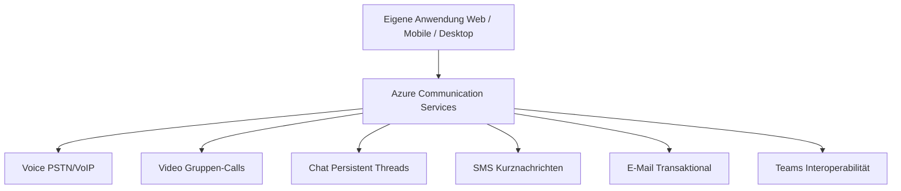
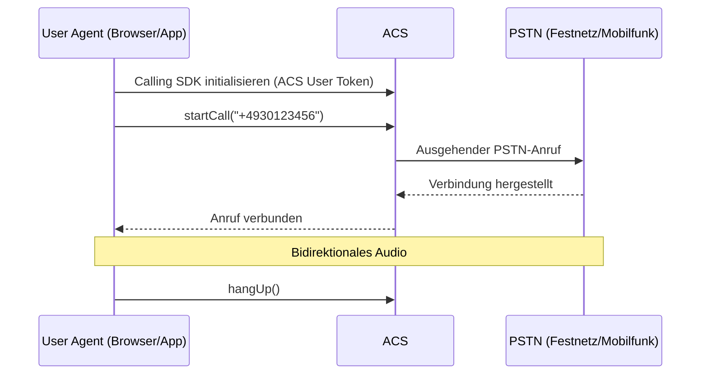
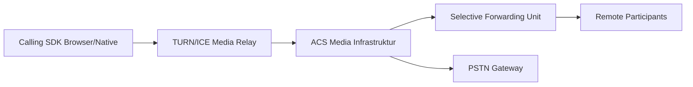
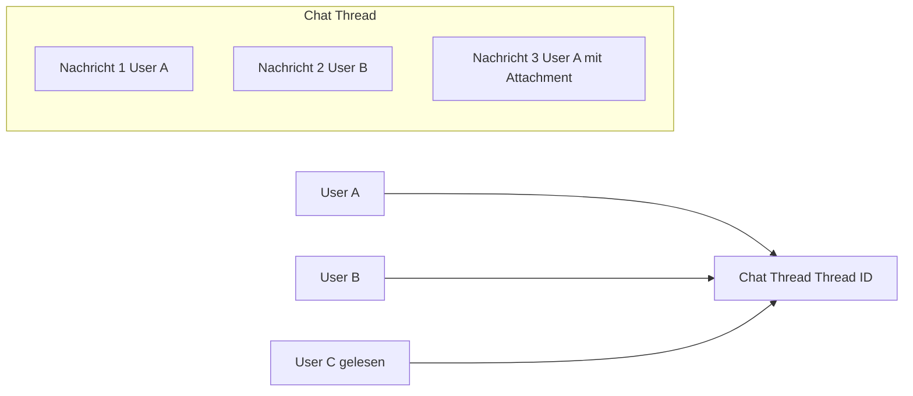
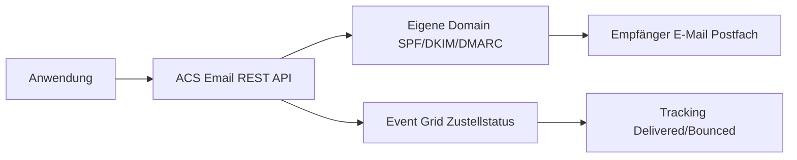
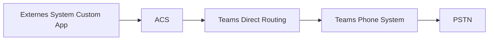

# Azure Communication Services

> [!ABSTRACT]
> Azure Communication Services (ACS) ist Microsofts CPaaS-Plattform (Communications Platform as a Service) – sie ermöglicht die Integration von Voice, Video, Chat, SMS und E-Mail direkt in eigene Anwendungen. ACS teilt dieselbe Infrastruktur wie Microsoft Teams.

---

## Was ist Azure Communication Services?

ACS ist eine **cloudbasierte Kommunikationsplattform**, die Entwicklern ermöglicht, Sprach- und Videoanrufe, Chat, SMS und E-Mail in eigene Anwendungen einzubetten – ohne eigene Telekommunikations-Infrastruktur aufzubauen.



**Typische Anwendungsfälle:**
- **Contact Center** – Eingehende/ausgehende Anrufe in einer Web-App
- **Telemedizin** – Arzt-Patient-Video-Konsultationen
- **Kundensupport** – Live-Chat + Eskalation zu Video/Voice
- **Virtuelle Events** – Webinar-Plattformen mit Custom UI
- **Field Service** – Techniker-App mit Video-Support

---

## CPaaS-Funktionen im Überblick

| Funktion | Kanal | Beschreibung |
|---|---|---|
| **Voice Calling** | VoIP + PSTN | Browser-Anrufe, ausgehende PSTN-Anrufe |
| **Video Calling** | WebRTC | Gruppen-Video, Recording, Bildschirmfreigabe |
| **Chat** | REST + WebSocket | Thread-basierter persistenter Chat |
| **SMS** | PSTN | Kurznachrichten senden und empfangen |
| **E-Mail** | SMTP/REST | Transaktionale E-Mails mit eigener Domain |
| **Teams Interop** | Teams-Infrastruktur | In Teams-Meetings eintreten, Teams Phone |

---

## Voice – Calling SDK

Das Calling SDK ermöglicht **browser-basierte VoIP-Anrufe** und PSTN-Integration:



### JavaScript Calling SDK
```javascript
import { CallClient, AzureCommunicationTokenCredential } from "@azure/communication-calling";

// Calling Client initialisieren
const callClient = new CallClient();
const tokenCredential = new AzureCommunicationTokenCredential(userAccessToken);
const callAgent = await callClient.createCallAgent(tokenCredential, {
  displayName: "Max Mustermann"
});

// Ausgehenden Anruf starten
const call = callAgent.startCall([{ phoneNumber: "+4930123456" }], {
  alternateCallerId: { phoneNumber: "+4989987654" } // Eigene PSTN-Nummer
});

// Anruf beenden
await call.hangUp({ forEveryone: false });

// Eingehende Anrufe empfangen
callAgent.on("incomingCall", async (event) => {
  const incomingCall = event.incomingCall;
  await incomingCall.accept(); // oder incomingCall.reject()
});
```

### Calling SDK Architektur



---

## Video – Gruppen-Calls und Recording

```javascript
// Kamera hinzufügen
const deviceManager = await callClient.getDeviceManager();
const cameras = await deviceManager.getCameras();
const localVideoStream = new LocalVideoStream(cameras[0]);

// Video in Anruf aktivieren
await call.startVideo(localVideoStream);

// Remote Video rendern
call.on("remoteParticipantsUpdated", (event) => {
  event.added.forEach(async (participant) => {
    participant.videoStreams.forEach(async (stream) => {
      if (stream.isAvailable) {
        const renderer = new VideoStreamRenderer(stream);
        const view = await renderer.createView();
        document.getElementById("remoteVideo").appendChild(view.target);
      }
    });
  });
});
```

### Call Recording
```csharp
// Server-seitig: Recording starten
var callAutomationClient = new CallAutomationClient(acsConnectionString);
var recordingOptions = new StartRecordingOptions(
    new ServerCallLocator(serverCallId))
{
    RecordingContent = RecordingContent.AudioAndVideo,
    RecordingChannel = RecordingChannel.Mixed,
    RecordingFormat = RecordingFormat.Mp4
};
var recordingResult = await callAutomationClient.GetCallRecording()
    .StartAsync(recordingOptions);
```

---

## Chat – Thread-basiert und Persistent

ACS Chat verwendet **persistente Threads** – Nachrichten bleiben gespeichert und können abgerufen werden:



```javascript
import { ChatClient } from "@azure/communication-chat";
import { AzureCommunicationTokenCredential } from "@azure/communication-common";

const chatClient = new ChatClient(
  "https://myresource.communication.azure.com",
  new AzureCommunicationTokenCredential(userToken)
);

// Thread erstellen
const createResult = await chatClient.createChatThread(
  { topic: "Support-Anfrage #12345" },
  {
    participants: [
      { id: { communicationUserId: agentUserId }, displayName: "Support Agent" },
      { id: { communicationUserId: customerUserId }, displayName: "Kunde" }
    ]
  }
);
const threadClient = chatClient.getChatThreadClient(createResult.chatThread.id);

// Nachricht senden
await threadClient.sendMessage(
  { content: "Hallo, wie kann ich Ihnen helfen?" },
  { senderDisplayName: "Support Agent", type: "text" }
);

// Echtzeit-Notifications via WebSocket
await chatClient.startRealtimeNotifications();
chatClient.on("chatMessageReceived", (event) => {
  console.log(`${event.senderDisplayName}: ${event.message}`);
});
```

---

## SMS

ACS ermöglicht das Senden und Empfangen von SMS über eigene Rufnummern:

```csharp
// SMS senden
var smsClient = new SmsClient(acsConnectionString);
var response = await smsClient.SendAsync(
    from: "+14155551234",        // Eigene ACS-Rufnummer
    to: "+4917612345678",
    message: "Ihr Bestätigungscode: 482910",
    new SmsSendOptions(enableDeliveryReport: true)
);

Console.WriteLine($"MessageId: {response.Value.MessageId}");
Console.WriteLine($"Successful: {response.Value.Successful}");
```

**Eingehende SMS empfangen** via Event Grid:
```json
{
  "eventType": "Microsoft.Communication.SMSReceived",
  "data": {
    "to": "+14155551234",
    "from": "+4917612345678",
    "message": "Hallo ACS!",
    "receivedTimestamp": "2024-01-15T10:00:00Z"
  }
}
```

---

## E-Mail – ACS Email (Transaktional)

ACS Email ermöglicht transaktionale E-Mails mit eigener Domain:



```csharp
// E-Mail senden
var emailClient = new EmailClient(acsConnectionString);
var emailMessage = new EmailMessage(
    senderAddress: "noreply@mycompany.com",
    recipients: new EmailRecipients(new List<EmailAddress> {
        new EmailAddress("kunde@example.com") { DisplayName = "Max Mustermann" }
    }),
    content: new EmailContent("Ihre Bestellbestätigung #12345")
    {
        PlainText = "Vielen Dank für Ihre Bestellung!",
        Html = "<h1>Vielen Dank!</h1><p>Ihre Bestellung #12345 wurde bestätigt.</p>"
    });

var operation = await emailClient.SendAsync(WaitUntil.Completed, emailMessage);
Console.WriteLine($"Status: {operation.Value.Status}");
```

> [!NOTE]
> ACS Email erfordert **Domain-Verifizierung** (eigene Domain oder Azure-subdomain `*.azurecomm.net`). Für eigene Domains müssen **SPF-, DKIM- und DMARC-DNS-Einträge** konfiguriert werden.

---

## Teams-Interoperabilität

ACS ermöglicht die Integration mit Microsoft Teams auf zwei Arten:

### Teams-Meeting beitreten via ACS
```javascript
// Externe User können Teams-Meetings beitreten (kein Teams-Konto nötig)
const locator = {
  meetingLink: "https://teams.microsoft.com/l/meetup-join/..."
};
const call = callAgent.join(locator, { videoOptions });
```

### Teams Phone mit ACS (Direct Routing)


**Interoperabilitäts-Szenarien:**

| Szenario | Beschreibung |
|---|---|
| **ACS User → Teams Meeting** | Externer User tritt Teams-Meeting bei |
| **Teams User → ACS Call** | Teams-Nutzer ruft ACS-Endpoint an |
| **ACS + Teams Calling** | Hybrides Contact Center |
| **Teams Phone Extension** | ACS als PSTN-Gateway für Teams |

> [!IMPORTANT]
> ACS-Nutzer in Teams-Meetings erscheinen als **externe Gäste** mit eingeschränkten Funktionen (kein Zugriff auf Teams-Chat-History, kein Breakout Room).

---

## Phone Numbers (Rufnummern kaufen)

```powershell
# Verfügbare Rufnummern suchen
az communication phonenumber search-available-phone-numbers \
  --resource-group myRG \
  --communication-service-name myACS \
  --country-code DE \
  --phone-plan-group-id <plan-group-id> \
  --phone-plan-id <plan-id> \
  --area-code 030 \
  --quantity 1
```

**Rufnummern-Typen:**
- **Lokale Nummern** (Geobezogen, z. B. 030 Berlin)
- **Toll-Free Nummern** (Kostenlos für Anrufer)
- **Short Codes** (SMS-Massenzustellung, USA)

---

## Event Grid Integration

ACS publiziert Ereignisse an Event Grid für asynchrone Verarbeitung:

| Event | Beschreibung |
|---|---|
| `SMSReceived` | Eingehende SMS |
| `SMSDeliveryReportReceived` | SMS-Zustellstatus |
| `EmailDeliveryReportReceived` | E-Mail-Zustellstatus |
| `IncomingCall` | Eingehender PSTN-Anruf |
| `RecordingFileStatusUpdated` | Recording abgeschlossen |

```json
{
  "eventType": "Microsoft.Communication.IncomingCall",
  "data": {
    "to": { "rawId": "+14155551234", "kind": "phoneNumber" },
    "from": { "rawId": "+4917612345678", "kind": "phoneNumber" },
    "serverCallId": "aHR0cHM6Ly9...",
    "callerDisplayName": "+4917612345678"
  }
}
```

---

## Identity – ACS User Tokens

ACS verwendet eigene Identitäten – unabhängig von Entra ID (optional koppelbar):

```csharp
// ACS Identity erstellen und Token ausstellen
var identityClient = new CommunicationIdentityClient(acsConnectionString);

// Neue Identity erstellen
var identity = await identityClient.CreateUserAsync();
Console.WriteLine($"User ID: {identity.Value.Id}");

// Token für mehrere Dienste ausstellen
var tokenResult = await identityClient.GetTokenAsync(
    identity.Value,
    scopes: new[] {
        CommunicationTokenScope.Chat,
        CommunicationTokenScope.VoIP
    });

Console.WriteLine($"Token: {tokenResult.Value.Token}");
Console.WriteLine($"Gültig bis: {tokenResult.Value.ExpiresOn}");
```

> [!WARNING]
> ACS User Tokens **niemals** direkt im Client-Code erstellen. Token-Ausstellung immer **server-seitig** – sonst ist der ACS Connection String im Client exponiert.

---

## ACS vs. Twilio

| Merkmal | Azure Communication Services | Twilio |
|---|---|---|
| **Plattform** | Microsoft Azure | Unabhängig |
| **Teams-Integration** | ✅ Native | ❌ (nur via Connector) |
| **Azure-Integration** | ✅ Nativ (Event Grid, Functions) | Via REST |
| **Entra ID** | ✅ Managed Identity | ❌ |
| **Compliance** | Azure-Compliance-Portfolio | Eigenes Portfolio |
| **SMS globale Reichweite** | Mittel (wächst) | Sehr groß |
| **Marktreife Voice** | Gut (wächst) | Sehr ausgereift |
| **Preisstruktur** | Pay-as-you-go (Azure) | Pay-as-you-go |
| **Support-Qualität** | Azure Support-Tiers | Twilio-eigener Support |
| **Video-API** | ✅ Ja | ✅ Twilio Video |
| **Empfehlung** | Azure-native Apps + Teams | Best-of-breed CPaaS |

---

## Kosten

| Dienst | Einheit | Preis (ca.) |
|---|---|---|
| **Voice PSTN eingehend** | Pro Minute | ~0,02 €/min |
| **Voice PSTN ausgehend** | Pro Minute | ~0,04 €/min (EU) |
| **Video** | Pro Nutzer/Minute | ~0,003 €/min |
| **Chat** | Pro Nachricht | ~0,0015 € |
| **SMS senden (DE)** | Pro Nachricht | ~0,05 € |
| **E-Mail** | Pro 1.000 E-Mails | ~0,25 € |
| **Rufnummer mieten** | Pro Monat | ~1–2 € |
| **Recording** | Pro Minute | ~0,002 € |

> [!TIP]
> Für **interne Microsoft-365-Nutzer** ist oft Teams direkt die bessere Wahl. ACS glänzt bei **externen Nutzern ohne Teams-Konto** und bei der Integration in eigene Anwendungen mit Custom UI.

---

---

## Via Azure Portal (UI)

> [!TIP]
> Portal: **[portal.azure.com](https://portal.azure.com)**

**Communication Services-Ressource erstellen:**
1. [portal.azure.com](https://portal.azure.com) → **+ Ressource erstellen** → **Communication Services**
2. Ressourcengruppe, Name und Region (Data-at-rest) wählen → **Erstellen**

**Verbindungszeichenfolge abrufen:**
- Ressource öffnen → **Schlüssel** → **Verbindungszeichenfolge** oder **Zugriffsschlüssel** kopieren

**Telefonnummer kaufen:**
- Ressource → **Telefonnummern** → **+ Erhalten** → Land, Typ (Lokal/Gebührenfrei) und Funktionen wählen → **Kaufen**

**E-Mail-Domäne konfigurieren:**
- Ressource → **E-Mail** → **+ Domänen hinzufügen** → Azure-Domäne (kostenlos) oder eigene Domäne verifizieren

**Teams-Interoperabilität aktivieren:**
- Ressource → **Teams-Interoperabilität** → Aktivieren → Teams Tenant-ID eintragen

**Nutzung und Monitoring:**
- Ressource → **Überwachung** → **Metriken** → Anrufminuten, gesendete SMS, E-Mails anzeigen

---

## Verwandte Notizen

- [[Azure Web PubSub]]
- [[Azure Event Grid]]
- [[Azure Logic Apps]]
