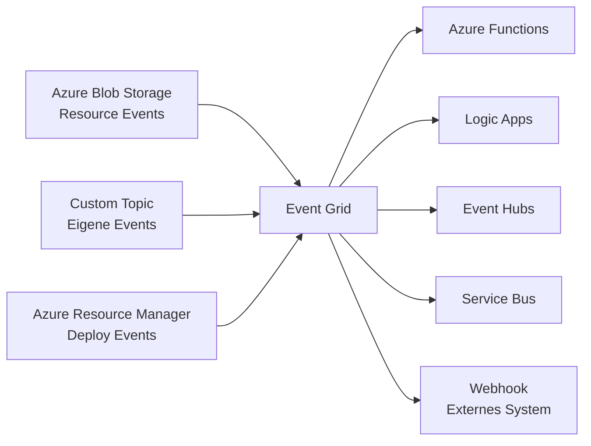
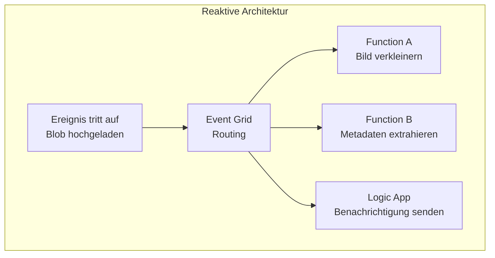
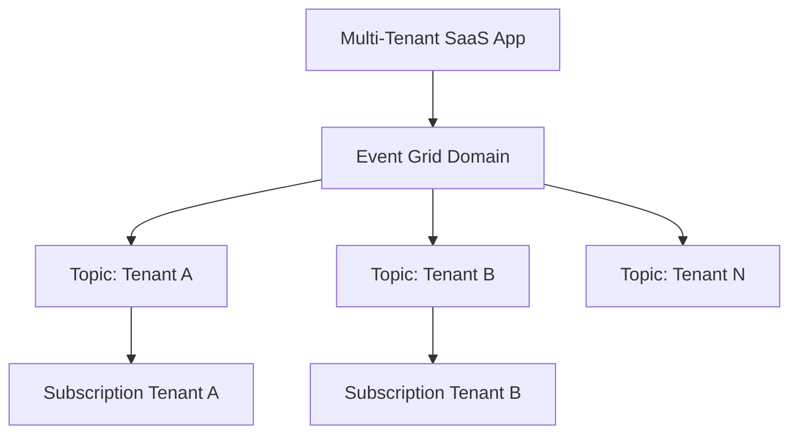
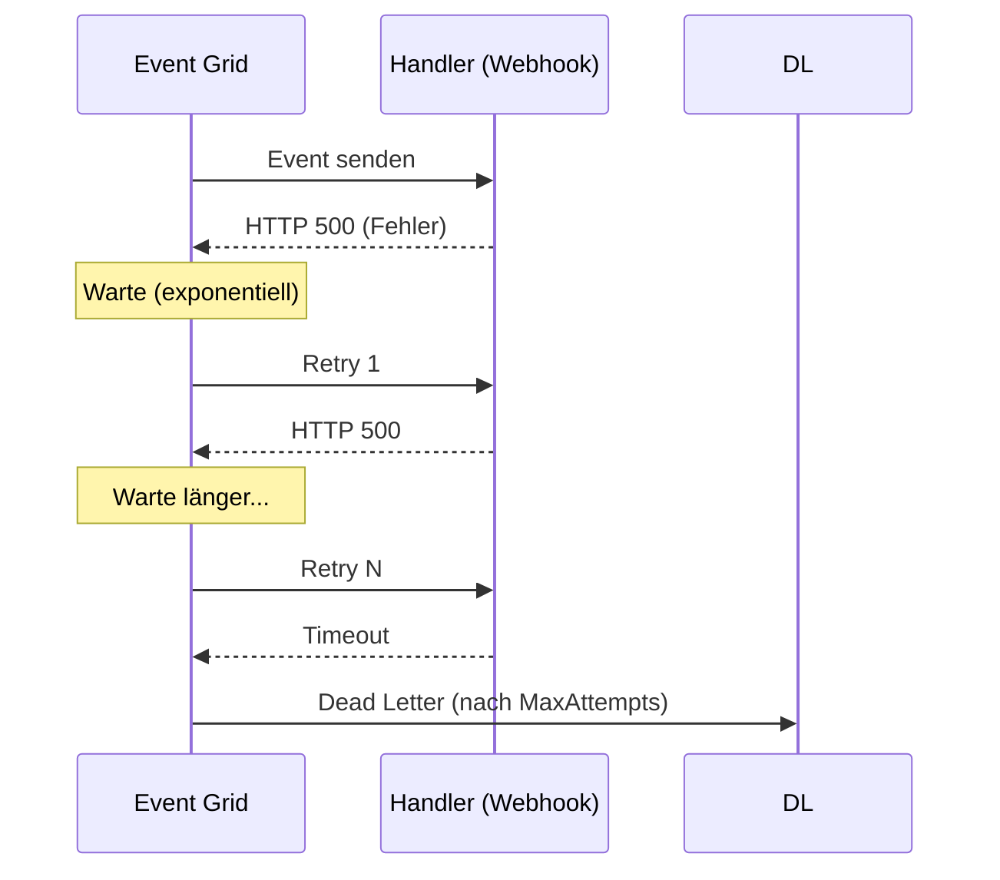
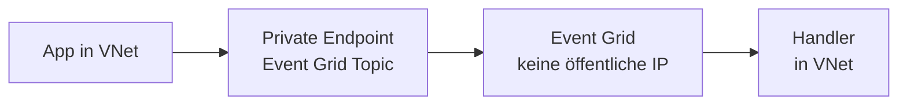

# Azure Event Grid

> [!ABSTRACT]
> Azure Event Grid ist ein vollständig verwalteter Event-Routing-Dienst, der eine reaktive, event-getriebene Architektur ermöglicht. Er verbindet Ereignisquellen (Azure-Dienste, Custom Apps) mit Event-Handlern (Functions, Logic Apps, Webhooks) über ein zuverlässiges Pub/Sub-Modell.

---

## Was ist Azure Event Grid?

Event Grid ist der **zentrale Event-Router** in Azure – konzipiert für **Push-basierte, reaktive Verarbeitung** von Ereignissen. Im Gegensatz zu Service Bus (garantierte Zustellung, Transaktionen) oder Event Hubs (Streaming) ist Event Grid für **einfache, skalierbare Event-Weiterleitung** optimiert.



**Kernprinzipien:**
- **Push-basiert:** Event Grid sendet Events aktiv an Handler (kein Polling)
- **At-Least-Once:** Jedes Event wird mindestens einmal zugestellt
- **Bis 24h Retry:** Bei Fehlern bis zu 24 Stunden Wiederholungsversuche
- **Massiver Durchsatz:** Millionen Events pro Sekunde möglich

---

## Event-getriebene Architektur



**Vorteile:**
- Kein Polling der Quelle nötig
- Loser Kopplung zwischen Produzenten und Konsumenten
- Horizontal skalierbar ohne Konfigurationsaufwand
- Einfachere Architektur für Reaktion auf Zustandsänderungen

---

## Ereignisquellen

### System Topics (Azure-interne Dienste)

| Azure-Dienst | Beispiel-Events |
|---|---|
| **Blob Storage** | BlobCreated, BlobDeleted |
| **Resource Manager** | ResourceWriteSuccess, ResourceDeleteSuccess |
| **IoT Hub** | DeviceTelemetry, DeviceConnected |
| **Container Registry** | ImagePushed, ImageDeleted |
| **Azure Maps** | GeofenceEntered, GeofenceExited |
| **Service Bus** | ActiveMessagesAvailableWithNoListeners |
| **Event Hubs** | CaptureFileCreated |
| **App Service** | BackupOperationCompleted |
| **SignalR Service** | ClientConnectionConnected |

### Custom Topics
Eigene Ereignisquellen – beliebige Anwendungen können Events an ein Custom Topic publishen:

```bash
# Custom Topic erstellen
az eventgrid topic create \
  --name my-custom-topic \
  --resource-group myRG \
  --location westeurope

# Endpoint und Key abfragen
ENDPOINT=$(az eventgrid topic show --name my-custom-topic -g myRG --query endpoint -o tsv)
KEY=$(az eventgrid topic key list --name my-custom-topic -g myRG --query key1 -o tsv)
```

**Event publishen:**
```bash
curl -X POST "$ENDPOINT/api/events" \
  -H "aeg-sas-key: $KEY" \
  -H "Content-Type: application/json" \
  -d '[{
    "id": "evt-001",
    "eventType": "MyApp.OrderCreated",
    "subject": "orders/12345",
    "eventTime": "2024-01-15T10:00:00Z",
    "data": { "orderId": "12345", "amount": 99.99 },
    "dataVersion": "1.0"
  }]'
```

### Partner Topics
- Externe SaaS-Anbieter (SAP, Auth0, Tribal, usw.) als Event-Quellen
- Erfordert Aktivierung im Azure Marketplace

---

## Ereignis-Handler

| Handler | Beschreibung |
|---|---|
| **Azure Functions** | Serverlose Verarbeitung (Event Grid Trigger) |
| **Logic Apps** | Workflow-Automatisierung |
| **Event Hubs** | Stream-Weiterleitung für Analyse |
| **Service Bus Queue/Topic** | Zuverlässige Weiterverarbeitung |
| **Azure Storage Queue** | Einfache Queue-Integration |
| **Webhook** | Beliebige HTTP-Endpunkte |
| **Azure Monitor** | Alerting und Diagnostics |

---

## Event Grid Topics

### System Topics
- Automatisch für jeden Azure-Dienst verfügbar
- Kein Topic muss manuell erstellt werden
- Subscription direkt auf die Azure-Ressource

```powershell
# System Topic Subscription für Blob Storage
New-AzEventGridSystemTopicEventSubscription `
  -ResourceGroupName "myRG" `
  -SystemTopicName "my-storage-system-topic" `
  -EventSubscriptionName "process-uploads" `
  -EndpointType "AzureFunction" `
  -Endpoint "/subscriptions/.../functions/ProcessUpload" `
  -IncludedEventType "Microsoft.Storage.BlobCreated"
```

### Custom Topics
- Manuelle Erstellung für eigene Event-Quellen
- Globaler Endpunkt zum Publishen

### Partner Topics
- Externe SaaS-Anbieter als Event-Quellen (API-gesteuert aktiviert)

---

## Event Subscriptions

### Filter
```json
{
  "filter": {
    "includedEventTypes": [
      "Microsoft.Storage.BlobCreated",
      "Microsoft.Storage.BlobDeleted"
    ],
    "subjectBeginsWith": "/blobServices/default/containers/uploads/",
    "subjectEndsWith": ".jpg",
    "advancedFilters": [
      {
        "operatorType": "NumberGreaterThan",
        "key": "data.contentLength",
        "value": 1000000
      }
    ]
  }
}
```

### Batching
```json
{
  "deliveryWithResourceIdentity": null,
  "destination": {
    "endpointType": "AzureFunction",
    "properties": {
      "maxEventsPerBatch": 10,
      "preferredBatchSizeInKilobytes": 64
    }
  }
}
```

### Retry Policy
```json
{
  "retryPolicy": {
    "maxDeliveryAttempts": 30,
    "eventTimeToLiveInMinutes": 1440
  }
}
```

---

## CloudEvents Schema vs. Event Grid Schema

| Merkmal | Event Grid Schema | CloudEvents Schema |
|---|---|---|
| Standard | Microsoft-proprietär | CNCF-offener Standard |
| Interoperabilität | Azure-intern | Cross-Cloud (AWS, GCP, usw.) |
| Felder | `eventType`, `subject`, `data` | `type`, `source`, `data` |
| Empfehlung | Bestehende Azure-Integrationen | Neue Projekte / Multi-Cloud |

**CloudEvents Format:**
```json
{
  "specversion": "1.0",
  "type": "com.myapp.order.created",
  "source": "https://myapp.example.com/orders",
  "id": "evt-001",
  "time": "2024-01-15T10:00:00Z",
  "datacontenttype": "application/json",
  "data": { "orderId": "12345", "amount": 99.99 }
}
```

---

## Event Grid Domains

Event Grid Domains ermöglichen **Fan-out an Tausende von Subscriptions** ohne viele einzelne Topics:



```powershell
# Domain erstellen
az eventgrid domain create \
  --name my-domain \
  --resource-group myRG \
  --location westeurope

# Subscriptions unter einem Domain-Topic erstellen
az eventgrid event-subscription create \
  --name tenant-a-sub \
  --source-resource-id "/subscriptions/.../domains/my-domain/topics/tenant-a" \
  --endpoint-type webhook \
  --endpoint "https://tenant-a.example.com/events"
```

---

## Delivery Guarantees und Dead Letter Events

### Delivery Guarantees
- **At-Least-Once Delivery**
- Retry mit exponentiellem Backoff
- Standard: 30 Versuche über 24 Stunden
- Konfigurierbar: max. 30 Versuche, max. 1440 Minuten



### Dead Letter Events

```powershell
# Dead Letter Konfiguration (Storage Account)
az eventgrid event-subscription update \
  --name my-subscription \
  --source-resource-id $TOPIC_ID \
  --deadletter-endpoint "$STORAGE_ID/blobServices/default/containers/deadletter"
```

---

## Private Endpoints für Event Grid

Im **Premium-Tier** können Custom Topics und Domains mit **Private Endpoints** versehen werden:



---

## Event Grid Namespace (Neu – Pull-Delivery und MQTT)

Das neue **Event Grid Namespace**-Konzept (2023+) erweitert Event Grid um:

| Feature | Beschreibung |
|---|---|
| **Pull Delivery** | Consumer fragt Events aktiv ab (statt Push) |
| **MQTT Broker** | IoT-Geräte mit MQTT verbinden |
| **CloudEvents** | Nativ CloudEvents-Unterstützung |
| **Namespaced Topics** | Eigene Topics im Namespace |

```bash
# Namespace erstellen
az eventgrid namespace create \
  --name my-eg-namespace \
  --resource-group myRG \
  --location westeurope \
  --topic-spaces-configuration '{"state":"Enabled"}'
```

---

## Event Grid vs. Service Bus vs. Event Hubs

| Merkmal | Event Grid | Service Bus | Event Hubs |
|---|---|---|---|
| **Muster** | Push-basiert (Event Routing) | Queue / Pub-Sub | Partitioniertes Streaming |
| **Reihenfolge** | ❌ | ✅ (Sessions) | Partiell (pro Partition) |
| **Retention** | 24h (Retry) | Bis 14 Tage | Bis 90 Tage |
| **Replay** | ❌ | ❌ | ✅ |
| **Max Event-Größe** | 1 MB | 100 MB (Premium) | 1 MB |
| **Durchsatz** | ~10 Mio./s | ~1 Mio./s | Millionen/s |
| **Transaktionen** | ❌ | ✅ | ❌ |
| **Primärer Einsatz** | Azure-Event-Reaktion | Enterprise-Messaging | Big Data / Telemetrie |
| **Kosten** | Sehr niedrig | Mittel | Mittel |
| **Zustellgarantie** | At-Least-Once | At-Least-Once | At-Least-Once |

> [!TIP]
> **Faustregel:** Azure-Events und einfache Reaktionen → Event Grid. Transaktionaler Nachrichtenaustausch → Service Bus. Massives Streaming von Telemetrie/Logs → Event Hubs.

---

## Kosten

| Ressource | Preis | Bemerkung |
|---|---|---|
| Erste 100.000 Ops/Monat | Kostenlos | Gratis-Kontingent |
| Danach | ~0,60 €/Mio. Ops | Pro Event-Veröffentlichung + Zustellung |
| Advanced Filter | ~0,60 €/Mio. Ops | Zusätzlich für komplexe Filter |
| Domain-Topics | Gleich wie Custom Topics | Pro Domain-Topic |

> [!NOTE]
> Event Grid ist einer der **günstigsten** Azure-Dienste für Event-Routing. Für typische Workloads (< 10 Mio. Events/Monat) liegen die Kosten unter 10 €.

---

## Verwandte Notizen

- [[Azure Service Bus]]
- [[Azure Event Hubs]]
- [[Azure Logic Apps]]
- [[Fabric Real-Time Intelligence]]
