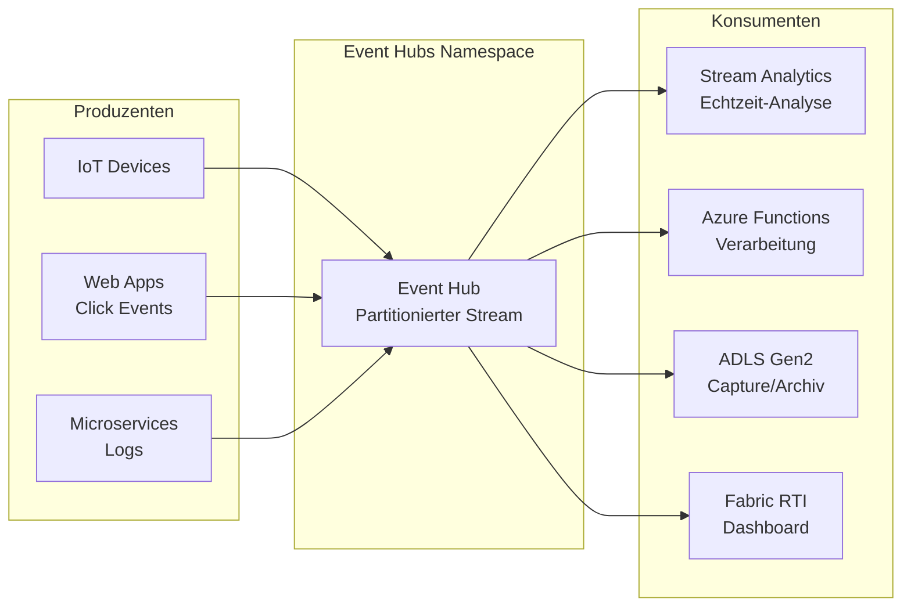
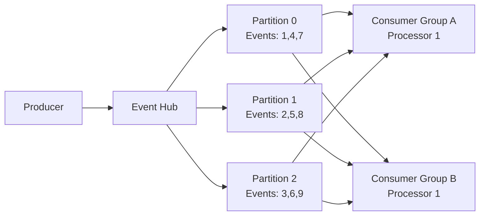
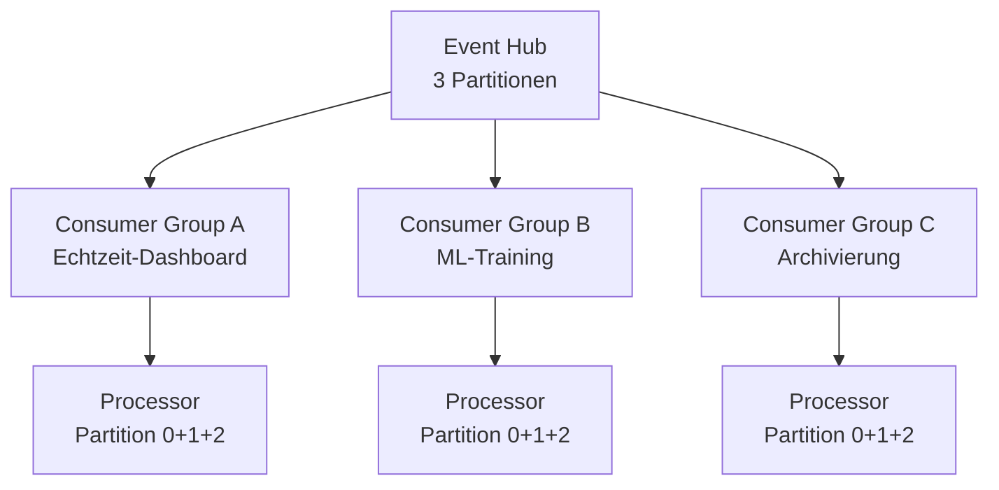
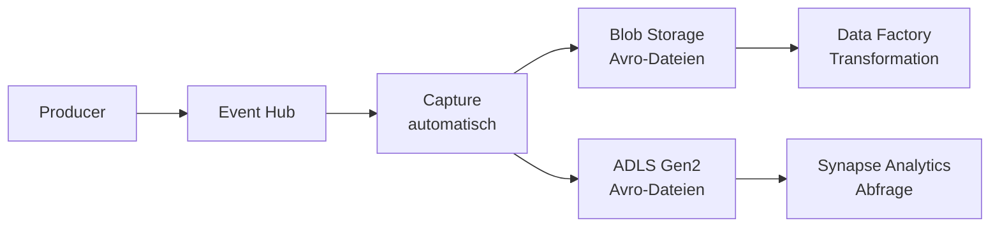
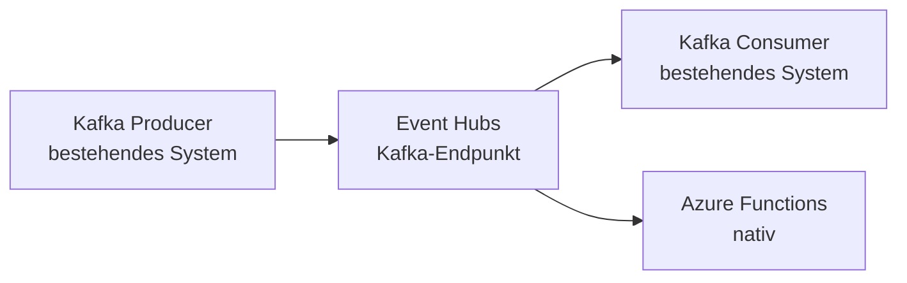

# Azure Event Hubs

> [!ABSTRACT]
> Azure Event Hubs ist ein vollständig verwalteter Big-Data-Streaming-Dienst, der Millionen von Ereignissen pro Sekunde aufnehmen kann. Er dient als Eingangspunkt für Data Pipelines und ermöglicht die parallele Verarbeitung durch Consumer Groups. Event Hubs ist Kafka-kompatibel.

---

## Was ist Azure Event Hubs?

Event Hubs ist das **Streaming-Rückgrat** in Azure – konzipiert für **massiven Durchsatz** von Telemetrie-, Log- und Ereignisdaten. Es handelt sich um einen persistenten, replizierten Event-Stream, aus dem Daten mehrfach gelesen werden können.



**Kernprinzipien:**
- **Partitionierter Consumer Stream** – parallele Verarbeitung
- **Zeitbasierte Retention** – Ereignisse bleiben mehrere Tage erhalten
- **Mehrere Consumer Groups** – unabhängige Leser
- **Kafka-kompatibel** – bestehende Kafka-Clients funktionieren ohne Code-Änderung

---

## Partitionen

Partitionen sind das Herzstück der Skalierbarkeit in Event Hubs:



| Tier | Max Partitionen | Bemerkung |
|---|---|---|
| **Basic** | 32 | Nicht änderbar nach Erstellung |
| **Standard** | 32 | Nicht änderbar nach Erstellung |
| **Premium** | 100 | Konfigurierbar |
| **Dedicated** | 2.000 | Capacity Unit-abhängig |

> [!IMPORTANT]
> Die Partitionsanzahl wird **beim Erstellen** festgelegt und kann danach **nicht verringert** werden (in Basic/Standard). Wähle die Partition-Anzahl sorgfältig – sie bestimmt den maximalen Parallelgrad der Verarbeitung.

### Partition Key
```csharp
// Events mit gleichem Partition Key gehen in dieselbe Partition
// → Reihenfolge innerhalb einer Geräte-ID garantiert
await producer.SendAsync(new EventData("sensor data") {
    PartitionKey = deviceId
});
```

---

## Consumer Groups

Consumer Groups ermöglichen **unabhängige, parallele Lesezugriffe** auf denselben Stream:



- Jede Consumer Group hat einen **unabhängigen Offset/Checkpoint**
- Eine Consumer Group = ein Leser-Kontext (z. B. eine Anwendung)
- **Standard:** Bis zu 20 Consumer Groups pro Event Hub
- **Basic:** Nur 1 Consumer Group (`$Default`)

> [!NOTE]
> Eine Consumer Group ist vergleichbar mit einer Kafka Consumer Group. Wenn du N Partitionen hast, kannst du maximal N parallele Konsumenten in einer Consumer Group betreiben.

---

## Retention

| Tier | Retention | Konfiguration |
|---|---|---|
| **Basic** | 1 Tag | Fest |
| **Standard** | 1–7 Tage | Konfigurierbar |
| **Premium** | 1–90 Tage | Konfigurierbar |
| **Dedicated** | 1–90 Tage | Pro Capacity Unit |

```powershell
# Retention konfigurieren (Standard-Tier, 7 Tage)
az eventhubs eventhub update \
  --resource-group myRG \
  --namespace-name myNamespace \
  --name myEventHub \
  --message-retention 7
```

---

## Capture – Automatische Archivierung

Event Hubs Capture schreibt Event-Streams **automatisch** in Azure Blob Storage oder ADLS Gen2 im Avro-Format:



```powershell
# Capture aktivieren
az eventhubs eventhub update \
  --resource-group myRG \
  --namespace-name myNamespace \
  --name myEventHub \
  --enable-capture true \
  --capture-interval 300 \
  --capture-size-limit 314572800 \
  --destination-name EventHubArchive.AzureBlockBlob \
  --storage-account myStorageAccount \
  --blob-container captures \
  --archive-name-format "{Namespace}/{EventHub}/{PartitionId}/{Year}/{Month}/{Day}/{Hour}/{Minute}/{Second}"
```

**Capture-Dateiformat (Avro):**
```json
{
  "SequenceNumber": 123,
  "Offset": "456",
  "EnqueuedTimeUtc": "2024-01-15T10:00:00Z",
  "SystemProperties": {},
  "Properties": { "deviceId": "sensor-001" },
  "Body": "<base64-encoded-data>"
}
```

---

## Kafka-Kompatibilität

Event Hubs unterstützt das **Kafka-Protokoll** (Kafka 1.0+) ohne Code-Änderungen:



**Kafka Producer-Konfiguration:**
```properties
bootstrap.servers=myNamespace.servicebus.windows.net:9093
security.protocol=SASL_SSL
sasl.mechanism=PLAIN
sasl.jaas.config=org.apache.kafka.common.security.plain.PlainLoginModule required \
  username="$ConnectionString" \
  password="<Event-Hubs-Connection-String>";
```

> [!TIP]
> Bei Migration von Kafka zu Event Hubs: Nur die **Verbindungskonfiguration** ändern – kein Code-Change nötig. Event Hub = Kafka Topic, Event Hubs Namespace = Kafka Cluster.

---

## Namespace Tiers

| Tier | Throughput | Max Event Size | Consumer Groups | Retention | Kafka |
|---|---|---|---|---|---|
| **Basic** | 1 TU = 1 MB/s | 256 KB | 1 | 1 Tag | ❌ |
| **Standard** | 1–20 TU | 1 MB | 20 | 1–7 Tage | ✅ |
| **Premium** | PU-basiert | 1 MB | 100 | 1–90 Tage | ✅ |
| **Dedicated** | CU-basiert | 1 MB | Unbegrenzt | 1–90 Tage | ✅ |

**Throughput Units (TU) / Processing Units (PU):**
- 1 TU = 1 MB/s Eingang, 2 MB/s Ausgang, 1.000 Ereignisse/s
- Standard: Auto-Inflate ermöglicht automatische Skalierung bis zu 40 TU

```powershell
# Auto-Inflate aktivieren (Standard-Tier)
az eventhubs namespace update \
  --resource-group myRG \
  --name myNamespace \
  --enable-auto-inflate true \
  --maximum-throughput-units 20
```

---

## Event Hubs Dedicated

Dedizierte Kapazitätseinheiten (Capacity Units – CU):

| Capacity Units | Eingang | Ausgang | Partitionen |
|---|---|---|---|
| 1 CU | 64 MB/s | 128 MB/s | 1.024 |
| 2 CU | 128 MB/s | 256 MB/s | 2.048 |
| 4 CU | 256 MB/s | 512 MB/s | 4.096 |

> [!NOTE]
> Dedicated ist die richtige Wahl für Workloads, die **Isolation, garantierte Kapazität und lange Retention** (bis 90 Tage) benötigen. Preis: ab ~7.000 €/Monat pro Cluster.

---

## Checkpointing

Checkpointing speichert die aktuelle **Leseposition** (Offset) eines Konsumenten:

```csharp
// Event Processor Client mit Checkpointing
var storageClient = new BlobContainerClient(storageConnectionString, "checkpoints");
var processor = new EventProcessorClient(
    storageClient,
    "$Default",
    eventHubConnectionString,
    "my-event-hub");

processor.ProcessEventAsync += async (args) => {
    // Event verarbeiten
    var data = Encoding.UTF8.GetString(args.Data.Body.ToArray());
    Console.WriteLine($"Event: {data}");
    
    // Checkpoint speichern (Leseposition)
    await args.UpdateCheckpointAsync(args.CancellationToken);
};

processor.ProcessErrorAsync += (args) => {
    Console.WriteLine($"Error: {args.Exception}");
    return Task.CompletedTask;
};

await processor.StartProcessingAsync();
```

> [!WARNING]
> Checkpoint **nicht** nach jedem Event setzen (Performance-Einbußen). Checkpoint alle N Events oder nach einem Batch – je nach Latenz- und Durability-Anforderungen.

---

## Event Processor Client (SDK)

Der `EventProcessorClient` ist die empfohlene SDK-Klasse für produktive Consumer:

```csharp
// Vollständiges Setup mit Partition-Ownership-Tracking
var processor = new EventProcessorClient(
    checkpointStore: new BlobContainerClient(storageConnStr, "checkpoints"),
    consumerGroup: "$Default",
    connectionString: eventHubConnStr,
    eventHubName: "telemetry");

processor.PartitionInitializingAsync += async (args) => {
    // Startet immer am Ende des Streams (nur neue Events)
    args.DefaultStartingPosition = EventPosition.Latest;
    await Task.CompletedTask;
};
```

---

## Integration mit Azure-Diensten

### Azure Stream Analytics
```sql
-- Real-time Aggregation über Event Hubs Input
SELECT
    DeviceId,
    AVG(Temperature) AS AvgTemp,
    MAX(Temperature) AS MaxTemp,
    System.Timestamp AS WindowEnd
FROM EventHubInput TIMESTAMP BY EventTime
GROUP BY DeviceId, TumblingWindow(minute, 5)
HAVING AvgTemp > 80
```

### Azure Functions Trigger
```csharp
[FunctionName("ProcessTelemetry")]
public static async Task Run(
    [EventHubTrigger("telemetry", Connection = "EventHubConnection",
        ConsumerGroup = "functions-cg")]
    EventData[] events,
    ILogger log)
{
    foreach (var evt in events) {
        var data = Encoding.UTF8.GetString(evt.Body.ToArray());
        log.LogInformation($"PartitionId: {evt.SystemProperties.PartitionKey}");
        log.LogInformation($"Offset: {evt.SystemProperties.Offset}");
        // Verarbeitung...
    }
}
```

### Fabric Real-Time Intelligence
Event Hubs kann direkt als **Datenquelle** für Fabric Real-Time Intelligence (Eventhouse/KQL) genutzt werden – ohne Middleware.

---

## Event Hubs Schema Registry

Die Schema Registry speichert und verwaltet **Avro-, JSON- und Protobuf-Schemas**:

```python
# Schema registrieren und nutzen
from azure.schemaregistry import SchemaRegistryClient
from azure.schemaregistry.encoder.avroencoder import AvroEncoder
from azure.identity import DefaultAzureCredential

schema_registry = SchemaRegistryClient(
    fully_qualified_namespace="myregistry.servicebus.windows.net",
    credential=DefaultAzureCredential())

encoder = AvroEncoder(
    client=schema_registry,
    group_name="mygroup",
    auto_register=True)

# Event kodieren mit Schema
encoded = encoder.encode({"sensorId": "s001", "value": 42.5},
                          schema=SENSOR_SCHEMA)
```

---

## Private Endpoint

```powershell
# Private Endpoint für Event Hubs
az network private-endpoint create \
  --resource-group myRG \
  --name eh-private-endpoint \
  --vnet-name myVNet \
  --subnet private-endpoints \
  --private-connection-resource-id $EH_NAMESPACE_ID \
  --group-id namespace \
  --connection-name eh-pe-connection
```

---

## Kosten

| Tier | Basispreis | Zusatz | Preis pro TU/PU |
|---|---|---|---|
| **Basic** | ~10 €/Monat/TU | – | Inkl. |
| **Standard** | ~10 €/Monat/TU | Capture: ~0,10 €/GB | Inkl. |
| **Premium** | ~700 €/Monat/PU | Capture inkl. | Pro PU |
| **Dedicated** | ~7.000 €/Monat/CU | Alles inkl. | Pro CU |

> [!TIP]
> Für Entwicklung/Test mit wenig Traffic: **Standard** mit 1 TU und minimalem Retention. Für produktive Telemetrie-Workloads: **Premium** (bessere Isolation, bis 90 Tage Retention). Für kritische Enterprise-Workloads mit Volumen-Garantien: **Dedicated**.

---

## Verwandte Notizen

- [[Azure Event Grid]]
- [[Azure Service Bus]]
- [[Fabric Real-Time Intelligence]]
- [[Azure Logic Apps]]
