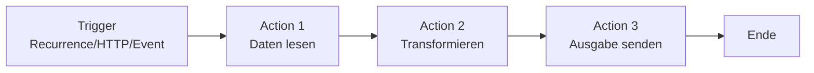
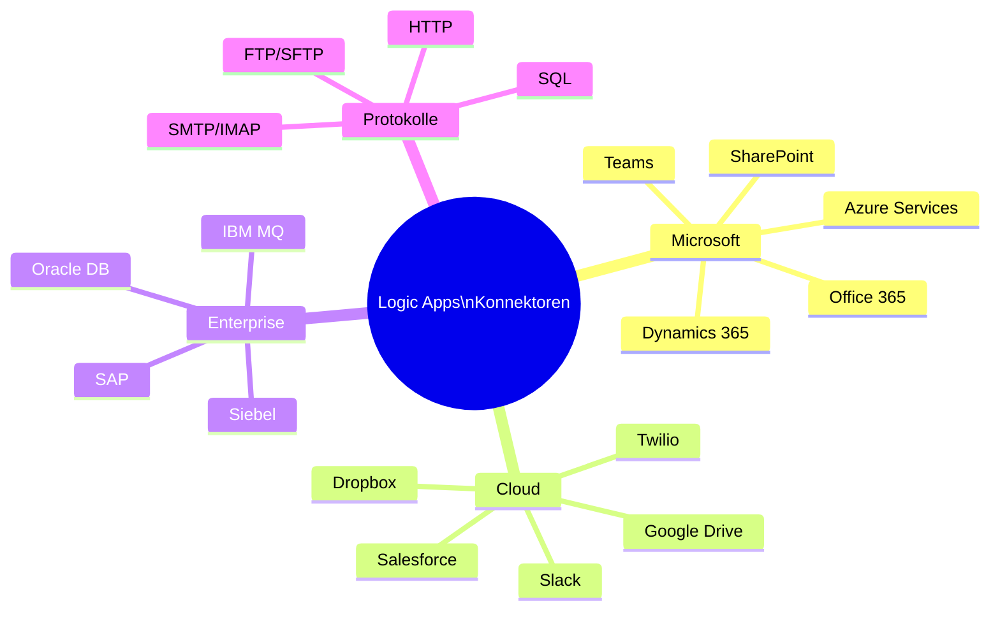
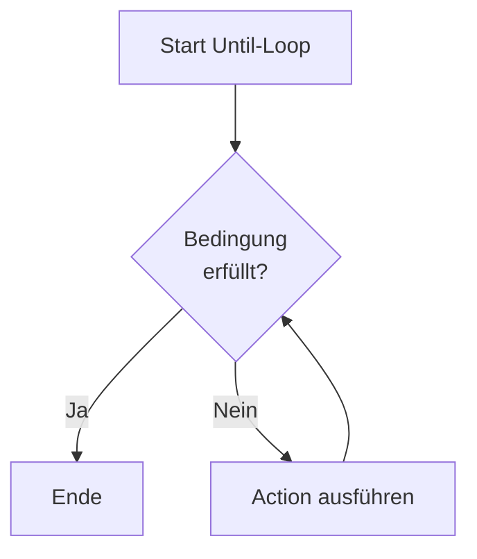
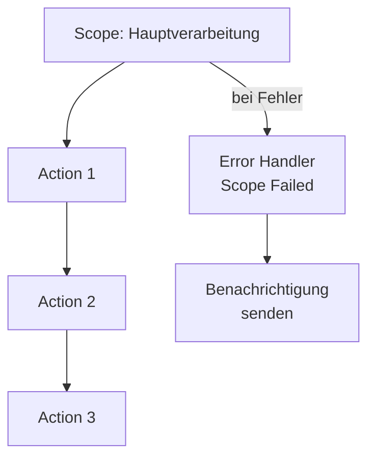
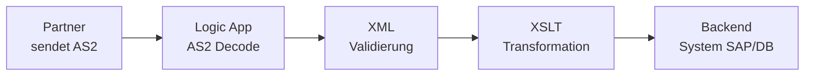
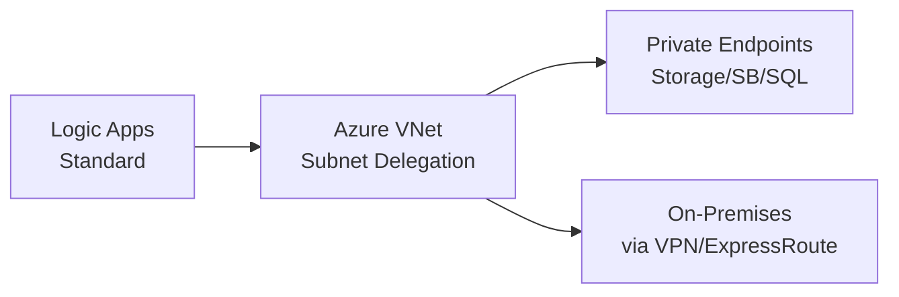

# Azure Logic Apps

> [!ABSTRACT]
> Azure Logic Apps ist ein cloudbasierter Dienst zur Automatisierung von Workflows und Geschäftsprozessen. Mit über 800 vorgefertigten Konnektoren lassen sich Anwendungen, Daten und Dienste – on-premises und in der Cloud – ohne umfangreichen Code integrieren.

---

## Was ist Azure Logic Apps?

Azure Logic Apps ist eine **Low-Code/No-Code-Integrationsplattform**, die auf der Azure Integration Services-Familie basiert. Sie ermöglicht die Automatisierung von End-to-End-Workflows über verschiedene Systeme hinweg.

**Kernkonzepte:**
- **Trigger:** Startet den Workflow (zeitbasiert, HTTP, Event-basiert)
- **Actions:** Einzelne Schritte im Workflow (Daten lesen, transformieren, senden)
- **Connector:** Verbindung zu einem externen Dienst (SAP, Salesforce, Office 365 usw.)
- **Workflow:** Eine Abfolge von Trigger + Actions



---

## Hosting-Pläne

### Consumption (Multi-Tenant)
- Vollständig serverlos – pay-per-execution
- Automatische Skalierung durch Microsoft
- **1 Workflow pro Logic App**
- Kein VNet-Zugriff (nur via On-Premises Data Gateway)
- Geeignet für: einfache Integrationen, niedrige Kosten

### Standard (Single-Tenant)
- Basiert auf Azure Functions Runtime (v4)
- **Mehrere Workflows pro Logic App** (wie Functions-App)
- VNet-Integration möglich
- Unterstützt Stateful und Stateless Workflows
- Ausführung auf dedizierter App Service Plan / Elastic Premium
- Deployment via ZIP, Container, GitHub Actions

### Premium / ISE (veraltet)
- Integration Service Environment (ISE) wurde deprecated (August 2024)
- Nachfolger: Logic Apps Standard mit VNet-Integration

| Feature | Consumption | Standard |
|---|---|---|
| Hosting | Multi-Tenant | Single-Tenant |
| Workflows pro App | 1 | Mehrere |
| VNet-Integration | ❌ | ✅ |
| Stateless Workflows | ❌ | ✅ |
| Preis | Pro Aktion | Pro Instanz/Stunde |
| Private Endpoint | ❌ | ✅ |
| Built-in Connectors | Standard-Set | Erweitert |

---

## Trigger und Actions

### Trigger-Typen

| Trigger-Typ | Beispiel | Beschreibung |
|---|---|---|
| **Recurrence** | Jede Stunde | Zeitgesteuerter Start |
| **HTTP Request** | POST /webhook | Externe HTTP-Anfrage |
| **Event-basiert** | Blob erstellt | Azure Storage Event |
| **Polling** | Neue E-Mail (Outlook) | Periodische Abfrage |
| **Push** | Service Bus Message | Nachricht empfangen |

### Wichtige Built-in Actions

- **HTTP** – REST-Aufrufe an beliebige APIs
- **Parse JSON** – JSON-Schemas anwenden
- **Compose** – Daten zusammenführen
- **Initialize/Set Variable** – Variablen verwalten
- **Delay / Delay Until** – Wartezeit einbauen
- **Response** – Antwort an HTTP-Trigger
- **Data Operations** – Filter Array, Join, Select, Create CSV/HTML Table

### 800+ Konnektoren



---

## Built-in vs. Managed Konnektoren

| Merkmal | Built-in Konnektoren | Managed Konnektoren |
|---|---|---|
| Laufzeit | In-Process (Logic Apps Runtime) | Extern (Azure Connector Platform) |
| Latenz | Sehr niedrig | Etwas höher |
| VNet-Zugriff | Direkt (Standard Plan) | Über Integration Service Runtime |
| Kosten (Consumption) | Günstigere Aktions-Kategorie | Teurer |
| Beispiele | HTTP, Service Bus (built-in), SQL (built-in) | Outlook, Salesforce, SAP |

> [!TIP]
> Im Standard-Plan solltest du bevorzugt **Built-in Konnektoren** nutzen – sie laufen direkt in der Runtime und benötigen keine ausgehenden Verbindungen zur Connector-Infrastruktur von Microsoft.

---

## Conditional Logic

### Condition (If/Else)
```json
{
  "type": "If",
  "expression": {
    "and": [
      {
        "greater": ["@body('Get_item')?['Status']", "0"]
      }
    ]
  },
  "actions": { "True_Branch": {} },
  "else": { "actions": { "False_Branch": {} } }
}
```

### Switch
Vergleicht einen Wert mit mehreren Cases – ähnlich `switch/case` in Programmiersprachen.

### For Each
Iteriert über ein Array – z. B. alle Zeilen einer SQL-Abfrage oder Items einer SharePoint-Liste.

> [!WARNING]
> **For Each** läuft standardmäßig mit **20 parallelen Iterationen** (Consumption). Für geordnete Verarbeitung: Concurrency auf `1` setzen.

### Until
Schleife, die läuft bis eine Bedingung erfüllt ist (max. 5.000 Iterationen oder Timeout).



---

## Error Handling

### Configure Run After
Jede Action kann konfiguriert werden, nach welchen Zuständen des Vorgängers sie läuft:
- `succeeded`
- `failed`
- `skipped`
- `timedOut`

```json
{
  "Send_Error_Notification": {
    "runAfter": {
      "Call_SAP_API": ["Failed", "TimedOut"]
    }
  }
}
```

### Retry Policies
Konfigurierbar pro Action:

| Policy | Beschreibung |
|---|---|
| Default | 4 Wiederholungen, exponentieller Backoff |
| None | Kein Retry |
| Fixed Interval | Feste Wartezeit zwischen Retries |
| Exponential Interval | Wachsende Wartezeit (mit Jitter) |

```json
{
  "retryPolicy": {
    "type": "exponential",
    "count": 5,
    "interval": "PT5S",
    "minimumInterval": "PT5S",
    "maximumInterval": "PT1H"
  }
}
```

### Scope
Gruppiert Actions – ähnlich einem Try/Catch-Block. Ein Scope kann als Einheit fehlschlagen und gezielt behandelt werden.



> [!IMPORTANT]
> Nutze **Scope** + **Configure Run After (failed)** als Standard-Pattern für robuste Error-Handling-Logik in produktiven Workflows.

---

## Enterprise Integration Pack (B2B)

Das Enterprise Integration Pack (EIP) ermöglicht **B2B-Messaging** nach Industriestandards.

### Unterstützte Protokolle

| Protokoll | Anwendungsfall |
|---|---|
| **AS2** | Sichere Nachrichtenübertragung über HTTP (inkl. MDN) |
| **X12** | EDI-Standard (USA, Healthcare: 837, 835, 270/271) |
| **EDIFACT** | EDI-Standard (Europa, international) |
| **RosettaNet** | Supply-Chain-Integration (RNIF) |
| **XML** | Validierung, Transformation (XSLT Maps) |

### Verarbeitungsschritte



---

## Integration Accounts

Ein **Integration Account** ist ein Azure-Ressource, die B2B-Artefakte speichert:

- **Partner** – Handelspartner mit Identifikatoren (AS2/EDIFACT/X12)
- **Agreements** – Protokoll-Vereinbarungen zwischen Partnern
- **Schemas** – XSD-Schemas zur XML-Validierung
- **Maps** – XSLT-Transformationen
- **Certificates** – Zertifikate für AS2-Verschlüsselung/Signierung
- **Assemblies** – .NET-Assemblies für benutzerdefinierte Logik

> [!NOTE]
> Integration Accounts sind **separat** von Logic Apps und haben eigene Kosten. Sie werden mit der Logic App verknüpft (nicht eingebettet).

---

## Logic Apps Standard – Erweiterte Features

### Mehrere Workflows
Eine Logic Apps Standard-Ressource kann **viele Workflows** enthalten – ähnlich wie eine Azure Functions-App mehrere Funktionen hat.

```bash
# Workflows auflisten (az CLI)
az logicapp workflow list \
  --name myLogicApp \
  --resource-group myRG
```

### Stateful vs. Stateless

| Typ | Zustand | Run History | Geeignet für |
|---|---|---|---|
| **Stateful** | In externem Storage | Ja | Langläufige Prozesse, Auditing |
| **Stateless** | Im Speicher (flüchtig) | Nein (opt-in) | Kurze, schnelle Verarbeitung |

### VNet-Integration (Standard Plan)



---

## Managed API Connections

Managed Connections sind Azure-Ressourcen (`Microsoft.Web/connections`), die Authentifizierungsdaten für Konnektoren speichern.

> [!WARNING]
> Bei Deployment via ARM/Bicep müssen Managed Connections **separat deployed** und autorisiert werden. OAuth-Connections (z. B. Outlook) erfordern eine **manuelle interaktive Autorisierung** – das ist eine bekannte Limitation bei CI/CD.

```bash
# Connections in einer Resource Group anzeigen
az resource list \
  --resource-group myRG \
  --resource-type "Microsoft.Web/connections" \
  --query "[].{Name:name, Kind:kind}" \
  --output table
```

---

## Logic Apps vs. Power Automate

| Merkmal | Azure Logic Apps | Power Automate |
|---|---|---|
| Zielgruppe | Entwickler / IT-Pros | Business-User (Citizen Developer) |
| Hosting | Azure (Consumption/Standard) | Microsoft Cloud |
| Preis | Azure-Abrechnung | Power Platform Lizenzen |
| VNet-Integration | ✅ (Standard) | ❌ (nur Data Gateway) |
| Custom Code | Azure Functions, Inline Code | Power Fx, Custom Connectors |
| CI/CD | ARM, Bicep, GitHub Actions | ❌ (eingeschränkt) |
| B2B/EDI | ✅ Enterprise Integration Pack | ❌ |
| Governance | Azure RBAC, Policies | Power Platform CoE |

> [!NOTE]
> Power Automate nutzt intern denselben Connector-Marktplatz wie Logic Apps, aber die Plattform ist auf Business-User ausgerichtet. Für Enterprise-Integrationen, VNet-Zugriff und CI/CD ist Logic Apps die richtige Wahl.

---

## Deployment

### ARM-Template (Consumption)
```json
{
  "$schema": "https://schema.management.azure.com/schemas/2019-04-01/deploymentTemplate.json#",
  "contentVersion": "1.0.0.0",
  "resources": [
    {
      "type": "Microsoft.Logic/workflows",
      "apiVersion": "2019-05-01",
      "name": "[parameters('logicAppName')]",
      "location": "[resourceGroup().location]",
      "properties": {
        "state": "Enabled",
        "definition": {
          "$schema": "https://schema.management.azure.com/providers/Microsoft.Logic/schemas/2016-06-01/workflowdefinition.json#",
          "triggers": {},
          "actions": {}
        }
      }
    }
  ]
}
```

### Bicep (Standard)
```bicep
resource logicApp 'Microsoft.Web/sites@2022-09-01' = {
  name: logicAppName
  location: location
  kind: 'functionapp,workflowapp'
  properties: {
    serverFarmId: appServicePlan.id
    siteConfig: {
      appSettings: [
        { name: 'AzureWebJobsStorage', value: storageConnectionString }
        { name: 'FUNCTIONS_EXTENSION_VERSION', value: '~4' }
        { name: 'WORKFLOWS_SUBSCRIPTION_ID', value: subscription().subscriptionId }
      ]
    }
  }
}
```

### GitHub Actions Deployment
```yaml
- name: Deploy Logic App Standard
  uses: azure/logicapps-deploy@v2
  with:
    app-name: ${{ env.LOGIC_APP_NAME }}
    resource-group: ${{ env.RESOURCE_GROUP }}
    package: ${{ github.workspace }}/logicapp
```

---

## Monitoring

### Run History
- Jeder Workflow-Lauf wird mit Status, Dauer und Ein-/Ausgabe jeder Action gespeichert
- Im Azure-Portal: Logic App → Übersicht → Ausführungsverlauf
- Consumption: 90 Tage Aufbewahrung
- Standard: abhängig von Storage Account

```powershell
# Run History per PowerShell abfragen
Get-AzLogicAppRunHistory `
  -ResourceGroupName "myRG" `
  -Name "myLogicApp" `
  -Top 20
```

### Azure Monitor Alerts
```powershell
# Alert bei fehlgeschlagenen Runs
New-AzMetricAlertRuleV2 `
  -Name "LogicApp-Failed-Runs" `
  -ResourceGroupName "myRG" `
  -TargetResourceId $logicAppId `
  -MetricName "RunsFailed" `
  -Operator GreaterThan `
  -Threshold 0 `
  -TimeAggregation Total `
  -WindowSize 00:05:00
```

---

## Kosten

| Plan | Preismodell | Kostentreiber |
|---|---|---|
| **Consumption** | Pro Aktion/Ausführung | Anzahl der Aktions-Ausführungen |
| **Standard WF1** | Ca. 12 €/Monat (1 vCore) | App Service Plan + Speicher |
| **Integration Account Basic** | Ca. 9 €/Monat | B2B-Artefakte |
| **Integration Account Standard** | Ca. 400 €/Monat | Alle B2B-Protokolle |

> [!TIP]
> Für einfache Szenarien mit wenigen täglichen Ausführungen ist **Consumption** oft am günstigsten. Bei vielen täglichen Ausführungen (>100.000 Aktionen/Tag) kann **Standard** kostengünstiger sein.

---

## Verwandte Notizen

- [[Azure API Management]]
- [[Azure Service Bus]]
- [[Azure Event Grid]]
- [[Azure Functions]]
