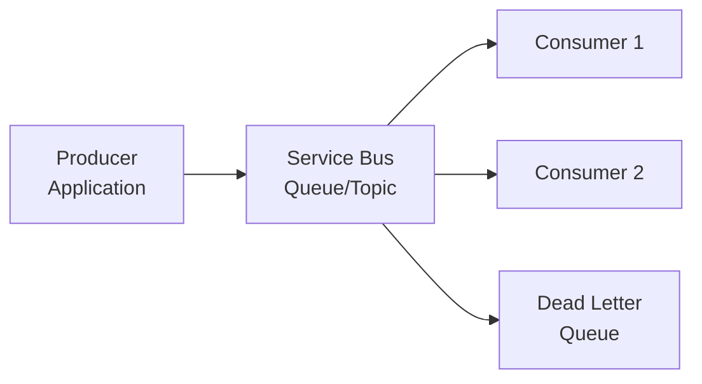
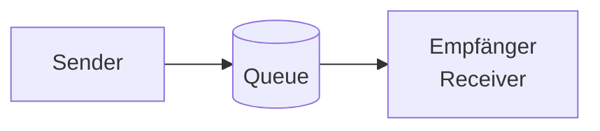
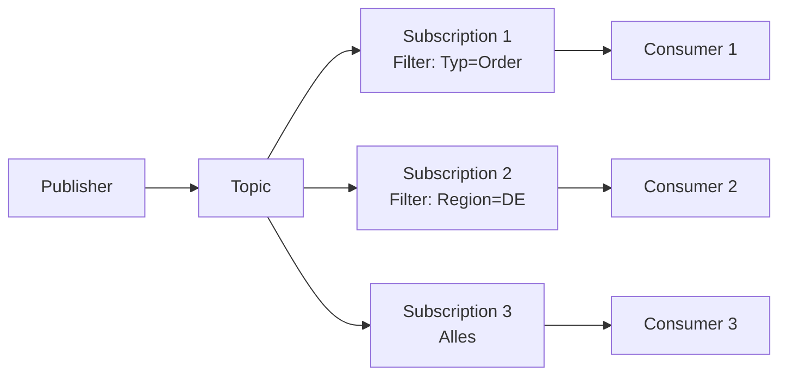
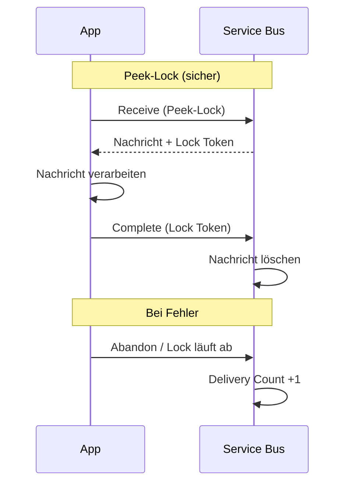
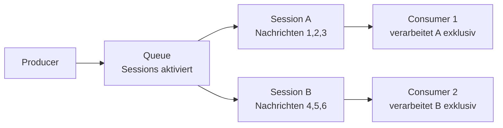

# Azure Service Bus

> [!ABSTRACT]
> Azure Service Bus ist ein vollständig verwalteter Enterprise-Message-Broker für zuverlässige, asynchrone Kommunikation zwischen Anwendungen und Diensten. Er unterstützt Queues (Point-to-Point) und Topics/Subscriptions (Publish/Subscribe) mit garantierter Zustellung und transaktionaler Verarbeitung.

---

## Was ist Azure Service Bus?

Service Bus ist der **Enterprise-Messaging-Dienst** in Azure – konzipiert für zuverlässige, geordnete und transaktionale Nachrichtenübertragung. Anders als Event Grid (Event-Routing) oder Event Hubs (Streaming) liegt der Fokus auf **Nachrichtenverarbeitung mit Garantien**.



**Typische Anwendungsfälle:**
- Entkopplung von Microservices
- Order Processing / Bestellabwicklung
- Workload Leveling (Lastausgleich)
- Zuverlässige Kommunikation mit Transaktionsgarantie
- B2B-Integration mit externen Partnern

---

## Messaging-Entitäten

### Queues (Point-to-Point)



- **FIFO** – Nachrichten werden in Reihenfolge zugestellt (wenn Sessions aktiviert)
- **At-Least-Once** – Nachricht wird mindestens einmal zugestellt
- **Konkurrierendes Konsumentenmuster** – Mehrere Consumer teilen sich die Queue
- Nur **ein** Consumer verarbeitet jede Nachricht

### Topics und Subscriptions (Pub/Sub)



- Eine Nachricht an ein **Topic** wird in alle **Subscriptions** kopiert (die den Filter erfüllen)
- Jede Subscription hat eine eigene **virtuelle Queue**
- Ermöglicht Fan-out an mehrere unabhängige Consumer

---

## Queue-Semantik

| Eigenschaft | Wert | Beschreibung |
|---|---|---|
| **At-Least-Once** | Standard | Nachricht kann mehrfach zugestellt werden |
| **At-Most-Once** | ReceiveAndDelete-Modus | Nachricht nach Empfang sofort gelöscht |
| **FIFO** | Mit Sessions | Reihenfolge garantiert pro Session Key |
| **Lock Duration** | 30s Standard (max 5 min) | Exklusiver Lock beim Verarbeiten |
| **Max Delivery Count** | 10 (Standard) | Danach → Dead Letter Queue |
| **Max Message Size** | 256 KB Standard / 100 MB Premium | Nachrichtengröße |
| **Max Queue Size** | 1 GB–80 GB | Konfigurierbar je Tier |

### Peek-Lock vs. ReceiveAndDelete



---

## Topics und Subscriptions mit Filter-Regeln

### SQL Filter
```sql
-- Nur Nachrichten mit Eigenschaft Typ='Order' und Betrag > 100
Typ = 'Order' AND Betrag > 100
```

### Correlation Filter (effizienter)
```json
{
  "correlationId": "order-type-express",
  "label": "ExpressOrder"
}
```

> [!TIP]
> **Correlation Filter** sind deutlich effizienter als SQL Filter, da sie intern als Hash-Lookup implementiert sind. Nutze SQL Filter nur wenn komplexe Logik notwendig ist.

### Filter per PowerShell setzen
```powershell
New-AzServiceBusRule `
  -ResourceGroupName "myRG" `
  -NamespaceName "myNamespace" `
  -TopicName "orders" `
  -SubscriptionName "express-orders" `
  -Name "ExpressFilter" `
  -SqlExpression "ShippingMethod = 'Express'"
```

---

## Message-Eigenschaften

### System Properties

| Eigenschaft | Beschreibung |
|---|---|
| `MessageId` | Eindeutige Nachrichten-ID (für Duplikatserkennung) |
| `CorrelationId` | ID zur Korrelation mit anderen Nachrichten |
| `SessionId` | Für geordnete Verarbeitung (Sessions) |
| `TimeToLive (TTL)` | Ablaufzeit der Nachricht |
| `ScheduledEnqueueTime` | Geplante Zustellzeit (Delayed Delivery) |
| `DeadLetterReason` | Grund für DLQ-Übertragung |
| `EnqueuedTimeUtc` | Eingestellte Zeit (read-only) |
| `DeliveryCount` | Anzahl der Zustellungsversuche |

### Custom Properties
```csharp
var message = new ServiceBusMessage("Order payload");
message.ApplicationProperties["OrderType"] = "Express";
message.ApplicationProperties["Region"] = "DE";
message.TimeToLive = TimeSpan.FromHours(24);
message.ScheduledEnqueueTime = DateTimeOffset.UtcNow.AddMinutes(30);
await sender.SendMessageAsync(message);
```

---

## Sessions

Sessions ermöglichen **geordnete FIFO-Verarbeitung** für zusammengehörige Nachrichten.



- **Session Key** = `SessionId` der Nachricht (z. B. `OrderId`, `CustomerId`)
- Alle Nachrichten mit gleichem `SessionId` gehen an **denselben Consumer** (während Session aktiv)
- Ermöglicht zustandsbehaftete Verarbeitung (Session State)

```csharp
// Session-Receiver
await using var sessionReceiver = await client.AcceptNextSessionAsync("orders");
Console.WriteLine($"Session: {sessionReceiver.SessionId}");
var messages = await sessionReceiver.ReceiveMessagesAsync(maxMessages: 10);
```

---

## Dead Letter Queue (DLQ)

Die DLQ ist eine **Sub-Queue** (`<queue>/$deadletterqueue`) für Nachrichten, die nicht verarbeitet werden konnten.

**Gründe für DLQ-Übertragung:**
- `MaxDeliveryCount` überschritten
- TTL abgelaufen
- Explizites `DeadLetter()` durch Consumer
- Filter-Auswertungsfehler

```csharp
// DLQ verarbeiten
var dlqReceiver = client.CreateReceiver(
    "orders",
    new ServiceBusReceiverOptions {
        SubQueue = SubQueue.DeadLetter
    });

var dlqMessages = await dlqReceiver.ReceiveMessagesAsync(10);
foreach (var msg in dlqMessages) {
    var reason = msg.DeadLetterReason;
    var description = msg.DeadLetterErrorDescription;
    // Fehler analysieren und ggf. neu einreihen
    await dlqReceiver.CompleteMessageAsync(msg);
}
```

> [!IMPORTANT]
> Die DLQ sollte **aktiv überwacht** werden. Unverarbeitete DLQ-Nachrichten bedeuten Datenverlust in der Business-Logik. Setze einen Azure Monitor Alert auf `DeadLetteredMessageCount`.

---

## Prefetching und Batch-Operationen

### Prefetching
Lädt Nachrichten vorab in einen lokalen Cache des Clients:
```csharp
var receiver = client.CreateReceiver("orders", new ServiceBusReceiverOptions {
    PrefetchCount = 50 // 50 Nachrichten vorab laden
});
```

> [!WARNING]
> Prefetch erhöht den Durchsatz, aber alle geprefetchten Nachrichten sind **gesperrt**. Bei Consumer-Absturz müssen alle Locks ablaufen, bevor andere Consumer die Nachrichten sehen.

### Batch Send
```csharp
using var batch = await sender.CreateMessageBatchAsync();
for (int i = 0; i < 100; i++) {
    if (!batch.TryAddMessage(new ServiceBusMessage($"Message {i}"))) {
        await sender.SendMessagesAsync(batch);
    }
}
await sender.SendMessagesAsync(batch);
```

---

## Premium vs. Standard Tier

| Feature | Standard | Premium |
|---|---|---|
| **Messaging-Isolierung** | Multi-Tenant (geteilt) | Dedizierte Messaging Units |
| **Max Message Size** | 256 KB | 100 MB |
| **VNet Integration** | ❌ | ✅ |
| **Private Endpoint** | ❌ | ✅ |
| **Customer-Managed Keys** | ❌ | ✅ (CMK) |
| **Geo-DR** | ✅ | ✅ |
| **Geo-Redundanz (Active)** | ❌ | ✅ |
| **Availability Zones** | ❌ | ✅ |
| **Max Namespace Size** | 10 GB | 1 TB (10× Messaging Units) |
| **Preis** | Ab ~0,01 €/Mio. Ops | Ab ~650 €/Monat |

> [!IMPORTANT]
> Für produktive Enterprise-Workloads ist **Premium** empfohlen: Isolation, große Nachrichten, VNet-Integration und Availability Zones sind für SLA-kritische Anwendungen notwendig.

---

## Geo-Disaster Recovery und Geo-Redundanz

### Geo-DR (Passive Failover)
- **Primär und Sekundär Namespace** werden als Alias-Paar konfiguriert
- Metadaten werden synchron repliziert (Queues, Topics, Subscriptions)
- **Keine** Nachrichten-Replikation (Nachrichten müssen re-gesendet werden)
- Failover ist manuell auszulösen

### Geo-Redundanz (Premium – Active Replication)
- **Aktive Replikation** über Availability Zones
- Automatisches Failover innerhalb einer Region
- Nachrichten werden synchron in mehrere Zonen geschrieben

```powershell
# Geo-DR Pairing
New-AzServiceBusGeoDRConfiguration `
  -ResourceGroupName "myRG" `
  -NamespaceName "primary-ns" `
  -Name "my-dr-alias" `
  -PartnerNamespace "/subscriptions/.../namespaces/secondary-ns"
```

---

## Service Bus Explorer

Das **Service Bus Explorer** ist ein Open-Source-Tool und auch direkt im Azure Portal verfügbar:
- Nachrichten senden und empfangen (Test)
- DLQ-Nachrichten anzeigen und requeuen
- Queue/Topic-Statistiken anzeigen
- Properties und Body inspizieren

> [!TIP]
> Im Azure Portal: Service Bus Namespace → Queue/Topic → **Service Bus Explorer**. Kein separates Tool-Download nötig.

---

## Azure Functions Service Bus Trigger

```csharp
[FunctionName("ProcessOrder")]
public static async Task Run(
    [ServiceBusTrigger("orders", Connection = "ServiceBusConnection")] 
    ServiceBusReceivedMessage message,
    ServiceBusMessageActions messageActions,
    ILogger log)
{
    log.LogInformation($"Processing message: {message.MessageId}");
    
    try {
        var order = JsonSerializer.Deserialize<Order>(message.Body);
        // Verarbeitung...
        await messageActions.CompleteMessageAsync(message);
    }
    catch (Exception ex) {
        log.LogError(ex, "Processing failed");
        await messageActions.DeadLetterMessageAsync(message, "ProcessingFailed", ex.Message);
    }
}
```

---

## Service Bus vs. Event Grid vs. Event Hubs vs. Storage Queue

| Merkmal | Service Bus | Event Grid | Event Hubs | Storage Queue |
|---|---|---|---|---|
| **Typ** | Message Broker | Event Router | Stream Processor | Simple Queue |
| **Muster** | Queue/Pub-Sub | Push (Webhook) | Pull (Consumer Group) | Pull |
| **Reihenfolge** | ✅ (Sessions) | ❌ | Partiell (Partitions) | ❌ |
| **Transaktionen** | ✅ | ❌ | ❌ | ❌ |
| **Max Message** | 100 MB (Premium) | 1 MB | 1 MB (Standard) | 64 KB |
| **Retention** | Bis 14 Tage | 24h (Retry) | Bis 90 Tage (Premium) | Bis 7 Tage |
| **Replay** | ❌ | ❌ | ✅ | ❌ |
| **Throughput** | ~1 Mio. Msg/s | ~10 Mio. Events/s | ~Millionen/s | Niedrig |
| **Kosten** | Mittel | Niedrig | Mittel-Hoch | Sehr niedrig |
| **Einsatz** | Enterprise-Messaging | Azure-interne Events | Big-Data-Streaming | Einfache Queues |

---

## Kosten

| Tier | Preis | Operationen |
|---|---|---|
| **Basic** | ~0,05 €/Mio. Ops | Nur Queues, keine Topics |
| **Standard** | ~0,01 €/Mio. Ops + Basisgebühr | Queues + Topics |
| **Premium 1 MU** | ~650 €/Monat | Dedicated, alle Features |
| **Premium 2 MU** | ~1.300 €/Monat | 2× Kapazität |

---

## Verwandte Notizen

- [[Azure Event Grid]]
- [[Azure Event Hubs]]
- [[Azure Logic Apps]]
- [[Azure API Management]]
