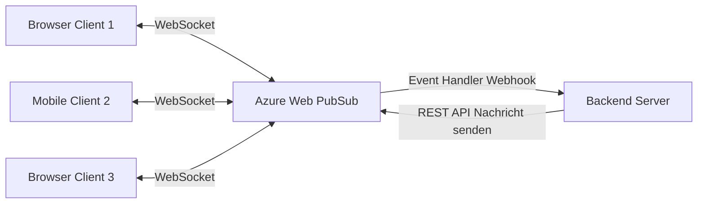
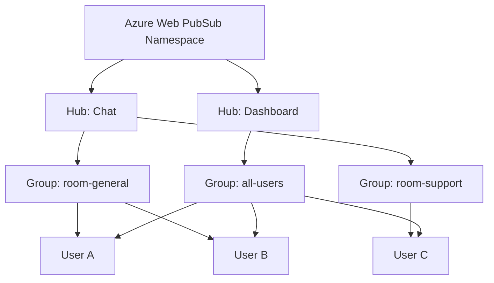
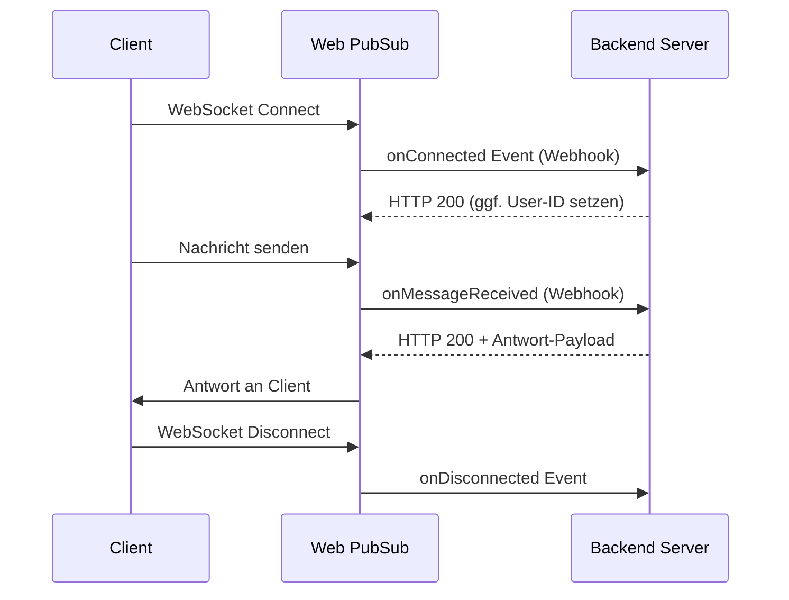

# Azure Web PubSub

> [!ABSTRACT]
> Azure Web PubSub ist ein vollständig verwalteter Echtzeit-Messaging-Dienst auf WebSocket-Basis. Er ermöglicht bidirektionale Kommunikation zwischen Server und Clients in großem Maßstab – ideal für Chat-Anwendungen, Live-Dashboards, Multiplayer-Spiele und kollaborative Tools.

---

## Was ist Azure Web PubSub?

Azure Web PubSub ist ein **verwalteter WebSocket-Service**, der Pub/Sub-Messaging direkt über persistente WebSocket-Verbindungen ermöglicht. Im Gegensatz zu klassischen REST-APIs ermöglicht er **echte bidirektionale Kommunikation** ohne Polling.



**Kernprinzipien:**
- **Persistente WebSocket-Verbindungen** – kein HTTP-Polling
- **Pub/Sub über Groups** – Nachrichten an logische Gruppen
- **Server-zu-Client** via REST API – kein persistenter Server-WebSocket nötig
- **Skalierung bis Millionen** gleichzeitiger Verbindungen

---

## Anwendungsfälle

| Szenario | Beschreibung |
|---|---|
| **Chat-Anwendungen** | Echtzeit-Textnachrichten, Gruppen-Chats |
| **Live-Dashboards** | Echtzeit-KPIs, Aktienpreise, Sensor-Daten |
| **Multiplayer-Spiele** | Spielzustand synchronisieren, Spieler-Positionen |
| **Kollaborations-Tools** | Gleichzeitiges Bearbeiten (Co-Authoring), Cursors |
| **Live-Benachrichtigungen** | Push-Notifications ohne App-Store |
| **IoT-Visualisierung** | Geräte-Status in Echtzeit anzeigen |
| **Live-Kommentar-Streams** | Sport-Events, Video-Livestreams |

---

## Architektur: Hubs und Gruppen



| Konzept | Beschreibung |
|---|---|
| **Hub** | Logischer Namensraum (z. B. „chat", „dashboard") |
| **Connection** | Eine WebSocket-Verbindung eines Clients |
| **Group** | Logische Gruppe von Verbindungen (z. B. Raum, Team) |
| **User** | Identifizierter Nutzer (kann mehrere Verbindungen haben) |

---

## Publish/Subscribe über WebSocket

### Client-seitig (JavaScript)
```javascript
import { WebPubSubClient } from "@azure/web-pubsub-client";

const client = new WebPubSubClient({
  getClientAccessUrl: async () => {
    // URL vom Backend holen (inkl. JWT-Token)
    const res = await fetch("/api/negotiate");
    const data = await res.json();
    return data.url;
  }
});

// Verbindung herstellen
await client.start();

// Gruppe beitreten
await client.joinGroup("room-general");

// Nachrichten empfangen
client.on("group-message", (event) => {
  console.log(`${event.message.fromUserId}: ${event.message.data}`);
});

// Nachricht an Gruppe senden
await client.sendToGroup("room-general", "Hallo alle!", "text");
```

### Server-zu-Client (REST API)
```bash
# Nachricht an alle Verbindungen in einem Hub senden
curl -X POST \
  "https://mywebpubsub.webpubsub.azure.com/api/hubs/chat/groups/room-general/:send?api-version=2021-10-01" \
  -H "Authorization: Bearer <TOKEN>" \
  -H "Content-Type: text/plain" \
  -d "Willkommen in Room General!"
```

---

## Event Handlers (Upstream)

Event Handlers ermöglichen dem Backend, auf WebSocket-Ereignisse zu reagieren:



**Event Handler Konfiguration (Portal oder ARM):**
```json
{
  "eventHandlers": [
    {
      "urlTemplate": "https://myapp.azurewebsites.net/api/eventhandler",
      "authType": "ManagedIdentity",
      "systemEvents": ["connect", "connected", "disconnected"],
      "userEventPattern": "*"
    }
  ]
}
```

---

## Azure Functions als Event Handler

```csharp
[FunctionName("WebPubSubEventHandler")]
public static async Task<MessageResponse> Run(
    [HttpTrigger(AuthorizationLevel.Anonymous, "post")] HttpRequest req,
    [WebPubSubContext] WebPubSubContext wpsContext,
    ILogger log)
{
    if (wpsContext.Request is ConnectEventRequest connectRequest) {
        // Verbindung autorisieren + User-ID setzen
        return new ConnectEventResponse {
            UserId = connectRequest.Claims["sub"].First()
        };
    }

    if (wpsContext.Request is UserEventRequest userEventRequest) {
        var message = userEventRequest.Data.ToString();
        log.LogInformation($"Message from {userEventRequest.ConnectionContext.UserId}: {message}");
        
        // Echo zurück an den Sender
        return new UserEventResponse(BinaryData.FromString($"Echo: {message}"), WebPubSubDataType.Text);
    }

    return null;
}
```

---

## Client-SDKs

| Sprache | Package |
|---|---|
| **JavaScript/TypeScript** | `@azure/web-pubsub-client` |
| **C#/.NET** | `Azure.Messaging.WebPubSub.Client` |
| **Python** | `azure-messaging-webpubsubservice` |
| **Java** | `azure-messaging-webpubsub` |
| **Go** | `github.com/Azure/azure-sdk-for-go/sdk/messaging/azwebpubsub` |

### Python Server SDK
```python
from azure.messaging.webpubsubservice import WebPubSubServiceClient
from azure.identity import DefaultAzureCredential

client = WebPubSubServiceClient(
    endpoint="https://mywebpubsub.webpubsub.azure.com",
    hub="chat",
    credential=DefaultAzureCredential())

# Nachricht an alle in einer Gruppe
client.send_to_group(
    group="room-general",
    message="Server-Nachricht an alle!",
    content_type="text/plain")

# Nachricht an einzelnen User
client.send_to_user(
    user_id="user-123",
    message="Private Nachricht",
    content_type="text/plain")

# Verbindungen in einer Gruppe zählen
info = client.get_group_info("room-general")
print(f"Verbundene Clients: {info.client_count}")
```

---

---

## Via Azure Portal (UI)

> [!TIP]
> Portal: **[portal.azure.com](https://portal.azure.com)**

**Web PubSub-Dienst erstellen:**
1. [portal.azure.com](https://portal.azure.com) → **+ Ressource erstellen** → **Web PubSub Service**
2. Ressourcengruppe, Name, Region und **Tarif** wählen (Free: 1 Einheit, Standard: bis 100 Einheiten)
3. **Erstellen**

**Connection String abrufen:**
- Web PubSub → **Schlüssel** → **Primäre Verbindungszeichenfolge** kopieren

**Hub-Einstellungen konfigurieren:**
- Web PubSub → **Einstellungen** → **+ Hub hinzufügen** → Hub-Name festlegen
- Event Handler-URL (Upstream) konfigurieren → Systemereignisse auswählen (connect, disconnected, message)

**Skalierung:**
- Web PubSub → **Skalieren** → Einheitenanzahl erhöhen oder Tier wechseln

**Verbindungen überwachen:**
- Web PubSub → **Metriken** → Aktive Verbindungen, gesendete Nachrichten, Fehler visualisieren

**Live Trace Tool:**
- Web PubSub → **Live-Ablaufverfolgung** → Echtzeit-Verbindungsdiagnose aktivieren

---

## REST API für Server-zu-Client Messaging

Die REST API ermöglicht Messaging ohne persistente Server-Verbindung:

| Endpunkt | Aktion |
|---|---|
| `POST /hubs/{hub}/groups/{group}/:send` | Nachricht an Gruppe |
| `POST /hubs/{hub}/users/{userId}/:send` | Nachricht an User |
| `POST /hubs/{hub}/connections/{connId}/:send` | Nachricht an Connection |
| `POST /hubs/{hub}/:send` | Broadcast an alle |
| `PUT /hubs/{hub}/groups/{group}/connections/{connId}` | User zu Gruppe hinzufügen |
| `DELETE /hubs/{hub}/groups/{group}/connections/{connId}` | User aus Gruppe entfernen |
| `GET /hubs/{hub}/groups/{group}` | Gruppen-Info (Verbindungsanzahl) |

---

## Verbindungs-Authentifizierung (JWT)

Clients erhalten einen **JWT-basierten Client Access URL** vom Backend:

```csharp
// .NET: Client Access URL generieren
var serviceClient = new WebPubSubServiceClient(
    new Uri("https://mywebpubsub.webpubsub.azure.com"),
    "chat",
    new DefaultAzureCredential());

var uri = await serviceClient.GetClientAccessUriAsync(
    userId: "user-123",
    roles: new[] { "webpubsub.joinLeaveGroup.room-general", "webpubsub.sendToGroup.room-general" },
    expiresAfter: TimeSpan.FromHours(1));

// URI an Client zurückgeben (enthält Token)
return Ok(new { url = uri.AbsoluteUri });
```

**Rollen für granulare Berechtigungen:**
- `webpubsub.joinLeaveGroup.<group>` – Gruppe beitreten/verlassen
- `webpubsub.sendToGroup.<group>` – An Gruppe senden
- `webpubsub.sendToServer` – An Server senden (Event Handler)

---

## Web PubSub für Socket.IO

Azure Web PubSub bietet einen **Socket.IO-kompatiblen Modus** – bestehende Socket.IO-Apps können ohne Code-Änderung skaliert werden:

```javascript
// Keine Code-Änderung nötig – nur Server-URL anpassen
const io = require("socket.io")(3000, {
  transports: ["websocket"],
  // Normalerweise: lokaler Server
  // Mit Web PubSub for Socket.IO:
  // azure-webpubsub-socketio npm Package als Middleware
});

const { useAzureSocketIO } = require("@azure/web-pubsub-socket.io");
await useAzureSocketIO(io, {
  hub: "myapp",
  connectionString: process.env.WEB_PUBSUB_CONNECTION_STRING
});
```

> [!NOTE]
> Web PubSub für Socket.IO ersetzt den **Socket.IO-Adapter** (z. B. Redis-Adapter) und ermöglicht horizontale Skalierung ohne Self-Managed Redis.

---

## Azure SignalR Service vs. Azure Web PubSub

| Merkmal | Azure SignalR Service | Azure Web PubSub |
|---|---|---|
| **Protokoll** | SignalR (WebSocket + Fallback) | Reines WebSocket / Socket.IO |
| **SDK** | .NET, Java, JavaScript (SignalR SDK) | Mehrsprachig, auch Raw WebSocket |
| **Socket.IO** | ❌ | ✅ (eigener Modus) |
| **Einsatz** | .NET-zentrische Apps | Sprachunabhängig, IoT, Web |
| **Event Handler** | Ja (ähnlich) | Ja (flexibler) |
| **Client-zu-Client** | Via Hub-Methoden | Via Group-Pub/Sub direkt |
| **Preis** | Gleich | Gleich |
| **Empfehlung** | Bestehende SignalR-Apps | Neue Projekte / Nicht-.NET |

> [!TIP]
> Für **neue Projekte** ist Azure Web PubSub die modernere und flexiblere Wahl. Für **bestehende SignalR-Apps** in .NET bleibt Azure SignalR Service die bessere Option, da keine Migration nötig ist.

---

## Skalierung

Web PubSub skaliert durch **Einheiten (Units)**:

| Einheiten | Max Verbindungen | Max Throughput |
|---|---|---|
| 1 | 1.000 | 1 MB/s |
| 2 | 2.000 | 2 MB/s |
| 5 | 5.000 | 5 MB/s |
| 10 | 10.000 | 10 MB/s |
| 100 | 100.000 | 100 MB/s |

```powershell
# Einheiten konfigurieren
az webpubsub update \
  --resource-group myRG \
  --name myWebPubSub \
  --sku Standard_S1 \
  --unit-count 10
```

---

## Private Endpoint

```powershell
# Private Endpoint für Web PubSub
az network private-endpoint create \
  --resource-group myRG \
  --name wps-private-endpoint \
  --vnet-name myVNet \
  --subnet private-endpoints \
  --private-connection-resource-id $WPS_RESOURCE_ID \
  --group-id webpubsub \
  --connection-name wps-pe-connection
```

---

## Monitoring

**Wichtige Metriken:**
- `ConnectionCount` – Aktive WebSocket-Verbindungen
- `ServerLoad` – Auslastung der Einheiten
- `MessageCount` – Nachrichten pro Sekunde
- `OutboundTraffic` – Ausgehender Datenverkehr

```powershell
# Alert auf hohe Verbindungsanzahl
az monitor metrics alert create \
  --name "WebPubSub-HighConnections" \
  --resource-group myRG \
  --scopes $WPS_RESOURCE_ID \
  --condition "avg ConnectionCount > 900" \
  --description "Verbindungen nahe am Limit"
```

---

## Kosten

| Tier | Preis | Verbindungen | Nachrichten |
|---|---|---|---|
| **Free** | Kostenlos | 20 | 20.000/Tag |
| **Standard 1 Unit** | ~50 €/Monat | 1.000 | 1 Mio./Einheit |
| **Standard 10 Units** | ~500 €/Monat | 10.000 | 10 Mio./Einheit |
| **Zusätzliche Nachrichten** | ~1 €/Mio. | – | Über Kontingent |

---

## Verwandte Notizen

- [[Azure Event Grid]]
- [[Azure Communication Services]]
- [[Azure Logic Apps]]
