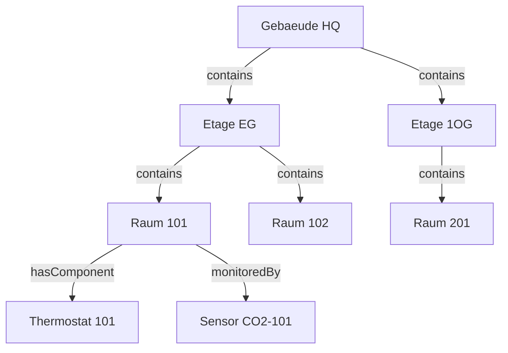
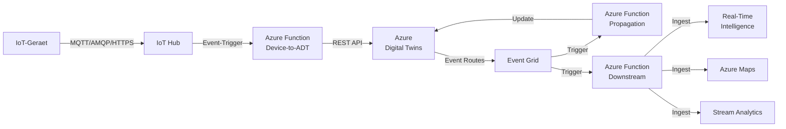

# Azure Digital Twins

> [!ABSTRACT]
> Azure Digital Twins (ADT) ist ein PaaS-Dienst von Microsoft Azure, der eine digitale 3D-Repräsentation physischer Umgebungen als Graph-Modell ermöglicht. Auf Basis der Digital Twin Definition Language (DTDL) können Gebäude, Fabriken, Versorgungsnetze und andere komplexe Systeme als lebendige, datengetriebene Zwillinge modelliert, verknüpft und in Echtzeit abgefragt werden.

---

## Was ist Azure Digital Twins?

Azure Digital Twins ist ein IoT-Plattformdienst, der es ermöglicht, vollständige Modelle physischer Umgebungen in der Cloud zu erstellen. Im Gegensatz zu einem klassischen IoT-Device-Management-Dienst wie IoT Hub liegt der Fokus von ADT auf der **semantischen Beziehung** zwischen Entitäten.

Kernkonzepte:

- **Modelle** definieren den Typ (z. B. „Raum", „Maschine") auf Basis von DTDL
- **Twins** sind Instanzen dieser Modelle mit eigenen Property-Werten
- **Beziehungen (Relationships)** verbinden Twins zu einem gerichteten Graphen
- **Abfragesprache** ermöglicht SQL-ähnliche Graph-Traversal-Queries

### Einsatzszenarien

| Domäne | Beispiel-Entitäten | Beziehungen |
|---|---|---|
| Smart Building | Raum, Etage, Gebäude, HLK-Anlage | `isPartOf`, `contains`, `feeds` |
| Smart Factory | Maschine, Produktionslinie, Werk | `isPartOf`, `produces`, `drives` |
| Connected Assets | Fahrzeug, Sensor, Wartungsauftrag | `hasComponent`, `monitors` |
| Supply Chain | Lieferant, Lager, Lieferung, Produkt | `suppliesTo`, `storedIn` |
| Smart City | Gebäude, Straße, Energienetz | `connectedTo`, `locatedIn` |

---

## Digital Twin Definition Language (DTDL)

DTDL ist eine auf **JSON-LD** basierende Sprache zur Beschreibung von Modellen. Sie definiert, welche Properties, Telemetry-Streams, Relationships, Commands und Components ein Zwilling haben kann.

### DTDL-Versions-Übersicht

| Version | Status | Wichtige Merkmale |
|---|---|---|
| DTDL v2 | Allgemein verfügbar | Basis-Features, weit verbreitet |
| DTDL v3 | Allgemein verfügbar | Enum-Erweiterungen, Maps, verbesserte Semantik |

### DTDL Element-Typen

| Element | Zweck | Persistenz | Beispiel |
|---|---|---|---|
| **Property** | Zustand eines Twins (persistiert) | Ja, gespeichert in ADT | `temperature`, `occupancy` |
| **Telemetry** | Echtzeit-Datenstrom (nicht persistiert) | Nein, nur Event | Sensorwerte, Messdaten |
| **Relationship** | Gerichtete Kante zwischen zwei Twins | Im Graph | `isPartOf`, `contains` |
| **Component** | Eingebettetes Sub-Modell (kein eigener Twin) | Teil des Twin | `thermostat` in `room` |
| **Command** | Aufrufbare Funktion am Twin | Nein | `reboot`, `setMode` |

> [!NOTE]
> **Telemetry vs. Property**: Telemetry-Werte werden **nicht** in ADT gespeichert. Sie müssen bei Bedarf an nachgelagerte Dienste (z. B. Real-Time Intelligence / Time Series Insights) weitergeleitet werden. Properties hingegen werden im ADT-Graph persistiert und können jederzeit abgefragt werden.

---

## DTDL-Modelle erstellen

### Syntax-Grundlagen

Ein DTDL-Modell ist ein JSON-LD-Dokument mit folgenden Pflichtfeldern:

```json
{
  "@context": "dtmi:dtdl:context;2",
  "@type": "Interface",
  "@id": "dtmi:example:Room;1",
  "displayName": "Raum",
  "description": "Modell fuer einen einzelnen Raum im Gebaeude",
  "contents": []
}
```

- `@context`: Verweist auf die DTDL-Version
- `@type`: Immer `Interface` fuer ein Modell
- `@id`: Digital Twin Model Identifier (DTMI) — Format `dtmi:<Pfad>;<Version>`
- `contents`: Array aus Properties, Telemetry, Relationships, Components, Commands

### Vollständiges Raummodell

```json
{
  "@context": "dtmi:dtdl:context;2",
  "@type": "Interface",
  "@id": "dtmi:example:building:Room;1",
  "displayName": "Raum",
  "description": "Repraesentiert einen physischen Raum in einem Gebaeude",
  "contents": [
    {
      "@type": "Property",
      "name": "roomNumber",
      "displayName": "Raumnummer",
      "schema": "string",
      "writable": true
    },
    {
      "@type": "Property",
      "name": "occupancy",
      "displayName": "Belegung",
      "schema": "integer",
      "writable": true
    },
    {
      "@type": ["Property", "Temperature"],
      "name": "temperature",
      "displayName": "Temperatur",
      "schema": "double",
      "unit": "degreeCelsius",
      "writable": false
    },
    {
      "@type": "Property",
      "name": "humidity",
      "displayName": "Luftfeuchtigkeit",
      "schema": "double",
      "writable": false
    },
    {
      "@type": "Telemetry",
      "name": "co2Level",
      "displayName": "CO2-Gehalt",
      "schema": "double"
    },
    {
      "@type": "Relationship",
      "name": "isPartOf",
      "displayName": "Ist Teil von",
      "target": "dtmi:example:building:Floor;1",
      "maxMultiplicity": 1
    },
    {
      "@type": "Command",
      "name": "setLightLevel",
      "displayName": "Lichtstaerke setzen",
      "request": {
        "name": "level",
        "schema": "integer"
      },
      "response": {
        "name": "result",
        "schema": "string"
      }
    }
  ]
}
```

### Etagen-Modell (Relationship-Target)

```json
{
  "@context": "dtmi:dtdl:context;2",
  "@type": "Interface",
  "@id": "dtmi:example:building:Floor;1",
  "displayName": "Etage",
  "contents": [
    {
      "@type": "Property",
      "name": "floorNumber",
      "schema": "integer",
      "writable": true
    },
    {
      "@type": "Relationship",
      "name": "isPartOf",
      "displayName": "Ist Teil von",
      "target": "dtmi:example:building:Building;1",
      "maxMultiplicity": 1
    }
  ]
}
```

> [!TIP]
> DTMIs sind global eindeutige Bezeichner. Verwende eine konsistente Namenskonvention wie `dtmi:<organisation>:<domäne>:<typ>;<version>`. Beispiel: `dtmi:contoso:smartbuilding:Room;1`

---

## Twins und Twin-Graphen

### Twins als Modell-Instanzen

Jeder Twin ist eine Instanz eines DTDL-Modells. Er besitzt:
- Eine eindeutige **Twin-ID** (frei wählbarer String)
- Eine **Modell-Referenz** (`$metadata.$model`)
- **Property-Werte** entsprechend dem Modell
- **Relationships** zu anderen Twins

### Typischer Building-Graph



### Graph-Visualisierung mit ADT Explorer

ADT Explorer ist ein browserbasiertes Tool, das über `https://explorer.digitaltwins.azure.net` erreichbar ist. Es ermöglicht:
- Upload und Verwaltung von DTDL-Modellen
- Erstellen, Bearbeiten und Löschen von Twins
- Visualisierung des Twin-Graphen
- Ausführen von ADT-Queries
- Import/Export von Twins und Relationships als JSON

> [!TIP]
> ADT Explorer ist Open Source und kann auch lokal als Docker-Container betrieben werden: `docker run -it -p 3000:3000 mcr.microsoft.com/adt/explorer`

---

## ADT Query Language

Die ADT Query Language ist eine SQL-ähnliche Sprache zur Abfrage von Twins und Relationships im Graph.

### Grundlegende Syntax

```sql
-- Alle Twins abfragen
SELECT * FROM DIGITALTWINS

-- Twins nach Modell filtern
SELECT * FROM DIGITALTWINS WHERE IS_OF_MODEL('dtmi:example:building:Room;1')

-- Twins nach Property filtern
SELECT * FROM DIGITALTWINS WHERE temperature > 25.0

-- Bestimmte Properties projizieren
SELECT T.roomNumber, T.temperature, T.occupancy
FROM DIGITALTWINS T
WHERE IS_OF_MODEL(T, 'dtmi:example:building:Room;1')
  AND T.occupancy > 0

-- Twins ueber Relationship traversieren (JOIN)
SELECT Room, Floor
FROM DIGITALTWINS Room
JOIN Floor RELATED Room.isPartOf
WHERE IS_OF_MODEL(Room, 'dtmi:example:building:Room;1')

-- Mehrstufige Traversierung
SELECT Room, Floor, Building
FROM DIGITALTWINS Room
JOIN Floor RELATED Room.isPartOf
JOIN Building RELATED Floor.isPartOf
WHERE Room.$dtId = 'room-101'
```

> [!NOTE]
> ADT unterstützt **keine** rekursiven Queries (keine unbegrenzte Graph-Traversierung). Die Anzahl der JOINs ist auf **5** begrenzt. Für tiefere Traversierungen müssen mehrere Queries kombiniert werden.

---

## Architektur und Daten-Ingestion Pipeline

### Gesamtarchitektur



### Ingestion-Ablauf (Schritt für Schritt)

**1. Gerätedaten ankommen (IoT Hub)**

Geräte senden Telemetry und Property-Updates über IoT Hub. Eine Azure Function wird durch den IoT Hub Event Hub-kompatiblen Endpunkt getriggert.

**2. Azure Function verarbeitet Nachrichten**

Die Function liest die Gerätedaten, mappt sie auf ADT-Twin-IDs und ruft die ADT REST API auf.

**3. ADT speichert Property-Updates**

Property-Updates werden persistent im Twin-Graph gespeichert. Telemetry-Nachrichten werden direkt an Event Grid weitergeleitet.

**4. Event Routes leiten Daten weiter**

ADT-Ereignisse (Lifecycle, Property-Changes, Telemetry) werden über Event Grid an Subscriber gesendet.

### Event Route Typen

| Event-Typ | Beschreibung | Typische Downstream-Verarbeitung |
|---|---|---|
| `Microsoft.DigitalTwins.Twin.Create` | Neuer Twin erstellt | Logging, Inventar-Update |
| `Microsoft.DigitalTwins.Twin.Update` | Property geaendert | Time Series, Dashboard |
| `Microsoft.DigitalTwins.Twin.Delete` | Twin geloescht | Cleanup, Archivierung |
| `Microsoft.DigitalTwins.Relationship.Create` | Neue Relationship | Graph-Analyse |
| `Microsoft.DigitalTwins.Relationship.Delete` | Relationship entfernt | Graph-Analyse |

---

## Python SDK

### Installation

```bash
pip install azure-digitaltwins-core azure-identity
```

### Twins erstellen und verwalten

```python
from azure.identity import DefaultAzureCredential
from azure.digitaltwins.core import DigitalTwinsClient

# Client initialisieren
credential = DefaultAzureCredential()
client = DigitalTwinsClient(
    endpoint="https://<adt-instanz>.api.weu.digitaltwins.azure.net",
    credential=credential
)

# Gebaeude-Twin erstellen
building_twin = {
    "$metadata": {
        "$model": "dtmi:example:building:Building;1"
    },
    "name": "Hauptgebaeude",
    "address": "Musterstrasse 1, Berlin"
}
client.upsert_digital_twin("building-hq", building_twin)
print("Gebaeude-Twin erstellt: building-hq")

# Etagen-Twin erstellen
floor_twin = {
    "$metadata": {
        "$model": "dtmi:example:building:Floor;1"
    },
    "floorNumber": 0
}
client.upsert_digital_twin("floor-eg", floor_twin)
print("Etagen-Twin erstellt: floor-eg")

# Raum-Twin erstellen
room_twin = {
    "$metadata": {
        "$model": "dtmi:example:building:Room;1"
    },
    "roomNumber": "101",
    "temperature": 21.5,
    "humidity": 45.0,
    "occupancy": 3
}
client.upsert_digital_twin("room-101", room_twin)
print("Raum-Twin erstellt: room-101")

# Relationship erstellen: Raum isPartOf Etage
relationship = {
    "$relationshipId": "room-101-isPartOf-floor-eg",
    "$sourceId": "room-101",
    "$relationshipName": "isPartOf",
    "$targetId": "floor-eg"
}
client.upsert_relationship(
    "room-101",
    "room-101-isPartOf-floor-eg",
    relationship
)
print("Relationship erstellt: room-101 -> floor-eg")

# Relationship erstellen: Etage isPartOf Gebaeude
floor_rel = {
    "$relationshipId": "floor-eg-isPartOf-building-hq",
    "$sourceId": "floor-eg",
    "$relationshipName": "isPartOf",
    "$targetId": "building-hq"
}
client.upsert_relationship(
    "floor-eg",
    "floor-eg-isPartOf-building-hq",
    floor_rel
)
print("Relationship erstellt: floor-eg -> building-hq")

# Twin lesen
twin = client.get_digital_twin("room-101")
print(f"Temperatur in Raum 101: {twin['temperature']} Grad Celsius")

# Property aktualisieren (JSON Patch)
from azure.core.exceptions import HttpResponseError
import json

patch = [
    {
        "op": "replace",
        "path": "/temperature",
        "value": 22.3
    },
    {
        "op": "replace",
        "path": "/occupancy",
        "value": 5
    }
]
client.update_digital_twin("room-101", patch)
print("Temperatur und Belegung aktualisiert")

# ADT Query ausfuehren
query = "SELECT * FROM DIGITALTWINS WHERE IS_OF_MODEL('dtmi:example:building:Room;1') AND temperature > 22"
query_result = client.query_twins(query)
print("\nRaeume mit Temperatur > 22 Grad:")
for twin in query_result:
    print(f"  - {twin['$dtId']}: {twin.get('temperature', 'N/A')} Grad, Belegung: {twin.get('occupancy', 0)}")

# Alle Relationships eines Twins abrufen
relationships = client.list_relationships("room-101")
print("\nRelationships von room-101:")
for rel in relationships:
    print(f"  - {rel['$relationshipName']} -> {rel['$targetId']}")

# Twin loeschen (erst alle Relationships entfernen)
for rel in client.list_relationships("room-101"):
    client.delete_relationship("room-101", rel["$relationshipId"])
client.delete_digital_twin("room-101")
print("Raum-Twin room-101 geloescht")
```

### Modell hochladen

```python
import json

# DTDL-Modell aus Datei laden
with open("room_model.json", "r", encoding="utf-8") as f:
    models = [json.load(f)]

# Modell in ADT registrieren
client.create_models(models)
print("Modell erfolgreich hochgeladen")

# Alle Modelle auflisten
for model in client.list_models():
    print(f"  Modell: {model.id} - {model.display_name}")
```

> [!WARNING]
> Modelle können in ADT nicht direkt geändert werden, sobald Twins davon existieren. Eine neue Version des Modells muss hochgeladen werden (z. B. `Room;2`), und bestehende Twins müssen migriert werden.

---

## Integration mit nachgelagerten Diensten

### Real-Time Intelligence (ehemals Time Series Insights)

ADT-Telemetry-Events werden über Event Grid → Azure Function → KQL-Datenbank (Kusto) in Microsoft Fabric Real-Time Intelligence gespeichert. Dies ermöglicht:
- Langzeit-Zeitreihenspeicherung
- Historische Analysen
- Anomalie-Erkennung

### Azure Maps Integration

ADT kann mit Azure Maps verknüpft werden, um Twins auf 2D/3D-Grundrissen anzuzeigen:
- Indoor-Karten mit Azure Maps Creator
- Echtzeit-Status von Räumen direkt auf dem Grundriss
- Drill-Down von Gebäude → Etage → Raum

### Integration mit Power BI

Über den ADT Query Explorer oder Azure Data Explorer kann der Twin-Graph in Power BI visualisiert werden:

```bash
# Daten exportieren fuer Power BI
az dt twin query \
  --dt-name myADTInstance \
  --query-command "SELECT * FROM DIGITALTWINS WHERE IS_OF_MODEL('dtmi:example:building:Room;1')" \
  --output json > twins_export.json
```

---

## Sicherheit und Zugriffskontrolle

### RBAC-Rollen

| Rolle | Berechtigungen | Typischer Nutzer |
|---|---|---|
| Azure Digital Twins Data Owner | Vollzugriff auf Twins, Modelle, Event Routes | Administrator, Entwickler |
| Azure Digital Twins Data Reader | Nur lesen (Twins, Modelle, Queries) | Analyst, Dashboard-Anwendung |

> [!IMPORTANT]
> ADT-Datenzugriff erfordert explizite RBAC-Zuweisung auf der ADT-Instanz-Ebene. **Subscription-Owner-Berechtigungen reichen nicht aus** — die Rolle muss direkt auf der ADT-Ressource zugewiesen werden.

### Managed Identity für Azure Functions

```bash
# Managed Identity fuer Function App aktivieren
az functionapp identity assign \
  --name myFunctionApp \
  --resource-group myResourceGroup

# RBAC-Rolle auf ADT zuweisen
PRINCIPAL_ID=$(az functionapp identity show \
  --name myFunctionApp \
  --resource-group myResourceGroup \
  --query principalId --output tsv)

az dt rbac assign-role \
  --dt-name myADTInstance \
  --assignee $PRINCIPAL_ID \
  --role "Azure Digital Twins Data Owner"
```

### Private Endpoints

```bash
# Private Endpoint fuer ADT erstellen
az network private-endpoint create \
  --name myADTPrivateEndpoint \
  --resource-group myResourceGroup \
  --vnet-name myVNet \
  --subnet mySubnet \
  --private-connection-resource-id $(az dt show --dt-name myADTInstance --query id -o tsv) \
  --group-id API \
  --connection-name myADTConnection
```

---

## Bereitstellung und Verwaltung

### ADT-Instanz erstellen

```bash
# Resource Group erstellen
az group create --name rg-adt-demo --location westeurope

# ADT-Instanz erstellen
az dt create \
  --dt-name myADTInstance \
  --resource-group rg-adt-demo \
  --location westeurope

# ADT-Instanz-Hostname abfragen
az dt show \
  --dt-name myADTInstance \
  --query "hostName" \
  --output tsv
```

### Event Route konfigurieren

```bash
# Event Grid Topic erstellen
az eventgrid topic create \
  --name adt-events-topic \
  --resource-group rg-adt-demo \
  --location westeurope

# Event Route in ADT erstellen
TOPIC_ID=$(az eventgrid topic show \
  --name adt-events-topic \
  --resource-group rg-adt-demo \
  --query id --output tsv)

az dt route create \
  --dt-name myADTInstance \
  --endpoint-name adt-eg-endpoint \
  --route-name all-events-route \
  --filter "true"
```

### Kosten-Übersicht

| Kostenfaktor | Einheit | Preis (ca.) |
|---|---|---|
| API-Operationen (Lesen) | Pro Million | ~0,65 USD |
| API-Operationen (Schreiben) | Pro Million | ~0,65 USD |
| Nachrichten (Event Routes) | Pro Million | ~0,65 USD |
| Query Units | Pro Million CUs | ~0,65 USD |
| Grundgebühr | Monatlich | **0 USD** |

> [!TIP]
> Azure Digital Twins hat **keine monatliche Grundgebühr** — Kosten entstehen ausschließlich durch die tatsächliche Nutzung (API-Calls, Messages, Queries). Für Entwicklungs- und Testszenarien fallen daher nur sehr geringe Kosten an.

---

## CLI-Schnellreferenz

```bash
# Twins verwalten
az dt twin create --dt-name <instanz> --dtmi <modell-id> --twin-id <id>
az dt twin show --dt-name <instanz> --twin-id <id>
az dt twin update --dt-name <instanz> --twin-id <id> --json-patch '[{"op":"replace","path":"/temperature","value":22}]'
az dt twin delete --dt-name <instanz> --twin-id <id>

# Relationships verwalten
az dt twin relationship create --dt-name <instanz> --twin-id <quelle> --relationship-id <rel-id> --relationship <name> --target <ziel>
az dt twin relationship list --dt-name <instanz> --twin-id <id>

# Modelle verwalten
az dt models create --dt-name <instanz> --models <pfad-zur-dtdl-json>
az dt models list --dt-name <instanz>
az dt models delete --dt-name <instanz> --dtmi <modell-id>

# Queries ausfuehren
az dt twin query --dt-name <instanz> --query-command "SELECT * FROM DIGITALTWINS"

# Event Routes
az dt route create --dt-name <instanz> --endpoint-name <ep> --route-name <name> --filter "true"
az dt route list --dt-name <instanz>
```

---

## Verwandte Notizen

- [[Azure IoT Hub]]
- [[Azure IoT Central]]
- [[Azure IoT Edge]]
