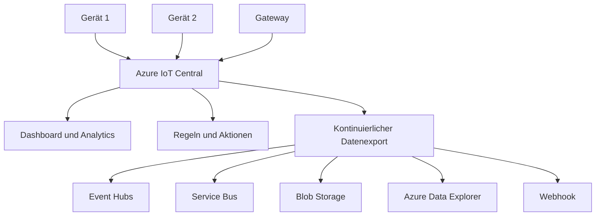
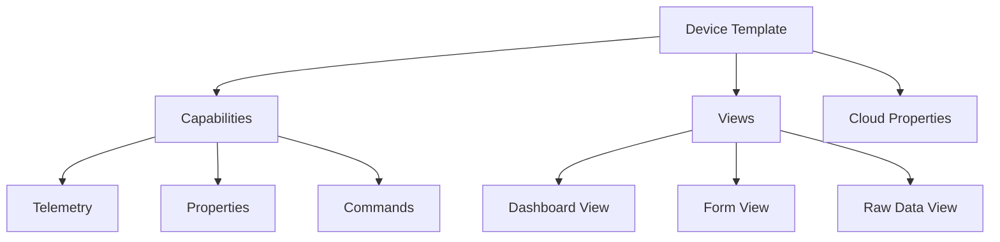
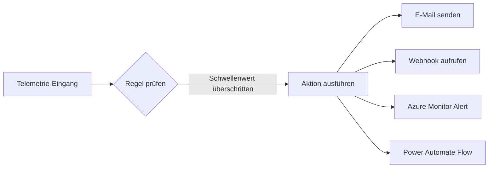
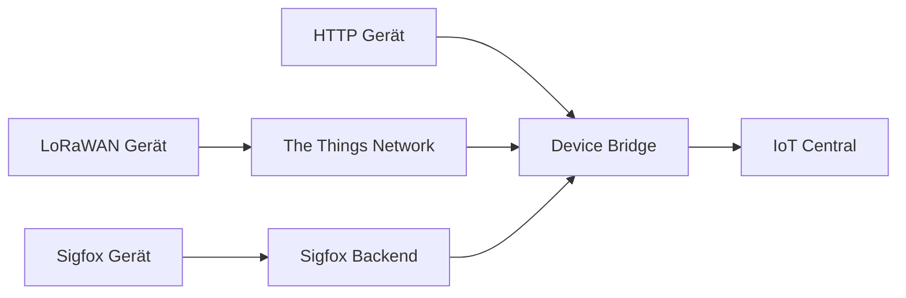

---
tags:
  - azure
  - iot
  - managed-platform
  - paas
aliases:
  - IoT Central
---

# Azure IoT Central

> [!ABSTRACT] TL;DR
> Azure IoT Central ist eine vollständig verwaltete IoT-SaaS-Anwendungsplattform. Kein Infrastruktur-Management erforderlich — Device Templates, Dashboards, Regeln, Aktionen und Datenexport sind eingebaut. Ideal für schnelle IoT-Lösungen ohne tiefes Cloud-Know-how.

---

## Was ist Azure IoT Central?

Azure IoT Central ist eine **vollständig verwaltete IoT-Anwendungsplattform** (aPaaS/SaaS), die auf Azure IoT Hub und anderen Azure-Diensten aufbaut. Im Gegensatz zu IoT Hub müssen Anwender keine Infrastruktur aufbauen oder verwalten.

**Kernprinzip:**



**Vorteile gegenüber IoT Hub:**
- Kein eigenes Backend für grundlegende Szenarien notwendig
- Eingebautes Dashboard, Visualisierungen und Analytics
- Geräteverwaltung out-of-the-box
- Regeln und Aktionen ohne Code konfigurierbar
- Kontinuierlicher Datenexport ohne Azure Functions/Logic Apps

> [!NOTE] Basiert auf IoT Hub
> Azure IoT Central nutzt intern Azure IoT Hub als Gerätekommunikations-Layer, abstrahiert aber alle Details. Geräte verbinden sich über MQTT, AMQP oder HTTP — genau wie bei IoT Hub direkt.

---

## Device Templates (Gerätevorlagen)

Device Templates sind das **Herzstück** von IoT Central. Sie beschreiben, welche Daten ein Gerät sendet und welche Befehle es akzeptiert.

**Aufbau eines Device Templates:**



### Capability Types

| Typ | Beschreibung | Beispiel |
|-----|-------------|---------|
| **Telemetry** | Zeitreihendaten vom Gerät | Temperatur, Luftfeuchtigkeit, GPS-Position |
| **Property (writeable)** | Konfiguration vom Cloud zum Gerät | Alarm-Schwellenwert, Sendeintervall |
| **Property (read-only)** | Gemeldeter Gerätezustand | Firmware-Version, Akkustand |
| **Command** | Befehl an das Gerät | Neustart, Kalibrierung, LED ein/aus |

### DTDL-basierte Templates

Device Templates basieren auf der **Digital Twin Definition Language (DTDL)** v2:

```json
{
  "@context": "dtmi:dtdl:context;2",
  "@id": "dtmi:com:example:TemperatureSensor;1",
  "@type": "Interface",
  "displayName": "Temperature Sensor",
  "contents": [
    {
      "@type": ["Telemetry", "Temperature"],
      "name": "temperature",
      "displayName": "Temperatur",
      "schema": "double",
      "unit": "degreeCelsius"
    },
    {
      "@type": "Property",
      "name": "alertThreshold",
      "displayName": "Alarm-Schwellenwert",
      "schema": "double",
      "writable": true
    },
    {
      "@type": "Command",
      "name": "reboot",
      "displayName": "Gerät neu starten"
    }
  ]
}
```

---

## Telemetrie, Properties und Commands

### Telemetrie empfangen

Geräte senden Telemetrie als JSON-Payload:

```python
# Python — Telemetrie an IoT Central senden
from azure.iot.device.aio import IoTHubDeviceClient
import asyncio, json

# DPS-basierter Connection String für IoT Central
PROVISIONING_HOST = "global.azure-devices-provisioning.net"
ID_SCOPE = "0ne00XXXXXX"
DEVICE_ID = "sensor01"
DEVICE_KEY = "..."

async def send_telemetry():
    from azure.iot.device.aio import ProvisioningDeviceClient
    from azure.iot.device import Message

    prov_client = ProvisioningDeviceClient.create_from_symmetric_key(
        provisioning_host=PROVISIONING_HOST,
        registration_id=DEVICE_ID,
        id_scope=ID_SCOPE,
        symmetric_key=DEVICE_KEY
    )
    result = await prov_client.register()
    device_client = IoTHubDeviceClient.create_from_symmetric_key(
        symmetric_key=DEVICE_KEY,
        hostname=result.registration_state.assigned_hub,
        device_id=result.registration_state.device_id
    )
    await device_client.connect()

    payload = {"temperature": 22.5, "humidity": 65.0}
    msg = Message(json.dumps(payload))
    msg.content_encoding = "utf-8"
    msg.content_type = "application/json"
    await device_client.send_message(msg)
    await device_client.disconnect()

asyncio.run(send_telemetry())
```

### Properties schreiben und lesen

Properties ermöglichen die bidirektionale Konfiguration:

```python
# Writeable Property Handler
async def property_handler(patch):
    print(f"Neue Property erhalten: {patch}")
    # Konfiguration anwenden...
    reported = {"alertThreshold": patch.get("alertThreshold")}
    await device_client.patch_twin_reported_properties(reported)

device_client.on_twin_desired_properties_patch_received = property_handler
```

---

## Dashboard und Analytics

IoT Central bietet **eingebettete Visualisierungen** ohne externe Tools:

**Dashboard-Komponenten:**

| Komponente | Beschreibung |
|-----------|-------------|
| Line Chart | Zeitreihendaten visualisieren |
| Bar Chart | Vergleiche zwischen Geräten |
| Map | GPS-Positionen auf Karte |
| KPI Tile | Einzelne Kennzahl prominent darstellen |
| Last Known Value | Letzter gemeldeter Wert |
| Event History | Ereignisprotokoll |
| Property Tile | Aktuellen Property-Wert anzeigen |
| Image | Statisches Bild oder Grundriss |

**Analytics-Seite:**
- Flexible Ad-hoc-Abfragen über alle Geräte
- Aggregationen (Durchschnitt, Min, Max, Summe, Anzahl)
- Zeitbereich wählbar (letzte Stunde bis 30 Tage)
- CSV-Export möglich

> [!TIP] Custom Dashboards
> Erstelle separate Dashboards für verschiedene Rollen: Operator-Dashboard (einfache KPIs), Engineer-Dashboard (technische Details), Management-Dashboard (Business Metrics).

---

## Regeln und Aktionen

Regeln reagieren automatisch auf Telemetrie-Werte oder Gerätestatus:



**Regeltypen:**

| Typ | Beschreibung | Beispiel |
|-----|-------------|---------|
| Telemetry Rule | Schwellenwert auf Telemetrie-Wert | Temperatur > 30°C |
| Event Rule | Bestimmtes Ereignis aufgetreten | Gerät meldet "alarm" |
| Property Rule | Property-Wert ändert sich | Batteriestand < 10% |

**Aktionen:**

| Aktion | Beschreibung |
|--------|-------------|
| E-Mail | Benachrichtigung mit Gerätedaten |
| Webhook | HTTP POST an beliebige URL (Teams, Slack, etc.) |
| Azure Monitor | Alert in Azure Monitor erstellen |
| Power Automate | Microsoft Flow/Power Automate auslösen |
| Azure Service Bus | Nachricht in Queue/Topic senden |

**Beispiel-Webhook Payload:**

```json
{
  "id": "xxxxxxxx-xxxx-xxxx-xxxx-xxxxxxxxxxxx",
  "displayName": "Temperatur-Alarm",
  "triggered": "2025-01-15T10:30:00Z",
  "device": {
    "id": "sensor01",
    "displayName": "Temperatursensor Halle 1"
  },
  "telemetry": {
    "temperature": 32.5
  }
}
```

---

## Kontinuierlicher Datenexport (CDE)

Der **Kontinuierliche Datenexport** leitet Daten aus IoT Central in andere Azure-Dienste oder externe Systeme:

**Unterstützte Destinations:**

| Ziel | Verwendung | Format |
|------|-----------|--------|
| **Azure Event Hubs** | Stream-Verarbeitung (Stream Analytics, Functions) | JSON |
| **Azure Service Bus** | Zuverlässige Queue-basierte Verarbeitung | JSON |
| **Azure Blob Storage** | Langzeitspeicherung, Data Lake | JSON (eine Datei pro Minute) |
| **Azure Data Explorer (ADX)** | Zeitreihen-Analytics, Kusto-Abfragen | Direkte Ingestion |
| **Webhook** | Externe Systeme, eigene APIs | JSON POST |

**Exportierbare Daten:**

| Datentyp | Beschreibung |
|----------|-------------|
| Telemetry | Alle Telemetrie-Nachrichten |
| Property Changes | Änderungen an reported/desired Properties |
| Device Connectivity | Connect/Disconnect-Ereignisse |
| Device Lifecycle | Gerät erstellt, gelöscht, aktualisiert |
| Device Template | Template-Änderungen |

```json
// Beispiel CDE Telemetrie-Export
{
  "applicationId": "xxxxxxxx-xxxx-xxxx-xxxx-xxxxxxxxxxxx",
  "messageSource": "telemetry",
  "deviceId": "sensor01",
  "schema": "default@v1",
  "templateId": "dtmi:com:example:TemperatureSensor;1",
  "enqueuedTime": "2025-01-15T10:30:00.000Z",
  "telemetry": {
    "temperature": 22.5,
    "humidity": 65.0
  },
  "messageProperties": {},
  "enrichments": {
    "location": "Werk-Berlin"
  }
}
```

> [!NOTE] Enrichments im CDE
> Füge dem exportierten Datenstrom zusätzliche Felder hinzu (z.B. Device Template Name, Custom Properties). Nützlich für nachgelagerte Verarbeitungs-Pipelines.

---

## Organizations und Rollen

**Hierarchische Organisationsstruktur** für Multi-Tenant-Szenarien:

```
IoT Central Application
└── Root Organization
    ├── Region: Europa
    │   ├── Werk Berlin
    │   └── Werk München
    └── Region: Amerika
        └── Werk New York
```

**Eingebaute Rollen:**

| Rolle | Berechtigungen |
|-------|---------------|
| **Administrator** | Alle Berechtigungen inkl. User-Management und App-Konfiguration |
| **Builder** | Device Templates erstellen, Dashboards konfigurieren, Regeln erstellen |
| **Operator** | Geräte verwalten, Dashboards anzeigen, Jobs ausführen |
| **Viewer** | Nur Lesezugriff auf Dashboards und Gerätedaten |

**Custom Roles:**
Eigene Rollen mit granularen Berechtigungen konfigurierbar (z.B. "Nur Geräte in Werk Berlin sehen").

---

## IoT Central API

Die **REST API** ermöglicht die Automatisierung aller IoT Central-Operationen:

```bash
# API Token erstellen
az iot central api-token create \
  --app-id myapp \
  --token-id mytoken \
  --role admin

# Geräteliste abrufen
curl -X GET \
  "https://myapp.azureiotcentral.com/api/devices?api-version=2022-07-31" \
  -H "Authorization: SharedAccessSignature sr=..."

# Telemetrie abfragen (letzter Wert)
curl -X GET \
  "https://myapp.azureiotcentral.com/api/devices/sensor01/telemetry/temperature?api-version=2022-07-31" \
  -H "Authorization: ..."
```

**API-Endpunkte:**

| Ressource | Endpunkt |
|-----------|---------|
| Devices | `/api/devices` |
| Device Templates | `/api/deviceTemplates` |
| Jobs | `/api/jobs` |
| Rules | `/api/rules` |
| Dashboards | `/api/dashboards` |
| Data Export | `/api/dataExports` |
| Organizations | `/api/organizations` |

---

## Device Bridge

Die **IoT Central Device Bridge** ermöglicht die Anbindung von Geräten, die kein natives Azure IoT SDK haben:



**Unterstützte Szenarien:**
- LoRaWAN-Geräte via The Things Network (TTN)
- Sigfox-Geräte
- Legacy HTTP-Geräte
- Drittanbieter IoT-Clouds (AWS IoT, Google Cloud IoT)

Die Device Bridge ist eine **Azure Function**, die als Open Source auf GitHub verfügbar ist.

---

## White-Labeling und Custom Applications

IoT Central unterstützt **vollständiges White-Labeling**:

- Custom Application Name und Logo
- Benutzerdefinierte Farben und Branding
- Custom Domains (`mycompany.azureiotcentral.com`)
- OEM-Partner können eigene IoT-Anwendungen auf Basis von IoT Central aufbauen
- Mehrere Anwendungen pro Azure-Abonnement

---

## IoT Hub vs. IoT Central — Vergleich

| Kriterium | IoT Hub (PaaS) | IoT Central (aPaaS) |
|-----------|---------------|-------------------|
| **Abstraktionsebene** | Infrastruktur-PaaS | Managed Application Platform |
| **Infrastruktur-Verwaltung** | Selbst verwaltet | Microsoft verwaltet |
| **Dashboard** | Nicht enthalten | Eingebaut |
| **Regeln und Aktionen** | Eigene Implementierung | Low-Code konfigurierbar |
| **Device Templates** | DTDL manuell verwalten | Eingebauter Template Designer |
| **Analytics** | Extern (Stream Analytics, Power BI) | Eingebaut |
| **Datenexport** | Message Routing | Kontinuierlicher Datenexport (CDE) |
| **Skalierbarkeit** | Bis zu Milliarden Geräten | Bis zu Millionen Geräten |
| **Customization** | Vollständig | UI-Ebene begrenzt |
| **Zielgruppe** | Cloud-Entwickler | Lösungsersteller, OT |
| **Time-to-Market** | Wochen bis Monate | Tage bis Wochen |
| **Kosten-Modell** | Pro Nachrichten-Unit | Pro Gerät pro Monat |

---

## Kosten

**Preismodell (2024/2025):**

| Plan | Preis | Geräte | Features |
|------|-------|--------|---------|
| **Standard 0** | Kostenlos | 2 Geräte | Alle Features (nur 2 Geräte!) |
| **Standard 1** | ~$0.016/Gerät/Monat | Unbegrenzt | Alle Features, bis 5.000 Nachr./Gerät/Monat |
| **Standard 2** | ~$0.10/Gerät/Monat | Unbegrenzt | Alle Features, bis 30.000 Nachr./Gerät/Monat |

**Zusätzliche Kosten:**
- Nachrichten über dem Kontingent: ~$0.006 pro 1.000 Nachrichten
- Datenexport: basierend auf Nachrichtenvolumen
- Storage für exportierte Daten (Blob, ADX etc.)

> [!TIP] Kostenoptimierung
> Beginne mit **Standard 0** für Entwicklung und Tests (2 Geräte kostenlos, alle Features). Wechsle zu **Standard 1** für Pilot-Projekte und **Standard 2** nur wenn das Nachrichtenvolumen es erfordert.

```powershell
# IoT Central Anwendung erstellen (Azure CLI)
az iot central app create \
  --name myiotapp \
  --resource-group myRG \
  --subdomain myiotapp \
  --sku ST1 \
  --template "iotc-pnp-preview" \
  --display-name "Meine IoT-Anwendung"
```

---

## Verwandte Notizen
- [[Azure IoT Hub]]
- [[Azure IoT Edge]]
- [[Azure Digital Twins]]
- [[Azure Event Hubs]]
