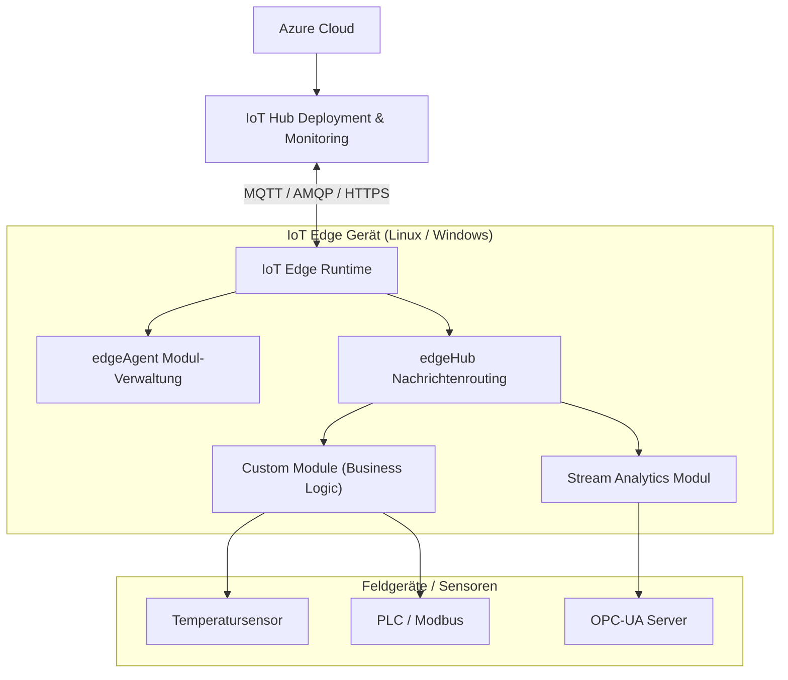
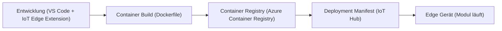
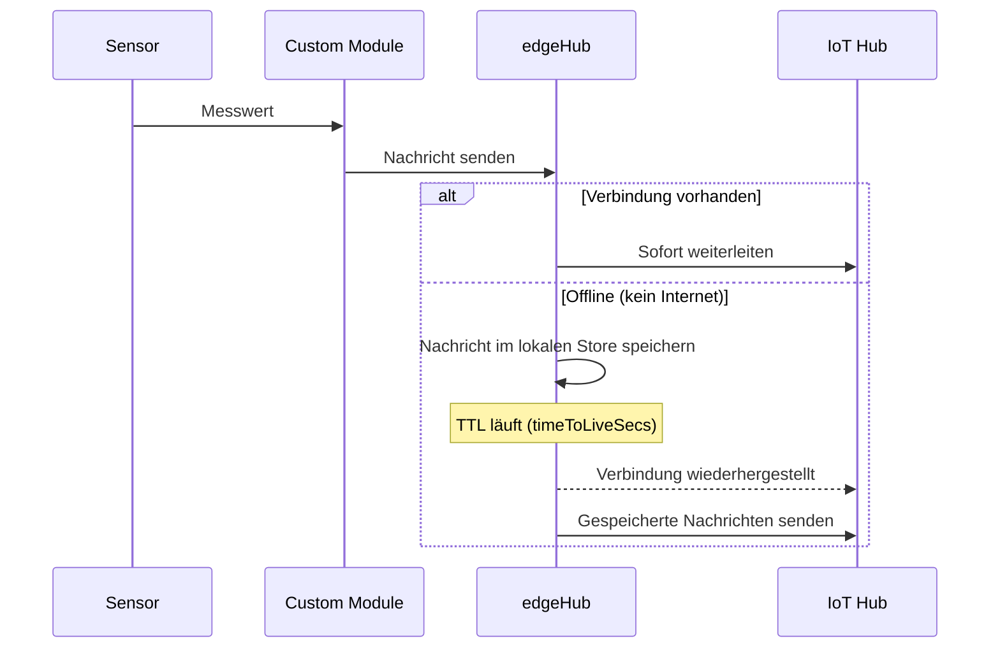
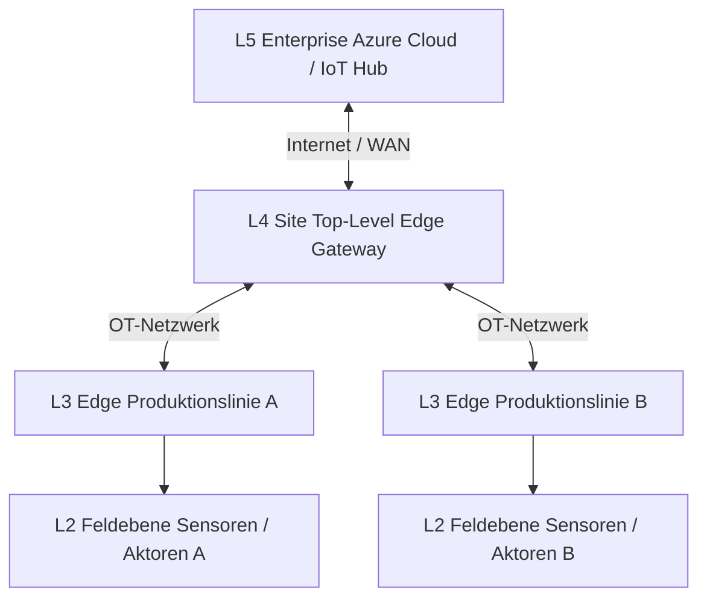
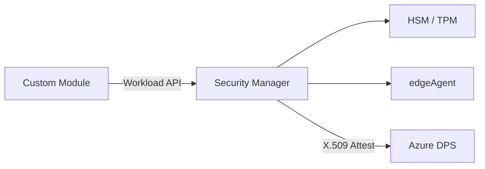

# Azure IoT Edge

> [!ABSTRACT]
> Azure IoT Edge ist eine vollständig verwaltete Service-Erweiterung des Azure IoT Hub, die es ermöglicht, Cloud-Workloads (Analysen, KI, Business Logic) direkt auf IoT-Geräten nahe der Datenquelle auszuführen. Containerisierte Module werden über IoT Hub zentral verwaltet und lokal auf Edge-Geräten betrieben — auch ohne permanente Cloud-Verbindung.

---

## Was ist Azure IoT Edge?

Azure IoT Edge verschiebt Cloud-Intelligenz an den Netzwerkrand (Edge). Anstatt alle Sensordaten in die Cloud zu senden, werden Daten lokal vorverarbeitet, gefiltert und analysiert. Nur relevante Ergebnisse oder Ereignisse werden an Azure weitergeleitet.

**Kernkomponenten:**

- **IoT Edge Runtime** — Läuft auf dem Edge-Gerät, verwaltet Module und Kommunikation
- **IoT Edge Modules** — Docker-Container mit Business Logic, ML-Modellen oder Protokoll-Adaptern
- **IoT Hub** — Zentrale Verwaltungsebene in der Cloud (Deployment, Monitoring, Twin)
- **Deployment Manifest** — JSON-Konfiguration, die definiert welche Module auf welchem Gerät laufen

---

## Edge Computing: Warum Edge?

| Anforderung | Problem ohne Edge | Lösung mit Edge |
|---|---|---|
| **Niedrige Latenz** | Cloud-Roundtrip: 50–200 ms | Lokale Verarbeitung: < 1 ms |
| **Begrenzte Konnektivität** | Datenverlust bei Verbindungsausfall | Store-and-Forward (edgeHub) |
| **Bandbreite** | Rohdaten: GB/Tag → hohe Kosten | Aggregation → nur Ergebnisse senden |
| **Datensouveränität** | Sensible Daten verlassen Standort | Daten bleiben lokal verarbeitbar |
| **Compliance** | DSGVO / Industrienormen | Lokale Verarbeitung ohne Cloud-Pflicht |
| **Echtzeit-Reaktion** | Cloud-Entscheidungen zu langsam | Autonome Steuerung am Edge |

> [!IMPORTANT]
> Edge Computing ist kein Ersatz für die Cloud — es ist eine Erweiterung. Komplexe Trainings, Langzeitarchivierung und globale Koordination bleiben in der Cloud.

---

## IoT Edge Architektur

### Überblick



### Kommunikationsfluss

1. **Feldgeräte → Edge Module** — Protokolle: MQTT, Modbus, OPC-UA, HTTP
2. **Module ↔ edgeHub** — Internes Routing über Message Broker (MQTT-basiert)
3. **edgeHub → IoT Hub** — Upstream-Verbindung (AMQP/MQTT over TLS)
4. **IoT Hub → edgeAgent** — Deployment Manifest Updates, Desired Properties
5. **edgeAgent → Module** — Container starten, stoppen, aktualisieren

---

## System-Module

### edgeAgent

Der `edgeAgent` ist der **Verwaltungsagent** auf dem Edge-Gerät:

- Empfängt das Deployment Manifest vom IoT Hub
- Startet, stoppt und aktualisiert Container-Module
- Meldet den Status aller Module als Reported Properties zurück
- Überwacht Modulgesundheit und startet fehlerhafte Module neu
- Läuft selbst als privilegierter Container

### edgeHub

Der `edgeHub` ist der **lokale Message Broker**:

- Implementiert das IoT Hub-Protokoll lokal (MQTT/AMQP Endpoint)
- Routet Nachrichten zwischen Modulen (Module-to-Module Routing)
- **Store-and-Forward**: Speichert Nachrichten bei fehlender Cloud-Verbindung zwischen
- Leitet D2C-Nachrichten (Device-to-Cloud) an IoT Hub weiter, wenn Verbindung besteht
- Unterstützt lokale Authentifizierung für nachgelagerte Geräte

> [!NOTE]
> edgeHub speichert Nachrichten standardmäßig auf dem Dateisystem des Geräts. Das Speicher-Limit und die TTL (Time-to-Live) lassen sich über Desired Properties konfigurieren.

---

## Deployment Manifests

Das Deployment Manifest ist ein JSON-Dokument, das vollständig beschreibt, welche Module auf einem Edge-Gerät (oder einer Gruppe von Geräten) ausgeführt werden sollen.

```json
{
  "modulesContent": {
    "$edgeAgent": {
      "properties.desired": {
        "schemaVersion": "1.1",
        "runtime": {
          "type": "docker",
          "settings": {
            "minDockerVersion": "v1.25",
            "loggingOptions": "",
            "registryCredentials": {
              "myregistry": {
                "username": "myuser",
                "password": "<password>",
                "address": "myregistry.azurecr.io"
              }
            }
          }
        },
        "systemModules": {
          "edgeAgent": {
            "type": "docker",
            "settings": {
              "image": "mcr.microsoft.com/azureiotedge-agent:1.4",
              "createOptions": "{}"
            }
          },
          "edgeHub": {
            "type": "docker",
            "status": "running",
            "restartPolicy": "always",
            "settings": {
              "image": "mcr.microsoft.com/azureiotedge-hub:1.4",
              "createOptions": "{\"HostConfig\":{\"PortBindings\":{\"5671/tcp\":[{\"HostPort\":\"5671\"}],\"8883/tcp\":[{\"HostPort\":\"8883\"}],\"443/tcp\":[{\"HostPort\":\"443\"}]}}}"
            }
          }
        },
        "modules": {
          "TemperatureFilter": {
            "version": "1.0",
            "type": "docker",
            "status": "running",
            "restartPolicy": "always",
            "settings": {
              "image": "myregistry.azurecr.io/temperaturefilter:latest",
              "createOptions": "{}"
            }
          }
        }
      }
    },
    "$edgeHub": {
      "properties.desired": {
        "schemaVersion": "1.1",
        "routes": {
          "sensorToFilter": "FROM /messages/modules/TemperatureSensor/outputs/temperatureOutput INTO BrokeredEndpoint(\"/modules/TemperatureFilter/inputs/input1\")",
          "filterToHub": "FROM /messages/modules/TemperatureFilter/outputs/output1 INTO $upstream"
        },
        "storeAndForwardConfiguration": {
          "timeToLiveSecs": 7200
        }
      }
    },
    "TemperatureFilter": {
      "properties.desired": {
        "TemperatureThreshold": 25
      }
    }
  }
}
```

> [!TIP]
> Routes im Deployment Manifest folgen der SQL-ähnlichen Syntax. `$upstream` ist der spezielle Endpunkt für den IoT Hub. Module können direkt miteinander kommunizieren ohne den IoT Hub zu involvieren.

---

## Custom Modules entwickeln

### Entwicklungs-Workflow



### Python-Modul Beispiel

```python
import asyncio
from azure.iot.device.aio import IoTHubModuleClient

async def main():
    client = await IoTHubModuleClient.create_from_edge_environment()
    
    async def message_handler(message):
        # Verarbeite eingehende Nachricht
        data = message.data.decode("utf-8")
        print(f"Empfangen: {data}")
        
        # Sende verarbeitete Nachricht weiter
        await client.send_message_to_output(message, "output1")
    
    client.on_message_received = message_handler
    
    # Desired Properties Handler
    async def twin_patch_handler(patch):
        print(f"Twin Update: {patch}")
    
    client.on_twin_desired_properties_patch_received = twin_patch_handler
    
    print("Modul läuft. Warte auf Nachrichten...")
    await asyncio.Event().wait()

if __name__ == "__main__":
    asyncio.run(main())
```

### Dockerfile für Edge Module

```dockerfile
FROM python:3.11-slim

WORKDIR /app

COPY requirements.txt .
RUN pip install --no-cache-dir -r requirements.txt

COPY main.py .

CMD ["python", "main.py"]
```

---

## Azure Marketplace Module

| Modul | Anbieter | Verwendungszweck |
|---|---|---|
| **Azure Stream Analytics on Edge** | Microsoft | Echtzeit-Datenanalyse, Aggregation, Fenster-Abfragen |
| **Azure Custom Vision** | Microsoft | Bild-Klassifikation und Objekterkennung lokal |
| **Azure SQL Edge** | Microsoft | Relationale Datenbank für strukturierte Edge-Daten |
| **OPC Publisher** | Microsoft | OPC-UA → IoT Hub Protokollbrücke |
| **Azure Blob Storage on IoT Edge** | Microsoft | Lokaler Blob Storage mit Cloud-Synchronisierung |
| **NVIDIA DeepStream** | NVIDIA | GPU-beschleunigte Video-Analytik |
| **Modbus TCP Module** | Microsoft | Modbus-Geräte an IoT Edge anbinden |
| **Grafana** | Community | Lokales Dashboard für Edge-Metriken |

> [!TIP]
> Azure Stream Analytics on Edge ist besonders wertvoll: Die Abfrage wird in Azure definiert und automatisch als Deployment Manifest auf Edge-Geräte ausgerollt — kein manuelles Konfigurieren auf dem Gerät nötig.

---

## Offline-Fähigkeit und Store-and-Forward

### edgeHub Store-and-Forward



### Konfiguration Store-and-Forward

In den Desired Properties von `$edgeHub`:

```json
{
  "storeAndForwardConfiguration": {
    "timeToLiveSecs": 7200
  }
}
```

**Wichtige Parameter:**
- `timeToLiveSecs`: Maximale Speicherzeit (7200 = 2 Stunden), danach werden Nachrichten verworfen
- Speicherort: Standardmäßig im Container-Dateisystem (flüchtiger Speicher)
- Für Persistenz: Bind-Mount auf Host-Dateisystem über `createOptions`

> [!WARNING]
> Ohne persistenten Speicher-Mount gehen gespeicherte Nachrichten beim Neustart des edgeHub-Containers verloren. Bei kritischen Anwendungen immer ein Bind-Mount für `/tmp/edgehub` konfigurieren.

---

## Installation auf Ubuntu

### Voraussetzungen

- Ubuntu 20.04 LTS oder 22.04 LTS (x86_64 oder ARM64)
- Sudo-Berechtigungen
- Internetzugang für Package-Download

### Schritt-für-Schritt Installation

```bash
# 1. Paketliste aktualisieren
sudo apt-get update

# 2. Abhängigkeiten installieren
sudo apt-get install -y curl apt-transport-https

# 3. Microsoft Package Repository hinzufügen
curl https://packages.microsoft.com/config/ubuntu/22.04/packages-microsoft-prod.deb \
  -o packages-microsoft-prod.deb
sudo dpkg -i packages-microsoft-prod.deb
rm packages-microsoft-prod.deb

# 4. Paketliste mit Microsoft Repo aktualisieren
sudo apt-get update

# 5. Moby Container Engine installieren (empfohlene Container Runtime)
sudo apt-get install -y moby-engine

# 6. IoT Edge Runtime installieren
sudo apt-get install -y aziot-edge

# 7. Verbindung mit IoT Hub herstellen
# Option A: Connection String (einfachste Methode)
sudo iotedge config wizard

# Option B: Manuelle Konfiguration
sudo nano /etc/aziot/config.toml
```

```toml
# /etc/aziot/config.toml — Manuelle Konfiguration
[provisioning]
source = "manual"
connection_string = "HostName=my-iot-hub.azure-devices.net;DeviceId=my-edge-device;SharedAccessKey=<key>"
```

```bash
# 8. Konfiguration anwenden
sudo iotedge config apply

# 9. Dienste prüfen
sudo iotedge system status

# 10. Module prüfen (edgeAgent und edgeHub sollten laufen)
sudo iotedge list

# 11. Logs prüfen
sudo iotedge logs edgeAgent
sudo iotedge logs edgeHub

# Troubleshooting: Vollständige Systemprüfung
sudo iotedge check
```

### Provisioning über DPS (Device Provisioning Service)

```toml
# /etc/aziot/config.toml — DPS X.509 Provisioning
[provisioning]
source = "dps"
global_endpoint = "https://global.azure-devices-provisioning.net"
id_scope = "0ne000XXXXX"

[provisioning.attestation]
method = "x509"

[provisioning.attestation.identity_cert]
method = "est"
registration_id = "my-edge-device"

[provisioning.attestation.identity_cert.bootstrap_identity_cert]
cert_uri = "file:///var/lib/aziot/certd/certs/bootstrap.cer"
pk_uri = "file:///var/lib/aziot/certd/private/bootstrap.key.pem"
```

---

## IoT Edge auf Windows (EFLOW)

**EFLOW (Edge For Linux on Windows)** ermöglicht das Ausführen von IoT Edge auf Windows-Hosts über eine optimierte Linux-VM (Hyper-V).

```powershell
# EFLOW auf Windows 10/11 Pro oder Server installieren

# 1. PowerShell als Admin ausführen
# 2. EFLOW herunterladen und installieren
$msiPath = "$env:TEMP\AzureIoTEdge.msi"
$ProgressPreference = 'SilentlyContinue'
Invoke-WebRequest `
  "https://aka.ms/AzEFLOWMSI_1_4_LTS_X64" `
  -OutFile $msiPath

Start-Process -Wait msiexec -ArgumentList "/i","$msiPath","/qn"

# 3. EFLOW VM erstellen
Deploy-Eflow

# 4. IoT Edge Gerät provisionieren
Provision-EflowVm `
  -provisioningType ManualConnectionString `
  -devConnString "HostName=my-hub.azure-devices.net;DeviceId=device1;SharedAccessKey=<key>"

# 5. Status prüfen
Get-EflowVmName
Invoke-EflowVmCommand "sudo iotedge list"
```

---

## IoT Edge vs. Direkte IoT Hub-Verbindung

| Kriterium | Direktes IoT Hub Device | IoT Edge Gerät |
|---|---|---|
| **Offline-Betrieb** | Keine lokale Verarbeitung | Store-and-Forward, lokale Logik |
| **Latenz** | Cloud-Roundtrip erforderlich | Lokale Entscheidung in ms |
| **Verwaltung** | Einzelgerät per Device Twin | Modulverwaltung über Deployment Manifest |
| **Protokoll-Support** | MQTT, AMQP, HTTPS | + Modbus, OPC-UA, BACnet via Module |
| **Datenvorverarbeitung** | Auf Gerät manuell implementiert | Container-Module standardisiert |
| **Downstream-Geräte** | Nicht nativ unterstützt | Transparent Gateway für Legacy-Geräte |
| **Kosten** | Pro Nachricht an IoT Hub | Reduziert durch Edge-Filterung |
| **Skalierung** | IoT Hub D2C Limits | Lokale Verarbeitung skaliert unabhängig |
| **Komplexität** | Niedrig | Höher (Container, Runtime) |
| **Geeignet für** | Einfache Sensoren, gute Konnektivität | Industrieumgebungen, begrenzte Konnektivität |

---

## Nested Edge (ISA-95 Topologie)

Nested Edge ermöglicht hierarchische Gerätestopologien nach dem ISA-95 Industriestandard:



- L4/L3 Edge-Geräte routen Nachrichten hierarchisch nach oben
- Feldgeräte kommunizieren nur mit dem nächsten Layer
- Air-Gapped Umgebungen (ohne direkten Internet-Zugang) werden unterstützt

---

## Sicherheit

### IoT Edge Security Manager

Der Security Manager verwaltet die kryptografische Identität des Edge-Geräts:

- **Hardware Security Module (HSM)** Integration — Private Keys verlassen HSM nie
- **X.509-Zertifikate** — Geräteidentität und Modulsignierung
- **Workload API** — Module können sicher Zertifikate und Secrets anfordern
- **TPM-Unterstützung** — Trusted Platform Module für Key Storage



> [!DANGER]
> Niemals Connection Strings oder Zertifikate im Klartext in Container-Images oder Deployment Manifests speichern. Secrets über die Workload API oder Azure Key Vault References beziehen. Connection Strings in Deployment Manifests sind nur für Entwicklung geeignet.

### Empfohlene Sicherheitsmaßnahmen

| Maßnahme | Beschreibung |
|---|---|
| X.509-Zertifikate | Statt Symmetric Key für Geräte-Authentifizierung |
| HSM-Integration | Private Keys hardwaregesichert speichern |
| DPS mit Enrollment Groups | Skalierbare Zero-Touch Provisionierung |
| Minimale Image-Größe | Alpine/Distroless Basis-Images verwenden |
| Non-Root Container | Module nicht als root ausführen |
| Netzwerkisolation | Nur notwendige Ports freigeben (5671, 8883, 443) |
| Regelmäßige Updates | IoT Edge Runtime und Module aktuell halten |

---

## Monitoring

### Eingebaute Metriken

IoT Edge Runtime exportiert Prometheus-Metriken über Port 9600 (edgeHub) und 9601 (edgeAgent):

```bash
# Metriken lokal abrufen
curl http://localhost:9600/metrics
curl http://localhost:9601/metrics
```

### Azure Monitor Integration

```bash
# Metrics Collector Modul deployen (sendet Metriken an Azure Monitor)
# Im Deployment Manifest als zusätzliches Modul hinzufügen:
```

```json
{
  "metrics-collector": {
    "type": "docker",
    "status": "running",
    "restartPolicy": "always",
    "settings": {
      "image": "mcr.microsoft.com/azureiotedge-metrics-collector:1.0",
      "createOptions": "{}"
    },
    "env": {
      "ResourceId": {
        "value": "/subscriptions/<sub>/resourceGroups/<rg>/providers/Microsoft.Devices/IotHubs/<hub>"
      },
      "UploadTarget": {
        "value": "AzureMonitor"
      },
      "ScrapeFrequencyInSecs": {
        "value": "300"
      }
    }
  }
}
```

> [!NOTE]
> Azure Monitor Workbooks für IoT Edge bieten vorgefertigte Dashboards für Modulgesundheit, Nachrichtendurchsatz und Verbindungsstatus. Template im Azure Monitor Workbooks-Katalog unter "IoT Edge" verfügbar.

---

## Azure Stack Edge + IoT Edge

Azure Stack Edge ist dedizierte Hardware von Microsoft für GPU-beschleunigtes Edge Computing:

| Feature | Azure Stack Edge Pro | Azure Stack Edge Mini |
|---|---|---|
| **GPU** | NVIDIA T4 (1–2 GPUs) | Keine dedizierte GPU |
| **Compute** | Intel Xeon D, bis 32 GB RAM | Quad-Core, 8 GB RAM |
| **IoT Edge** | Vollständig integriert | Vollständig integriert |
| **Kubernetes** | Integriertes K8s Cluster | Begrenzt |
| **Anwendungsfall** | ML Inferenz, Video-Analytik | Leichte Edge-Workloads |

---

## Kosten

| Komponente | Kosten |
|---|---|
| IoT Edge Runtime | **Kostenlos** (Open Source) |
| IoT Hub Messaging | Nach Tier: Free (8000 Msg/Tag), Basic/Standard ab ~10 €/Monat |
| Azure Stream Analytics on Edge | Nach verarbeiteten Streaming Units |
| Azure Container Registry | Free Tier bis 10 GB, dann ~5 €/Monat |
| Azure Monitor (Metriken) | Nach Datenmenge (~0,30 €/GB) |
| Azure Stack Edge Hardware | Hardware-Kaufpreis + Azure-Gebühren |

> [!TIP]
> Edge-seitige Vorverarbeitung reduziert direkt IoT Hub Messaging-Kosten. Ein Sensor der 100 Nachrichten/Sekunde sendet, kann durch Edge-Aggregation auf 1 Nachricht/Minute reduziert werden — Kostenreduktion um Faktor 6000.

---

## Häufige Troubleshooting-Befehle

```bash
# Systemstatus prüfen
sudo iotedge system status

# Alle laufenden Module auflisten
sudo iotedge list

# Vollständige Diagnose (Verbindung, Zertifikate, Module)
sudo iotedge check

# Logs eines Moduls anzeigen
sudo iotedge logs <module-name> --tail 100 --follow

# edgeHub Logs
sudo iotedge logs edgeHub

# edgeAgent Logs
sudo iotedge logs edgeAgent

# IoT Edge Dienst neu starten
sudo iotedge system restart

# Modul-Container direkt inspizieren
sudo docker ps
sudo docker logs <container-id>
sudo docker inspect <container-name>
```

---

## Verwandte Notizen

- [[Azure IoT Hub]]
- [[Azure Stack Edge]]
- [[Azure Digital Twins]]
- [[Azure Sphere]]
